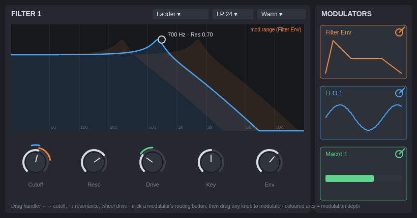

# ChipWave Tracker

A modern music tracker inspired by **OctaMED** and the Commodore **Amiga**, sister project to [BigWave Radio](https://github.com/postmanpat-303/BigWaveRadio).

**Status:** planning. No code yet.

## Goals
- OctaMED-style workflow: blocks, sections and sequences, the classic keyboard layout
- Sample instruments with loops, volume, transpose, finetune and hold/decay
- OctaMED effect commands, including the quirks that give it its sound
- Load MED (MMD0–MMD3) and MOD files, export WAV
- Optional "Paula" mode for authentic Amiga sound
- **Built-in sound design:** analogue-style synth with Bitwig-inspired filters (SVF, ladder, Sallen-Key…), drag-to-modulate envelopes/LFOs, per-sound FX chain, and render-to-sample
- **Visual arranger:** blocks as coloured clips on a side-scrolling timeline, mapped to OctaMED sections and playing sequences
- Windows 11 and Linux, built in Rust with egui and cpal

## Roadmap
1. **MVP:** song, sequences and blocks; sample instruments; core effects; track editor with undo; simple sequence list editor; MMD/MOD load; WAV export
2. **Phase 1.5:** sound design v1 (synth, SVF + ladder filters, envelopes, LFOs, drag-to-modulate, 4 FX, render-to-sample, TOML presets) and the visual arranger. Both sit on top of the proven MVP core (the synth is just a new instrument type, the arranger a richer view of the same sequence data), so they don't risk the playback or file format work.
3. **Phase 2:** OctaMED synth and hybrid sounds, more filter models and FX, wavetables, full mod matrix, sample editor, MIDI, MOD/XM export
4. **Phase 3:** Rhai scripting/plugins, XM/IT import, arranger variation lanes

See [docs/OCTAMED_SPEC.md](docs/OCTAMED_SPEC.md) for the full OctaMED feature blueprint, [docs/SOUND_DESIGN.md](docs/SOUND_DESIGN.md) for the synth and effects, and [docs/ARRANGER.md](docs/ARRANGER.md) for the timeline.

