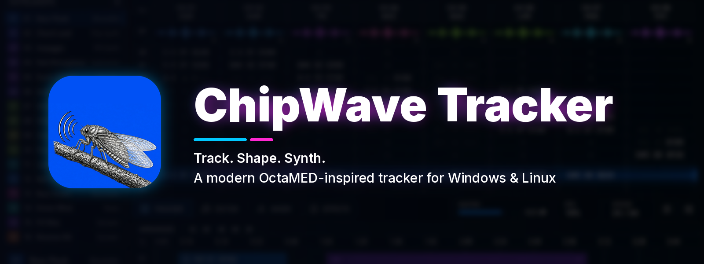
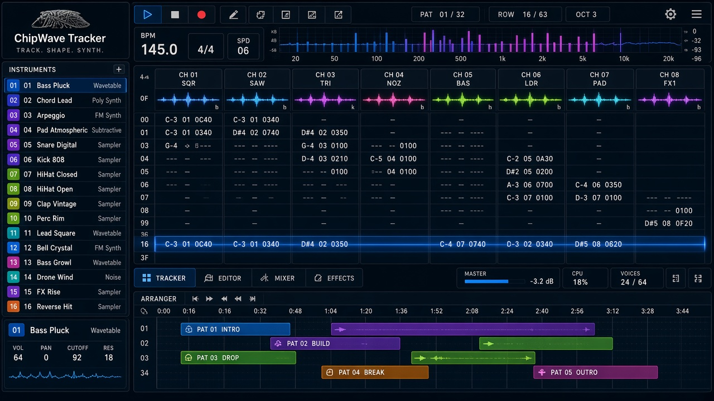
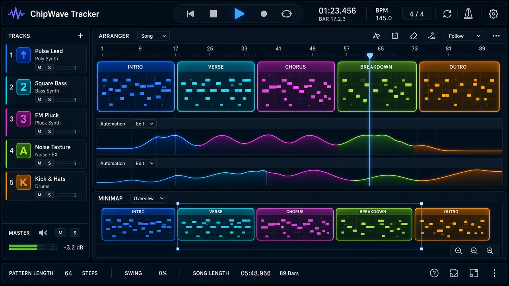
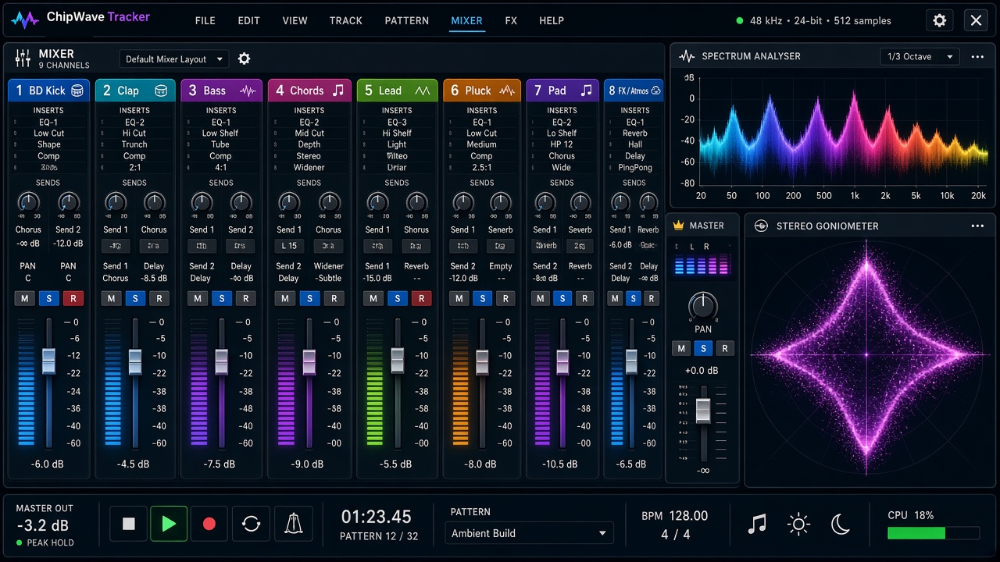
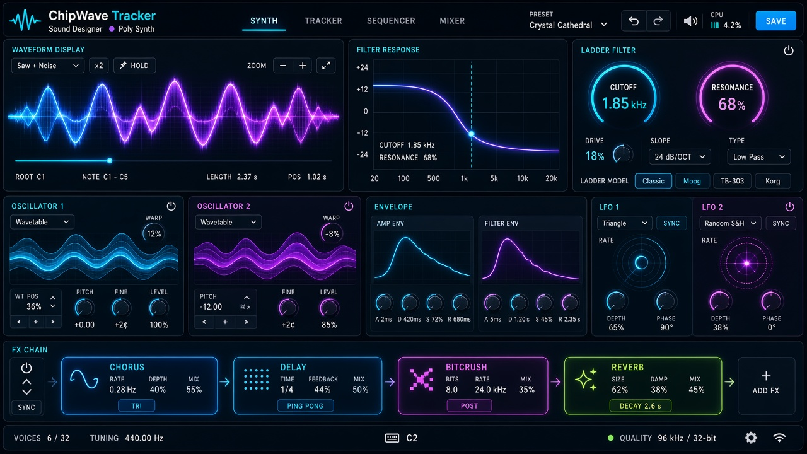

<p align="center">
  
</p>

<p align="center">
  
  
  <a href="LICENSE"></a>
  
  <a href="https://github.com/postmanpat-303/ChipWaveTracker/releases"></a>
</p>

<p align="center">
  <a href="https://github.com/postmanpat-303/ChipWaveTracker/releases"><b>⬇ Download</b></a> &nbsp;·&nbsp;
  <a href="#documentation"><b>📖 Docs</b></a> &nbsp;·&nbsp;
  <a href="https://github.com/postmanpat-303/BigWaveRadio"><b>📻 BigWave Radio</b></a> (sister project)
</p>

**ChipWave Tracker** is a modern music tracker inspired by **OctaMED** and the Commodore **Amiga**. It keeps the fast, keyboard-driven workflow of the classic tracker (blocks, sections and sequences) and adds the things a modern studio expects: built-in sound design, a visual arranger, a mixer with automation, WAV/MP3 export and clean scaling on any screen. It's written in Rust with egui and cpal for Windows 11 and Linux.

**Status:** in active development, currently **v0.2.3.5** (`Cargo.toml` 0.2.3+fix.5). It's playable today with the pattern editor, playback, synth presets, sample import, arranger, mixer, automation, `.cwt` save/load, WAV/MP3 export, settings, Fill to length auto arrange and MIDI keyboard input (play, record, MIDI learn: [docs/MIDI.md](docs/MIDI.md)). The latest tagged release is v0.2.3.

## Feature highlights

<table>
  <tr>
    <td width="50%"><br><b>Pattern editor</b>: OctaMED-style blocks with the classic keyboard layout</td>
    <td width="50%"><br><b>Arranger</b>: blocks as coloured clips on a side-scrolling timeline</td>
  </tr>
  <tr>
    <td width="50%"><br><b>Mixer</b>: faders, pan, mute/solo, peak meters and master</td>
    <td width="50%"><br><b>Sound designer</b>: analogue-style synth, filters, envelopes, LFOs and FX chain</td>
  </tr>
</table>

<p align="center"><sub><i>These are design concept renders showing where the UI is heading, not screenshots of the current build. See the real current screenshots in <a href="dist/">dist/</a>.</i></sub></p>

## Goals
- OctaMED-style workflow: blocks, sections and sequences, the classic keyboard layout
- Sample instruments with loops, volume, transpose, finetune and hold/decay
- OctaMED effect commands, including the quirks that give it its sound
- Load MED (MMD0–MMD3) and MOD files; export WAV and MP3 (song, range, block, stems)
- OctaMED-style instrument list (255 slots) with a sample browser: audition, drag-and-drop, batch import of WAV/AIFF/FLAC/MP3/OGG/IFF 8SVX and samples from modules
- MIDI in/out with MIDI learn, and CLAP/VST3 instrument and effect hosting (sandboxed)
- Native `.cwt` song format: an inspectable ZIP of TOML and WAV files that holds everything
- Optional "Paula" mode for authentic Amiga sound
- **Built-in sound design:** analogue-style synth with Bitwig-inspired filters (SVF, ladder, Sallen-Key…), drag-to-modulate envelopes/LFOs, per-sound FX chain, and render-to-sample
- **Visual arranger:** blocks as coloured clips on a side-scrolling timeline, mapped to OctaMED sections and playing sequences
- Windows 11 and Linux, built in Rust with egui and cpal
- Scales cleanly on any screen: OS DPI and fractional scaling, a user UI-scale setting, vector-drawn widgets, responsive layouts from 1366×768 laptops to 4K, ultrawide and portrait, plus an optional Amiga look

## Roadmap
1. **MVP:** song, sequences and blocks; sample instruments; instrument list + sample browser/importer (preview, drag-and-drop, batch import, core formats, slot remap); core effects; track editor with undo; simple sequence list editor; MMD/MOD load; native `.cwt` save/load; UI scaling basics (OS + user scale, crisp vector widgets and grid text, compact/standard layouts, window modes); WAV and MP3 export (MP3 reuses the same offline renderer, so it's little extra work, and it's the format people actually share)
2. **Phase 1.5:** sound design v1 (synth, SVF + ladder filters, envelopes, LFOs, drag-to-modulate, 4 FX, render-to-sample, TOML presets) and the visual arranger; stem export, loudness normalisation; advanced import options (normalise, resample, Paula crunch, trim, auto loop), module sample extraction; MIDI input (keyboard entry, record, MIDI learn); dockable panels, ultrawide/portrait layouts, per-screen layouts, high-contrast and colour-blind themes. Both sit on top of the proven MVP core (the synth is just a new instrument type, the arranger a richer view of the same sequence data), so they don't risk the playback or file format work.
3. **Phase 2:** OctaMED synth and hybrid sounds, more filter models and FX, wavetables, full mod matrix, sample editor, MIDI output + clock sync, CLAP/VST3 plugin hosting, MOD/XM export, Amiga-mode retro look
4. **Phase 3:** Rhai scripting/plugins, XM/IT import, arranger variation lanes, ChipWave itself as a CLAP/VST3 plugin (nih-plug)

<a id="documentation"></a>
## Documentation

- [PATTERN_EDITOR.md](docs/PATTERN_EDITOR.md) — the core pattern editor and keymap
- [PACKAGING.md](docs/PACKAGING.md) — Windows/Linux/macOS packages and CI
- [STARTER_SOUNDS.md](docs/STARTER_SOUNDS.md) — the psytrance and alien factory presets
- [SAFETY.md](docs/SAFETY.md) — autosave, crash recovery and recent files
- [MIXER.md](docs/MIXER.md) — the mixer
- [AUTOMATION.md](docs/AUTOMATION.md) — automation lanes
- [FIRST_RUN.md](docs/FIRST_RUN.md) — the self-building first-run demo
- [SETTINGS.md](docs/SETTINGS.md) — settings
- [OCTAMED_SPEC.md](docs/OCTAMED_SPEC.md) — the full OctaMED feature blueprint
- [SOUND_DESIGN.md](docs/SOUND_DESIGN.md) — the synth and effects
- [ARRANGER.md](docs/ARRANGER.md) — the timeline
- [AUTO_ARRANGE.md](docs/AUTO_ARRANGE.md) — fill-to-length auto arrange and quick-start fun features
- [EXPORT.md](docs/EXPORT.md) — WAV/MP3 export
- [FILE_FORMAT.md](docs/FILE_FORMAT.md) — the `.cwt` song format
- [UI_SCALING.md](docs/UI_SCALING.md) — screen scaling and layouts
- [SAMPLES.md](docs/SAMPLES.md) — the instrument list and importer
- [MIDI.md](docs/MIDI.md) — MIDI keyboard input: play, record, velocity, sustain, MIDI learn (0.2.3)
- [MIDI_VST.md](docs/MIDI_VST.md) — MIDI and plugins (plan)
- [PLUGIN_MANAGER.md](docs/PLUGIN_MANAGER.md) — the plugin manager (scan, verify, activate)
- [DESIGN_LANGUAGE.md](docs/DESIGN_LANGUAGE.md) — ChipWave's "Wave Cartridge" visual identity

<details>
<summary>Earlier mockups</summary>


</details>

## Build (v0.1.0, first runnable version)
```
cargo run --release                     # Linux (needs libasound2-dev)
cargo build --release --target x86_64-pc-windows-gnu   # Windows exe from Linux (mingw-w64)
chipwave --self-test [out.wav]          # headless: renders the demo, checks it is not silent
chipwave --render demo out.wav
```
### Keys (0.1.3)
```
  Arrows, PgUp/PgDn, Home/End    move (Ctrl+Home/End = first/last block)
  Tab / Shift+Tab                next / previous channel
  Z S X D C V G B H N J M        notes C..B,  Q 2 W 3 E R 5 T 6 Y 7 U I 9 O 0 P = octave up
  1                              note off
  F1..F8, numpad - / +           base octave (also the - / + buttons by "Oct")
  0-9 A-F                        hex in instrument / volume / effect columns
  Delete / Backspace / Insert    clear (selection) / pull up / push down
  Shift+arrows/PgUp/PgDn, drag   select (highlighted green)
  Ctrl+A                         select channel; press again = whole block
  Ctrl+C / Ctrl+X / Ctrl+V       copy / cut / paste at cursor
  Space / Shift+Space            play/stop current block (loop) / play/stop song
  Enter / Ctrl+Enter             restart block / play from cursor row
  Esc                            edit mode on/off
  Ctrl+Z / Ctrl+Y                undo / redo (edits, paste, arranger changes)
  Alt +/-  (Shift = octave)      transpose selection (or whole channel)
  Ctrl+= / Ctrl+- / Ctrl+0       UI scale up / down / 100 %
  F9 / F10                       mute / solo channel
  Ctrl+Tab, Ctrl+1 .. 5          views: Pattern / Arranger / Mixer / FX / Sample
  FX / Sample view: Up / Down    previous / next instrument
  Sample view: Space             preview; drag = select, drag S/E = loop points
  F12                            key list (Help > Keys)
  Ctrl+Q                         quit
  FX device strip                power = bypass, folder = presets, click name =
                                 collapse, drag name = reorder, right-click = menu
  Ctrl+D / Ctrl+Shift+D          arranger: duplicate clip / as new block (also when docked)
  Mouse wheel                    pattern: 1 row per notch (Shift = 16); arranger: scroll, Ctrl = zoom
  Ctrl+Shift+K                   debug: show the last 10 input events in the status bar
  Arranger (click to focus, light outline + ARRANGER tag): click / Shift+click / Ctrl+click select,
    Ctrl+X / C / V cut / copy / paste after selection (Ctrl+Shift+V = as new blocks),
    Del, Ctrl+A, Shift+Left/Right, right-click menu; click the pattern to focus it again
  Arranger: Left/Right, Del, Ins, Ctrl+D (Shift = unique copy), +/-  zoom
  Ctrl+N / Ctrl+O / Ctrl+S       new / open / save .cwt   (Ctrl+Shift+S = save as)
  Ctrl+E                         quick export WAV
  Ctrl+Shift+E                   export dialog (WAV / MP3, tags, range)
  Ctrl+,                         settings (arrows + Enter move/open cards)
  Ctrl+Shift+F                   Song > Fill to length (auto arrange)
  1-7 / 0 (arranger focus)       block role Intro/Verse/Chorus/Bridge/Breakdown/Outro/Fill / clear
  Fill dialog                    G generate, R reroll, L lock, P preview, H hide, S style,
                                 Up/Down variation, Left/Right section, Enter accept, Esc discard
  Unsaved prompt                 Enter = save, N = don't save, Esc = cancel
```

Effects: 01/02 slide, 08 note decay (xx × 10 ms, e.g. short/long hats), 09 speed, 0C volume, 0D volume slide, 0F tempo (0F00 = break). BPM/speed changes (toolbar or 09/0F) apply instantly while playing.

## Changelog highlights

v0.2.3.5 adds an **update check**: Help > **Check for updates…** asks GitHub for the latest release (background thread, 5 s timeout) and shows "You have X, latest is Y" with the release notes and **Download installer** / **Open release page** / **Not now** / **Skip this version**; Settings > Files & Safety > "Check for updates at startup" (on by default, at most once a day, only a small menu-bar badge when a newer non-skipped version exists). `ChipWave.exe --check-updates` from the command line. See [docs/UPDATES.md](docs/UPDATES.md).

v0.2.3.4 changes the demo hi-hat to a classic trance **offbeat hat**: one crisp, slightly open hit (about 80 ms) exactly on the "and" between kicks, four per bar, on the grid; no other hat-channel hits (preview: `dist/demo-0.2.3.4.mp3`).

v0.2.3.3 reworks the **hi-hats** of "Lumen Drift" after a hats-focused analysis of two reference tracks (style only; `scripts/hat_analyze.py`, `scripts/hat_compare.py`; preview: `dist/demo-0.2.3.3.mp3`, per-16th hat comparison: `dist/demo-0.2.3.3-hats.png`). Synth: an **808-style metallic source** (six square oscillators, "Metal (808)"), stereo noise (width now applies to noise), a fresh noise burst per note instead of the same one every hit, **Velocity > cutoff** (softer notes are darker) and a **Start delay** (0–50 ms, for laid-back percussion). New effect **08xx** = per-note decay (xx × 10 ms); a new note on the same channel still chokes the previous one, so an open hat is cut by the next closed hat. New built-in **shaker** sound. Engine fix: the first row after starting playback came one tick (about 18 ms at 140 BPM) early; rows are now sample-accurate (test `rows_trigger_sample_accurately_on_the_grid`). Help > About now links to Buy me a coffee and PayPal.

v0.2.3.1 adds toolbar **Chord** (chord spread) and **Rec live / Rec step** toggles next to the MIDI light; instrument right-click menu: **Add effect**, **Copy effects**, **Paste effects** (replace / append) and **Open in FX view** (all undoable); mixer double-click reset (fader to 0 dB, pan to centre) now works; Help > About shows the credit and a "Buy me a coffee" link; a new demo song "Night Signal" (psytrance, F# minor, 1:41, full arrangement with automation; File > New from demo song or Help > Load demo song; preview: `dist/demo-0.2.3.1.mp3`).

v0.2.3.2 replaces the demo with **"Lumen Drift"** (uplifting trance, A minor, 140 BPM, 2:26), written and iterated against an objective analysis of a reference trance track (style only; `scripts/style_analyze.py`, `scripts/style_compare.py`; preview: `dist/demo-0.2.3.2.mp3`, comparison: `dist/demo-0.2.3.2-compare.png`). New engine features: **sidechain ducking** (mixer Sidechain key + release, per-channel Duck %), **stereo unison width** and a **synth LFO** (free or tempo-synced, to cutoff / amp gate / pitch).

v0.2.3 adds MIDI keyboard input: Settings > MIDI (device, all devices, auto-connect and hot-plug, channel filter, velocity curve, MIDI octave), live play of the current instrument with velocity, sustain pedal and pitch bend, recording into the pattern (step or live while playing, chord spread, one undo step per note), simple MIDI learn (right-click a fader / knob) and a toolbar MIDI light. `ChipWave.exe --midi-list` / `--midi-monitor` check a keyboard from the command line. See [docs/MIDI.md](docs/MIDI.md).

v0.1.3 adds a basic arranger (song order as clips: drag to reorder, duplicate, insert, delete, click to open, playhead, zoom, dockable), a basic mixer (fader, pan, mute/solo, peak meters, master; saved in `.cwt` as `mixer.toml`), selection + copy/paste, octave buttons and per-instrument transpose. Screenshots: [arranger](dist/screenshot-0.1.3-arranger.png), [mixer](dist/screenshot-0.1.3-mixer.png), [pattern + selection](dist/screenshot-0.1.3-pattern-selection.png).

v0.1.0 has the pattern editor (keys per [docs/PATTERN_EDITOR.md](docs/PATTERN_EDITOR.md)), tracker playback, a simple synth with factory psytrance presets, WAV sample import, `.cwt` save/load, WAV export, the first-run demo song, and Dark Circuit (default) / Amiga themes. Windows build: `ChipWave-0.1.1-windows-x64.zip` on the [Releases page](https://github.com/postmanpat-303/ChipWaveTracker/releases); screenshot: [dist/screenshot.png](dist/screenshot.png).

## Credits

Created by **Derek Heasley**. To keep the software going I need Coffee :) [Buy me a coffee](https://buymeacoffee.com/postmanpat) · [PayPal](https://paypal.me/derekh100)

## Licence

ChipWave Tracker is free software, licensed under the [GNU General Public License v3.0](LICENSE) (GPL-3.0-or-later).
