<p align="center">
  
</p>

<h1 align="center">ChipWave Studio</h1>

<p align="center">
  
  
  <a href="LICENSE"></a>
  
  <a href="https://www.youtube.com/@whatgoesaround1551"></a>
  <a href="https://github.com/postmanpat-303/ChipWaveStudio/releases/latest"></a>
</p>

<p align="center">
  <a href="https://youtu.be/j1w23Pkuodg">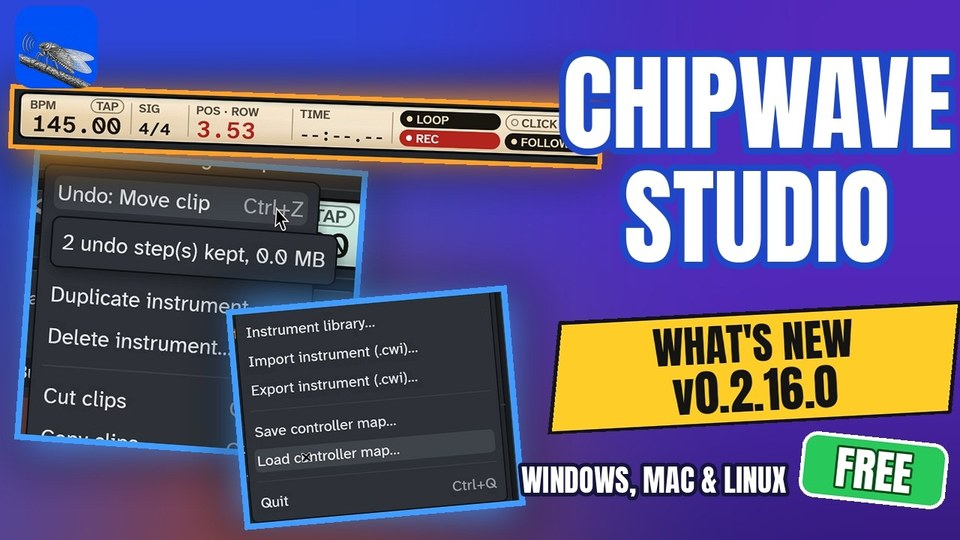</a>
  <br><sub>▶ <a href="https://youtu.be/j1w23Pkuodg">Watch the promo on YouTube</a> · <a href="https://youtu.be/4sbt7f9bIdw">Watch the Short</a> · more demos on <a href="https://www.youtube.com/@whatgoesaround1551">the channel</a></sub>
</p>

```
 ┌──────────────────────────────────────────────────────────────────────────┐
 │  C H I P W A V E   S T U D I O            v0.2.12.0    BPM 140  SPD 06  │
 ├──────┬─────────────┬─────────────┬──────────────────┬───────────────────┤
 │  00  │ A-2 01 .. … │ ... .. .. … │ ... .. .. ....   │ free music studio │
 │  01  │ ... .. .. … │ A-2 02 38 … │ ... .. .. ....   │ sequencer + synth │
 │  02  │ ... .. .. … │ ... .. .. … │ C-5 03 38 0814   │ Windows · Linux   │
 └──────┴─────────────┴─────────────┴──────────────────┴───────────────────┘
```

<p align="center">
  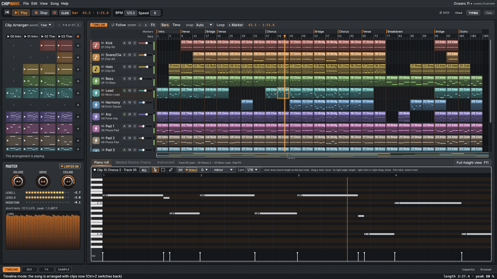
  <br><sub>Real capture of ChipWave Studio playing the built-in demo “Oceans 11” (music by Martin Galway): the Timeline on top, the piano roll below.</sub>
</p>

<p align="center">
  <a href="https://github.com/postmanpat-303/ChipWaveStudio/releases/latest"><b>⬇ Download latest for Windows</b></a> &nbsp;·&nbsp;
  <a href="https://github.com/postmanpat-303/ChipWaveStudio/releases/latest/download/ChipWave-macos-universal.dmg"><b>⬇ macOS</b></a> <sub>(<a href="docs/MACOS.md">first launch</a>)</sub> &nbsp;·&nbsp;
  <a href="#new"><b>New in 0.2.17.0</b></a> &nbsp;·&nbsp;
  <a href="docs/manual/ChipWave-Studio-User-Manual.pdf"><b>User manual (PDF)</b></a> &nbsp;·&nbsp;
  <a href="#features"><b>Features</b></a> &nbsp;·&nbsp;
  <a href="#themes"><b>Themes</b></a> &nbsp;·&nbsp;
  <a href="#keys"><b>Keys</b></a> &nbsp;·&nbsp;
  <a href="#documentation"><b>Docs</b></a> &nbsp;·&nbsp;
  <a href="https://github.com/postmanpat-303/BigWaveRadio"><b>BigWave Radio</b></a> (sister project)
</p>

**ChipWave Studio** is a free music sequencer with a retro heart. Try ideas in the **Clip Arranger**, lay them out as clips on the **Timeline**, write melodies in the **piano roll** and beats in the **Drum Kit**'s step sequencer, then shape every sound with **WaveForge**, **StringWave**, **FM-4**, **Chip FX**, Analog, a synthetic Voice and more. Build each track's sound in the **Rack**, a row of the instrument and its effects under the Timeline, stack sounds into **racks**, add effects and automation, mix with sidechain ducking and a true-peak limiter, and export WAV or MP3. CLAP and VST3 plugins and MIDI keyboards work too, and for those who love the classic way there is an optional OctaMED-style **Tracker** view. Up to 32 tracks per song. Written in Rust with egui and cpal, for Windows, macOS (universal: Apple Silicon + Intel) and Linux. Early version, in active development.

> **ChipWave Studio was called ChipWave Tracker until 0.2.3.19.** It was renamed in 0.2.4.0 to tell it apart from an unrelated iOS app called "ChipWave". Same app, same settings, same `.cwt` songs; the old GitHub links redirect here. Website: **[postmanpat-303.github.io/ChipWaveStudio](https://postmanpat-303.github.io/ChipWaveStudio/)**. Details: [docs/RENAME.md](docs/RENAME.md).

All pictures on this page are real captures of the current build (no mockups). They were made with `scripts/screenshots.sh` and `scripts/record_gifs.sh`.

<a id="new"></a>
## New in 0.2.17.0: a built-in manual, a digital rain About page and cleaner exports

- **The user manual is built in** ([PDF](docs/manual/ChipWave-Studio-User-Manual.pdf)): **Help > User Manual**, or the **User manual (PDF)** button on the About page, opens a friendly 38-page guide, from installing and your first song in 10 minutes to the mixer, MIDI, exporting and a shortcuts table. It's inside the app, so it works without the internet.
- **About opens with digital rain**: green code falls and the About page appears as it goes, in about a second and a half. Press any key or click to skip it, and **Reduce motion** in Settings switches it off.
- **About opens straight away**: the About window no longer grows and creeps up the screen for a few seconds after opening.
- **Exports end cleanly**: saving a song to WAV or MP3 (and `--render`) now stops at the end of the song instead of playing the first row once more in the tail. Playing and looping in the app are unchanged.

Songs play in the app exactly as in 0.2.16.0. Exported files are the same up to the end of the song; only that stray extra row after it is gone. Details in the [CHANGELOG](docs/CHANGELOG.md).

<table>
  <tr>
    <td width="60%">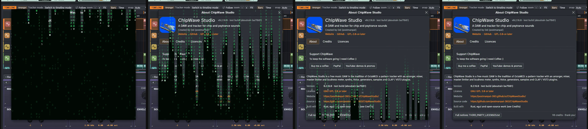<br><b>Digital rain</b>: the About page appears as the code falls.</td>
    <td width="40%">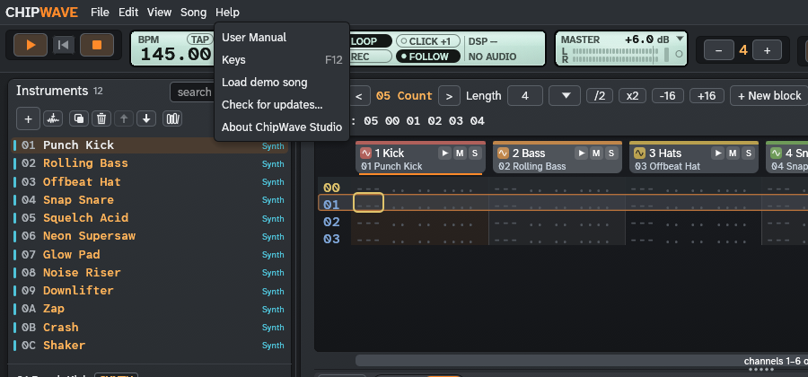<br><b>Help > User Manual</b> opens the built-in PDF.</td>
  </tr>
</table>

<details><summary><b>New in 0.2.16.0: controller maps, named Undo and a glowing display</b></summary>


- **Save and load controller maps** ([MIDI.md](docs/MIDI.md#controller-maps)): **File > Save controller map…** keeps the knobs you've MIDI-learned as a small file for your keyboard or controller, and **File > Load controller map…** puts them back. The same two buttons sit under the learned list in Settings > MIDI.
- **Undo says what it will undo**: the Edit menu now reads, for example, **Undo: Move clip** or **Redo: Add note** for the most common edits (clips, notes, tracker cells, tracks and knobs).
- **Glow and shine display**: the top LCD has a soft backlight glow in the middle and a glassy shine across the top, in whichever display colour you pick (Mint, Amber, Ice and the rest). The text stays easy to read on every colour.
- **Behind the scenes**: every knob now comes from one shared list, so automation, MIDI learn, modulation and controller maps all name knobs the same way, and a new [ARCHITECTURE.md](docs/ARCHITECTURE.md) guide says which files a new knob, effect, instrument or saved setting goes in.

Every song saves, plays and renders exactly as in 0.2.15.0. Known limits and details in the [CHANGELOG](docs/CHANGELOG.md).

<table>
  <tr>
    <td width="50%">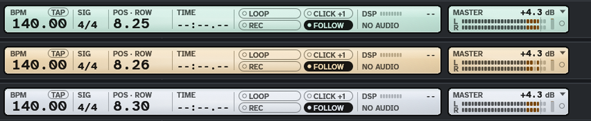<br><b>Glow and shine</b> in Mint, Amber and Ice (Slate).</td>
    <td width="50%">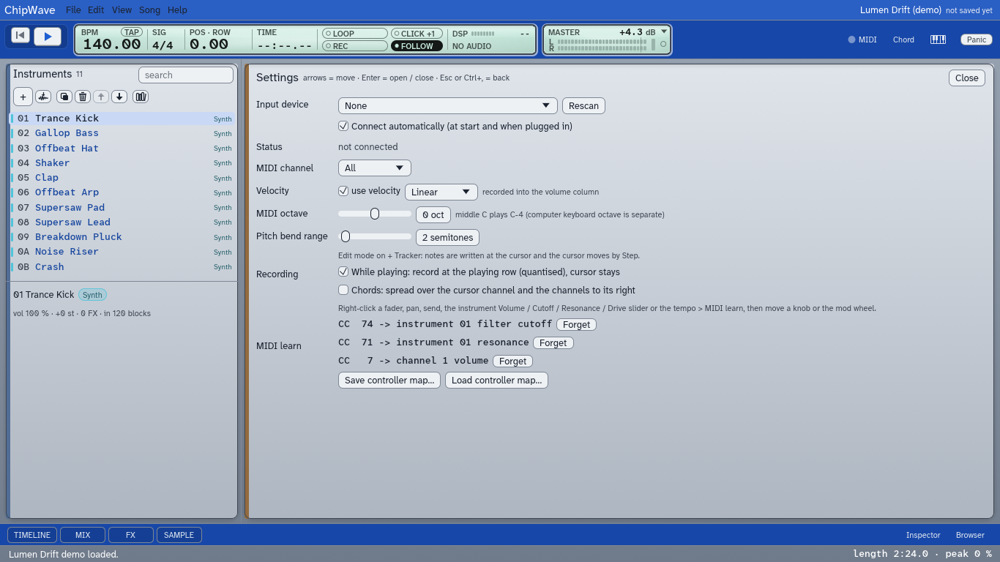<br><b>Controller maps</b>: save and load your learned knobs (Amiga).</td>
  </tr>
</table>

</details>

<details><summary><b>New in 0.2.15.0: Chords that write to the timeline</b></summary>


- **Write to timeline always writes** ([CHORDS.md](docs/CHORDS.md#generators-panel-chords-melody-and-bass)): the Chords, Melody and Bass generators were rebuilt so **Write to timeline** puts real notes on a melodic track every time, as one **Ctrl+Z**.
  - Pick the target on the WRITE card: **this track**, a **new track** below it, or **this clip**. A new clip starts at the loop start (or the play marker's bar), and the card and the status bar say exactly where the notes went.
  - It works with no clip open, on an empty song and from a drum track (the notes go to a new melodic track). Clips grow to show everything that was written.
  - A new **Chords…** button beside **+ Add track** opens the generator straight from the Timeline.
- **Chords only on pitched sounds**: Chords…, Melody… and Bass… (in the track pie, the piano roll's chord lane and Generate, and beside + Add track) are hidden on drum kits, drum generators and drum-named sounds such as a synth "Trance Kick". A new Chords, Melody or Bass track never copies a drum sound.
- **Fixes**: the Write card no longer reads "Bars bars"; Preview plays on a melodic sound.

Every song saves, plays and renders exactly as in 0.2.14.0. Known limits and details in the [CHANGELOG](docs/CHANGELOG.md).

<table>
  <tr>
    <td width="50%">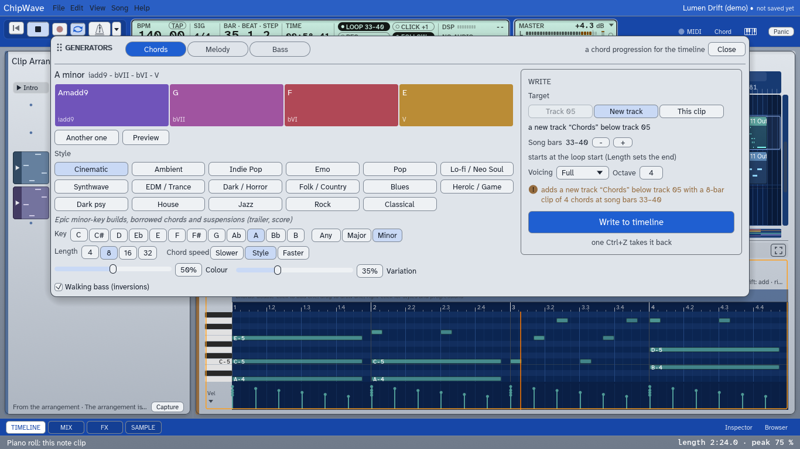<br><b>The WRITE card</b> says where the chords will go (Amiga).</td>
    <td width="50%">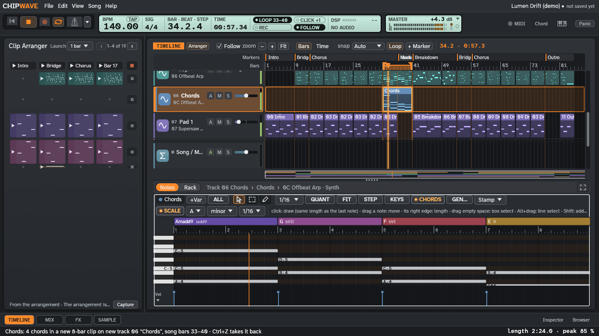<br><b>Written</b>: a new Chords track with the notes, one Ctrl+Z.</td>
  </tr>
</table>

</details>

<details><summary><b>New in 0.2.14.0: Round Robin, key pressure and clip copy and paste</b></summary>


- **Round Robin** ([ROUND_ROBIN.md](docs/ROUND_ROBIN.md)): loops that sound a little different each pass, but render the same every time (everything comes from a seed plus the pass or hit number).
  - **Step conditions**: a note can play every X of Y passes, only the first time, never the first time, only in fills or never in fills, next to its **Chance**. Conditions and Chance lanes in the piano roll, a **Play this note…** popover, striped notes and a **Fill** toggle.
  - **Clip Variations**: up to four takes (A–D) per note clip, one per loop pass: in order, random, random no repeat, ping-pong or every N.
  - **Drum pad Round Robin**: up to four sounds per pad take turns, with per-hit drift of pitch, level, tone, decay, timing and pan, and a "Next 8 hits" preview.
  - **Follow actions**: launcher clips move on after N loops (X % Next / Again / Other / First / Last / Any / Stop), and **Capture** writes the performance to the timeline.
- **MIDI key pressure and .mid import** ([MIDI.md](docs/MIDI.md)): poly and channel aftertouch drive a new **Pressure** modulator, recorded notes keep their pressure curves, and the piano roll's **Pressure** lane draws and clears them. MIDI files from the browser import as one note clip with velocities and pressure.
- **Clip copy and paste**: Ctrl+C / X / V on the Timeline, Copy / Cut in the clip pie, **Paste here** (independent or linked) on an empty lane, Paste at playhead in the track pie.
- **Transport Loop button** beside the metronome, and **double-click a clip** to loop exactly it (again: loop off).
- **Bigger pies** (30 %), with Settings › Look › Pie menus Small / Normal / Large.
- **Fixes**: a drum kit added after StringWave or WaveForge plays the kit; the go-to-start button is legible in Amiga.

Every song saves, plays and renders exactly as in 0.2.13.0. Known limits and details in the [CHANGELOG](docs/CHANGELOG.md).

<table>
  <tr>
    <td width="50%">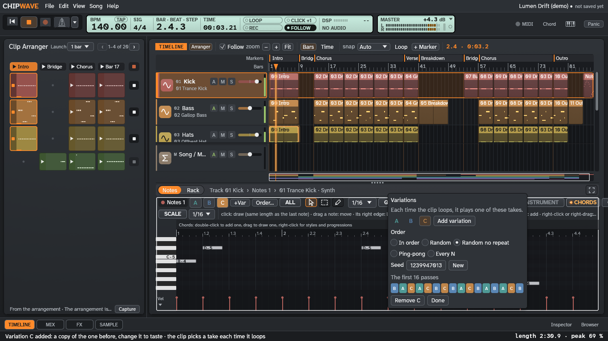<br><b>Clip Variations</b>: a take per loop pass.</td>
    <td width="50%">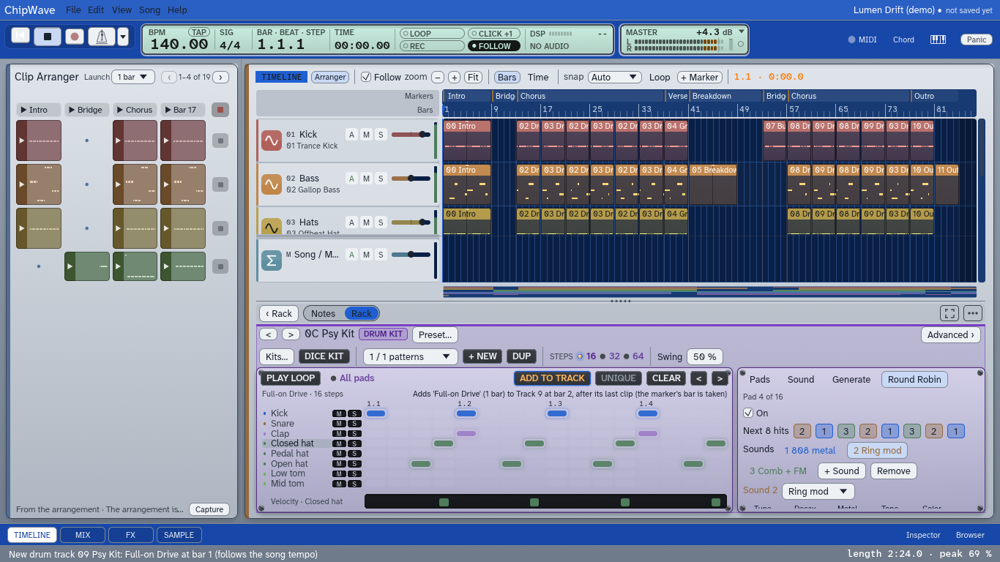<br><b>Drum pad Round Robin</b> (Amiga).</td>
  </tr>
  <tr>
    <td width="50%">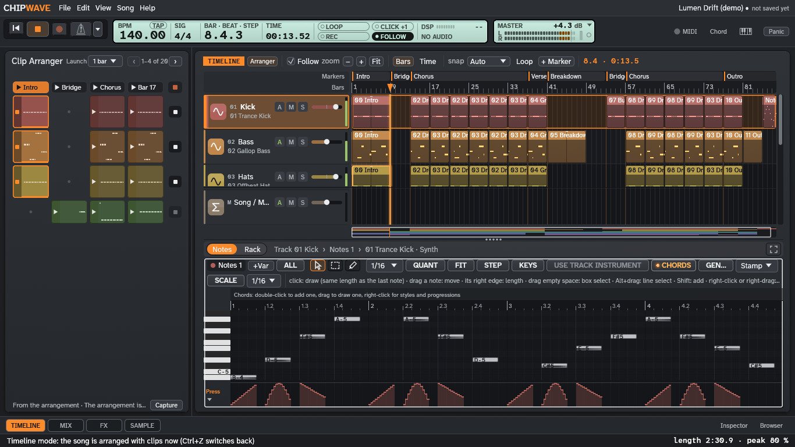<br><b>Pressure lane</b>: recorded aftertouch, drawn and editable.</td>
    <td width="50%">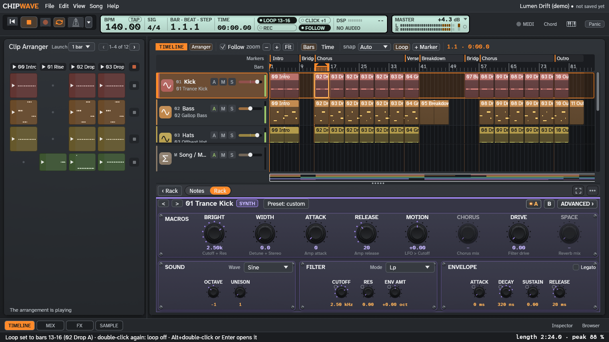<br><b>Double-click a clip</b> to loop it.</td>
  </tr>
</table>

</details>

<details><summary><b>New in 0.2.13.0: live recording, quick modulation and a backlit LCD</b></summary>


- **Live recording block**: press Record and a REC block opens at once on the track and grows with the playhead, with no length limit. Notes appear as you play them and fade in; on Stop it becomes a normal clip, rounded to the bar. The take is one undo step, an empty take is dropped, and loop recording overdubs in place.
- **Quick modulation on every knob**: click the small dot on a knob (or right-click › Modulate with…) and pick **LFO**, **Envelope**, **Random**, **Velocity** or **Mod wheel**. Clear sliders set **Speed** ("1 beat (1/4 note)", "2 bars" or Hz, with **Sync to tempo**), **Length** and **Attack** for envelopes, **Smooth** for Random and **Amount** for all, with a live preview of the shape. One **Movement** list per instrument shows everything that moves ("LFO 1 sine · 1 beat → Cutoff · +25 %").
- **A tidier instrument header**: no tab counts, a Modulation dot, a "Synth" tab, hints in a **?** tooltip, an F11 icon and Save rack in the **⋯** menu.
- **Backlit mint LCD**: the top display is now light, backlit glass with Atkinson Mono digits, toggle pills and DSP / BUF meters. Mint is the default; Cyan, Amber, Green, Red and Ice are backlight tints.
- **Keyboard icon for Keys → Notes**: the computer keyboard plays notes from a lit keyboard icon in the toolbar (hover for octave and velocity). It's on by default when no MIDI keyboard is connected, and your own choice is remembered.

Every song saves, plays and renders exactly as in 0.2.12.0. Known limits and details in the [CHANGELOG](docs/CHANGELOG.md).

<table>
  <tr>
    <td width="50%">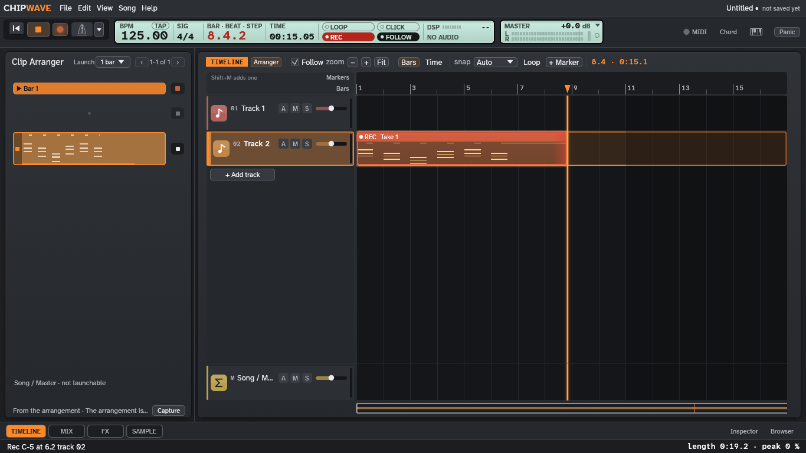<br><b>Live recording block</b>: it opens at once and grows as you play.</td>
    <td width="50%">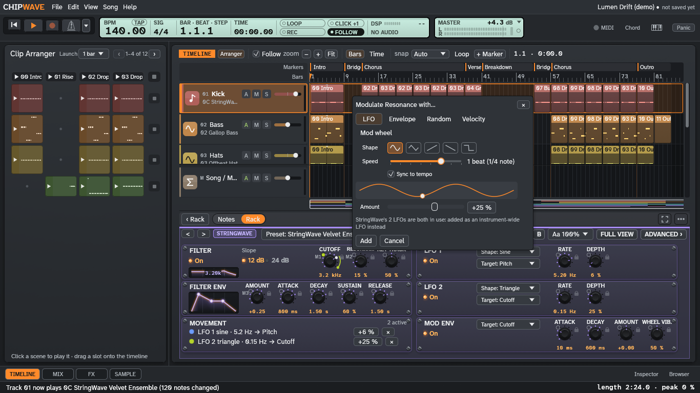<br><b>Quick modulation</b>: Speed in plain words, with a live preview.</td>
  </tr>
  <tr>
    <td width="50%">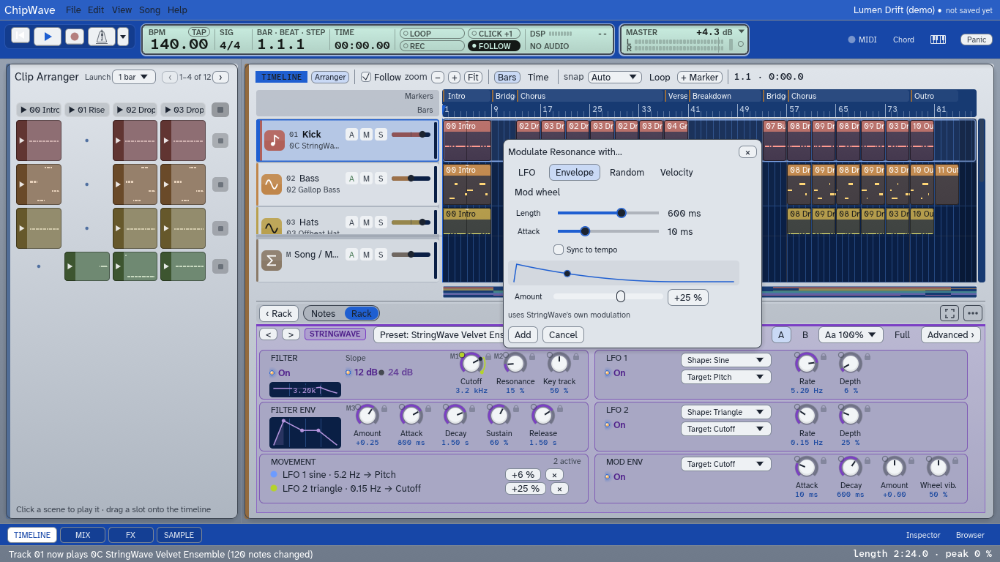<br><b>Envelope</b>: Length and Attack sliders (Amiga).</td>
    <td width="50%">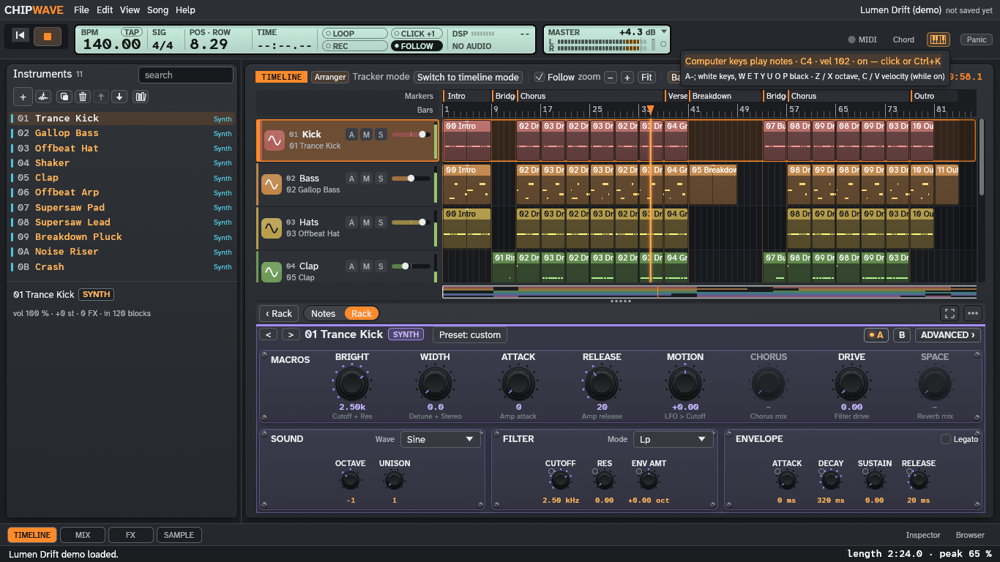<br><b>Mint LCD</b> and the <b>Keys → Notes</b> keyboard icon.</td>
  </tr>
</table>

</details>

<details><summary><b>New in 0.2.12.0: bigger, resizable and movable tracks</b></summary>

- **Taller tracks** by default on the Timeline.
- **Resize a track**: drag the bottom edge of its header (28 to 200 pt, one undo step, saved with the song). **Double-click** the edge to reset it.
- **Resize every track**: **Ctrl+wheel over the track headers** or **Alt+wheel**; the new size is remembered.
- **Move tracks up and down**: drag a header up or down (a line shows where it lands) or use **Move up / Move down** in the track pie. Clips, sound, colour and mix go with the track, and Undo works.
- **The selected track stands out**: accent-tinted header with a wide accent bar and outline, bold name, and a tinted, outlined lane in every theme.

Every song saves, plays and renders exactly as in 0.2.11.0. Known limits and details in the [CHANGELOG](docs/CHANGELOG.md).

<table>
  <tr>
    <td width="50%">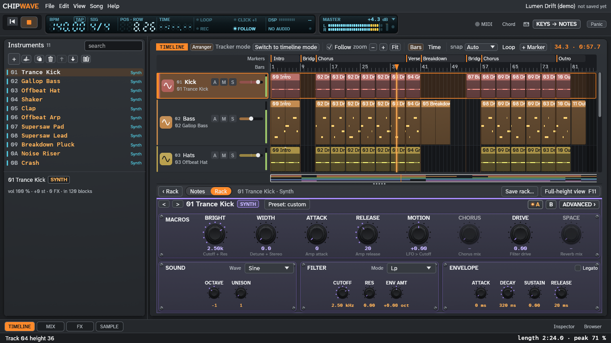<br><b>Resized tracks</b>: drag a header's bottom edge.</td>
    <td width="50%">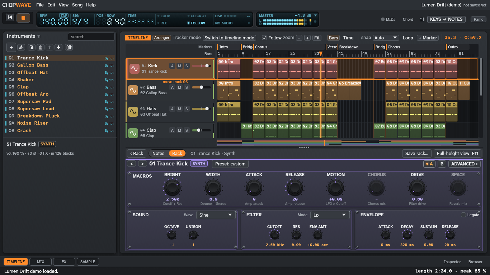<br><b>Drag to reorder</b>: the line shows where the track lands.</td>
  </tr>
  <tr>
    <td width="50%"><br><b>Selected track</b> in Slate.</td>
    <td width="50%">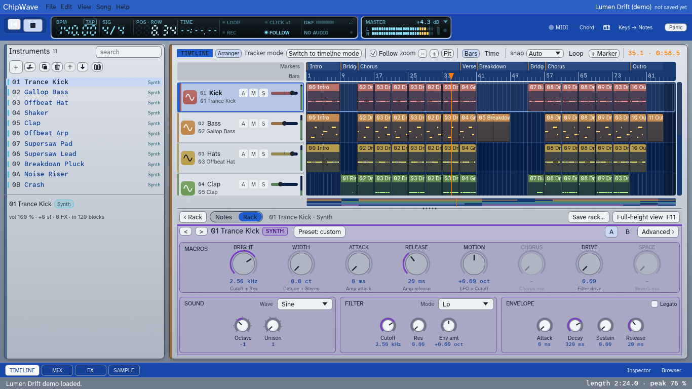<br><b>Selected track</b> in Amiga.</td>
  </tr>
</table>

</details>

<details><summary><b>New in 0.2.11.0: easier-to-read text, UI scale and Text size</b></summary>

- **New fonts**: the bundled **Atkinson Hyperlegible Next** for text and **Atkinson Hyperlegible Mono** for numbers, the tracker and the LCD, in every theme. One type scale sets every size, and nothing is smaller than 10 pt.
- **UI scale and Text size**: Settings › Look, each 90 to 150 % in 5 % steps (Ctrl+= / Ctrl+- / Ctrl+0 for the UI scale). ChipWave follows your Windows, Wayland or X11 display scale.
- **Fits small and scaled screens**: every view fits at 1366 × 768 and at 150 % on 1920 × 1080 in Slate, Dark and Amiga. Long names end in "…" with a tooltip, and the piano roll's toolbar goes to two rows when narrow.
- **Contrast**: higher text contrast in Dark, readable selection text, and text that follows the surface under it.
- **Import**: an imported instrument becomes the active one, on its own track on the Timeline.
- **One gradient over the tracks**: Timeline clips share one top-to-bottom gradient across all tracks.

Every song saves, plays and renders exactly as in 0.2.10.0. Known limits and details in the [CHANGELOG](docs/CHANGELOG.md).

<table>
  <tr>
    <td width="50%">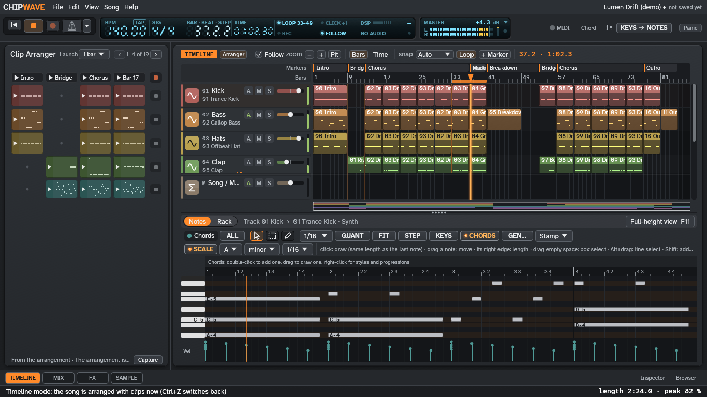<br><b>Atkinson Hyperlegible</b> at 1366 × 768, piano roll toolbar in two rows.</td>
    <td width="50%">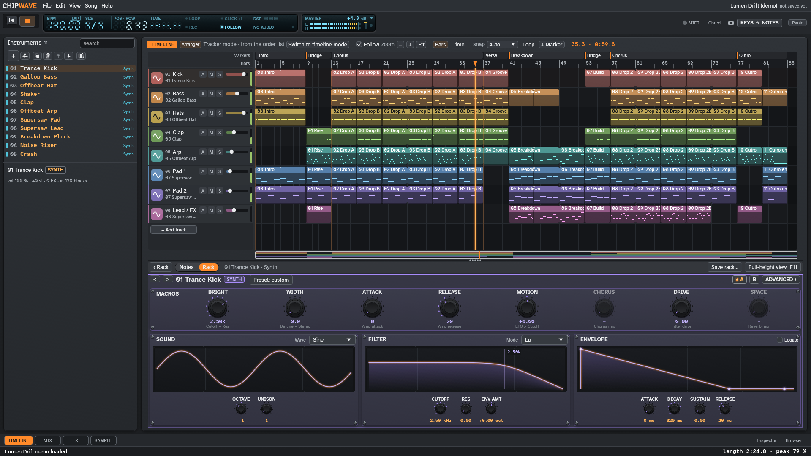<br><b>One gradient over the tracks</b>.</td>
  </tr>
  <tr>
    <td width="50%">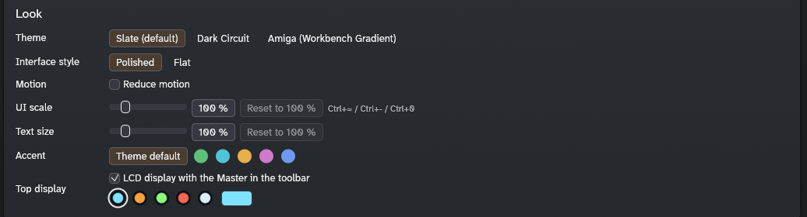<br><b>Settings › Look</b>: UI scale and Text size.</td>
    <td width="50%">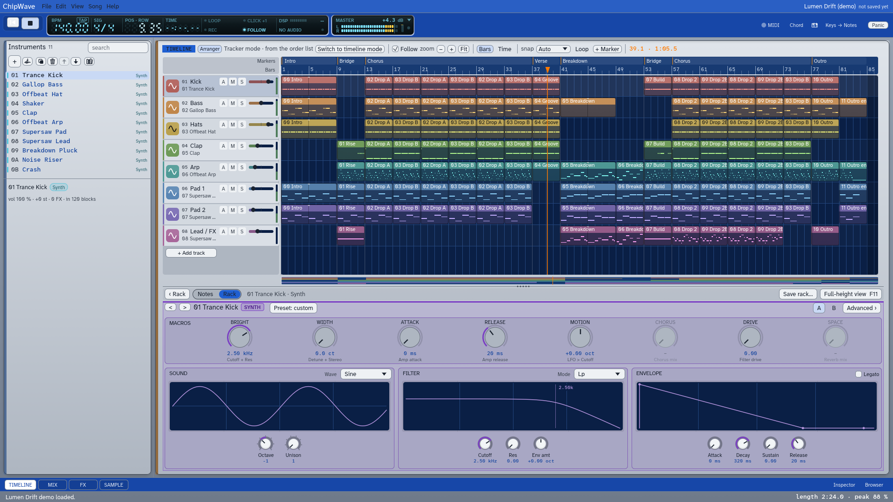<br><b>Amiga</b> with the new fonts.</td>
  </tr>
</table>

</details>

<details><summary><b>New in 0.2.10.0: Generators, the LCD toolbar and smarter pies</b></summary>

- **Generators: Chords | Melody | Bass.** One panel with three tabs and one Write card. The **Melody** tab writes a seeded tune over your chords (rhythm, contour, motif, density, range); the **Bass** tab follows the chord roots in six styles (Root, Octave pump, Walking, Acid, Syncopated, Euclid). Drag the **⠿ GENERATORS** grip to move the panel anywhere.
- **A big Preview pad**: Preview, Dice and Another one sit in one large rounded pad, and **Write to timeline** gives the new track a copy of your track's instrument, so it sounds like the preview.
- **LCD toolbar**: tempo, position, time, signature and load on a display in Cyan, Amber, Green, Red, Ice or your own colour (since 0.2.13.0 a backlit mint display, with those colours as backlight tints), with a compact Master meter that opens the Master panel. Settings › Top display brings back the classic toolbar.
- **Context-aware pies**: right-click a track and the first ring fits it (drum tracks get kits, patterns and Dice kit; melodic tracks get instruments, Sounds, Chords…, Melody… and Bass…). Right-click under the tracks for a New track pie.
- **Tracks and the Rack**: Song / Master sits at the bottom, a new empty track has no instrument until you give it one, a new built-in instrument opens as its compact Rack card with a **Drag an effect here** box beside it, and a double-click on a side tab collapses or expands a card.
- **Clip Arranger**: ▶ becomes ■ on a playing slot to stop it, and the **Arranger** button hides the panel for room.
- **Piano roll**: Shift+arrows nudge notes; the octave move is now Ctrl+Up/Down.
- **Clean exit**: the recovery dialog only appears after a real crash.

Every song saves, plays and renders exactly as in 0.2.9.0. Known limits and details in the [CHANGELOG](docs/CHANGELOG.md).

<table>
  <tr>
    <td width="50%">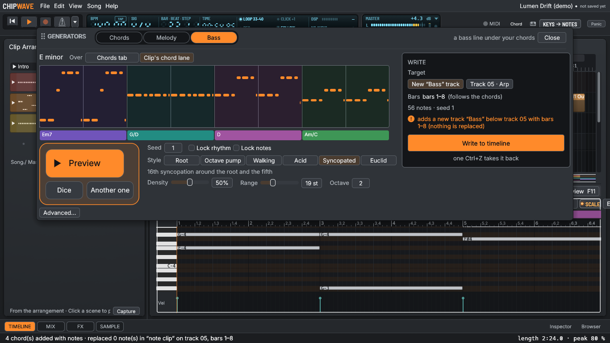<br><b>Generators</b>: Chords, Melody and Bass tabs, the big Preview pad and the Write card.</td>
    <td width="50%">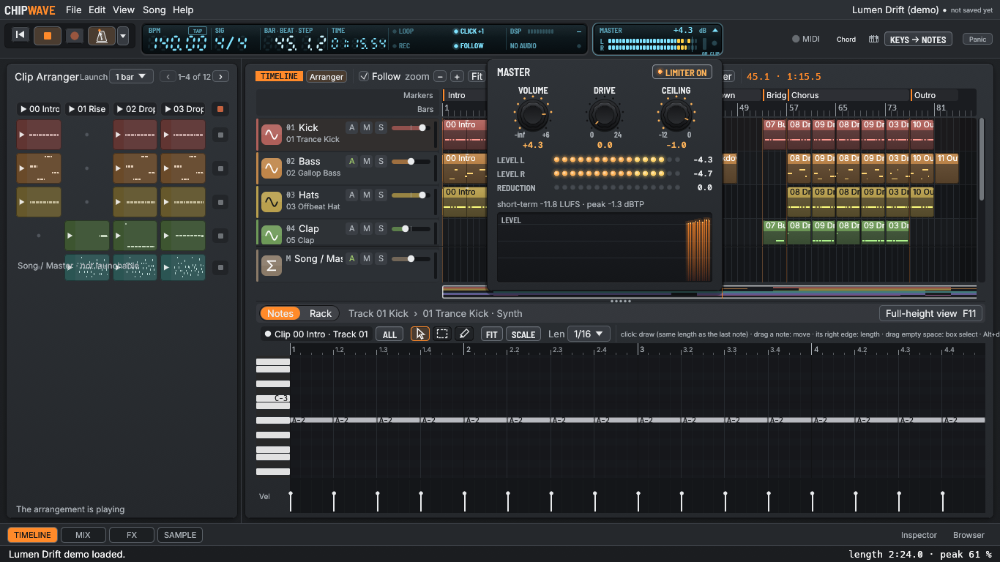<br><b>LCD toolbar</b>: the display and the compact Master meter, with its popover open.</td>
  </tr>
  <tr>
    <td width="50%">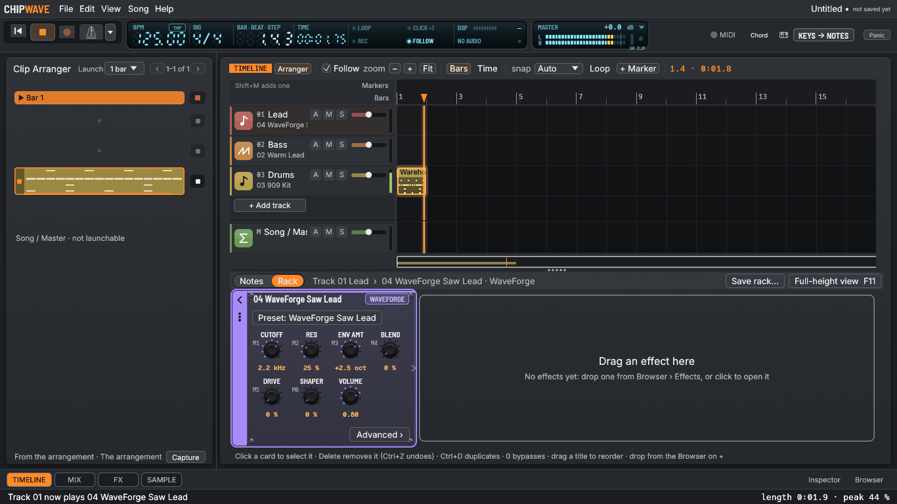<br><b>Compact Rack card</b>: a new instrument with room to drop effects.</td>
    <td width="50%">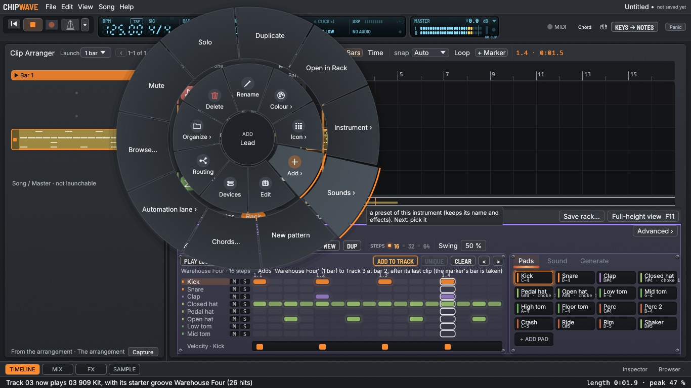<br><b>Context-aware track pie</b>: the first ring fits the track.</td>
  </tr>
</table>

</details>

<details><summary><b>New in 0.2.9.0: the new Rack</b></summary>

- **The Rack**: click a track and its sound shows under the Timeline as one sideways row, the instrument first and then its effects in order, with a **+** zone at the end. A wide row scrolls sideways.
- **Side tabs on every card**: ⏻ bypass, ✕ remove and ‹ collapse. The instrument only collapses; right-click › *Replace instrument…* swaps it.
- **Select a device** and it is highlighted (violet for ChipWave's own instruments). **Delete** removes it and **Ctrl+D** duplicates it, with Ctrl+Z to undo. Delete on the Timeline still deletes clips.
- **Starter knobs**: each instrument card shows a few chosen knobs and Volume; **Advanced ›** opens the full editor. A **Drum Kit** card has a pad picker, and a **rack** shows its layers in place.
- **Drag from the Browser** onto the row, its **+** zone or a Timeline track; drag a card's title to reorder. **Save rack…** keeps the whole row in My Racks.
- **Notes | Rack**: one switch in the lower panel replaces the three old tabs (Ctrl+7 shows the Rack).
- **Browser › Instruments shows instruments only**; their presets are on the Rack card.
- **CI and test fixes** since 0.2.8.0.

Every song saves, plays and renders exactly as in 0.2.8.0. Known limits and details in the [CHANGELOG](docs/CHANGELOG.md). The tree from 0.2.7.0 is still there as the **chain editor** for Splits and layer settings (right-click an effect › *Open in the chain editor*).

<table>
  <tr>
    <td width="50%">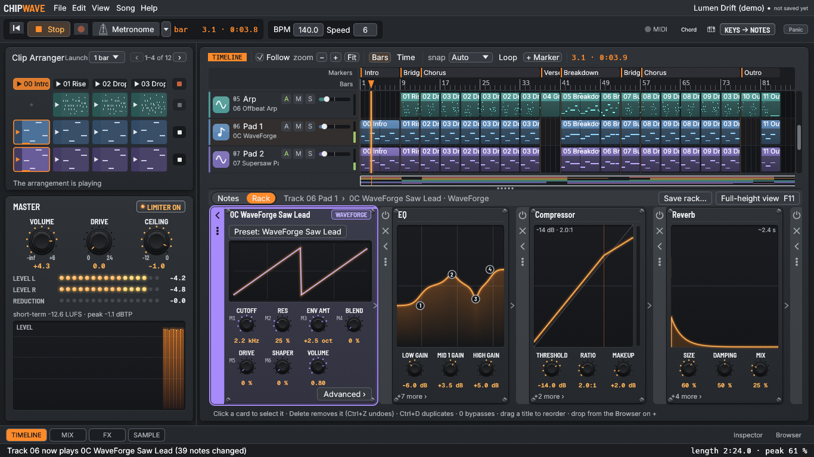<br><b>The Rack</b>: the instrument and its effects in one row; the selected card is outlined, and the side tabs bypass, remove or collapse a card.</td>
    <td width="50%">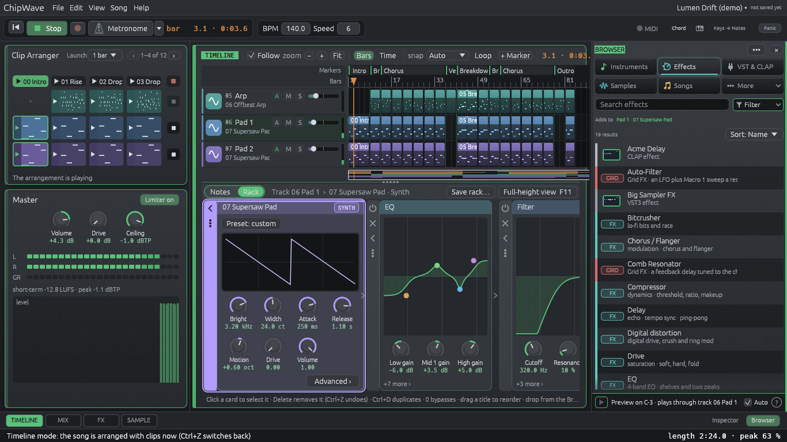<br><b>Drag from the Browser</b>: drop an effect on the row, its + zone or a Timeline track.</td>
  </tr>
</table>

</details>

<details><summary><b>New in 0.2.8.0: StringWave, the violet look and pie-ring Add</b></summary>

- **StringWave**, a new built-in string-ensemble instrument: three layers, undertones (sub and drone), a filter with its own envelope, two LFOs, chorus, echo and a big reverb, with eight presets from *Velvet Ensemble* to *Slow Swell Orchestra*. The mod wheel, expression and sustain pedal work out of the box. Find it in **Track pie › Add › Instrument** or **Browser › ChipWave Instruments**.
- **A violet look for ChipWave's own instruments**: every built-in instrument panel, its card in Nested Device Chains and its row in the Browser share one violet tint, so you can tell a ChipWave instrument from a plugin at a glance.
- **Track pie › Add opens rings**: *Drum pattern › Drum Kit › 909 Kit* (or an instrument) makes a new track below with an empty 1-bar pattern, ready to fill. One Ctrl+Z takes it all back.
- **Drum Kit**: *Kits…* and *Dice kit* now load the kit's name, sounds and pad names, and an empty pattern gets the kit's starter groove.
- **Piano roll ruler**: click the ruler to set a paste marker (Ctrl+V pastes there and carries on after it), the play marker follows the Timeline, and bar, beat and grid ticks.
- **CLAP plugins**: knob moves in a plugin's own window are heard on every track that plays it, and its sound is always saved.
- **Polish since 0.2.7.0**: studio knobs, a lower panel that keeps its height, a calmer Master level history, Nested Device Chains opens on Cards, silent plugin previews, **VST & CLAP** in a simpler Browser, **Keys → Notes**, a Play / Stop toggle, a metronome with count-in, box and Alt-line select in the piano roll, clip colours that show at once, and many visual fixes.

Songs that use StringWave need 0.2.8.0 to open; every other song plays exactly as before. Known limits and details in the [CHANGELOG](docs/CHANGELOG.md).

<table>
  <tr>
    <td width="50%">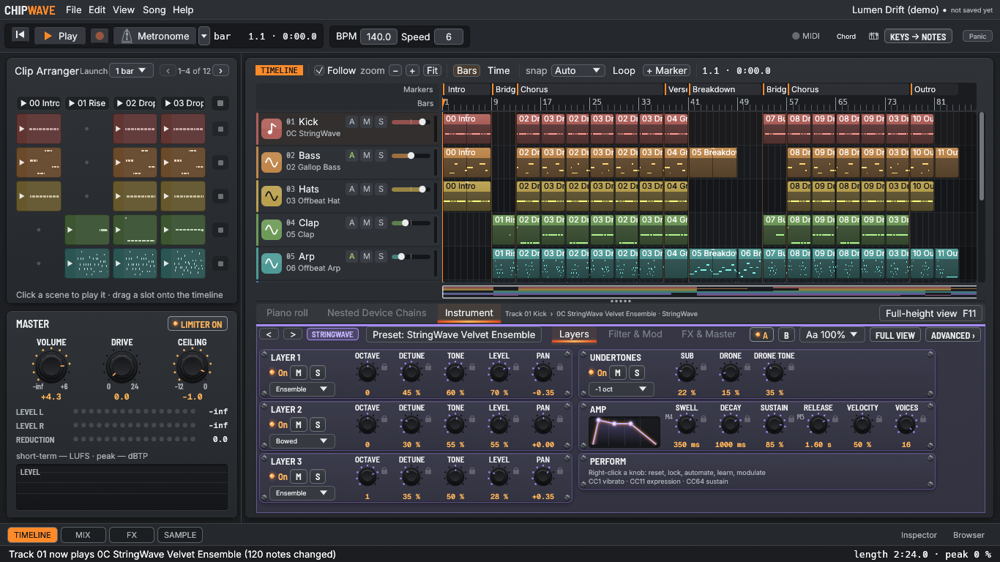<br><b>StringWave</b>: three layers, undertones and a swelling amp envelope on the Layers page; Filter &amp; Mod and FX &amp; Master are one click away.</td>
    <td width="50%">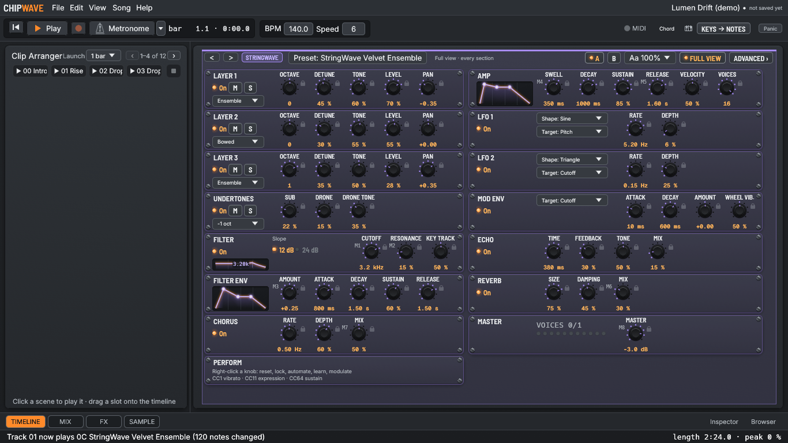<br><b>Full view</b>: every StringWave section on one page.</td>
  </tr>
  <tr>
    <td width="50%">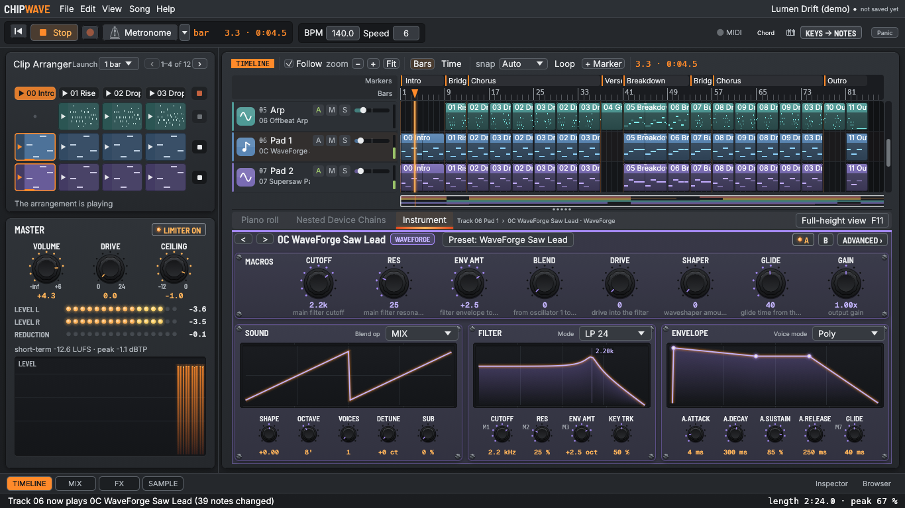<br><b>The violet look</b>: ChipWave's own instruments share one tint, here WaveForge; plugins stay neutral.</td>
    <td width="50%">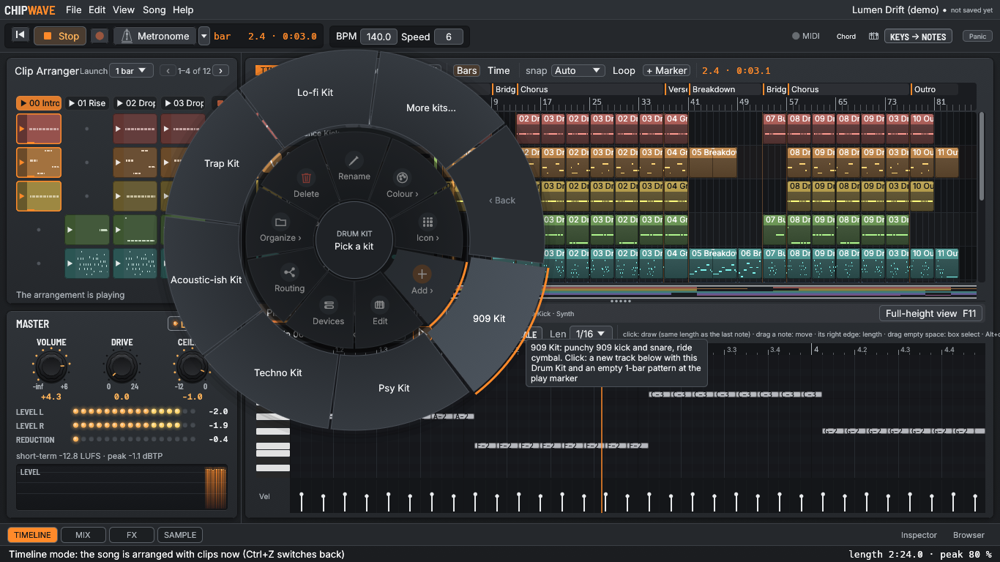<br><b>Add rings</b>: Drum pattern › Drum Kit › a kit makes a new drum track with a 1-bar pattern at the play marker.</td>
  </tr>
</table>

</details>

<details><summary><b>New in 0.2.7.0: racks and Nested Device Chains</b></summary>


Build your own instruments right under the Timeline:
- **Nested Device Chains:** click a track and its instrument opens under the Timeline (Ctrl+7) as a tree of the instrument, its layers and every effect in order, with the selected item's controls beside it. **+ Add Device**, drag to reorder or move a device to another chain (Ctrl: copy), Bypass, Duplicate and Remove, all undoable.
- **Split** sends the sound down 2 to 4 parallel paths, each with its own effects, Level and Pan, and mixes them back.
- **Racks:** *Make a rack from this instrument* gives up to 4 layers that play together, each with Level, Pan, Transpose, a key range and its own effects, plus Rack effects on the mix.
- **Save Custom Rack… and My Racks:** save a rack with a name, description, sound type and tags, then search, load, preview, rename, duplicate, update and delete it in **Browser › My Racks**. Missing plugins are reported, with **Find plugins…** or **Load anyway**. See [RACKS.md](docs/RACKS.md).
- **Piano roll copy and paste:** Ctrl-drag copies notes; Ctrl+C / X / V / D copy, cut, paste and duplicate. The Tracker's **Automation** tab now only shows with the Tracker (track automation is in the Timeline's lanes).
- **New demo song "Oceans 11"**: music by **Martin Galway** (Commodore 64), arranged by Del (postmanpat), made only from Chip FX, effects and a Drum Kit.

Known limits: plugin instruments can't be layers and plugin effects on a layer probably pass the sound through; live MIDI and the note preview play only the first layer; no plugin effects or automation inside a Split; Tracker slides don't reach layers; no *Make a rack* in the track pie yet. Full list in the [CHANGELOG](docs/CHANGELOG.md).

<table>
  <tr>
    <td width="50%">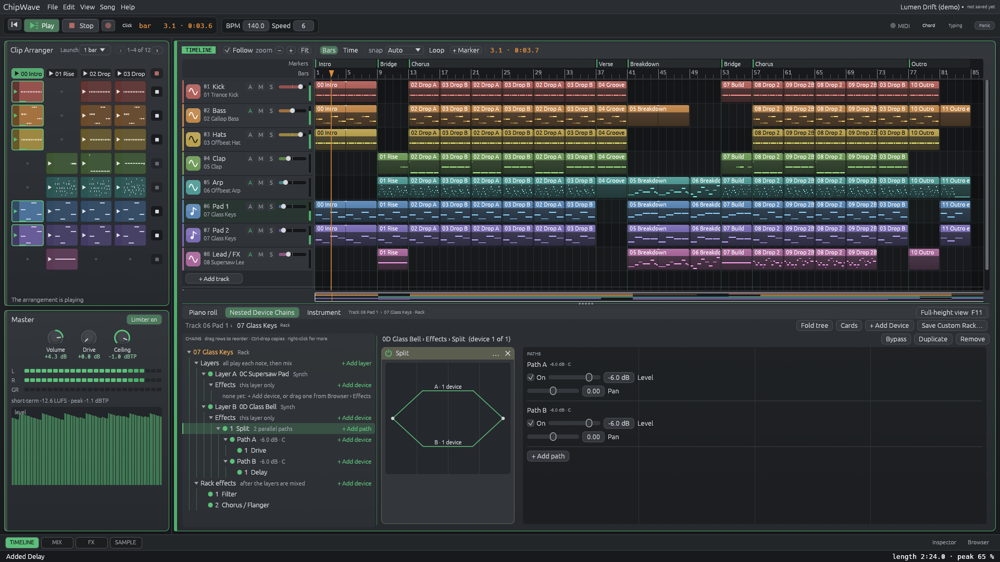<br><b>Nested Device Chains</b> (0.2.7.0; since 0.2.9.0 this tree is the chain editor behind the Rack): a rack's layers, a Split's parallel paths and the Rack effects, with the selected device's controls on the right.</td>
    <td width="50%">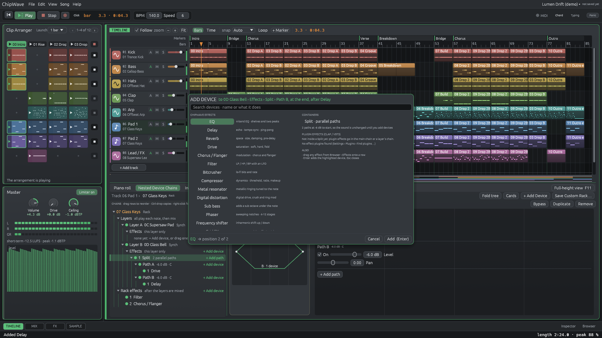<br><b>+ Add Device</b>: a searchable list of ChipWave effects, a Split and your plugin effects; the device goes exactly where the list says.</td>
  </tr>
  <tr>
    <td width="50%">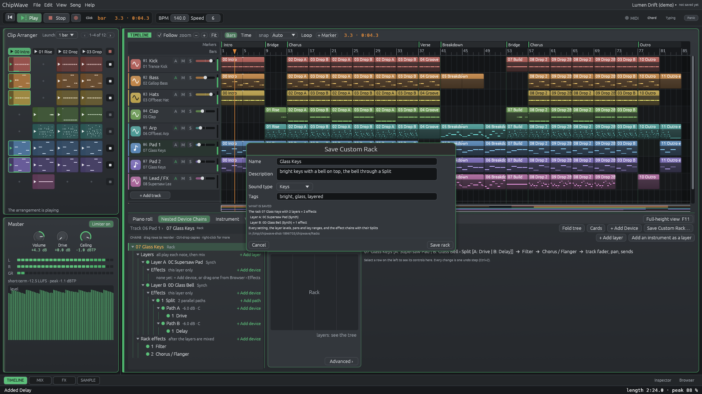<br><b>Save Custom Rack</b>: a name, description, sound type and tags, and a summary of what will be saved.</td>
    <td width="50%">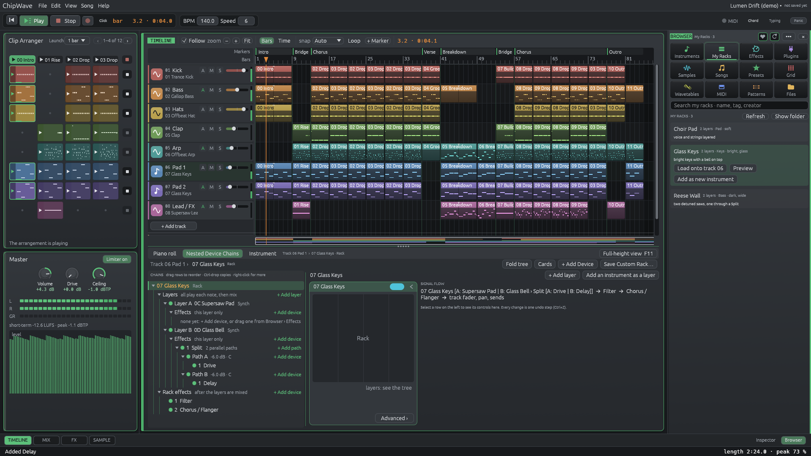<br><b>My Racks</b>: your saved racks in the Browser, searchable, loaded onto the selected track in one undo step.</td>
  </tr>
</table>

</details>

<details><summary><b>New in 0.2.6.0: one workflow</b></summary>

The Timeline is now the place you work in, with everything else following it (inspired by other DAWs):
- **Drag a Clip Arranger clip or a Browser pattern onto the Timeline** and see where it lands first: the target track, a ghost clip, the snap line and a card with the track, its instrument and whether it's a linked copy (Alt: independent). Over other clips it asks **Replace / Place after it / Keep both / Cancel**; nothing is overwritten silently.
- **Launcher clips** in the Clip Arranger: **Capture** the arrangement's scenes, launch one clip per track on the next bar while the others play on, make variations, and drag them back as **linked copies** (shown as **×N**; the piano roll's *Linked ×N* makes one unique).
- **Click a track, get its instrument; click a clip, get the clip.** One rule decides a track's instrument everywhere; a track without one offers a chooser, and a shared one says so (with *Make a separate copy*).
- **Pies** on clips, launcher clips and the Drum Kit's step grid; clips get their own **name and colour**; the lower panel says which track, clip and instrument it edits.
- **ChipWave Instruments** first in the Browser, the Windows **title bar in the theme's colours**, and fixes (plugin effects heard at once, the piano roll playhead in sync).

Known limits: the launcher holds note clips only, there's no recording into slots or generating into a launcher clip yet, the drum pie's Variation is simple, and some Tracker wording remains in block mode. Full list in the [CHANGELOG](docs/CHANGELOG.md).

<table>
  <tr>
    <td width="50%">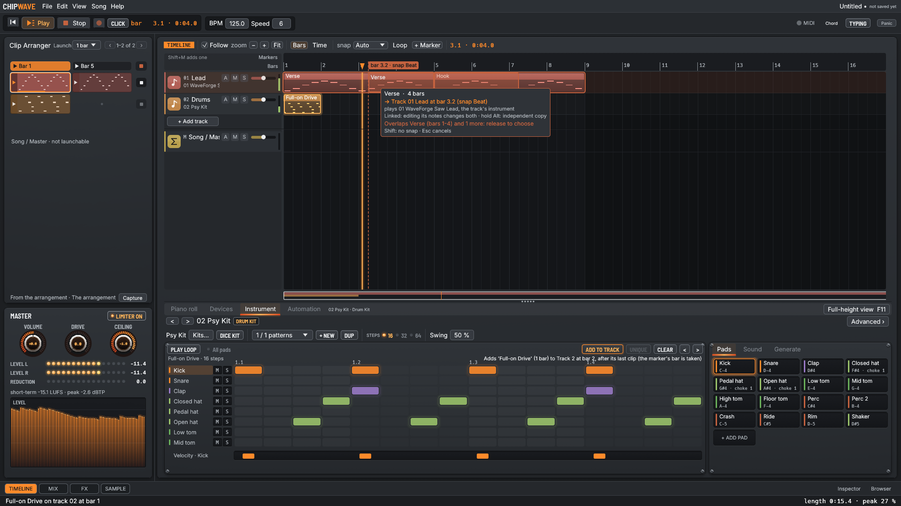<br><b>Drop preview</b>: a Clip Arranger clip dragged onto the Timeline, with the snap line, a ghost clip and the card that says what will happen.</td>
    <td width="50%">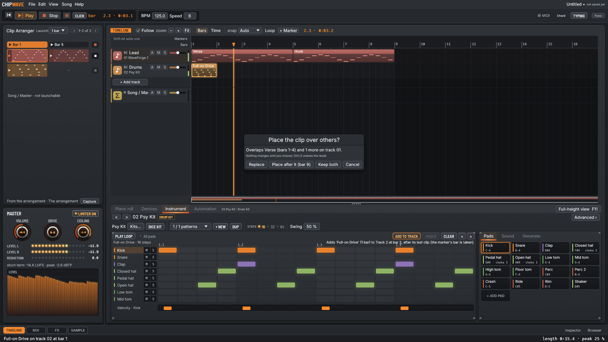<br><b>The overlap question</b>: a drop over other clips asks first: Replace, Place after it (bar 9), Keep both or Cancel. One undo step.</td>
  </tr>
  <tr>
    <td width="50%">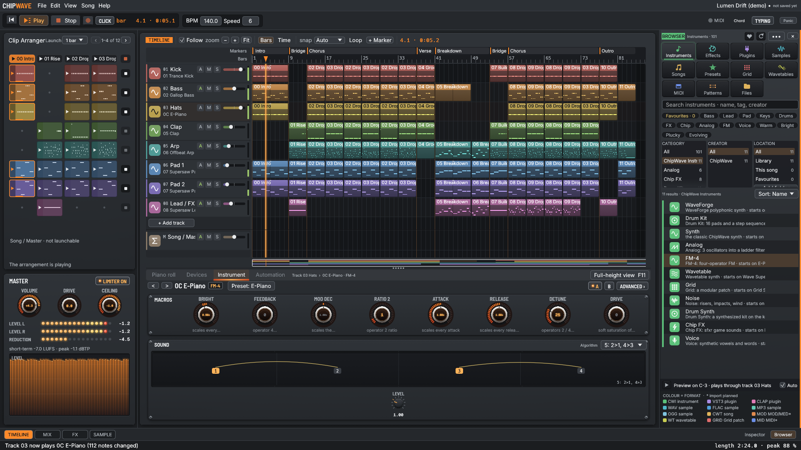<br><b>ChipWave Instruments</b>: the built-in instruments first in the Browser, each on a playable preset. Drag one onto a track, or double-click for a new track.</td>
    <td width="50%">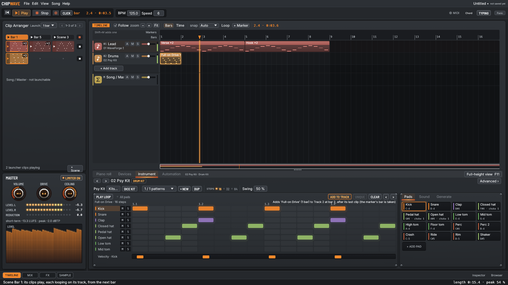<br><b>Launcher clips</b>: captured from the arrangement, linked (×2), launched per track or per scene.</td>
  </tr>
</table>

</details>

```
 ═══[ 01 ]═══ FEATURES ═════════════════════════════════════════════════════
```
<a id="features"></a>

<table>
  <tr>
    <td width="50%">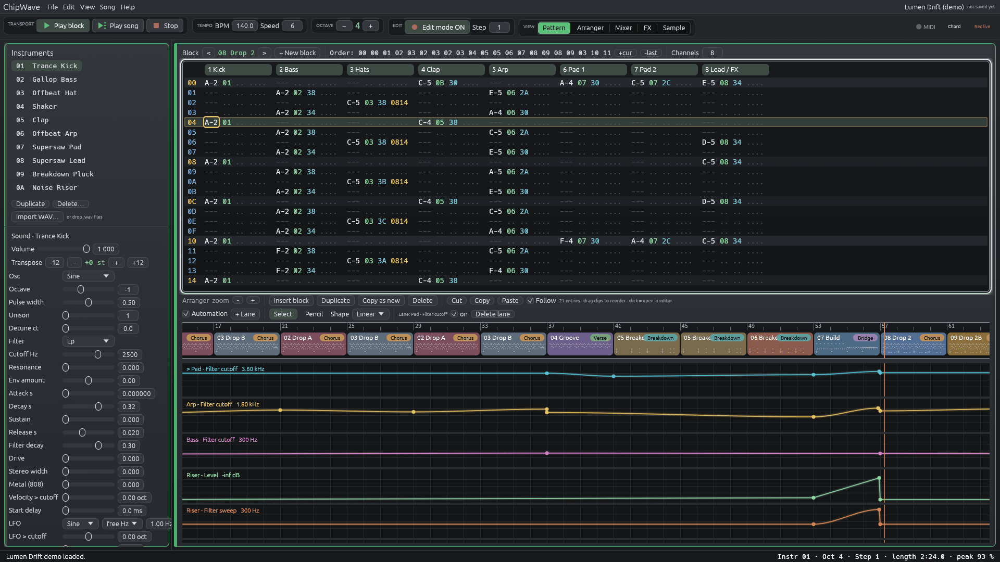<br><b>Tracker</b>: OctaMED-style blocks (64 rows by default; set the length on the one-line Block bar), note / instrument / volume / effect columns, decimal row numbers (hex in Settings › Look), the classic Z–M keyboard layout, selection, copy/paste, transpose (keys, the Block bar’s -12 / -1 / +1 / +12 buttons or Edit › Transpose) and undo. The cursor follows the playing row. Shown: the “Velvet Mirrorball” disco demo with its Cyber Choir voice in the instrument editor below.</td>
    <td width="50%">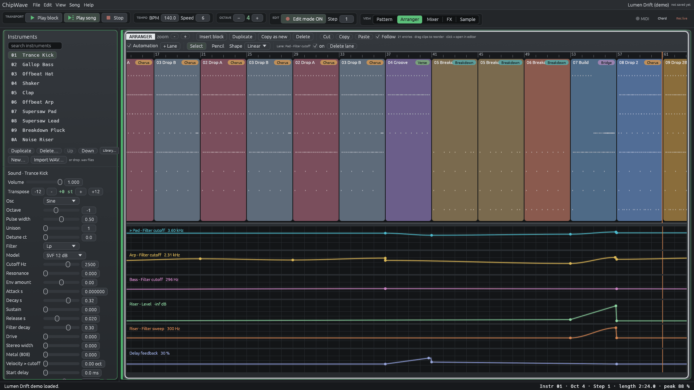<br><b>Order list</b>: the song order as coloured clips with role badges (Intro, Verse, Chorus, Bridge, Breakdown, Outro), drag to reorder, duplicate, zoom, plus <b>automation lanes</b> for filter sweeps, levels and delay feedback.</td>
  </tr>
  <tr>
    <td width="50%">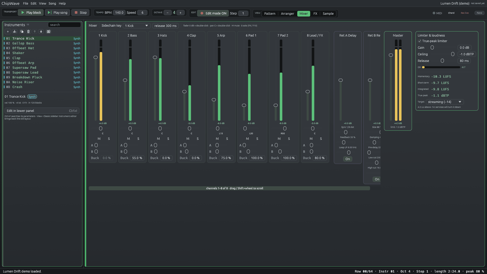<br><b>Mixer</b>: per-channel fader, pan, mute/solo, peak meters, two send/return buses (delay and reverb) and <b>sidechain ducking</b>: pick a key channel and set Duck % per channel for the trance pump.</td>
    <td width="50%">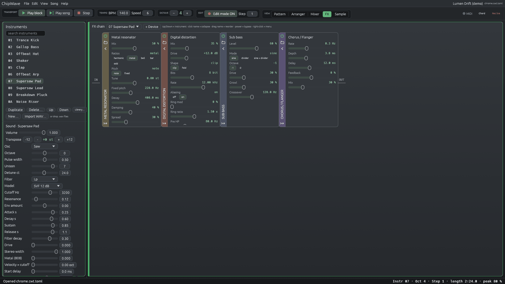<br><b>FX chain</b>: per-instrument device strip with Filter, Chorus/Flanger, Delay, Reverb, Drive, Bitcrusher and Compressor, plus the chrome devices <b>Metal resonator</b>, <b>Digital distortion</b> and <b>Sub bass</b> (0.2.3.11, they follow the note; <code>40</code>–<code>42</code> set their mix); bypass, collapse, drag to reorder, presets.</td>
  </tr>
  <tr>
    <td width="50%">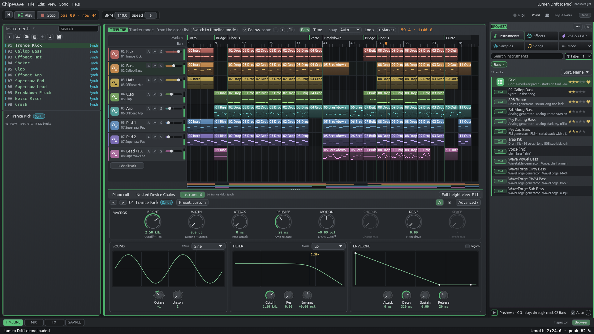<br><b>Browser</b> <sub>(0.2.4.1)</sub>: <code>Ctrl+B</code>. Instruments, CLAP / VST3 plugins, samples, songs, presets, Grid patches and wavetables in one searchable panel with tags, Category / Creator / Location filters, favourites and ratings. Double-click to load, drag onto a track header to give the track that sound, or below the last track for a new one. See <a href="docs/BROWSER.md">BROWSER.md</a>.</td>
    <td width="50%">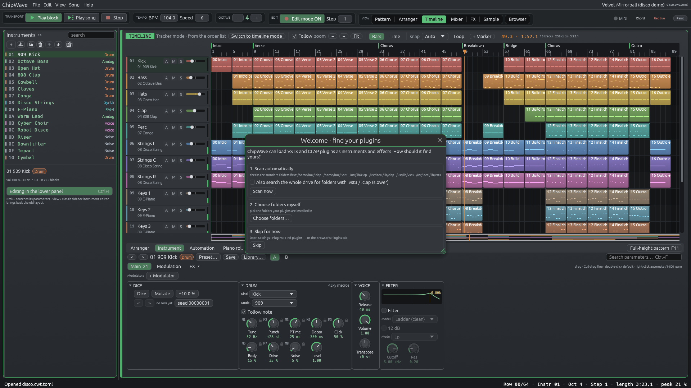<br><b>Find plugins</b> <sub>(0.2.4.1)</sub>: on the first start ChipWave offers to search the standard VST3 / CLAP folders (optionally the whole drive) in the background, let you pick folders, or skip. Always in Settings › Plugins.</td>
  </tr>
  <tr>
    <td width="50%">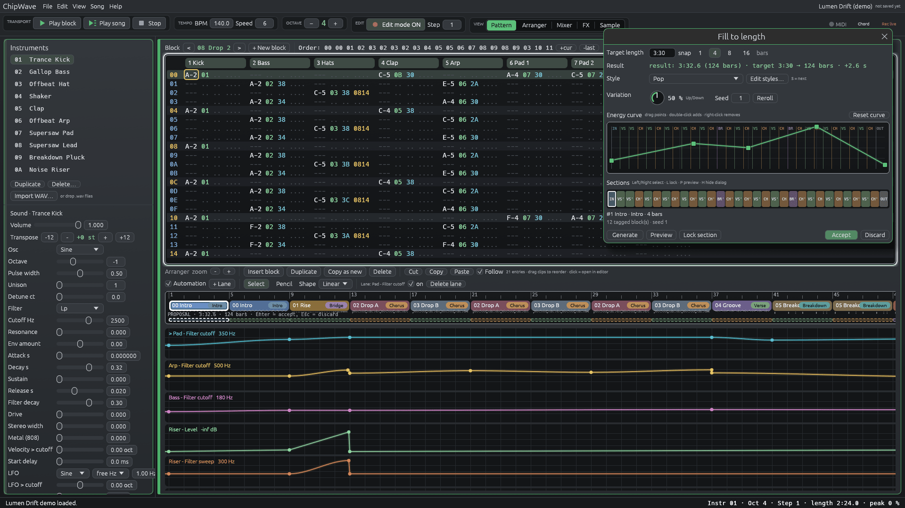<br><b>Fill to length</b>: auto-arrange the song to a target length from a style, with an editable energy curve, variation, seed, preview and section locks.</td>
    <td width="50%">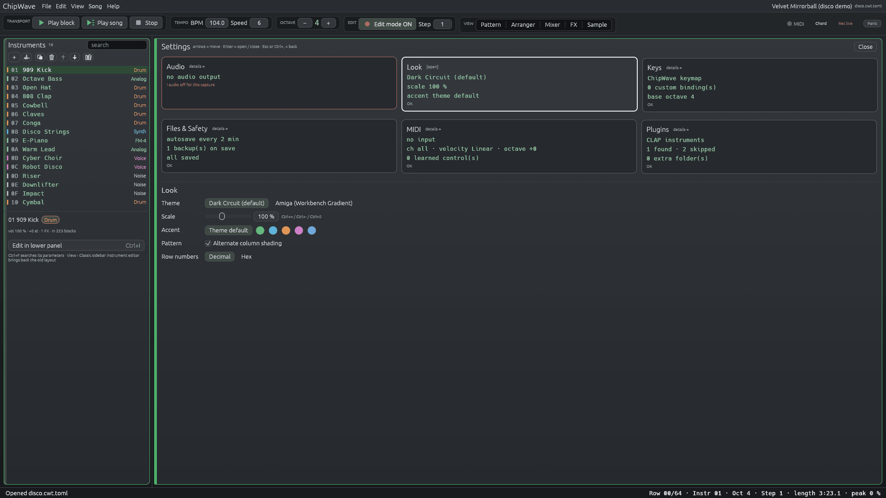<br><b>Settings</b>: summary cards for Audio, Look, Keys (remappable), Files &amp; Safety (autosave, backups, crash recovery, update check) and MIDI. <sub>(Captured on a machine without a sound card, hence “no audio output”.)</sub></td>
  </tr>
  <tr>
    <td width="50%">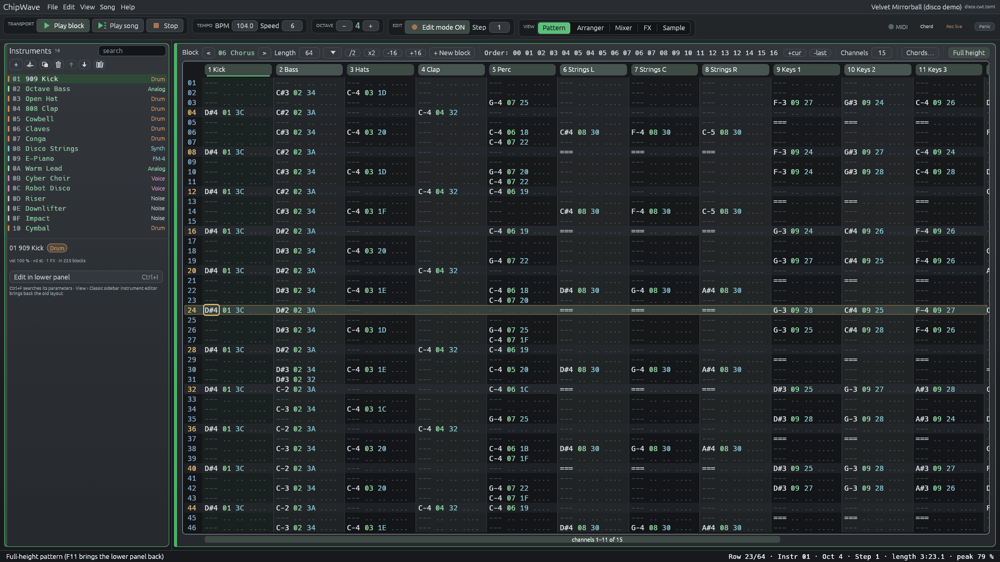<br><b>Full-height view</b> <sub>(0.2.3.19)</sub>: <code>F11</code>, the <b>Full height</b> button, or dragging the splitter to the bottom hides the lower panel so the pattern fills the window; press <code>F11</code> again to bring it back.</td>
    <td width="50%"><br><b>FX tab</b> <sub>(0.2.3.19)</sub>: an instrument's effect chain as knob cards in the lower panel (here the disco demo’s strings: high-pass and low-pass filters and two chorus/flanger stages), next to the Main, Modulation and Advanced tabs.</td>
  </tr>
</table>

<table>
  <tr>
    <td width="34%" valign="top"><br><b>Synth / sound editor</b>: oscillator, unison + detune, stereo width, LP/HP/BP filter (SVF or Moog ladder, clean / vintage, 12/24 dB) with envelope, ADSR, drive, an 808-style metallic source for hats, velocity → cutoff, start delay, 303 glide / legato and accent, and a tempo-syncable LFO to cutoff, amp and pitch. <a href="docs/screenshots/dark-instrument.png">Still</a>.</td>
    <td width="66%" valign="top"><br><b>Mixer while playing</b>: the pads and bass duck under the kick (sidechain), meters per channel and on the master.
    <br><br><br><b>Order list while playing</b>: the playhead runs through the clips and the automation curves.</td>
  </tr>
  <tr>
    <td width="34%" valign="top"></td>
    <td width="66%" valign="top"><b>Instrument editor</b> <sub>(0.2.3.19)</sub>: every instrument (synth, sample, Voice, generators, Chip FX, CLAP plugins) is edited under the pattern with <b>knobs</b> on side-by-side, collapsible cards in four tabs (Main, Modulation, FX, Advanced), small envelope / filter / wave pictures, presets, A/B compare and <b>parameter search</b> (<code>Ctrl+F</code>). Drag a knob, <code>Ctrl</code>-drag for fine steps, double-click for the default, right-click to automate or MIDI-learn. The lower panel switches between Order list, Instrument and Automation, resizes with a splitter, and <b>Full-height view</b> (<code>F11</code>) hides it. See <a href="docs/INSTRUMENT_EDITOR.md">INSTRUMENT_EDITOR.md</a>.</td>
  </tr>
  <tr>
    <td width="34%" valign="top"></td>
    <td width="66%" valign="top"><b>Voice (glitch) instrument</b> <sub>(0.2.3.6)</sub>: synthetic “ahh, eee, ohh, err” vowel chops for dark psytrance. No samples: a glottal pulse with breath and jitter through five formant filters, a vowel sequence you build from chips (A E I O U ER AE), smooth morphing, random <i>babble</i>, Bass/Tenor/Alto/Soprano/<b>Demon</b> registers, formant shift, a tempo-synced chop gate and <b>stutter / beat-repeat</b>. Pattern effects <code>30</code>–<code>37</code> change the vowel, shift and stutter per row (<code>33xy</code> stutters any instrument). Presets: Demon Ahh, Choir Eee, Glitch Babble, Robot Err, Stutter Ohh, Whisper Ooh. See <a href="docs/VOICE.md">VOICE.md</a>. <a href="docs/screenshots/amiga-voice.png">Amiga theme</a>.</td>
</tr>
  <tr>
    <td width="34%" valign="top"></td>
    <td width="66%" valign="top"><b>Master limiter &amp; loudness</b> <sub>(0.2.3.7)</sub>: the panel pinned to the right of the mixer, captured while the demo plays: a lookahead true-peak limiter (gain, ceiling −1 dBTP, release, gain-reduction bar, bypass = the old soft clipper) and momentary / short-term / integrated LUFS plus true peak (ITU-R BS.1770), with a loudness-target hint. Exports use the same limiter. Also new: pattern effects <code>38</code>–<code>3D</code> for per-row filter cutoff, resonance and cutoff slides, 303 glide (Legato + <code>3C</code>) and accent (<code>3D</code> or a velocity threshold); see <a href="docs/TRACKER.md">TRACKER.md</a> and <a href="docs/MIXER.md">MIXER.md</a>.</td>
  </tr>
  <tr>
    <td width="34%" valign="top"></td>
    <td width="66%" valign="top"><b>Up to 32 channels</b> <sub>(0.2.3.8)</sub>: a 32-channel test song in the Tracker (four sets of kick, hat, clap, bass, three arp voices and a lead). The bar under the grid reads “channels 1–11 of 32”; click or drag it, or Tab through the channels. The mixer strips scroll the same way beside the pinned master.</td>
  </tr>
  <tr>
    <td width="34%" valign="top"></td>
    <td width="66%" valign="top"><b>Chord helper</b> <sub>(0.2.3.9)</sub>: pick or detect the song key (Krumhansl–Schmuckler), click chord pads (triad, 7th, sus, add9, power; octave and inversion) to hear them and build a progression, or pick a preset, then write it into the block as chords, an arpeggio or a bass line. Scale lock snaps typed and MIDI notes to the key. See <a href="docs/CHORDS.md">CHORDS.md</a>.</td>
  </tr>
  <tr>
    <td width="34%" valign="top"></td>
    <td width="66%" valign="top"><b>Instrument library</b> <sub>(0.2.3.9)</sub>: the song's instruments, your own library folder of <code>.cwi</code> files and the factory sounds side by side, with search, audition, add, and “replace this slot's sound but keep its notes”. In the instrument list: rename (double-click), reorder (notes follow), search, and “use this instead of” to swap instruments across the song or one block. See <a href="docs/INSTRUMENT_LIBRARY.md">INSTRUMENT_LIBRARY.md</a>.</td>
  </tr>
  <tr>
    <td width="34%" valign="top"></td>
    <td width="66%" valign="top"><b>Voice words and Throat mode</b> <sub>(0.2.3.10)</sub>: the Voice instrument speaks short words (<code>gha dum osh kar</code>), one per note or picked with <code>3Exx</code>: plosives, fricatives and nasals built from noise bursts and formant transitions. <b>Throat</b> swaps the formant filters for a simulated vocal tract inspired by <a href="https://dood.al/pinktrombone/">Pink Trombone</a> by Neil Thapen (MIT). See <a href="docs/VOICE.md">VOICE.md</a>.</td>
  </tr>
  <tr>
    <td width="34%" valign="top"></td>
    <td width="66%" valign="top"><b>Chop / slice</b> <sub>(0.2.3.10)</sub>: a synthesised breakbeat cut at its transients (or on a grid) into numbered slices. Select a slice to normalise, reverse or fade just that part; <b>To instruments</b> makes one instrument per slice and <b>To notes</b> writes them into the block at the song tempo, ready to rearrange. See <a href="docs/SAMPLES.md">SAMPLES.md</a>.</td>
  </tr>
  <tr>
    <td width="34%" valign="top"></td>
    <td width="66%" valign="top"><b>Voice Transform</b> <sub>(0.2.3.11)</sub>: blend the voice into <b>metallic resonance</b> (modal resonators tuned to the note: metal, bell, bar, harmonic, odd), <b>digital distortion</b> (clip/fold, bits, sample-rate, ring mod) and a <b>heavy sub</b> (sine or octave divider, mono below the crossover), with formant drop for a monster voice. Presets Metal Demon, Digital Ghost, Sub Beast, Cyber Choir, Ritual Growl; <code>3F</code>–<code>42</code> per row; the stages are FX devices for any instrument too. See <a href="docs/VOICE.md">VOICE.md</a>.</td>
  </tr>
  <tr>
    <td width="34%" valign="top"></td>
    <td width="66%" valign="top"><b>WaveForge</b> <sub>(0.2.5.0)</sub>: a polyphonic synth inspired by classic subtractive synths. Two band-limited (polyBLEP) oscillators that morph pulse → saw → octave-up saw, with sub, hard sync and up to 16 unison voices each; six blend modes and noise; LP / BP / HP filters at 12 or 24 dB/oct plus band-reject; drive, feedback and a shaper; filter and amp envelopes; Poly / Mono / Legato with 1–8 notes and glide; eight mod routes. Its own editor shows every section side by side on a wide panel and switches to tabs on a narrow one. 11 presets with Init and Revert. See <a href="docs/GENERATORS.md#waveforge-polyphonic-synth-0250">GENERATORS.md</a>.</td>
  </tr>
  <tr>
    <td width="34%" valign="top"></td>
    <td width="66%" valign="top"><b>Drum Kit</b> <sub>(0.2.5.0)</sub>: one instrument with up to 32 pads (key, tune, pan, decay, attack, velocity depth, choke groups, mute / solo), 13 kits of 16 pads, a <b>step sequencer</b> with velocity lane, swing and 16 / 32 / 64 steps, a <b>groove generator</b> (style, energy, fill), <b>Add to track</b> and a compact layout for laptop screens. Old Kits convert bit-identically. See <a href="docs/GENERATORS.md#drum-kit-0250">GENERATORS.md</a>.</td>
  </tr>
  <tr>
    <td width="34%" valign="top"></td>
    <td width="66%" valign="top"><b>Generators: Drum Synth</b> <sub>(0.2.3.12)</sub>: kick (v0, 808, 909, psy Zap), snare, hat, clap, tom and perc from eight macro knobs, or a whole <b>kit</b> on one instrument. <b>Dice</b> rolls a new sound within sensible ranges, <b>Mutate</b> nudges it, <b>lock</b> keeps a knob, 16 rolls of history, stored seed, <b>Bake to sample</b>. Plus a <b>Moog ladder filter</b> (clean or vintage, 12/24 dB LP/BP/HP) in every synth. <code>43xy</code> sets a macro per row. See <a href="docs/GENERATORS.md">GENERATORS.md</a>.</td>
  </tr>
  <tr>
    <td width="34%" valign="top"></td>
    <td width="66%" valign="top"><b>Generators: Analog</b> <sub>(0.2.3.14)</sub>: a Moog-style synth, written from scratch. Three drifting oscillators (saw, triangle, square, pulse with PWM; octave, semitone and detune; sync), noise, the vintage <b>ladder</b>, filter and amp envelopes and glide. Eight macros, Dice/Mutate/locks/Bake. Presets <b>Fat Moog Bass</b>, <b>Psy Rolling Bass</b>, <b>Warm Lead</b>, <b>Brass</b>, <b>Dark Pad</b>, <b>Acid Squelch</b>. Inspired by <a href="https://github.com/mtytel/vital">Vital</a> (Matt Tytel) and <a href="https://github.com/surge-synthesizer/surge">Surge XT</a>.</td>
  </tr>
  <tr>
    <td width="34%" valign="top"></td>
    <td width="66%" valign="top"><b>Generators: FM-4 and Noise</b> <sub>(0.2.3.14)</sub>: <b>FM-4</b> has four operators, the 8 DX21/TX81Z algorithms, ratios, feedback and an envelope per operator. Presets: <b>E-Piano</b>, <b>Metallic Bell</b>, <b>Psy Zap Bass</b>, <b>Growl</b>, <b>Dark Pluck</b>. Informed by <a href="https://github.com/asb2m10/dexed">Dexed</a>/MSFA. <b>Noise</b> offers white, pink, brown or crackle through a ladder or SVF with a sweep envelope. Presets: <b>White Riser</b>, <b>Downlifter</b>, <b>Impact</b>, <b>Wind</b>, <b>Vinyl Crackle</b>.</td>
  </tr>
  <tr>
    <td width="34%" valign="top"></td>
    <td width="66%" valign="top"><b>Generators: Chip FX</b> <sub>(0.2.3.13)</sub>: retro game sounds from a port of <a href="https://www.drpetter.se/project_sfxr.html">sfxr</a> by DrPetter (via <a href="https://github.com/bzar/sfxr-rs">sfxr-rs</a>, both MIT). Click <b>Pickup</b>, <b>Laser</b>, <b>Explosion</b>, <b>Power-up</b>, <b>Hit</b>, <b>Jump</b> or <b>Blip</b> for a new sound, <b>Randomize</b> for anything, <b>Mutate</b> to nudge it; lock what you like, step back through 16 rolls, bake to a sample. Plays in tune with the pattern note. See <a href="docs/GENERATORS.md">GENERATORS.md</a>.</td>
  </tr>
  <tr>
    <td width="34%" valign="top"></td>
    <td width="66%" valign="top"><b>CLAP plugin instruments</b> <sub>(0.2.3.16)</sub>: Surge XT and other CLAP instruments play from the pattern like any other instrument. The lower panel shows the plugin card (Configure… opens its own editor on Windows), eight macro knobs for <code>43xy</code> and automation, and every plugin parameter, searchable, on the Advanced tab (<a href="docs/screenshots/plugin-clap-params.png">picture</a>). See <a href="docs/PLUGINS.md">PLUGINS.md</a>.</td>
  </tr>
</table>

**Also in the box**

| | |
|---|---|
| 🎹 **MIDI keyboard** | play the current instrument with velocity, sustain and pitch bend; record step or live into the pattern; chord spread; MIDI learn on faders and knobs |
| 🎚️ **Up to 32 channels** | each song sets its own channel count (1–32); the Tracker and mixer scroll with a bar showing which channels are in view |
| 🎼 **Chords & scale lock** | song key (pick or detect), chord pads, progressions written as chords, arps or bass, scale lock for typing and MIDI |
| 📚 **Instrument library** | `.cwi` instrument files, a library folder with categories, factory sounds, audition, rename / reorder / swap instruments |
| 🎛️ **Effects column** | `01`/`02` slide, `08` note decay, `09` speed, `0C` volume, `0D` volume slide, `0F` tempo; Voice `30`–`37` (`33`/`34` stutter any instrument); filter and acid `38`–`3D` (cutoff, resonance, cutoff slides, 303 glide, accent); `3E` speak word; `3F`–`42` Voice Transform and chrome devices; `43xy` generator macros. Full table: [TRACKER.md](docs/TRACKER.md#5-effect-commands) |
| 🔌 **Plugin instruments** | CLAP instruments such as Surge XT: crash-guarded scanner, browser, native editor (Windows), parameter list, 8 macros for `43xy` and automation, state saved in the song, offline render. VST3 instruments and effects are hosted the same way (0.2.4.1). [PLUGINS.md](docs/PLUGINS.md) |
| 🎲 **Generators** | macro-knob instruments: Drum Synth and kits, Drum Kit (32 pads, step sequencer, groove generator), Chip FX (sfxr), Analog (Moog-style), FM-4, Noise, Wave, Grid, WaveForge (polyphonic, two oscillators with unison), StringWave (string ensemble); Dice, Mutate, locks, 16-roll history, Bake to sample; presets for each |
| 🧩 **Rack & device chains** | the **Rack** under the Timeline (Ctrl+7): the instrument and its effects in one row with side tabs (bypass, remove, collapse), Delete / Ctrl+D on the selected card, starter knobs with Advanced ›, drag from the Browser; the **chain editor** tree for Splits and layers, + Add Device, drag to reorder or move (Ctrl: copy); **Split** into 2–4 parallel paths; **racks** of up to 4 layers (level, pan, transpose, key range, own effects); Save Custom Rack and **Browser › My Racks** ([RACKS.md](docs/RACKS.md)) |
| 🗣️ **Voice** | synthetic vowels, babble, stutter, spoken words, Throat (vocal tract) mode and the Transform (metal, digital, sub) |
| 🧱 **Master limiter** | lookahead true-peak limiter on the master and in every export (ceiling −1 dBTP by default, gain, release, bypass), with a loudness meter: momentary, short-term and integrated LUFS plus true peak, and a loudness-target hint |
| 🔊 **Samples** | import WAV (button or drag and drop), sample view with loop points and preview, chop / slice into instruments or notes |
| 💾 **Files** | `.cwt` songs (a ZIP of TOML + WAV you can inspect), autosave, backups and crash recovery |
| 📼 **Export** | WAV and MP3 with ID3 tags; whole song, the current block or the Order list selection |
| 🎵 **Demo songs** | File > Demo songs: “Lumen Drift” (140 BPM uplifting trance), “Hollow Ritual” (147 BPM dark psytrance) “Velvet Mirrorball” (104 BPM disco with Voice choir, phaser strings and filter sweeps), “Chrome Throat” (145 BPM psy with Voice chants) and “Oceans 11” (125 BPM melodic chiptune made only with Chip FX, effects and a Drum Kit: music by Martin Galway, Commodore 64, arranged by Del (postmanpat)) |
| ⬆️ **Update check** | Help > Check for updates…, and an optional quiet check at startup |
| 🖥️ **Scaling** | UI scale in 25 % steps (Ctrl+= / Ctrl+-, up to what fits the window), remembers window size and position |

<p align="center"> About" width="70%"><br><sub>Help > About</sub></p>

```
 ═══[ 02 ]═══ THEMES ═══════════════════════════════════════════════════════
```
<a id="themes"></a>

Two built-in themes, switchable in View > Theme or Settings > Look: **Dark Circuit** (default) and **Amiga (Workbench Gradient)**, a light Workbench look with the classic blue headers and orange cursor.

<p align="center">
  
</p>

<table>
  <tr>
    <th>Dark Circuit (default)</th>
    <th>Amiga (Workbench Gradient)</th>
  </tr>
  <tr>
    <td></td>
    <td></td>
  </tr>
  <tr>
    <td></td>
    <td></td>
  </tr>
  <tr>
    <td></td>
    <td></td>
  </tr>
  <tr>
    <td></td>
    <td></td>
  </tr>
</table>

The palettes, generated from the colour values in [`src/theme.rs`](src/theme.rs) (`scripts/theme_swatches.py`):

<p align="center"></p>

```
 ═══[ 03 ]═══ DOWNLOAD ═════════════════════════════════════════════════════
```
<a id="download"></a>

Get the **Windows** installer [`ChipWave-setup-x64.exe`](https://github.com/postmanpat-303/ChipWaveStudio/releases/latest/download/ChipWave-setup-x64.exe) or the portable [`ChipWave-windows-x64.zip`](https://github.com/postmanpat-303/ChipWaveStudio/releases/latest/download/ChipWave-windows-x64.zip) from the [latest release](https://github.com/postmanpat-303/ChipWaveStudio/releases/latest) (these links always fetch the newest version; older versions are on the [releases page](https://github.com/postmanpat-303/ChipWaveStudio/releases)). Already on 0.2.3.5 or later? **Help > Check for updates…** offers it. The exe isn't code-signed yet, so SmartScreen may warn: click “More info”, then “Run anyway”. The app opens with a clean song (the same as File > New); to hear what it can do, open **File > Demo songs** and press **Space**.

**macOS**: the universal disk image [`ChipWave-macos-universal.dmg`](https://github.com/postmanpat-303/ChipWaveStudio/releases/latest/download/ChipWave-macos-universal.dmg) runs on both Apple Silicon and Intel Macs, macOS 11 or later (or get the zip, [`ChipWave-macos-universal.zip`](https://github.com/postmanpat-303/ChipWaveStudio/releases/latest/download/ChipWave-macos-universal.zip)). It isn't notarised, so open it the first time with Control-click → **Open** (or `xattr -dr com.apple.quarantine /Applications/ChipWave.app`). See [MACOS.md](docs/MACOS.md).

On Linux, build it from source (below).

```
 ═══[ 04 ]═══ KEYS ═════════════════════════════════════════════════════════
```
<a id="keys"></a>

| Keys | Action |
|---|---|
| `Z S X D C V G B H N J M` | notes C…B; `Q 2 W 3 E R 5 T 6 Y 7 U I 9 O 0 P` = octave up |
| `1` | note off |
| `F1`…`F8`, numpad `-` / `+` | base octave |
| `0`–`9` `A`–`F` | hex in the instrument / volume / effect columns |
| Arrows, `PgUp`/`PgDn`, `Home`/`End` | move (Ctrl+Home/End = first / last block) |
| `Tab` / `Shift+Tab` | next / previous channel |
| `Space` / `Shift+Space` | play / stop block (loop) / whole song (from the Order list play marker) |
| Click / drag the Order list ruler | move the play marker to that bar (jumps there while playing); drag = scrub, `Alt`+click = exact row |
| `Enter` / `Ctrl+Enter` | restart block / play from the cursor row |
| `Esc` | edit mode on / off (in the Tracker and Order list; Edit › Edit mode works everywhere) |
| `Delete`, `Backspace`, `Insert` | clear, pull up, push down |
| `Shift`+arrows, mouse drag, `Ctrl+A` | select (again = whole block) |
| `Ctrl+C` / `Ctrl+X` / `Ctrl+V` | copy / cut / paste |
| Piano roll (click into it): `Ctrl+C` / `Ctrl+X` / `Ctrl+V`, `Ctrl+D`, `Ctrl`-drag | copy / cut / paste notes (at the paste marker set by clicking the roll's bar strip, else the playhead; also into another clip), duplicate the selection after itself, drag copies of the selected notes ([TIMELINE.md](docs/TIMELINE.md)) |
| `Ctrl+Z` / `Ctrl+Y` | undo / redo |
| `Alt +` / `Alt -` (Shift = octave) | transpose selection or channel (also the Block bar **-12 -1 +1 +12** buttons and **Edit › Transpose**, which has *Transpose by…* for -24…+24) |
| `F9` / `F10` | mute / solo channel |
| `Ctrl+T`, `Ctrl+3`…`5`, `Ctrl+Tab` | Timeline / Mixer / FX / Sample view (`Ctrl+1` / `Ctrl+2`: the Tracker / Order list, also View › Tracker) |
| `Ctrl+6` | the default layout: Timeline on top, piano roll below (also View › Reset to default layout) |
| `Ctrl+7` | the Rack in the lower panel (Notes \| Rack): the selected track's instrument and effects in one row ([RACKS.md](docs/RACKS.md)) |
| `Ctrl+8` | Clip Arranger on / off: scenes and slots left of the Timeline (also View › Clip Arranger; off shows the Instruments list there) |
| `Ctrl+T` | Timeline view (tracks and clips; in timeline mode drag, loop, split, copy clips, [TIMELINE.md](docs/TIMELINE.md)) |
| `Ctrl+Shift+F` | Fill to length |
| `Ctrl+Shift+PgDn` / `Ctrl+Shift+PgUp` | double / halve the block length (or the Length field in the Block bar) |
| `Ctrl+N` / `Ctrl+O` / `Ctrl+S` | new / open / save |
| `Ctrl+E` / `Ctrl+Shift+E` | quick WAV export / export dialog |
| `Ctrl+,` | settings |
| `Ctrl+=` / `Ctrl+-` / `Ctrl+0` | UI scale up / down / 100 % |
| `Ctrl+I` | instrument editor in the lower panel (again: back to the Order list) |
| `R` (not in the Tracker) | Record: live into the Timeline, from the play marker (again: stop recording). Toolbar ● and **Metronome** (its arrow or right-click: count-in) |
| `Ctrl+K` | **Keys → Notes** on / off (toolbar button; play notes on the computer keyboard; off, those keys are normal shortcuts again): `A S D F G H J K L ;` white keys, `W E T Y U O P` black keys, `Z` / `X` octave, `C` / `V` velocity |
| `I` (`Alt+I` in the Tracker) | show / hide the Inspector: the selected track or clip ([INSPECTOR.md](docs/INSPECTOR.md)) |
| `Ctrl+B` | show / hide the Browser (instruments, plugins, samples, songs…; [BROWSER.md](docs/BROWSER.md)) |
| `Ctrl+F` | search the instrument's parameters |
| `F11` | Full-height view: hide / show the lower panel |
| `F12` | the full key list (Help > Keys) |

```
 ═══[ 05 ]═══ BUILD ════════════════════════════════════════════════════════
```

```
cargo run --release                                    # Linux (needs libasound2-dev)
cargo build --release --target x86_64-pc-windows-gnu   # Windows exe from Linux (mingw-w64)
chipwave --self-test [out.wav]                         # headless check: renders the demo
chipwave --render demo out.mp3                         # render the demo (or a .cwt) to WAV/MP3
chipwave --check-updates                               # ask GitHub for a newer version
scripts/screenshots.sh && scripts/record_gifs.sh       # regenerate the pictures on this page
```

```
 ═══[ 06 ]═══ ROADMAP (PLANNED, NOT IN THE APP YET) ═════════════════════════
```

- MED (MMD0–MMD3) and MOD loading, more OctaMED effect commands, optional “Paula” mode
- More filter models (Sallen-Key, diode), wavetables, a full mod matrix, render-to-sample for synth and Voice instruments (generators already Bake), oversampled FM
- MIDI output and clock sync (CLAP instruments work since 0.2.3.16; plugin effects and VST3 hosting since 0.2.4.1)
- Stem export and LUFS-target normalisation; MOD/XM export
- Polyphony within one channel (today chords use several channels)
- See [OCTAMED_SPEC.md](docs/OCTAMED_SPEC.md), [SOUND_DESIGN.md](docs/SOUND_DESIGN.md) and [MIDI_VST.md](docs/MIDI_VST.md) for the plans.

<a id="documentation"></a>
## Documentation

- [ROADMAP.md](docs/ROADMAP.md) — things to add in the future, with good first picks; [CONTRIBUTING.md](CONTRIBUTING.md) — how to build, test and send a pull request
- [ARCHITECTURE.md](docs/ARCHITECTURE.md) — where does this go? Which files a new knob, effect, instrument, saved field or MIDI feature touches, and the audio-thread rules
- [TRACKER.md](docs/TRACKER.md) — the core Tracker, keymap, 32 channels and all effect commands (00–43)
- [PACKAGING.md](docs/PACKAGING.md) — Windows/Linux/macOS packages and CI
- [MACOS.md](docs/MACOS.md): the universal Mac build, installing it, first launch, and building it
- [STARTER_SOUNDS.md](docs/STARTER_SOUNDS.md) — the psytrance and alien factory presets
- [SAFETY.md](docs/SAFETY.md) — autosave, crash recovery and recent files
- [MIXER.md](docs/MIXER.md) — the mixer, master limiter and LUFS meter (0.2.3.7)
- [AUTOMATION.md](docs/AUTOMATION.md) — automation lanes
- [FIRST_RUN.md](docs/FIRST_RUN.md) — the self-building first-run demo and the demo songs
- [SETTINGS.md](docs/SETTINGS.md) — settings
- [OCTAMED_SPEC.md](docs/OCTAMED_SPEC.md) — the full OctaMED feature blueprint
- [SOUND_DESIGN.md](docs/SOUND_DESIGN.md) — the synth and effects
- [FX.md](docs/FX.md) — the FX devices (Phaser and the rest)
- [ORDER_LIST.md](docs/ORDER_LIST.md) — the Order list (the order list as a lane of blocks)
- [TIMELINE.md](docs/TIMELINE.md) — the Timeline view (Ctrl+T) and timeline mode: arrange tracks and clips like a DAW
- [CLIP_ARRANGER.md](docs/CLIP_ARRANGER.md) — the Clip Arranger: scenes and slots left of the Timeline, launched on the next bar, and the Master panel
- [INSPECTOR.md](docs/INSPECTOR.md) — the Inspector (I) and the view tab bar along the bottom
- [BROWSER.md](docs/BROWSER.md) — the Browser (Ctrl+B): find and load instruments, plugins, samples, songs, presets, Grid patches and wavetables; drag them onto tracks; Find plugins
- [RACKS.md](docs/RACKS.md) — the Rack, the chain editor, Split, racks with layers, Save Custom Rack and My Racks ([rack file format](docs/racks/FORMAT.md))
- [DAW_TIMELINE_PLAN.md](docs/DAW_TIMELINE_PLAN.md) — the DAW timeline plan and milestones
- [AUTO_ARRANGE.md](docs/AUTO_ARRANGE.md) — fill-to-length auto arrange and quick-start fun features
- [EXPORT.md](docs/EXPORT.md) — WAV/MP3 export
- [FILE_FORMAT.md](docs/FILE_FORMAT.md) — the `.cwt` song format
- [UI_SCALING.md](docs/UI_SCALING.md) — screen scaling and layouts
- [INSTRUMENT_EDITOR.md](docs/INSTRUMENT_EDITOR.md) — the lower-panel instrument editor: knobs, tabs, cards, search, A/B, Full-height view (0.2.3.19)
- [SAMPLES.md](docs/SAMPLES.md) — the instrument list, importer and chop / slice (0.2.3.10)
- [INSTRUMENT_LIBRARY.md](docs/INSTRUMENT_LIBRARY.md) — instrument library, `.cwi` files, rename / reorder / swap (0.2.3.9)
- [CHORDS.md](docs/CHORDS.md) — chord helper and scale lock (0.2.3.9)
- [VOICE.md](docs/VOICE.md) — the Voice (glitch) instrument: vowels, babble, stutter, words, Throat mode, Transform and chrome FX devices, effects 30–42 (0.2.3.6-11)
- [GENERATORS.md](docs/GENERATORS.md) — generators: Drum Synth, kits, Drum Kit, Chip FX (sfxr), Analog, FM-4, Noise, Wave, Grid, WaveForge, Dice, Bake, Moog ladder filter, effect 43xy (0.2.3.12–0.2.5.0)
- [MIDI.md](docs/MIDI.md) — MIDI keyboard input: play, record, velocity, sustain, MIDI learn (0.2.3)
- [MIDI_VST.md](docs/MIDI_VST.md) — MIDI and plugins (plan)
- [PLUGIN_MANAGER.md](docs/PLUGIN_MANAGER.md) — the plugin manager (scan, verify, activate)
- [DESIGN_LANGUAGE.md](docs/DESIGN_LANGUAGE.md) — ChipWave's "Wave Cartridge" visual identity
- [UPDATES.md](docs/UPDATES.md) — the update check (0.2.3.5)
- [CHANGELOG.md](docs/CHANGELOG.md) — what changed in each version

## Credits

Created by **Del (postmanpat)**. To keep the software going I need Coffee :)

<p>
  <a href="https://buymeacoffee.com/postmanpat"><b>☕ Buy me a coffee</b></a> &nbsp;·&nbsp;
  <a href="https://paypal.me/derekh100"><b>PayPal</b></a> &nbsp;·&nbsp;
  <a href="https://www.youtube.com/@whatgoesaround1551"><b>▶ YouTube: demos &amp; promos</b></a>
</p>

### Acknowledgements / Credits

ChipWave stands on the shoulders of open source and published research. With thanks to:

- **StringWave** by **Del (postmanpat)** (MIT): the StringWave string-ensemble instrument, ported in from its author's own synth; the MIT notice is in `THIRD_PARTY_LICENSES.txt`.
- **Martin Galway**, the great composer on the Commodore 64: the demo song "Oceans 11" is a ChipWave arrangement of his music (arranged by Del (postmanpat)).
- **Emilie Gillet / Mutable Instruments**: the Voice (glitch) instrument's design is inspired by the [Plaits speech engine](https://github.com/pichenettes/eurorack/tree/master/plaits/dsp/speech) (“naive speech synth”, MIT). No code is copied; the MIT notice is in `THIRD_PARTY_LICENSES.txt`.
- **The Csound community**: vowel formant values from the [Csound manual's formant table](https://csound.com/docs/manual/MiscFormants.html) ([Csound](https://github.com/csound/csound), LGPL-2.1).
- **G. E. Peterson & H. L. Barney** (1952), [“Control methods used in a study of the vowels”](https://doi.org/10.1121/1.1906875): the ER and AE vowels.
- **A. E. Rosenberg** (1971), [glottal pulse shape](https://doi.org/10.1121/1.1912389), and **G. Fant, J. Liljencrants & Q. Lin** (1985), the LF glottal flow model: the voice's pulse and “tension”.
- **Dennis H. Klatt** (1980), [“Software for a cascade/parallel formant synthesizer”](https://doi.org/10.1121/1.383940): the parallel formant structure.
- **Vadim Zavalishin**, *The Art of VA Filter Design*: the TPT state-variable filter used throughout the synth, and the zero-delay-feedback all-pass stages of the **Phaser** FX (whose swept-notch structure follows analog phaser pedals such as the MXR Phase 90 and Electro-Harmonix Small Stone; no circuit or code copied).
- **Harald Bode**'s single-sideband frequency shifter and **Olli Niemitalo**'s [Hilbert transformer all-pass coefficients](https://yehar.com/blog/?p=368): the **Frequency shifter** FX (independent implementation; published coefficients only, no code copied).
- **ITU-R BS.1770-4** and **EBU R 128 / Tech 3341**: the loudness meter (K-weighting, gating, momentary / short-term / integrated LUFS) and the 4x oversampled true-peak measurement used by the master limiter.
- **Jan Kokemüller** ([libebur128](https://github.com/jiixyj/libebur128), MIT) and **Christian Steinmetz** ([pyloudnorm](https://github.com/csteinmetz1/pyloudnorm), MIT): the sample-rate-independent K-weighting filter formulas (no code copied).
- **Geraint Luff / Signalsmith Audio**, [“Designing a straightforward limiter”](https://signalsmith-audio.co.uk/writing/2022/limiter/): the peak-hold + moving-average lookahead design of the master limiter.
- **Neil Thapen**, [Pink Trombone](https://dood.al/pinktrombone/) (MIT): the Voice instrument's **Throat** mode follows its vocal-tract design (a Kelly-Lochbaum tube with tongue, lips, nose and turbulence noise). Independent implementation; the MIT notice is in `THIRD_PARTY_LICENSES.txt`.
- **P. Delattre, A. Liberman & F. Cooper** (1955), [“Acoustic loci and transitional cues for consonants”](https://doi.org/10.1121/1.1908024), and **K. N. Stevens**, *Acoustic Phonetics* (1998): consonant formant transitions and noise bands. **J. L. Kelly & C. C. Lochbaum** (1962): the tube model.
- **Julius O. Smith & James B. Angell** (1982), “A constant-gain digital resonator tuned by a single coefficient” ([J. O. Smith, *Introduction to Digital Filters*](https://ccrma.stanford.edu/~jos/filters/)): the Transform's modal resonators. **N. H. Fletcher & T. D. Rossing**, *The Physics of Musical Instruments*: the bell and bar mode ratios; the “metal” ratios are the Roland TR-808 cymbal oscillator frequencies. **S. H. Linkwitz** (1976): the Linkwitz-Riley crossover that keeps the sub mono; the octave divider follows analog octave pedals (Boss OC-2).
- **Vadim Zavalishin**, *The Art of VA Filter Design*, **Antti Huovilainen** (DAFx-04) and **Vesa Välimäki & Antti Huovilainen** (CMJ 2006): the Moog ladder filter (clean and vintage). Cross-checked against [DaisySP](https://github.com/electro-smith/DaisySP)'s ladder (**Richard van Hoesel**, **Infrasonic Audio**, MIT), [fundsp](https://github.com/SamiPerttu/fundsp) (**Sami Perttu**, MIT/Apache-2.0) and [MoogLadders](https://github.com/ddiakopoulos/MoogLadders) (**Dimitri Diakopoulos**, Stefano D'Angelo).
- **Sonic Pi**'s [sc808](https://github.com/sonic-pi-net/sonic-pi) SynthDefs (**Sam Aaron** and contributors, MIT), after **Yoshinosuke Horiuchi**'s SuperCollider TR-808, and **Emilie Gillet**'s [Plaits](https://github.com/pichenettes/eurorack) drum models (MIT) as ported to [DaisySP](https://github.com/electro-smith/DaisySP) by **Electrosmith** (MIT): the Drum Synth recipes. Other DAWs' modular environments: the macro + dice workflow idea (no code or assets). **Tomas Pettersson (DrPetter)**'s [sfxr](https://www.drpetter.se/project_sfxr.html) (MIT) via **Teemu Erkkola**'s [sfxr-rs](https://github.com/bzar/sfxr-rs) (MIT): the Chip FX generator. MIT notices are in `THIRD_PARTY_LICENSES.txt`.
- **Robert Moog**'s Minimoog and **Vesa Välimäki & Antti Huovilainen**'s polyBLEP oscillators (IEEE SPM 2007): the Analog generator. **Matt Tytel**'s [Vital](https://github.com/mtytel/vital) (GPL-3) and the **Surge Synth Team**'s [Surge XT](https://github.com/surge-synthesizer/surge) (GPL-3): oscillator drift, noise and macro ideas. **Pascal Gauthier**'s [Dexed](https://github.com/asb2m10/dexed) (GPL-3) and **Raph Levien**'s [MSFA](https://github.com/google/music-synthesizer-for-android) (Apache-2.0), plus the Yamaha DX21/TX81Z algorithms: the FM-4 generator. **Paul Kellet**'s [pink noise filter](https://www.musicdsp.org/en/latest/Filters/76-pink-noise-filter.html), and the Dust generators of [SuperCollider](https://github.com/supercollider/supercollider) and DaisySP: the Noise generator. **Vadim Zavalishin**'s *The Art of VA Filter Design* (zero-delay filters) and the polyBLEP paper above: the WaveForge generator. All of it was written from scratch (no code copied).
- **The free-audio project** (**Alexandre Bique** and contributors): [CLAP](https://github.com/free-audio/clap) (MIT), the plugin standard ChipWave hosts, through **micahrj**'s [clap-sys](https://github.com/micahrj/clap-sys) bindings (MIT/Apache-2.0). Host design references, no code copied: [clack](https://github.com/prokopyl/clack) by **Adrien Prokopowicz** (MIT/Apache-2.0), [Carla](https://github.com/falkTX/Carla) by **Filipe Coelho (falkTX)** and [Ardour](https://ardour.org) (GPL-2.0+). Plugin loading uses [libloading](https://github.com/nagisa/rust_libloading) (**Simonas Kazlauskas**, ISC), editor windows [windows-sys](https://github.com/microsoft/windows-rs) (Microsoft, MIT/Apache-2.0). Tested with [Surge XT](https://surge-synthesizer.github.io) (Surge Synth Team, GPL-3; not bundled).
- **Carol L. Krumhansl & Edward J. Kessler** (1982), [key profiles](https://doi.org/10.1037/0033-295X.89.4.334), and the **Krumhansl–Schmuckler** key-finding algorithm (Krumhansl, *Cognitive Foundations of Musical Pitch*, 1990): the chord helper's key detection.
- **The Melody generator** (ideas only, no code copied): **Bozhidar Bozhanov**'s [Computoser](https://arxiv.org/abs/1412.3079) paper (2014), **Godfried T. Toussaint**'s Euclidean rhythms (2005, after **E. Bjorklund**'s algorithm, also used by the Bass generator), **Timo Hoogland**'s [total-serialism](https://github.com/tmhglnd/total-serialism) (MIT), **Daniel Jones**'s [isobar](https://github.com/ideoforms/isobar) (MIT) and **Emilie Gillet**'s open [Eurorack firmware](https://github.com/pichenettes/eurorack) (MIT).
- **The Bass generator** (ideas only, no code copied): **David Whiting (vitling)**'s [acid-banger](https://github.com/vitling/acid-banger) (CC BY 4.0), **midilab**'s [aciduino](https://github.com/midilab/aciduino) (MIT) and [JC-303](https://github.com/midilab/jc303) (GPL-3.0, its engine Open303 by **Robin Schmidt**), **Zack Scholl**'s [acid-test](https://github.com/schollz/acid-test) (MIT) and **philxan**'s [WalkingBass](https://github.com/philxan/WalkingBass) (MIT).
- **Scaler** by Plugin Boutique: the inspiration for the chord pads and progressions (no code, data or artwork used).
- The **Roland TB-303**, whose glide and accent the `3C` / `3D` effects imitate.
- **Teijo Kinnunen and Ray Burt-Frost** for [OctaMED](https://en.wikipedia.org/wiki/OctaMED), whose workflow ChipWave follows.
- The interface fonts, embedded under the [SIL Open Font License 1.1](LICENSES/AtkinsonHyperlegibleNext-OFL.txt): [**Atkinson Hyperlegible Next**](https://github.com/googlefonts/atkinson-hyperlegible-next) and [**Atkinson Hyperlegible Mono**](https://github.com/googlefonts/atkinson-hyperlegible-next-mono) by the **Braille Institute of America** (The Atkinson Hyperlegible Next / Mono Project Authors), with [**Inter**](https://github.com/rsms/inter) by **Rasmus Andersson** (The Inter Project Authors) as the fallback for symbols, Greek and Cyrillic. Their licences are in `LICENSES/` and `THIRD_PARTY_LICENSES.txt`.
- The Rust crates ChipWave is built on (egui/eframe, cpal, midir, hound, toml, zip, mp3lame-encoder and more), listed with their licences in `THIRD_PARTY_LICENSES.txt`.

Research notes: [docs/research/voice-glitch.md](docs/research/voice-glitch.md).

## Licence

ChipWave Studio is free software, licensed under the [GNU General Public License v3.0](LICENSE) (GPL-3.0-or-later).

## 💛 Thank you

A big thank you to [storytold](https://github.com/storytold/), whose open-source [PhotoCraft](https://github.com/storytold/photocraft) inspired the look of the Wave family icons, and whose [ArtCraft Launcher](https://github.com/storytold/craft-launcher) inspired the upcoming Wave Hub. Open source at its best. Go give them a ⭐!
