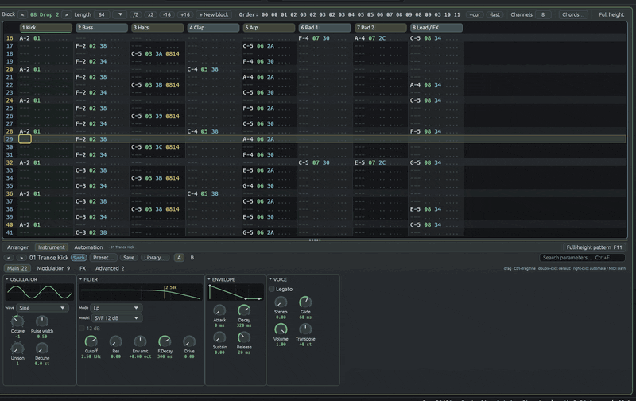

<p align="center">
  
</p>

<h1 align="center">ChipWave Tracker</h1>

<p align="center">
  
  
  <a href="LICENSE"></a>
  
  <a href="https://github.com/postmanpat-303/ChipWaveTracker/releases/latest"></a>
</p>

```
 ┌──────────────────────────────────────────────────────────────────────────┐
 │  C H I P W A V E   T R A C K E R          v0.2.3.5     BPM 140  SPD 06  │
 ├──────┬─────────────┬─────────────┬──────────────────┬───────────────────┤
 │  00  │ A-2 01 .. … │ ... .. .. … │ ... .. .. ....   │ OctaMED-inspired  │
 │  01  │ ... .. .. … │ A-2 02 38 … │ ... .. .. ....   │ tracker + synth   │
 │  02  │ ... .. .. … │ ... .. .. … │ C-5 03 38 0814   │ Windows · Linux   │
 └──────┴─────────────┴─────────────┴──────────────────┴───────────────────┘
```

<p align="center">
  
  <br><sub>Real capture of ChipWave 0.2.3.5 playing the built-in demo song “Lumen Drift”.</sub>
</p>

<p align="center">
  <a href="https://github.com/postmanpat-303/ChipWaveTracker/releases/latest"><b>⬇ Download for Windows</b></a> &nbsp;·&nbsp;
  <a href="#features"><b>Features</b></a> &nbsp;·&nbsp;
  <a href="#themes"><b>Themes</b></a> &nbsp;·&nbsp;
  <a href="#keys"><b>Keys</b></a> &nbsp;·&nbsp;
  <a href="#documentation"><b>Docs</b></a> &nbsp;·&nbsp;
  <a href="https://github.com/postmanpat-303/BigWaveRadio"><b>BigWave Radio</b></a> (sister project)
</p>

**ChipWave Tracker** is a music tracker inspired by **OctaMED** and the Commodore **Amiga**: the fast, keyboard-driven pattern workflow of a classic tracker, plus a built-in synth, a visual arranger, a mixer with sidechain ducking, automation and WAV/MP3 export. Written in Rust with egui and cpal, for Windows and Linux. Early version, in active development.

All pictures on this page are real captures of the current build (no mockups). They were made with `scripts/screenshots.sh` and `scripts/record_gifs.sh`.

```
 ═══[ 01 ]═══ FEATURES ═════════════════════════════════════════════════════
```
<a id="features"></a>

<table>
  <tr>
    <td width="50%"><br><b>Pattern editor</b>: OctaMED-style blocks of 64 rows, note / instrument / volume / effect columns, the classic Z–M keyboard layout, selection, copy/paste, transpose and undo. The cursor follows the playing row.</td>
    <td width="50%"><br><b>Arranger</b>: the song order as coloured clips with role badges (Intro, Verse, Chorus, Bridge, Breakdown, Outro), drag to reorder, duplicate, zoom, plus <b>automation lanes</b> for filter sweeps, levels and delay feedback.</td>
  </tr>
  <tr>
    <td width="50%"><br><b>Mixer</b>: per-channel fader, pan, mute/solo, peak meters, two send/return buses (delay and reverb) and <b>sidechain ducking</b>: pick a key channel and set Duck % per channel for the trance pump.</td>
    <td width="50%"><br><b>FX chain</b>: per-instrument device strip with Filter, Chorus/Flanger, Delay, Reverb, Drive, Bitcrusher and Compressor; bypass, collapse, drag to reorder, presets.</td>
  </tr>
  <tr>
    <td width="50%"><br><b>Fill to length</b>: auto-arrange the song to a target length from a style, with an editable energy curve, variation, seed, preview and section locks.</td>
    <td width="50%"><br><b>Settings</b>: summary cards for Audio, Look, Keys (remappable), Files &amp; Safety (autosave, backups, crash recovery, update check) and MIDI. <sub>(Captured on a machine without a sound card, hence “no audio output”.)</sub></td>
  </tr>
</table>

<table>
  <tr>
    <td width="34%" valign="top"><br><b>Synth / sound editor</b>: oscillator, unison + detune, stereo width, LP/HP/BP filter with envelope, ADSR, drive, an 808-style metallic source for hats, velocity → cutoff, start delay, 303 glide / legato and accent, and a tempo-syncable LFO to cutoff, amp and pitch. <a href="docs/screenshots/dark-instrument.png">Still</a>.</td>
    <td width="66%" valign="top"><br><b>Mixer while playing</b>: the pads and bass duck under the kick (sidechain), meters per channel and on the master.
    <br><br><br><b>Arranger while playing</b>: the playhead runs through the clips and the automation curves.</td>
  </tr>
  <tr>
    <td width="34%" valign="top"></td>
    <td width="66%" valign="top"><b>Voice (glitch) instrument</b> <sub>(0.2.3.6)</sub>: synthetic “ahh, eee, ohh, err” vowel chops for dark psytrance. No samples: a glottal pulse with breath and jitter through five formant filters, a vowel sequence you build from chips (A E I O U ER AE), smooth morphing, random <i>babble</i>, Bass/Tenor/Alto/Soprano/<b>Demon</b> registers, formant shift, a tempo-synced chop gate and <b>stutter / beat-repeat</b>. Pattern effects <code>30</code>–<code>37</code> change the vowel, shift and stutter per row (<code>33xy</code> stutters any instrument). Presets: Demon Ahh, Choir Eee, Glitch Babble, Robot Err, Stutter Ohh, Whisper Ooh. See <a href="docs/VOICE.md">VOICE.md</a>. <a href="docs/screenshots/amiga-voice.png">Amiga theme</a>.</td>
</tr>
  <tr>
    <td width="34%" valign="top"></td>
    <td width="66%" valign="top"><b>Master limiter &amp; loudness</b> <sub>(0.2.3.7)</sub>: the panel pinned to the right of the mixer, captured while the demo plays: a lookahead true-peak limiter (gain, ceiling −1 dBTP, release, gain-reduction bar, bypass = the old soft clipper) and momentary / short-term / integrated LUFS plus true peak (ITU-R BS.1770), with a loudness-target hint. Exports use the same limiter. Also new: pattern effects <code>38</code>–<code>3D</code> for per-row filter cutoff, resonance and cutoff slides, 303 glide (Legato + <code>3C</code>) and accent (<code>3D</code> or a velocity threshold); see <a href="docs/PATTERN_EDITOR.md">PATTERN_EDITOR.md</a> and <a href="docs/MIXER.md">MIXER.md</a>.</td>
  </tr>
  <tr>
    <td width="34%" valign="top"></td>
    <td width="66%" valign="top"><b>Up to 32 channels</b> <sub>(0.2.3.8)</sub>: a 32-channel test song in the pattern editor (drums, bass, a four-channel interlocking arp, eight string voices, sixteen sparkle voices). The bar under the grid reads “channels 1–8 of 32”; click or drag it, or Tab through the channels. The mixer strips scroll the same way beside the pinned master.</td>
  </tr>
  <tr>
    <td width="34%" valign="top"></td>
    <td width="66%" valign="top"><b>Chord helper</b> <sub>(0.2.3.9)</sub>: pick or detect the song key (Krumhansl–Schmuckler), click chord pads (triad, 7th, sus, add9, power; octave and inversion) to hear them and build a progression, or pick a preset, then write it into the block as chords, an arpeggio or a bass line. Scale lock snaps typed and MIDI notes to the key. See <a href="docs/CHORDS.md">CHORDS.md</a>.</td>
  </tr>
  <tr>
    <td width="34%" valign="top"></td>
    <td width="66%" valign="top"><b>Instrument library</b> <sub>(0.2.3.9)</sub>: the song's instruments, your own library folder of <code>.cwi</code> files and the factory sounds side by side, with search, audition, add, and “replace this slot's sound but keep its notes”. In the instrument list: rename (double-click), reorder (notes follow), search, and “use this instead of” to swap instruments across the song or one block. See <a href="docs/INSTRUMENT_LIBRARY.md">INSTRUMENT_LIBRARY.md</a>.</td>
  </tr>
</table>

**Also in the box**

| | |
|---|---|
| 🎹 **MIDI keyboard** | play the current instrument with velocity, sustain and pitch bend; record step or live into the pattern; chord spread; MIDI learn on faders and knobs |
| 🎚️ **Up to 32 channels** | each song sets its own channel count (1–32); the pattern editor and mixer scroll with a bar showing which channels are in view |
| 🎼 **Chords & scale lock** | song key (pick or detect), chord pads, progressions written as chords, arps or bass, scale lock for typing and MIDI |
| 📚 **Instrument library** | `.cwi` instrument files, a library folder with categories, factory sounds, audition, rename / reorder / swap instruments |
| 🎛️ **Effects column** | `01`/`02` slide, `08` note decay, `09` speed, `0C` volume, `0D` volume slide, `0F` tempo; Voice `30`–`37`; filter and acid `38`–`3D` (cutoff, resonance, cutoff slides, 303 glide, accent) |
| 🧱 **Master limiter** | lookahead true-peak limiter on the master and in every export (ceiling −1 dBTP by default, gain, release, bypass), with a loudness meter: momentary, short-term and integrated LUFS plus true peak, and a loudness-target hint |
| 🔊 **Samples** | import WAV (button or drag and drop), sample view with loop points and preview |
| 💾 **Files** | `.cwt` songs (a ZIP of TOML + WAV you can inspect), autosave, backups and crash recovery |
| 📼 **Export** | WAV and MP3 with ID3 tags; whole song, the current block or the arranger selection |
| 🎵 **Demo song** | “Lumen Drift”, an original 140 BPM uplifting trance track (File > New from demo song) |
| ⬆️ **Update check** | Help > Check for updates…, and an optional quiet check at startup |
| 🖥️ **Scaling** | UI scale in 25 % steps (Ctrl+= / Ctrl+-, up to what fits the window), remembers window size and position |

<p align="center"> About" width="70%"><br><sub>Help > About</sub></p>

```
 ═══[ 02 ]═══ THEMES ═══════════════════════════════════════════════════════
```
<a id="themes"></a>

Two built-in themes, switchable in View > Theme or Settings > Look: **Dark Circuit** (default) and **Amiga (Workbench Gradient)**, a light Workbench look with the classic blue headers and orange cursor.

<p align="center">
  
</p>

<table>
  <tr>
    <th>Dark Circuit (default)</th>
    <th>Amiga (Workbench Gradient)</th>
  </tr>
  <tr>
    <td></td>
    <td></td>
  </tr>
  <tr>
    <td></td>
    <td></td>
  </tr>
  <tr>
    <td></td>
    <td></td>
  </tr>
  <tr>
    <td></td>
    <td></td>
  </tr>
</table>

The palettes, generated from the colour values in [`src/theme.rs`](src/theme.rs) (`scripts/theme_swatches.py`):

<p align="center"></p>

```
 ═══[ 03 ]═══ DOWNLOAD ═════════════════════════════════════════════════════
```
<a id="download"></a>

Get the **Windows** installer (`ChipWave-x.y.z-setup-x64.exe`) or the portable zip from the [latest release](https://github.com/postmanpat-303/ChipWaveTracker/releases/latest). The exe isn't code-signed yet, so SmartScreen may warn: click “More info”, then “Run anyway”. The app opens with the demo song loaded: press **Space** to play.

On Linux, build it from source (below).

```
 ═══[ 04 ]═══ KEYS ═════════════════════════════════════════════════════════
```
<a id="keys"></a>

| Keys | Action |
|---|---|
| `Z S X D C V G B H N J M` | notes C…B; `Q 2 W 3 E R 5 T 6 Y 7 U I 9 O 0 P` = octave up |
| `1` | note off |
| `F1`…`F8`, numpad `-` / `+` | base octave |
| `0`–`9` `A`–`F` | hex in the instrument / volume / effect columns |
| Arrows, `PgUp`/`PgDn`, `Home`/`End` | move (Ctrl+Home/End = first / last block) |
| `Tab` / `Shift+Tab` | next / previous channel |
| `Space` / `Shift+Space` | play / stop block (loop) / whole song |
| `Enter` / `Ctrl+Enter` | restart block / play from the cursor row |
| `Esc` | edit mode on / off |
| `Delete`, `Backspace`, `Insert` | clear, pull up, push down |
| `Shift`+arrows, mouse drag, `Ctrl+A` | select (again = whole block) |
| `Ctrl+C` / `Ctrl+X` / `Ctrl+V` | copy / cut / paste |
| `Ctrl+Z` / `Ctrl+Y` | undo / redo |
| `Alt +` / `Alt -` (Shift = octave) | transpose selection or channel |
| `F9` / `F10` | mute / solo channel |
| `Ctrl+1`…`5`, `Ctrl+Tab` | Pattern / Arranger / Mixer / FX / Sample view |
| `Ctrl+Shift+F` | Fill to length |
| `Ctrl+N` / `Ctrl+O` / `Ctrl+S` | new / open / save |
| `Ctrl+E` / `Ctrl+Shift+E` | quick WAV export / export dialog |
| `Ctrl+,` | settings |
| `Ctrl+=` / `Ctrl+-` / `Ctrl+0` | UI scale up / down / 100 % |
| `F12` | the full key list (Help > Keys) |

```
 ═══[ 05 ]═══ BUILD ════════════════════════════════════════════════════════
```

```
cargo run --release                                    # Linux (needs libasound2-dev)
cargo build --release --target x86_64-pc-windows-gnu   # Windows exe from Linux (mingw-w64)
chipwave --self-test [out.wav]                         # headless check: renders the demo
chipwave --render demo out.mp3                         # render the demo (or a .cwt) to WAV/MP3
chipwave --check-updates                               # ask GitHub for a newer version
scripts/screenshots.sh && scripts/record_gifs.sh       # regenerate the pictures on this page
```

```
 ═══[ 06 ]═══ ROADMAP (PLANNED, NOT IN THE APP YET) ═════════════════════════
```

- MED (MMD0–MMD3) and MOD loading, more OctaMED effect commands, optional “Paula” mode
- More filter models (ladder, Sallen-Key), wavetables, a full mod matrix, render-to-sample
- MIDI output and clock sync, CLAP/VST3 plugin hosting (the Plugins settings card is a placeholder today)
- Stem export and loudness normalisation; MOD/XM export
- See [OCTAMED_SPEC.md](docs/OCTAMED_SPEC.md), [SOUND_DESIGN.md](docs/SOUND_DESIGN.md) and [MIDI_VST.md](docs/MIDI_VST.md) for the plans.

<a id="documentation"></a>
## Documentation

- [PATTERN_EDITOR.md](docs/PATTERN_EDITOR.md) — the core pattern editor and keymap
- [PACKAGING.md](docs/PACKAGING.md) — Windows/Linux/macOS packages and CI
- [STARTER_SOUNDS.md](docs/STARTER_SOUNDS.md) — the psytrance and alien factory presets
- [SAFETY.md](docs/SAFETY.md) — autosave, crash recovery and recent files
- [MIXER.md](docs/MIXER.md) — the mixer
- [AUTOMATION.md](docs/AUTOMATION.md) — automation lanes
- [FIRST_RUN.md](docs/FIRST_RUN.md) — the self-building first-run demo
- [SETTINGS.md](docs/SETTINGS.md) — settings
- [OCTAMED_SPEC.md](docs/OCTAMED_SPEC.md) — the full OctaMED feature blueprint
- [SOUND_DESIGN.md](docs/SOUND_DESIGN.md) — the synth and effects
- [ARRANGER.md](docs/ARRANGER.md) — the timeline
- [AUTO_ARRANGE.md](docs/AUTO_ARRANGE.md) — fill-to-length auto arrange and quick-start fun features
- [EXPORT.md](docs/EXPORT.md) — WAV/MP3 export
- [FILE_FORMAT.md](docs/FILE_FORMAT.md) — the `.cwt` song format
- [UI_SCALING.md](docs/UI_SCALING.md) — screen scaling and layouts
- [SAMPLES.md](docs/SAMPLES.md) — the instrument list and importer
- [VOICE.md](docs/VOICE.md) — the Voice (glitch) instrument: synthetic vowels, babble, stutter, effects 30–37 (0.2.3.6)
- [MIDI.md](docs/MIDI.md) — MIDI keyboard input: play, record, velocity, sustain, MIDI learn (0.2.3)
- [MIDI_VST.md](docs/MIDI_VST.md) — MIDI and plugins (plan)
- [PLUGIN_MANAGER.md](docs/PLUGIN_MANAGER.md) — the plugin manager (scan, verify, activate)
- [DESIGN_LANGUAGE.md](docs/DESIGN_LANGUAGE.md) — ChipWave's "Wave Cartridge" visual identity
- [UPDATES.md](docs/UPDATES.md) — the update check (0.2.3.5)
- [CHANGELOG.md](docs/CHANGELOG.md) — what changed in each version

## Credits

Created by **Derek Heasley**. To keep the software going I need Coffee :)

<p>
  <a href="https://buymeacoffee.com/postmanpat"><b>☕ Buy me a coffee</b></a> &nbsp;·&nbsp;
  <a href="https://paypal.me/derekh100"><b>PayPal</b></a>
</p>

### Acknowledgements / Credits

ChipWave stands on the shoulders of open source and published research. With thanks to:

- **Emilie Gillet / Mutable Instruments**: the Voice (glitch) instrument's design is inspired by the [Plaits speech engine](https://github.com/pichenettes/eurorack/tree/master/plaits/dsp/speech) (“naive speech synth”, MIT). No code is copied; the MIT notice is in `THIRD_PARTY_LICENSES.txt`.
- **The Csound community**: vowel formant values from the [Csound manual's formant table](https://csound.com/docs/manual/MiscFormants.html) ([Csound](https://github.com/csound/csound), LGPL-2.1).
- **G. E. Peterson & H. L. Barney** (1952), [“Control methods used in a study of the vowels”](https://doi.org/10.1121/1.1906875): the ER and AE vowels.
- **A. E. Rosenberg** (1971), [glottal pulse shape](https://doi.org/10.1121/1.1912389), and **G. Fant, J. Liljencrants & Q. Lin** (1985), the LF glottal flow model: the voice's pulse and “tension”.
- **Dennis H. Klatt** (1980), [“Software for a cascade/parallel formant synthesizer”](https://doi.org/10.1121/1.383940): the parallel formant structure.
- **Vadim Zavalishin**, *The Art of VA Filter Design*: the TPT state-variable filter used throughout the synth.
- **ITU-R BS.1770-4** and **EBU R 128 / Tech 3341**: the loudness meter (K-weighting, gating, momentary / short-term / integrated LUFS) and the 4x oversampled true-peak measurement used by the master limiter.
- **Jan Kokemüller** ([libebur128](https://github.com/jiixyj/libebur128), MIT) and **Christian Steinmetz** ([pyloudnorm](https://github.com/csteinmetz1/pyloudnorm), MIT): the sample-rate-independent K-weighting filter formulas (no code copied).
- **Geraint Luff / Signalsmith Audio**, [“Designing a straightforward limiter”](https://signalsmith-audio.co.uk/writing/2022/limiter/): the peak-hold + moving-average lookahead design of the master limiter.
- **Carol L. Krumhansl & Edward J. Kessler** (1982), [key profiles](https://doi.org/10.1037/0033-295X.89.4.334), and the **Krumhansl–Schmuckler** key-finding algorithm (Krumhansl, *Cognitive Foundations of Musical Pitch*, 1990): the chord helper's key detection.
- **Scaler** by Plugin Boutique: the inspiration for the chord pads and progressions (no code, data or artwork used).
- The **Roland TB-303**, whose glide and accent the `3C` / `3D` effects imitate.
- **Teijo Kinnunen and Ray Burt-Frost** for [OctaMED](https://en.wikipedia.org/wiki/OctaMED), whose workflow ChipWave follows.
- The Rust crates ChipWave is built on (egui/eframe, cpal, midir, hound, toml, zip, mp3lame-encoder and more), listed with their licences in `THIRD_PARTY_LICENSES.txt`.

Research notes: [docs/research/voice-glitch.md](docs/research/voice-glitch.md).

## Licence

ChipWave Tracker is free software, licensed under the [GNU General Public License v3.0](LICENSE) (GPL-3.0-or-later).

## 💛 Thank you

A big thank you to [storytold](https://github.com/storytold/), whose open-source [PhotoCraft](https://github.com/storytold/photocraft) inspired the look of the Wave family icons, and whose [ArtCraft Launcher](https://github.com/storytold/craft-launcher) inspired the upcoming Wave Hub. Open source at its best. Go give them a ⭐!
