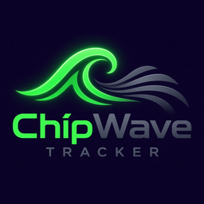
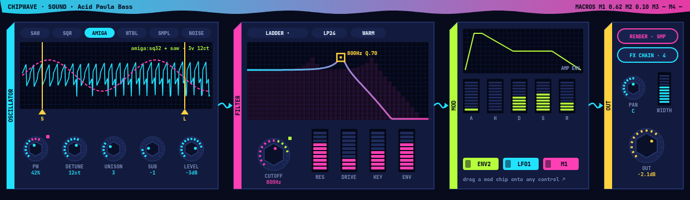
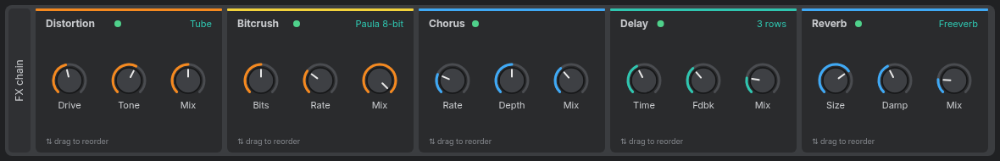
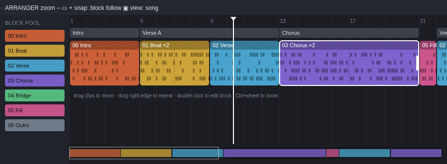

# ChipWave Tracker

<p align="center"></p>

A modern music tracker inspired by **OctaMED** and the Commodore **Amiga**, sister project to [BigWave Radio](https://github.com/postmanpat-303/BigWaveRadio).

**Status:** planning. No code yet.

## Goals
- OctaMED-style workflow: blocks, sections and sequences, the classic keyboard layout
- Sample instruments with loops, volume, transpose, finetune and hold/decay
- OctaMED effect commands, including the quirks that give it its sound
- Load MED (MMD0–MMD3) and MOD files; export WAV and MP3 (song, range, block, stems)
- OctaMED-style instrument list (255 slots) with a sample browser: audition, drag-and-drop, batch import of WAV/AIFF/FLAC/MP3/OGG/IFF 8SVX and samples from modules
- MIDI in/out with MIDI learn, and CLAP/VST3 instrument and effect hosting (sandboxed)
- Native `.cwt` song format: an inspectable ZIP of TOML and WAV files that holds everything
- Optional "Paula" mode for authentic Amiga sound
- **Built-in sound design:** analogue-style synth with Bitwig-inspired filters (SVF, ladder, Sallen-Key…), drag-to-modulate envelopes/LFOs, per-sound FX chain, and render-to-sample
- **Visual arranger:** blocks as coloured clips on a side-scrolling timeline, mapped to OctaMED sections and playing sequences
- Windows 11 and Linux, built in Rust with egui and cpal
- Scales cleanly on any screen: OS DPI and fractional scaling, a user UI-scale setting, vector-drawn widgets, responsive layouts from 1366×768 laptops to 4K, ultrawide and portrait, plus an optional Amiga look

## Roadmap
1. **MVP:** song, sequences and blocks; sample instruments; instrument list + sample browser/importer (preview, drag-and-drop, batch import, core formats, slot remap); core effects; track editor with undo; simple sequence list editor; MMD/MOD load; native `.cwt` save/load; UI scaling basics (OS + user scale, crisp vector widgets and grid text, compact/standard layouts, window modes); WAV and MP3 export (MP3 reuses the same offline renderer, so it's little extra work, and it's the format people actually share)
2. **Phase 1.5:** sound design v1 (synth, SVF + ladder filters, envelopes, LFOs, drag-to-modulate, 4 FX, render-to-sample, TOML presets) and the visual arranger; stem export, loudness normalisation; advanced import options (normalise, resample, Paula crunch, trim, auto loop), module sample extraction; MIDI input (keyboard entry, record, MIDI learn); dockable panels, ultrawide/portrait layouts, per-screen layouts, high-contrast and colour-blind themes. Both sit on top of the proven MVP core (the synth is just a new instrument type, the arranger a richer view of the same sequence data), so they don't risk the playback or file format work.
3. **Phase 2:** OctaMED synth and hybrid sounds, more filter models and FX, wavetables, full mod matrix, sample editor, MIDI output + clock sync, CLAP/VST3 plugin hosting, MOD/XM export, Amiga-mode retro look
4. **Phase 3:** Rhai scripting/plugins, XM/IT import, arranger variation lanes, ChipWave itself as a CLAP/VST3 plugin (nih-plug)

See [docs/PATTERN_EDITOR.md](docs/PATTERN_EDITOR.md) for the core pattern editor and keymap, [docs/PACKAGING.md](docs/PACKAGING.md) for Windows/Linux/macOS packages and CI, [docs/STARTER_SOUNDS.md](docs/STARTER_SOUNDS.md) for the psytrance and alien factory presets, [docs/SAFETY.md](docs/SAFETY.md) for autosave, crash recovery and recent files, [docs/MIXER.md](docs/MIXER.md) for the mixer, [docs/AUTOMATION.md](docs/AUTOMATION.md) for automation lanes, [docs/FIRST_RUN.md](docs/FIRST_RUN.md) for the self-building first-run demo, [docs/SETTINGS.md](docs/SETTINGS.md) for settings, [docs/OCTAMED_SPEC.md](docs/OCTAMED_SPEC.md) for the full OctaMED feature blueprint, [docs/SOUND_DESIGN.md](docs/SOUND_DESIGN.md) for the synth and effects, [docs/ARRANGER.md](docs/ARRANGER.md) for the timeline, [docs/AUTO_ARRANGE.md](docs/AUTO_ARRANGE.md) for fill-to-length auto arrange and quick-start fun features, [docs/EXPORT.md](docs/EXPORT.md) for WAV/MP3 export, [docs/FILE_FORMAT.md](docs/FILE_FORMAT.md) for the `.cwt` song format, and [docs/UI_SCALING.md](docs/UI_SCALING.md) for screen scaling and layouts, [docs/SAMPLES.md](docs/SAMPLES.md) for the instrument list and importer, [docs/MIDI_VST.md](docs/MIDI_VST.md) for MIDI and plugins, [docs/PLUGIN_MANAGER.md](docs/PLUGIN_MANAGER.md) for the plugin manager (scan, verify, activate), and [docs/DESIGN_LANGUAGE.md](docs/DESIGN_LANGUAGE.md) for ChipWave's "Wave Cartridge" visual identity.





## Licence

ChipWave Tracker is free software, licensed under the [GNU General Public License v3.0](LICENSE) (GPL-3.0-or-later).

## Build (v0.1.0, first runnable version)
```
cargo run --release                     # Linux (needs libasound2-dev)
cargo build --release --target x86_64-pc-windows-gnu   # Windows exe from Linux (mingw-w64)
chipwave --self-test [out.wav]          # headless: renders the demo, checks it is not silent
chipwave --render demo out.wav
```
### Keys (0.1.3)
```
  Arrows, PgUp/PgDn, Home/End    move (Ctrl+Home/End = first/last block)
  Tab / Shift+Tab                next / previous channel
  Z S X D C V G B H N J M        notes C..B,  Q 2 W 3 E R 5 T 6 Y 7 U I 9 O 0 P = octave up
  1                              note off
  F1..F8, numpad - / +           base octave (also the - / + buttons by "Oct")
  0-9 A-F                        hex in instrument / volume / effect columns
  Delete / Backspace / Insert    clear (selection) / pull up / push down
  Shift+arrows/PgUp/PgDn, drag   select (highlighted green)
  Ctrl+A                         select channel; press again = whole block
  Ctrl+C / Ctrl+X / Ctrl+V       copy / cut / paste at cursor
  Space / Shift+Space            play/stop current block (loop) / play/stop song
  Enter / Ctrl+Enter             restart block / play from cursor row
  Esc                            edit mode on/off
  Ctrl+Z / Ctrl+Y                undo / redo (edits, paste, arranger changes)
  Alt +/-  (Shift = octave)      transpose selection (or whole channel)
  Ctrl+= / Ctrl+- / Ctrl+0       UI scale up / down / 100 %
  F9 / F10                       mute / solo channel
  Ctrl+Tab, Ctrl+1 .. 5          views: Pattern / Arranger / Mixer / FX / Sample
  FX / Sample view: Up / Down    previous / next instrument
  Sample view: Space             preview; drag = select, drag S/E = loop points
  F12                            key list (Help > Keys)
  Ctrl+Q                         quit
  FX device strip                power = bypass, folder = presets, click name =
                                 collapse, drag name = reorder, right-click = menu
  Ctrl+D / Ctrl+Shift+D          arranger: duplicate clip / as new block (also when docked)
  Mouse wheel                    pattern: 1 row per notch (Shift = 16); arranger: scroll, Ctrl = zoom
  Ctrl+Shift+K                   debug: show the last 10 input events in the status bar
  Arranger (click to focus, light outline + ARRANGER tag): click / Shift+click / Ctrl+click select,
    Ctrl+X / C / V cut / copy / paste after selection (Ctrl+Shift+V = as new blocks),
    Del, Ctrl+A, Shift+Left/Right, right-click menu; click the pattern to focus it again
  Arranger: Left/Right, Del, Ins, Ctrl+D (Shift = unique copy), +/-  zoom
  Ctrl+N / Ctrl+O / Ctrl+S       new / open / save .cwt   (Ctrl+Shift+S = save as)
  Ctrl+E                         export WAV
```
Effects: 01/02 slide, 09 speed, 0C volume, 0D volume slide, 0F tempo (0F00 = break). BPM/speed changes (toolbar or 09/0F) apply instantly while playing.

v0.1.3 adds a basic arranger (song order as clips: drag to reorder, duplicate, insert, delete, click to open, playhead, zoom, dockable), a basic mixer (fader, pan, mute/solo, peak meters, master; saved in `.cwt` as `mixer.toml`), selection + copy/paste, octave buttons and per-instrument transpose. Screenshots: [arranger](dist/screenshot-0.1.3-arranger.png), [mixer](dist/screenshot-0.1.3-mixer.png), [pattern + selection](dist/screenshot-0.1.3-pattern-selection.png).

v0.1.0 has the pattern editor (keys per [docs/PATTERN_EDITOR.md](docs/PATTERN_EDITOR.md)), tracker playback, a simple synth with factory psytrance presets, WAV sample import, `.cwt` save/load, WAV export, the first-run demo song, and Dark Circuit (default) / Amiga themes. Windows build: `ChipWave-0.1.1-windows-x64.zip` on the [Releases page](https://github.com/postmanpat-303/ChipWaveTracker/releases); screenshot: [dist/screenshot.png](dist/screenshot.png).
