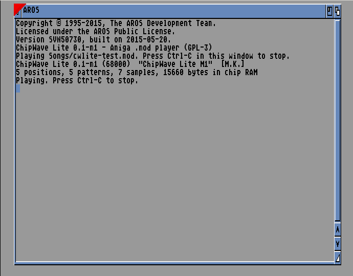

# ChipWave Lite (Amiga)

A small native tracker for AmigaOS 3.1+ that swaps songs with PC ChipWave as ProTracker `.mod` files. The plan, with Del's decisions, is in [`docs/AMIGA_LITE_PLAN.md`](../docs/AMIGA_LITE_PLAN.md).

**Status: milestone M1 (Replay) is done.** `ChipWaveLite` is a Shell command that loads a `.mod` into chip RAM and plays it through Paula with ptplayer. The editor arrives in M2.

## Builds

| Program | CPU | Machines |
|---|---|---|
| `ChipWaveLite` | 68020+ | A1200, A3000, A4000 |
| `ChipWaveLite.000` | 68000 | A500, A500+, A600, A2000 (OCS/ECS). Also runs on a 68020+. |

Both builds come from the same source. Neither needs AGA, fast RAM or any disk-based library, and both run on Kickstart 3.1 and 3.2.

## Usage

```
ChipWaveLite <file.mod>                     play until Ctrl-C
ChipWaveLite <file.mod> LOOPS 1             play the song once
ChipWaveLite <file.mod> SECONDS 30          play for 30 s
ChipWaveLite <file.mod> RESULT RAM:r.txt    also write a result/status file
ChipWaveLite <file.mod> TICKLOG RAM:t.bin [TICKS n] [BENCH]   test mode, see below
```

- **Loading:** the module goes into chip RAM. It must be 4-channel, tagged `M.K.`, `M!K!`, `FLT4` or `4CHN`, and is checked before playing.
- **Playing:** ptplayer runs with `OSCOMPAT=1`. It takes the four audio channels from audio.device and the CIA-B timers from ciab.resource, so it doesn't fight the OS. Tempo comes from CIA timer A; DMA and repeat are set by timer B.
- **Effects:** all ProTracker 2.3 effects (`0`–`F`, `E0`–`EF`).
- **Stopping:** Ctrl-C, the end of `LOOPS`, or the end of `SECONDS`. The player then stops the music, switches audio DMA off, removes its CIA interrupts and frees the channels and memory. The tests check each of these.

## Source tree

```
amiga/
  Makefile               make (both CPUs), make test, make dist
  src/main.c             the CLI program (ReadArgs, chip RAM load, play loop, tick log)
  src/core/mod.[ch]      .mod reader and validator (portable C89, no OS calls)
  src/replay/
    ptplayer.asm         ptplayer 6.4 by Frank Wille (public domain) + 3 marked ChipWave Lite fixes
    replay.s, replay.h   C glue for ptplayer's register calls
    mklog.py             makes the tick-log copy of ptplayer (RAM shadows instead of Paula/CIAs)
  test/                  test song generator, tick-log tools, libxmp reference, FS-UAE runner
  pkg/                   ADF/LHA packaging, ReadMe.txt for the disk
  spike/                 the feasibility spike (kept for reference)
```

### ptplayer changes

ptplayer 6.4 is imported unmodified in commit `a5bcb67`. The next commit makes it behave exactly like ProTracker 2.3, checked against 8bitbubsy's pt2-clone replayer:

1. **7xy tremolo:** PT depth (ptplayer used the vibrato tables, so the tremolo was half as deep), plus PT's ramp-waveform quirk.
2. **5xy/6xy:** the volume slide no longer overwrites the period. It used to cancel the vibrato of `6xy` and the glissando of `5xy`. A latent register bug (a byte loaded into a word index) is fixed as well.
3. **Volume after tremolo:** the channel volume is rewritten on every tick except for `7xy`, as PT does, so a tremolo doesn't leave Paula at a modulated volume.

## Build

You need **m68k-amigaos-gcc** (AmigaPorts, which bundles **vasm**) and python3.

```sh
make AMIGA_GCC=/path/to/m68k-amigaos-gcc      # build/ChipWaveLite, build/ChipWaveLite.000
```

The flags are `-Os -noixemul`, with `-m68020` or `-m68000`. Both programs are about 35 KB.

## Tests (`make test`)

Everything runs headless on Linux. The tests use **vamos** and **xdftool** (amitools), **FS-UAE** with its built-in AROS ROM (no Kickstart file needed), and **libxmp**.

1. **Tick log:** `TICKLOG` runs a second copy of ptplayer whose Paula and CIA registers are RAM shadows, one tick at a time. For each tick it records:
   - DMACON (stop/start);
   - AUDxLC/LEN/PER/VOL after `mt_music`;
   - the repeat LC/LEN after `mt_setrep`;
   - INTREQ, the LED filter bit, `E8x` and the tempo.

   Format: [`test/ticklog.py`](test/ticklog.py).
2. **vamos:** the 68000 and 68020 builds must write byte-identical logs.
3. **libxmp reference:** [`test/xmpref.c`](test/xmpref.c) dumps libxmp's per-tick period, volume and BPM. [`test/compare_ref.py`](test/compare_ref.py) compares them with the log:
   - the lead-in of 5 ticks is skipped;
   - ±1 rounding differences are allowed (PT's period table vs libxmp's computed periods);
   - a one-shot sample that has ended counts as a match;
   - libxmp's own departures from ProTracker are listed and explained in [`test/ref_known_diffs.txt`](test/ref_known_diffs.txt).
4. **FS-UAE + AROS** in four configurations:

   | Config | CPU | Chipset | Memory |
   |---|---|---|---|
   | A500 | 68000 | OCS | 512K chip + 512K slow |
   | A500 | 68000 | OCS | 512K chip only |
   | A500 | 68000 | OCS | 1 MB chip |
   | A1200 | 68020 | AGA | 2 MB chip |

   Each run boots a test ADF whose startup-sequence does the following, writing results to a host folder mounted as `DH0:`:
   1. the tick log, timed with the E-clock;
   2. a full play-through (`LOOPS 1`, timed with `DateStamp`);
   3. a Ctrl-C stop, sent by [`test/cwbreak.c`](test/cwbreak.c) because the ROM has no `Break` command;
   4. a second run, which proves the channels and timers were given back.

**Results (18 Oct 2026):**

| Check | A500 512K+512K | A500 512K | A500 1 MB chip | A1200 |
|---|---|---|---|---|
| Tick log identical to vamos/reference (1230 ticks) | PASS | see `make test` | PASS | PASS |
| `LOOPS 1` length (libxmp: 24.34 s) | 24.34 s | | 24.34 s | 24.34 s |
| Audio DMA off and INTENA restored after exit | PASS | | PASS | PASS |
| Ctrl-C stop, then a clean second run | PASS | | PASS | PASS |
| Replay CPU per tick, average / peak (one tick = 20 ms at 125 BPM) | 1.01 / 1.72 ms (5.0 % / 8.6 %) | | 1.01 / 1.72 ms | 0.45 / 0.84 ms (2.3 % / 4.2 %) |

The CPU times were measured on FS-UAE's cycle-exact A500 and on the A1200 without fast RAM.



## Packaging (`make dist`)

- `dist/ChipWaveLite-0.1-m1.adf`: a bootable disk (FFS). Its startup-sequence starts `ChipWaveLite.000 Songs/cwlite-test.mod` (the 68000 build runs on every Amiga); Ctrl-C stops it. It uses only shell built-ins, so no Workbench files are needed.
- `dist/ChipWaveLite-0.1-m1.lha`: a `ChipWaveLite` drawer with both programs, `Songs/`, `ReadMe.txt` and the licences.

## Trying it in WinUAE

You need a Kickstart 3.1 or 3.2 ROM (Amiga Forever, or the AmigaOS 3.2 package). It can't be bundled.

- **A1200:**
  1. Quickstart: model *A1200*, the basic (non-expanded) configuration: 68020, AGA, 2 MB chip RAM.
  2. Choose your 3.1 or 3.2 ROM under ROM.
  3. Insert `ChipWaveLite-0.1-m1.adf` in DF0: and press Start.
  4. The disk boots into a Shell window and plays the test song. Ctrl-C stops it.
- **A500:**
  1. Quickstart: model *A500* (OCS, 512 KB chip + 512 KB slow is the usual setup). Then choose a Kickstart 3.1 ROM for the A500/A600/A2000 (40.063) in the ROM panel. 1 MB chip (ECS Agnus) or 512 KB chip only work too.
  2. Insert the ADF in DF0: and press Start. The disk runs `ChipWaveLite.000`.
- **From a hard disk:**
  1. Unpack `ChipWaveLite-0.1-m1.lha` (`lha x ChipWaveLite-0.1-m1.lha`) onto a Workbench hard disk; a WinUAE directory hard drive works.
  2. Open a Shell, `cd` into the drawer and type `ChipWaveLite Songs/cwlite-test.mod`. On a 68000 use `ChipWaveLite.000`.
  3. Any 4-channel ProTracker module works.

Don't start the 68020 build on a 68000: the C startup code stops it with a "68020 required" alert. Use `ChipWaveLite.000` there.

## Test song

`test/cwlite-test.mod`, "Paula Steps", is generated by [`test/make_test_mod.py`](test/make_test_mod.py) and dedicated to the public domain (CC0 1.0). It is a short A-minor groove whose synthesised samples exercise every ProTracker effect:
- position 3 must be skipped by a `B` jump;
- the rest of pattern 1 must be skipped by a `D10` break.

## Credits

- **Frank Wille:** ptplayer (public domain), vasm and vlink (with **Volker Barthelmann**).
- **Stefan "bebbo" Franke** and the **AmigaPorts** team: m68k-amigaos-gcc, libnix.
- **Hyperion Entertainment:** NDK 3.2 headers (compile time only).
- **Olav "8bitbubsy" Sørensen:** pt2-clone (BSD-3), used as the ProTracker behaviour reference.
- **libxmp** (Claudio Matsuoka, Hipolito Carraro Jr and contributors, MIT): the reference dump.
- **Christian Vogelgsang:** amitools (vamos, xdftool).
- **Frode Solheim:** FS-UAE. The **AROS Development Team:** the AROS ROM. **Toni Wilen:** WinUAE.

ChipWave Lite is GPL-3.0-or-later; see [`../LICENSE`](../LICENSE).
