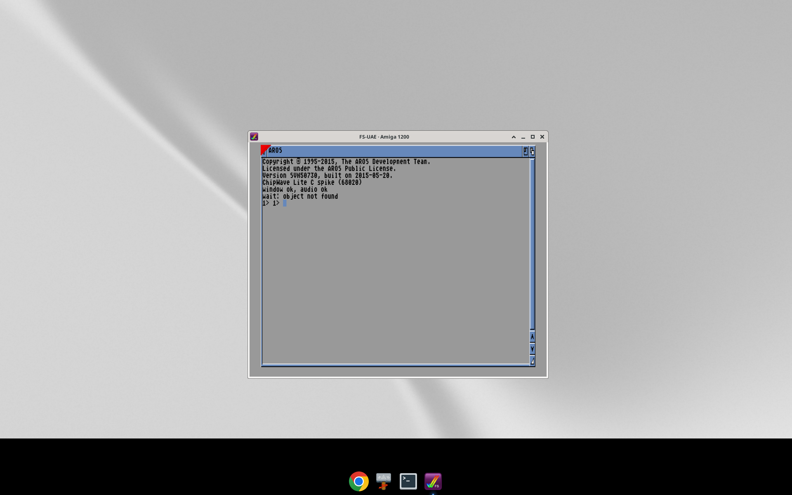

# ChipWave Lite for the Amiga (A500 and A1200): plan

**Status:** plan **approved by Del on 18 Oct 2026** with the decisions in §12. The feasibility spike is in [`amiga/spike/`](../amiga/spike/) and is kept in the repo. Milestone **M1 Replay** (the `ChipWaveLite <file.mod>` CLI player) is in [`amiga/`](../amiga/README.md).

ChipWave Lite is a small native tracker for AmigaOS 3.x (Kickstart 3.1 and later). It is built twice from the same source: a **68000** build for the A500 (OCS/ECS, 512 KB–1 MB chip RAM where possible) and a **68020** build for the A1200 (2 MB chip RAM). It uses no AGA features. Del runs it in **WinUAE** on Windows. It plays four channels through Paula, has an OctaMED-style pattern editor and a Workbench look, and swaps songs with PC ChipWave. It ships as a bootable **.adf** and an **.lha**.

## 1. Spike results (what already works)

All of this ran on the box (Debian 13, x86-64) in about 25 minutes, with no Docker.

| Step | Result |
|---|---|
| Cross compiler | **AmigaPorts m68k-amigaos-gcc 16.2-rc17**, the maintained continuation of bebbo's amiga-gcc. A prebuilt `x86_64-linux.tar.xz` (72 MB download, 343 MB unpacked) includes the NDK headers, libnix, vasm, vlink and vbcc. A C program using `proto/exec.h`, `proto/dos.h` and `proto/intuition.h` compiled to a 4.6 KB 68020 hunk exe. |
| Assembler | **vasm** (m68k, Motorola syntax), built from the GitHub mirror. The hasenbraten.de server didn't answer from the box. It produces hunk executables directly with `-Fhunkexe`. |
| Headless OS test | **vamos** (amitools) ran the asm "hello" on Linux with no emulator: `ChipWave Lite spike: hello from 68020`. It needed `python3-dev` and `greenlet`, and amitools from git; the PyPI 0.8.1 release and machine68k 0.4.1 don't match. |
| Emulator boot | **FS-UAE 3.1.66** (Debian package) in A1200 mode with its **built-in AROS ROM**, so no Kickstart file was needed. It booted an ADF made with `xdftool` (FFS, boot block, `s/startup-sequence`) and ran three programs. |
| Paula, hardware way | The asm beep put a square wave on channel 0 through `AUD0LC/LEN/PER/VOL` and `DMACON`. The DMA bit read back set and wrote `BEEPOK` to a host folder mounted as DH0:. |
| Paula, OS way | The C spike opened a Workbench window titled "ChipWave Lite spike" and allocated a channel through **audio.device**. It played a 1 s beep with `CMD_WRITE` from chip RAM and wrote `window=ok audio=ok`. |
| Packaging | `xdftool` makes bootable ADFs; `jlha` (Debian `jlha-utils`) makes .lha archives, and `lhasa` lists them. |
| Reproduce | `amiga/spike/run_spike.sh` does all of the above. |



**Not proven yet:**
- Listening to the audio. FS-UAE ran with a null audio driver, so success was checked through DMA status and the audio.device return code.
- Running under a real Kickstart 3.x ROM, which we can't bundle.
- A GadTools GUI, and ptplayer replaying a MOD.

## 2. Toolchain and libraries (research)

| What | Choice | Licence / notes |
|---|---|---|
| C compiler | **m68k-amigaos-gcc** (AmigaPorts, after Stefan "bebbo" Franke's amiga-gcc), `-m68000` and `-m68020`, `-Os -noixemul` with libnix | GCC is GPL-3 with the runtime exception; libnix is public domain. Prebuilt for Linux, macOS and Windows (installer). https://github.com/AmigaPorts/m68k-amigaos-gcc · https://codeberg.org/bebbo/amiga-gcc |
| Alternative compiler | **vbcc** by Volker Barthelmann and Frank Wille, with vasm and vlink | Freeware: free for non-commercial use, and binaries for M68k AmigaOS may be distributed. It isn't GPL, but it is only a build tool. A fallback if gcc code is too big or slow. http://sun.hasenbraten.de/vbcc/ |
| OS headers | **NDK 3.2** (Hyperion), bundled with the toolchain as `ndk-include` | Free download from Hyperion. We only compile against it; the headers aren't shipped. |
| Replay routine | **ptplayer 6.4** by Frank Wille (ProTracker 2.3B replay, CIA timed, OS-friendly with `OSCOMPAT=1` through audio.device) | Public domain, so it can be used in GPL-3 code. https://aminet.net/package/mus/play/ptplayer · mirror https://github.com/AmigaPorts/ptplayer |
| Reference trackers | **ProTracker 2.3F** by 8bitbubsy (68k asm, BSD-3). **pt2-clone** (C, BSD-3) for exact replay behaviour. **HivelyTracker** by Xeron/IRIS and Spot/Up Rough (C, AmigaOS build, BSD-3). **ProTracker 3.15 source** (public domain). | All GPL-3 compatible and credited. Mostly used for behaviour and UI reference; any code we take keeps its notice. https://github.com/8bitbubsy/pt23f · https://github.com/8bitbubsy/pt2-clone · https://github.com/pete-gordon/hivelytracker |
| Headless testing | **vamos** (amitools by Christian Vogelgsang, GPL-2+) for CLI and format tests. **FS-UAE** (GPL-2+) with the AROS ROM for boot, GUI and Paula tests. **xdftool** for ADFs. | AROS ROM: AROS Public License, bundled with FS-UAE. |
| Packaging | `xdftool` (ADF), `jlha` (LHA) | |

**How Del runs it in WinUAE:** a Kickstart 3.x ROM is needed, and it can't be bundled. The usual legal sources:
- **Amiga Forever** (Cloanto): the Plus Edition includes the 3.1 ROMs and 3.X.
- **AmigaOS 3.2** (Hyperion): includes the Kickstart 3.2 ROM files for use in emulators.

The quickest WinUAE setup is the A1200 quickstart (68020, 2 MB chip, plus fast RAM if wanted) with the ROM selected and `ChipWaveLite.adf` in DF0:. It boots straight into Lite. With the .lha, unpack it to a Workbench hard disk (a WinUAE directory hard drive works) and double-click the icon.

## 3. Scope of v0.1

**In:**
- Four channels on Paula, played with a ptplayer-based replay (CIA timing, PAL/NTSC). ProTracker effects: `0`–`F` and `E0`–`EF`.
- OctaMED-style pattern editor:
  - 64-row blocks, 4 tracks, note / instrument / effect columns.
  - The Z–M two-row piano keys, arrows, Tab, octave on F1/F2, edit mode on Esc.
  - Space plays the block, Shift+Space plays the song.
  - Delete, Backspace and Insert; cut/copy/paste of a track or block; transpose ±1 and ±12; undo of the last 16 edits.
  - A cursor follows the playing row.
- Song order list (up to 128 positions), up to 64 blocks, up to 31 sample instruments. Each has name, volume, finetune and loop start/length, plus a simple waveform view.
- Load and save **ProTracker .mod** (M.K.). It is the exchange format with PC ChipWave (§5) and Lite's native format in v0.1.
- Load **IFF 8SVX** and raw samples as instruments.
- Workbench look (§6), PAL hires 640×256.
- Mute/solo per track; four channel scopes or VU bars, if the CPU budget allows (§7).
- **About** with credits; a built-in help page listing the keys.
- Runs from the bootable ADF with no Workbench disk, and from Workbench through the .lha.

**Cut, compared with PC ChipWave:**
- the live synth, Voice, Generators, the FX chain, the mixer and limiter, and automation;
- the arranger timeline, Fill to length, the chord helper and the instrument library;
- MIDI, more than 4 channels, MP3/WAV export, themes and UI scaling.

From the PC side, synth, Voice and Generator sounds arrive in Lite as rendered 8-bit samples.

**Maybe later (v0.2+):** the OctaMED MMD0 format, an IFF song format with ChipWave extras (§5.3), 8-channel software mixing, a sample editor, MIDI in through the serial port, and an AGA 256-colour skin.

## 4. Architecture (sketch)

```
amiga/
  src/core/   pattern model, song, MOD/8SVX read-write, effect tables   (portable C89,
              also built for Linux and tested there with the same unit tests)
  src/replay/ ptplayer.asm (Frank Wille, PD) + a thin C wrapper; OS-friendly mode
  src/ui/     screen/window, GadTools gadgets, pattern view (graphics.library Text/ScrollRaster),
              keyboard (IDCMP RAWKEY), own file requester (asl.library if present)
  src/main.c
  test/       unit tests (host), vamos CLI tests, FS-UAE boot scripts
  pkg/        adf.sh, lha.sh, icons
```

- **Shared core:** the core is C89 with no OS calls. It runs on the Amiga, natively on Linux for fast tests, and under vamos.
- **Command-line mode:** `cwlite --check song.mod` and `cwlite --roundtrip in.mod out.mod` let headless tests use the real Amiga binary under vamos, with no GUI.
- **Replay:** ptplayer plays the song from chip RAM. A small patch adds per-channel mute/solo and an "edit while playing" refresh, so a changed cell is heard on the next pass.

## 5. Song exchange with PC ChipWave

### 5.1 PC → Lite: File > Export > Amiga 4-channel (.mod)

New PC ChipWave work for M3.

1. **Choose four channels** in a dialog (default: the first four non-empty ones). The song's order and blocks are exported; blocks over 64 rows are split, shorter ones padded with a break (`D00`).
2. **Instruments become samples.**
   - Sample instruments are converted to 8-bit signed at a rate that keeps the note in Paula's range (period 113–856). Loops are kept.
   - Synth, Voice and Generator instruments are **rendered** at the note they're used most at (Bake does this today), trimmed, resampled to 8-bit and normalised. Optional: one sample per octave used, as separate instruments.
   - The limits: up to 31 instruments, 128 KB each, and a chip RAM budget (default 1 MB total). A warning lists what didn't fit.
3. **Notes:** PC C-1…B-3 maps to MOD; anything outside is folded by octave, with a warning.
4. **Tempo:** a PC row lasts 60 / (BPM × 4) s and doesn't depend on speed (`src/engine.rs` tick_len). A MOD row lasts speed × 2.5 / BPM s. So export writes `F06` (speed 6) and `Fxx` with BPM_mod = BPM_pc; the same works at any speed s with BPM_mod = s × BPM_pc / 6. Tempos outside 32–255 are scaled.
5. **Effects:**

   | PC | MOD | Notes |
   |---|---|---|
   | `01`/`02` slide | `1xx`/`2xx` | rescaled |
   | `0C` volume | `Cxx` | |
   | `0D` volume slide | `Axy` | |
   | `09` speed | `Fxx` (< 20) | |
   | `0F` tempo / break | `Fxx` (≥ 20) / `Dxx` | |
   | `08` note decay | `ECx` (cut at tick), approximate | |
   | `3C` glide | `3xx` portamento | |
   | `30`–`3B`, `3D`–`43` | dropped | listed in the export report |

6. **Volume column:** becomes `Cxx` when the effect column is free.
7. **Report:** a text report (`song-amiga-export.txt`) lists every approximation.

### 5.2 Lite → PC: File > Import > ProTracker .mod

New PC ChipWave work; MOD load is already on the roadmap in OCTAMED_SPEC.md.

- Samples become sample instruments, and patterns become 64-row blocks on 4 channels.
- The `1`–`F` and `E` effects map back where PC has an equivalent. The rest are kept in the cell and shown, but not played until PC supports them.
- A song exported and re-imported unchanged keeps its notes, order, tempo and samples (round-trip test).

### 5.3 Why .mod, and the extension for later

- **Why .mod:** every Amiga and PC tool reads it, ptplayer plays it directly, and it's simple to test byte for byte.
- **What it can't carry:** PC instrument names longer than 22 characters, the original PC song link, channel names, and which PC channel each Amiga track came from.
- **Later, if wanted:** an **IFF FORM CWLT** file (`NAME`, `INFO`, `ORDR`, `PATT`, `SMPL`, plus a `CWPC` chunk with the PC metadata). Lite would save it next to the .mod, and PC import would read the extras when present.

## 6. UI (Workbench look)

Lite uses its own PAL hires screen (640×256, 16 colours), cloned from Workbench where possible (`SA_LikeWorkbench`) so it gets the user's palette and font. The fallback palette is the 3.x grey/black/white/blue, with topaz 8 for the pattern grid. The gadgets are GadTools (3D bevels, Workbench style). It uses **no AGA features**, so the same screen opens on an A500 (OCS/ECS). On OCS/ECS the 68000 build opens the screen with 2 bitplanes (4 colours, 40 KB chip) instead of 4: hires with 4 bitplanes steals most of the chip bus from a 68000 during the display. NTSC machines get the same 640-pixel-wide screen with 200 lines (the pattern view shows fewer rows).

```
+-------------------------------------------------------------------------------+
| ChipWave Lite 0.1                     [Project] [Edit] [Song] [Help]       [=]|
+---------------------------------+---------------------------------------------+
| SONG  Lumen Drift 4ch           | POS 03/12  BLK 05  ROW 1C  BPM 140  SPD 06  |
| [Play Song] [Play Blk] [Stop]   | OCT 3  STEP 1  EDIT [ON]   CHIP 812K FREE   |
+---------------------------------+---------------------------------------------+
| INSTR  01 Kick         v40 ft0  |  ORDER  00 01 02 02 03 [05] 04 06 ...        |
|        02 Bass  saw    v38 ft0  |  BLOCKS 00..0B   [New] [Dup] [Del]           |
|        03 OpenHat      v30 ft0  |  SAMPLE ~~~/\/\/\___/\/\~~~  [Load] [Loop]   |
+-----+-----------+-----------+-----------+-----------+-------------------------+
| ROW |  1 Kick   |  2 Bass   |  3 Hats   |  4 Lead   |   M S  M S  M S  M S    |
+-----+-----------+-----------+-----------+-----------+-------------------------+
|  1A | --- 00 000| C-2 02 000| --- 00 000| --- 00 000|   |||| ||   ||||| |     |
|  1B | --- 00 000| C-2 02 C20| C-4 03 000| --- 00 000|   scopes / VU (if CPU)  |
|> 1C | C-2 01 000| --- 00 000| --- 00 000| E-3 04 300|                         |
|  1D | --- 00 000| C-2 02 000| C-4 03 000| --- 00 000|                         |
|  1E | --- 00 000| C-2 02 000| --- 00 000| G-3 04 000|                         |
+-----+-----------+-----------+-----------+-----------+-------------------------+
| Saved DH0:Songs/lumen-4ch.mod                                    F1/F2 octave |
+-------------------------------------------------------------------------------+
```

- Menus are standard Intuition: Project (New, Open…, Save, Save as…, About, Quit), Edit, Song and Help.
- The current row is highlighted in Workbench blue, beat rows are shaded, and the cursor is the Workbench orange.
- Workbench users get an icon (`ChipWaveLite.info`), and Lite saves songs with icons.

## 7. Memory and CPU budget

### 7.1 A1200 (68020 build)

**Baseline machine:** an A1200 with a 68020 at 14 MHz, 2 MB chip RAM and no fast RAM.

| Item | Chip RAM | Fast/any RAM |
|---|---|---|
| AmigaOS 3.x booted from the ADF, no Workbench | ~250–350 KB used | |
| Lite screen: 640×256, 4 bitplanes (16 colours) | 80 KB | |
| Lite program (code + data) | | ~120–180 KB target |
| Song: 64 blocks × 1 KB + order + instrument headers | | ~70 KB |
| Undo, clipboard, file buffers | | ~60 KB |
| **Samples** (Paula reads chip RAM only) | **budget 1.0–1.2 MB** | |
| Headroom for Workbench, if started from WB | ~300 KB | |

- With fast RAM, everything except samples and the screen moves out of chip RAM, so the sample budget grows to about 1.4 MB.
- The PC exporter defaults to 1 MB of samples and warns above that.
- **CPU:**
  - ptplayer takes about 1–3 % of a 68020/14 per CIA tick.
  - The pattern view redraws only changed rows; while following playback it scrolls one row at a time with `ScrollRaster`, then draws a single row.
  - Scopes: four 64-pixel bars at 25 fps, switched off automatically if a frame overruns.
  - Target: under 40 % CPU while playing with the editor open, so the system stays responsive.

### 7.2 A500 (68000 build)

**Baseline machines:** an A500 or A500+ with a 7.09 MHz 68000 (PAL), OCS or ECS chipset, Kickstart 3.1, booted from the ADF without Workbench. No AGA anywhere.

| Configuration | What it is | Sample budget (chip) | Everything else |
|---|---|---|---|
| **512 KB chip** | stock A500 | **~200–250 KB** | program, song and screen all in chip; the editor screen is 2 bitplanes (40 KB) |
| **512 KB chip + 512 KB slow** | A500 with the usual trapdoor card (slow RAM at `$C00000`, *not* chip) | **~300–350 KB** | program, song, undo and buffers load into slow RAM automatically (AmigaOS puts non-`MEMF_CHIP` allocations there) |
| **1 MB chip** | A500+, or an A500 with an ECS Agnus (8372A) jumpered for 1 MB chip | **~600–650 KB** | as for 512 KB chip |

- Kickstart 3.1 booted from the ADF with no Workbench uses about 100–150 KB of chip RAM on an A500; the CLI player alone is about 20 KB, the editor target is under 120 KB.
- The PC exporter gets an **A500 preset**: a 256 KB or 512 KB sample budget (instead of 1 MB), which renders synth sounds shorter and at lower rates.
- Lite checks free chip RAM before loading a song and reports how much is missing instead of failing halfway.

**CPU on a 7 MHz 68000** (one PAL frame is 20 ms, about 141,800 CPU cycles):
- **ptplayer:** measured in M1 (see [`amiga/README.md`](../amiga/README.md)); roughly 2–6 % of the CPU per tick, with the peak on rows where all four channels start notes with effects. It runs in the CIA-B interrupt, so the GUI can't make it stutter.
- **Editor (M2):** the pattern view redraws only changed rows; while following playback it scrolls by one row (`ScrollRaster` on 2 bitplanes, done by the blitter) and draws one row of text. Target under 50 % CPU while playing.
- **Scopes/VU:** off by default on the 68000 build; VU bars (cheap) can be switched on, scopes are 68020 only.
- **No fast RAM** means the CPU shares the chip bus with the display; the 2-bitplane screen keeps that cost low.

## 8. Milestones

| Milestone | Deliverable | Done when | Rough effort |
|---|---|---|---|
| **M1 Replay** | `cwlite` plays a .mod from the command line through ptplayer (`OSCOMPAT`); C core with the MOD reader; host unit tests | A test MOD and the PC demo exported by hand play in FS-UAE/AROS and WinUAE/KS 3.x; replay register log matches pt2-clone timing within one tick | 2–3 sessions |
| **M2 Editor** | Screen, pattern view, keys, order list, instrument list, play/stop, follow, mute/solo, undo | Notes can be entered and heard while playing; GUI smoke test in FS-UAE produces the expected screenshot | 4–6 sessions |
| **M3 Load/save + exchange** | MOD save, 8SVX load, own file requester; PC ChipWave "Export Amiga 4-channel" and "Import .mod" (Rust, with tests) | PC → .mod → Lite → .mod → PC round trip keeps notes, order, tempo and samples; the export report lists dropped effects | 3–4 sessions |
| **M4 Packaging** | Bootable `ChipWaveLite-0.1.adf` (FFS, boot block, startup-sequence, Lite, a demo song, icons), `ChipWaveLite-0.1.lha` (drawer, icon, docs, demo songs); scripts in `amiga/pkg/`; README section | Both boot or run in FS-UAE/AROS headless, and Del confirms in WinUAE with Kickstart 3.1 or 3.2 | 1–2 sessions |

Each milestone is committed in small green steps. A GitHub release happens only when Del asks.

## 9. Testing

1. **Host unit tests (fast):** build the C core natively on Linux and test MOD read/write byte for byte, the note/period tables, the effect mapping, and the undo and edit operations.
2. **vamos (real 68k binary, no emulator):** `cwlite --roundtrip` and `--check` on test songs, and a 68020 build of the core tests.
3. **FS-UAE + AROS ROM (headless on `DISPLAY=:5`):** boot the release ADF with a test startup-sequence.
   - Lite writes results to a host folder mounted as DH0: (as the spike does).
   - A screenshot is compared against a reference.
   - A **replay log mode** dumps every Paula register write (per tick) to DH0:, compared with a log from pt2-clone or our own reference player on the PC.
   - This checks the audio without needing an audio capture.
4. **PC side:** Rust tests for export/import, plus a golden .mod in `tests/fixtures/`.
5. **Manual:** Del runs the ADF and the .lha in WinUAE with his Kickstart 3.x (a checklist ships with each milestone).

## 10. Risks

| Risk | Mitigation |
|---|---|
| The AROS ROM in FS-UAE is from 2015 and behaves differently from Kickstart 3.1/3.2 (GadTools, fonts, audio.device timing) | Treat AROS as a smoke test only; Del's WinUAE + KS 3.x is the acceptance test; keep to plain, well-documented OS calls |
| No Kickstart or Workbench files can be shipped, so a bootable ADF has only ROM libraries. GadTools and Intuition are in ROM, but **asl.library and iffparse.library are disk-based** in 3.1 | Write a small file requester of our own (use asl when present, e.g. from Workbench); parse IFF ourselves (8SVX is simple) |
| Chip RAM fills up with rendered PC instruments | Exporter budget plus warnings, shorter renders, lower rates for bass and pads |
| MOD can't express PC features (32 channels, synth, effects 30–43) | Clear export report; the IFF extension later if Del wants richer round trips |
| GCC code size or speed on a 68020 | `-Os`, keep the hot paths in ptplayer (asm); vbcc as the fallback compiler |
| Tool hosts go offline (hasenbraten.de didn't answer today) | Pin versions; keep the downloaded toolchain archives on the box; GitHub mirrors (AmigaPorts) |
| CPU time spent on GUI redraws makes playback stutter | Replay runs in the CIA interrupt (independent of the GUI); dirty-row redraw; scopes off by default on slow machines |

## 11. Credits (planned, also for Lite's About and README)

- **Stefan "bebbo" Franke** (amiga-gcc) and the **AmigaPorts** team (m68k-amigaos-gcc)
- **Volker Barthelmann and Frank Wille** (vbcc, vasm, vlink)
- **Frank Wille** (ptplayer, public domain)
- **Hyperion Entertainment** (NDK 3.2)
- **8bitbubsy** (ProTracker 2.3F and pt2-clone, BSD-3)
- **Xeron/IRIS and Spot/Up Rough** (HivelyTracker, BSD-3)
- **Lars Hamre / Amiga Freelancers and Cryptoburners** (ProTracker, PT 3.15 source, public domain)
- **Teijo Kinnunen and Ray Burt-Frost** (OctaMED, the workflow model)
- **Christian Vogelgsang** (amitools: vamos, xdftool)
- **Frode Solheim** (FS-UAE), **Toni Wilen** (WinUAE), the **AROS Development Team** (AROS ROM)
- **Cloanto** (Amiga Forever)

## 12. Decisions (approved by Del, 18 Oct 2026)

| Question | Decision |
|---|---|
| Kickstart / OS baseline | **Kickstart 3.1** is the target. Must also run on **3.2 / 3.2.2**; nothing needs 3.2. Tested headless with the AROS ROM; acceptance is Del in WinUAE with 3.1/3.2. |
| Screen | **Own PAL hires screen, 640×256.** 16 colours on the 68020 build, 4 colours on OCS/ECS (§6, §7.2). NTSC opens 640×200. |
| Minimum RAM | **2 MB chip** is the A1200 baseline (no fast RAM required). The A500 build aims to work with 512 KB–1 MB chip where possible (§7.2). |
| Exchange format | **Plain ProTracker .mod** (M.K.) for v0.1. The IFF `CWLT` extension stays a "later" idea (§5.3). |
| Effect set | **ProTracker effects only** (`0`–`F`, `E0`–`EF`), played by ptplayer. |
| CPU baseline | **Two builds from one source:** `ChipWaveLite` for 68020 (A1200) and `ChipWaveLite.000` for 68000 (A500, OCS/ECS). Both are tested headless in FS-UAE (A500 and A1200 configs). |
| Spike sources | Kept in `amiga/spike/`. |

**Still open (not needed before M3/M4):**
1. **PC export defaults:** which four channels; render synth sounds as one sample, or one per octave; chip budget 1 MB for A1200 and 256/512 KB for A500?
2. **Name and icon:** "ChipWave Lite" with a Workbench-style icon (as in the PC app's Amiga theme)?
3. **Distribution:** host the ADF and .lha in this repo's releases (only when Del approves), and on Aminet later?
