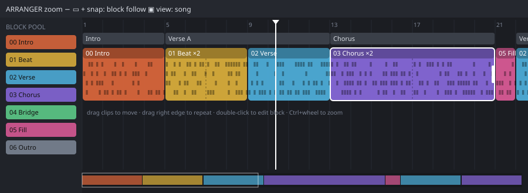

# ChipWave Tracker: Visual Arranger

**Status:** design. No code yet.

The arranger is a side-scrolling timeline where your **blocks** (OctaMED's patterns) appear as coloured clips you drag, resize and repeat. It's another view of the same song structure OctaMED stores as **sections** and **playing sequences**, so MMD files still load and save (see [OCTAMED_SPEC.md](OCTAMED_SPEC.md) §2 and §6).



## 1. Data model

OctaMED MMD2/MMD3 songs are: a **section list** → each entry points to a **playing sequence** (a named list of block numbers) → **blocks** (variable lines and tracks). MMD0/MMD1 have a single play sequence. ChipWave keeps that structure as the source of truth and adds display-only data on top.

```rust
struct Song {
    blocks: Vec<Block>,              // patterns: lines, tracks, name
    sequences: Vec<PlaySeq>,         // == MMD2 playing sequences
    sections: Vec<SeqId>,            // == MMD2 section list (order of play)
    arranger: ArrangerMeta,          // ChipWave-only, ignored by MMD export
}

struct PlaySeq {
    name: String,                    // e.g. "Verse", "Chorus"
    entries: Vec<SeqEntry>,
    colour: Option<Rgb>,             // ChipWave-only
}

struct SeqEntry {
    block: BlockId,
    // ChipWave-only extras; export flattens them (see §4)
    repeat: u16,                     // 1 = play once
    lane: u8,                        // visual row, 0 = main
}

struct ArrangerMeta {
    block_colours: HashMap<BlockId, Rgb>,
    zoom: f32,                       // pixels per line
    scroll: f32,
    markers: Vec<Marker>,            // named song positions
    loop_range: Option<(SongPos, SongPos)>,
}
```

Timeline position is measured in **lines** (rows), not seconds, because block length and tempo vary. The ruler can switch between lines, bars (lines ÷ lines-per-beat × beats) and time (computed from tempo/speed commands as the song is pre-scanned).

## 2. Layout

```
┌ toolbar: zoom − ▭ +  | snap: block/beat/line | follow ▣ | view: song / sections ┐
├ ruler: 1   5   9   13 ...  markers ▼Intro ▼Verse                                ┤
├ section strip: [ Intro ][ Verse ][ Chorus ][ Verse ][ Chorus ][ Outro ]       ┤
├ lane 0:  ███ 00 ███ ██ 01 ██ ███ 02 ×2 ███ ...   (clips, mini pattern preview) ┤
├ lane 1:  (optional overlay / alt lane for variations, see §5)                  ┤
├ block pool (left or bottom): all blocks as draggable chips, unused greyed      ┤
└ mini-map of whole song (click/drag to scroll)                                  ┘
```

- **Clip:** width = block lines × zoom × repeat. Shows block number + name, a colour (auto from block id, user-editable), and a **mini pattern preview**: per-track note density drawn as tiny horizontal ticks (rendered once to a texture, refreshed when the block changes). Repeats draw as faint dividers with "×N".
- **Section strip:** coloured bands above the clips showing which playing sequence each stretch belongs to. Click a band to select the whole sequence.
- **Playhead:** vertical line; with *follow* on, the view scrolls smoothly so the playhead sits about a third from the left (page-flip mode as an option for low CPU).

## 3. Interactions

| Action | Result |
|---|---|
| Drag block from pool → timeline | Inserts a `SeqEntry` at the drop point (snaps to clip boundaries) |
| Drag clip | Moves it; other clips ripple to close gaps (tracker songs have no silence gaps; use an empty block for rests) |
| Alt/Ctrl-drag clip | Duplicate (same block reference) |
| Ctrl+D | Duplicate clip as a **new copy** of the block (unique block) |
| Drag right edge | Changes `repeat` (snaps to whole block lengths). Shift-drag edits block length instead (asks first, since it affects every use) |
| Double-click clip | Opens the block in the track editor; Esc returns to arranger |
| Drag on section strip | Select range → "Make section" turns it into a named playing sequence |
| Wheel / Shift+wheel / Ctrl+wheel | Scroll / scroll horizontally / zoom around cursor |
| Click ruler | Move play position; drag to set loop range |
| Right-click clip | Colour, rename block, make unique, delete, "show all uses" (highlights every clip using this block) |
| Del / Backspace | Remove entry (block stays in pool) |
| Ctrl+Z / Ctrl+Y | Undo / redo (shared undo stack with the rest of the editor) |

Keyboard-only users can do all of it: arrows move the selection clip-by-clip, `[`/`]` change repeat, `+`/`-` zoom, Enter opens the block. This keeps the tracker spirit.

## 4. Mapping to and from MMD

**Import**
- MMD2/MMD3: each section-list entry becomes a section band; its playing sequence's block numbers become clips in order. Sequences referenced several times appear several times (same `SeqId`, so editing one updates all, shown with a link icon).
- MMD0/MMD1: the single play sequence becomes one sequence named "Main", one section.
- MOD: the order list becomes "Main". Consecutive identical entries collapse into one clip with `repeat` (display only; reversible).
- Colours, lanes and markers don't exist in MMD, so they're stored only in the native `.cwt` file.

**Export**
- `repeat = N` is flattened to N consecutive identical block numbers.
- Lanes > 0 (see §5) are exported only if they can be resolved to the main lane; otherwise ChipWave warns and offers to "bounce" them into merged blocks.
- To MMD0/MMD1/MOD (no sections): sections are concatenated into one sequence.
- Round-trip test: MMD → ChipWave → MMD must produce an identical section list and playing sequences when nothing was edited.

## 5. Later: variation lanes (phase 3, optional)

A second lane lets you lay an alternative block under a clip (e.g. drum fill) and choose per playthrough which one plays. Because MMD has no notion of this, it stays in the native format and is flattened on export. Listed here so the data model leaves room for it; not planned for the first arranger.

## 6. Rendering in egui

- Custom widget using `egui::Painter` (rects, text, lines) inside a `ScrollArea`; only clips intersecting the visible range are painted.
- Mini previews cached as `TextureHandle`s keyed by block id + edit counter.
- Drag-and-drop with egui's `dnd_drag_source` / `dnd_drop_zone` (pool → timeline) and manual pointer handling for clip moves/resizes.
- Playhead position comes from the audio thread through an atomic (song position in lines), read once per frame.

## 7. Roadmap placement

**Phase 1.5**, together with the synth, with a minimal **sequence list** in the MVP. Reasoning:
- The MVP needs some way to order blocks to prove sequence playback and MMD round-trips. A plain list editor (like OctaMED's) is a few hours of work and directly mirrors the file format.
- The arranger is a richer *view* over exactly that data. Building it right after the MVP means the data model and playback are proven first, and the arranger can't introduce format bugs.
- It's high-impact for how the app feels, so it shouldn't wait for phase 2.
