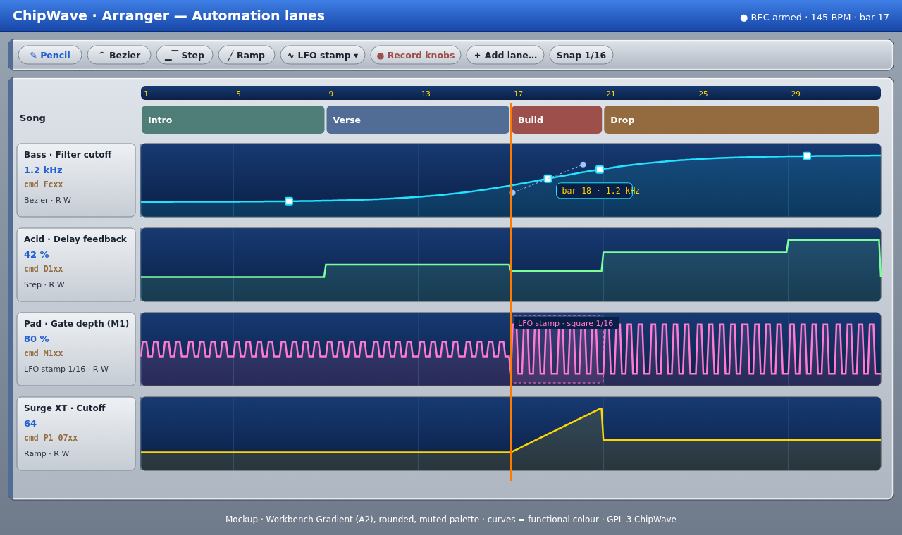

# Automation

 (SVG: [`mockups/automation.svg`](mockups/automation.svg))

> **Redesign proposal (Oct 2026):** [research/automation-ux.md](research/automation-ux.md): lanes under each track with a Device > Parameter picker, value scale, Read/Touch/Latch, clip envelopes and a unified Filter card.
>
> **Stage 1 (Unreleased):** lane headers show **Device > Parameter** (generated from the target); colour follows the parameter family (cutoff cyan, resonance magenta, volume green, pan amber…); a **value scale** (Hz / dB / %) sits on the left of each timeline lane; points are larger; **double-click** adds a point (a plain click no longer does); the "+ Lane" menu has a **search** box; **Add automation lane** from a knob in timeline mode creates a **track** lane (does not switch the lower panel away from the Instrument editor, and does not duplicate an existing lane).

Automation lanes sit **under the arranger blocks** ([ARRANGER.md](ARRANGER.md)), drawn as glowing curves on dark CRT-style lanes: the "visually cool" part. Curve colours are functional (one saturated colour per lane), while block colours stay muted ([DESIGN_LANGUAGE.md](DESIGN_LANGUAGE.md)).

## 1. Lanes
- **Any parameter** can have a lane:
  - synth patch parameters and macros
  - generator knobs: Drum/Kit macros, Chip FX, Analog, FM-4 and Noise (`instrument.N.gen.K`, see [GENERATORS.md](GENERATORS.md#automation-lanes-on-generator-knobs))
  - FX devices
  - mixer faders, pans and sends
  - CLAP/VST3/LV2 plugin parameters (CLAP effect parameters: `instrument.N.fx.D.p<param id>`, 0–1 over the parameter's range, see [FX.md](FX.md#plugin-effects-clap-unreleased))
  - tempo
  - synth-patch knobs without a target of their own (pulse width, detune, ADSR, glide, LFO depths…: `instrument.N.patch.<key>`, Unreleased)
  - a modulation routing's depth (`mod.K.amount`, −100..+100 %, Unreleased): **Lane** on the Routings card ([MODULATION.md](MODULATION.md))
- **Modulation** (Unreleased) adds on top of a lane: a modulated parameter moves around the lane's value ([MODULATION.md](MODULATION.md)).
- **Adding a lane:** "＋ Add lane…" (searchable, using the same list as the effect autocomplete in [PATTERN_EDITOR.md §6](PATTERN_EDITOR.md)), right-click a knob → "Automate", or just move a knob while recording.
- **Lane header:** name, current value in real units, the matching effect command (e.g. `cmd Fcxx`), the curve type, and **R** (read) / **W** (write) toggles. Lanes can be collapsed, reordered, coloured and grouped per channel.
- **Song or block scope:**
  - **Song lanes** run across the arranger timeline (the default).
  - **Block lanes** belong to a block and repeat wherever that block is played, which is good for per-pattern wobbles.
  - Both are shown, with block lanes drawn inside the block's span.

**Timeline lanes (Unreleased):** in timeline mode a lane can also live under a track or inside a clip, and the innermost one wins (clip, then track, then song). Linear segments can be bent into curves by Alt-dragging them there. See [TIMELINE.md › Automation lanes](TIMELINE.md#automation-lanes).

## 2. Drawing
| Tool | Behaviour |
|---|---|
| **Pencil** | Freehand; points are thinned (Ramer–Douglas–Peucker) so the curve stays light. |
| **Bezier** | Click to add points. Each segment is a cubic with draggable handles; Alt-drag the segment bends it. |
| **Step** | Values hold until the next point (good for tracker-style changes). |
| **Ramp** | Straight line between points; Shift constrains to 0/45/90°. |
| **LFO stamp** | Drag a range and pick shape (sine, tri, saw, square, S&H, random), rate (synced 1/64–8 bars), depth and phase. It writes points that stay editable, or a live "LFO segment" kept as a parameter set until flattened. |
| Select / move | Box-select points, drag, scale vertically (Ctrl-drag) or time-stretch. Copy/paste between lanes with unit conversion. |

Snapping uses the arranger grid (1/16 by default), with Shift to bypass. Hovering a point shows a readout in real units ("bar 18 · 1.2 kHz").

## 3. Recording
- **Record knobs:** arm with "● Record knobs" (or `Ctrl+R` in the arranger). While playing, moving any on-screen knob or a **MIDI-learned** controller ([MIDI_VST.md](MIDI_VST.md)) writes points.
- **Modes:** *Touch* (writes while held, then returns to the existing curve), *Latch* (keeps the last value until stop), *Overwrite*.
- Recorded data is thinned on stop. Undo removes the whole pass in one step.
- **Plugins:** parameter changes coming from plugin GUIs (CLAP param events, VST3 `performEdit`, LV2 port events) are recorded the same way.

## 4. Link with tracker effect commands
Tracker commands and lanes are two views of the same idea:
- **Commands win locally:** an effect command like `Fc80` in the pattern sets the value at that row, overriding the lane until the lane's next point. This is documented and shown as a small marker on the lane.
- **Convert lane → commands:** writes the curve into the block's effect column at the chosen resolution (each row, or only on changes). Useful for MMD export and for people who prefer the pattern view.
- **Convert commands → lane:** reads a column of `Fcxx`/`D1xx`/`Pn ppxx` commands into a lane.
- MMD export bakes lanes into commands where the target maps to an OctaMED command (volume `0C`, tempo `0F`, etc.). Other lanes are dropped, with a warning list.

## 5. Engine
- Lanes are evaluated per sub-block (32–64 samples, as in [SOUND_DESIGN.md §9](SOUND_DESIGN.md)). Bezier segments are pre-tessellated into a lookup with linear interpolation, and parameter values are smoothed.
- Lanes are stored in `.cwt` as `automation/*.toml`: points `(song_pos_lines, value_normalised, curve_kind, handles)` plus a target id resolved through the song's target table, so moving or renaming a device keeps its automation.

**Implemented in 0.1.7 (first working version):** song-scope lanes under the arranger (show/hide), targets synth cutoff/resonance/drive, instrument amp level, mixer channel volume/pan, master volume and tempo. Breakpoints: click to add (snaps to lines, Shift = free), drag to move, right-click to delete; per-segment shapes Linear/Step/Smooth; Pencil tool (one point per line, no thinning yet). Glowing curve on a dark lane, playhead, value readout. The engine evaluates lanes every 32 samples with smoothing, in realtime and in WAV export; saved in `.cwt` as `automation/NN.toml` (`pos` in lines, `value` normalised 0..1, `shape`); undoable. The first-run demo loads both lanes; lane 2 (delay feedback) maps to the bass filter resonance until a delay return exists. Deferred: block-scope lanes, Bezier handles, recording knobs (touch/latch), LFO stamp, box-select, command ↔ lane conversion, MMD baking, lane reorder/colour/collapse, effect-command override markers.

