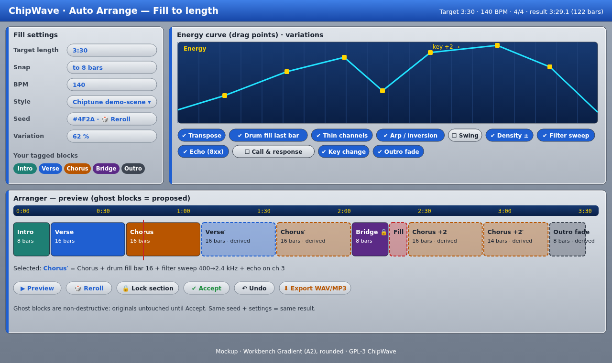

# Auto Arrange: Fill to length, plus Fun & Fast

Del's ask: *"fun to use, easy to get results out quick into a working track… if the user has created an intro, a chorus etc, an option to fill to a certain time length with some music computational variations."*

 (SVG: [`mockups/auto_arrange.svg`](mockups/auto_arrange.svg))

Builds on the arranger data model in [ARRANGER.md](ARRANGER.md): blocks → play sequences → section list. Auto Arrange only *proposes* a new section list plus derived blocks; nothing is changed until you press Accept.

## 1. Workflow
1. **Tag blocks with roles:** Intro, Verse, Chorus, Bridge, Breakdown, Outro or Fill. Right-click a block, or press `1`–`7` in the arranger. Untagged blocks are ignored. One role can hold several blocks (Chorus A/B).
2. **Pick a target length** (e.g. 3:30) and a **snap** setting (1 / 4 / 8 / 16 bars). Bar length is computed from BPM, speed and lines-per-beat (`bar_secs = beats_per_bar × 60 / bpm`). The generator works in whole bars and reports the real result, e.g. *3:29.1 (122 bars)*. Tempo changes inside blocks are handled by the same pre-scan the ruler uses.
3. **Pick a style template:** Pop, Chiptune demo-scene, Club build/drop or Ambient.
4. Press **Generate**. Ghost blocks appear in the arranger. **▶ Preview** plays them, **🎲 Reroll** tries a new seed, **🔒 Lock** keeps a section on reroll, and **Accept** or **Undo** commits or discards the proposal (one undo step).

## 2. Style templates
A template is a small TOML grammar plus a default energy curve, user-editable in `~/.config/chipwave/arrange/`.

| Style | Skeleton | Typical lengths | Variations favoured |
|---|---|---|---|
| Pop | I V C V C B C C O | 4–8 bar intro, 16-bar verse/chorus | Key change before final chorus, drum fill, thin verse 2 |
| Chiptune demo-scene | I V C V′ C′ B F C+ O | 8-bar units | Arpeggio variants, echo via tracker effects, octave shift, fast fills |
| Club build/drop | I Bd(build) C(drop) Bk V Bd C O | 16/32 bars | Filter sweep, density increase into the drop, mute kick in the breakdown |
| Psytrance (145) | I(32) V Bd F C(drop) V Bd F C O(32) | 16-bar units, 7:00 default | Filter sweeps, mute kick in the breakdown, risers into drops, echo. Full template in [STARTER_SOUNDS.md](STARTER_SOUNDS.md) |
| Ambient | I V B V′ O, long repeats | 16–32 bars | Density reduce, slow filter, ritardando outro |

```toml
# pop.toml
[grammar]
start = ["Intro"]
next.Intro   = [["Verse", 1.0]]
next.Verse   = [["Chorus", 0.8], ["Verse", 0.2]]
next.Chorus  = [["Verse", 0.5], ["Bridge", 0.3], ["Outro", 0.2]]
next.Bridge  = [["Chorus", 1.0]]
end = ["Outro"]
max_repeat = 2
energy = [[0.0,0.2],[0.3,0.6],[0.5,0.5],[0.75,1.0],[1.0,0.1]]
```

If a role is missing (no Bridge tagged, say), the generator skips it or makes a derived stand-in (a thinned Verse) and says so in the result panel.

## 3. Generator (deterministic and seeded)
Same blocks + settings + seed always give the same result. It uses a `rand_chacha::ChaCha8Rng` seeded from the 64-bit seed shown in the UI.

```text
fn fill_to_length(blocks, template, target_bars, energy, seed, locks):
    rng = ChaCha8(seed)
    best = None
    repeat N=200 candidates:
        path = walk template grammar from start, weighted by rng, keeping locked sections fixed
        lengths = for each section: base bars of its tagged block(s)
        # fit: adjust repeats/trims until total == target (within snap)
        while total(path) < target: grow the section with the highest (energy-fit gain / bars), repeat ≤ max_repeat, else insert a Fill or an extra Verse→Chorus pair
        while total(path) > target: shrink: drop a repeat, then trim to half length (only if the block length divides), then remove the optional Bridge
        score = |total-target| * 10 + energy_mismatch(path, energy) + monotony_penalty(path) + template_deviation(path)
        keep best by score
    assign variations to best (§4) driven by energy delta and rng
    return Proposal { sections, derived_blocks }
```

- **Structure graph:** the grammar is a weighted Markov graph over roles. Locks are fixed nodes the walk must pass through in place.
- **Fitting by repeats:** exact length comes from repeat counts and Fill blocks (1, 2 or 4 bars) as padding. If no exact fit exists at the chosen snap, it picks the nearest result and shows the difference (e.g. "−0.9 s").
- Cost: 200 candidates × ~20 sections is microseconds, so preview is instant and runs off the audio thread.

## 4. Variation transforms (non-destructive)
A **derived block** stores `source: BlockId` plus an ordered list of transforms. It's rendered to real pattern data on demand and cached. Edit the source and every variant updates. Accept keeps them as derived blocks; "Bake" turns one into an ordinary block. MMD export always bakes them.

```rust
struct DerivedBlock { source: BlockId, ops: Vec<VarOp>, seed: u64 }
enum VarOp {
    Transpose(i8), OctaveShift { channels: ChanMask, oct: i8 },
    DrumFillLastBar { channel: u8, density: f32 }, MuteChannels(ChanMask), ThinChannels(ChanMask, f32),
    Arpeggiate { channel: u8, pattern: ArpShape }, ChordInvert { channels: ChanMask, steps: i8 },
    Swing(f32), Density(f32),  // <1 removes weak-beat notes, >1 adds ghost notes on the scale
    FilterSweep { from_hz: f32, to_hz: f32, curve: Curve }, // writes synth automation lane
    EchoFx { channel: u8, delay_lines: u8, feedback: u8 },  // uses tracker volume/delay commands in free channels
    CallResponse { call: ChanMask, answer: ChanMask },      // copies bar 1–2 phrase to answer channel in bars 3–4, transposed by a scale step
    KeyChange(i8), FadeOut { bars: u8 }, Ritardando { bars: u8, end_bpm_pct: u8 },
}
```

| Transform | How (implementable) | Default use |
|---|---|---|
| Transpose / octave shift | Shift note numbers; clamp to the sample's range; skip drum channels (tagged) | Verse 2, final chorus |
| Drum fill on last bar | Replace the last bar of the drum channel with a template fill (rolls, toms) seeded by rng | Before every Chorus |
| Mute / thin channels | Clear a channel, or drop notes with probability p (off-beats first) | Intro, breakdown, verse 1 |
| Arpeggio / chord inversion | Detect chord notes per row across channels; rotate the inversion or emit `0xy` arpeggio commands | Chiptune repeats |
| Swing | Delay odd 16ths via delay command `Fxx`/note-delay | Style-dependent |
| Density ± | Remove weak-beat notes or add passing notes from the detected scale (simple Krumhansl key profile) | Builds and ambient |
| Filter sweep | Automation lane on the synth cutoff, start→end over the block | Club builds |
| Tracker echo | Echo note copies at lower volume in a free channel, N rows later | Demo-scene |
| Call and response | Copy the phrase from channel A to channel B a bar later, shifted by a scale degree | Bridge |
| Key change | +1 or +2 semitones from the block before the final chorus to the end | Pop |
| Outro fade / ritardando | Volume ramp over the last N bars; tempo commands lowering BPM by up to 20 % | Outro |

Variation intensity scales with the **Variation %** knob. Transforms are chosen where the energy curve rises (add density/fills/sweeps) or falls (thin/mute/fade).

## 5. Energy curve UI
- A CRT display with draggable square handles (A2 style), from 0 to 1 over song time. Double-click adds a point; right-click removes it.
- Each style has a default curve. Dragging re-scores live (debounced 100 ms) and updates the ghost blocks.
- Section energy is estimated from note density, active channels and average volume, so the generator can match sections to the curve.

## 6. Arranger integration
- **Ghost blocks:** translucent fill with a dashed outline; derived ones are labelled *derived* with a ′ mark. Hovering shows the transform list.
- **Time display:** live total versus target in the header, plus a time ruler.
- **Live preview:** loops the ghost song from the cursor. Click a ghost block to audition just that one.
- Keys: `G` generate, `R` reroll, `L` lock, `Enter` accept, `Esc` / `Ctrl+Z` undo.

## 7. Fun & fast
- **Quick-start templates:** File → New from template (Chiptune, Pop, Club, **Psytrance 145**, Ambient, Amiga MOD 4-channel). Each comes with a tempo, instrument slots filled from the bundled sample pack, a drum block and an empty tagged Verse/Chorus.
- **First track in 5 minutes:** a skippable onboarding overlay. (1) Pick a template. (2) Type a melody in the Chorus block (keyboard as piano, step highlighted). (3) Press 🎲 for a bass line from the chord guess. (4) Fill to length 2:30. (5) Export. Progress dots, no account, never pops up again once dismissed.
- **Randomise patch:** 🎲 on the sound designer randomises within musical limits (cutoff 200 Hz–8 kHz, envelope sane, levels capped) and keeps a history so you can step back.
- **Happy-accident dice:** in any block, randomly applies one transform from §4 to the selection (also seeded and undoable), e.g. "inverted chords on ch 2".
- **Instant export:** `Ctrl+E` renders WAV/MP3 with the last settings ([EXPORT.md](EXPORT.md)) and shows the file in a toast with "Open folder".

## 8. Roadmap
- **Phase 2:** roles, generator, Pop/Chiptune templates, transforms Transpose/Fill/Mute/Thin/KeyChange/Fade, ghost preview and accept/undo, quick-start templates, instant export.
- **Phase 2.5:** energy curve editing, the remaining transforms, Club/Ambient templates, onboarding, dice.
