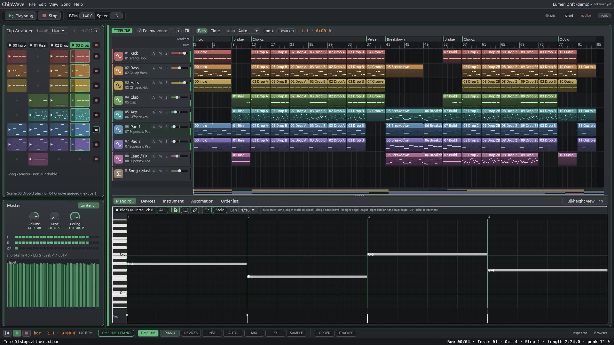

# Clip Arranger

A grid of **scenes** and **slots** on the left of the Timeline, one row per track, lined up with the
timeline's track rows. Inspired by other DAWs' session views. It takes the place of the left
Instruments list on the Timeline; **Ctrl+8** or **View › Clip Arranger** switches between the two.
The Tracker view keeps its Instruments list.

## Scenes and slots

| | What it is | Click |
|---|---|---|
| **Scene** (header button) | block N (`03 Drop B`) | every track plays block N, looping, from the next bar |
| **Slot** (one per track and scene) | the track's column of block N, with a mini preview of its notes | ▶ plays just that track: in the playing scene it joins at the next bar; otherwise scene N starts with the other tracks held |
| **■** at the end of a row | | that track stops at the next bar |
| **■** in the header | | everything stops at the next bar |

- A dot is an empty slot (no notes in that column).
- The playing scene is lit; the slots that play have an accent outline and a progress bar. While the
  arrangement plays, the slot of the block under the playhead on each track is lit instead.
- A queued scene, slot or stop has a pulsing outline until its bar line (steady with Settings › Look ›
  Reduce motion). Clicking a queued scene again takes it back.
- **Launch** (top right): **1 bar**, **½ bar**, **Beat** or **Off** (the next row). Bars follow the
  timeline's time signature.
- **Drag a slot onto the timeline:** it lands as an ordinary **Tracker clip** (block + column) on the
  bar under the mouse, as long as the block. One undo step.
- **Double-click a slot** to open that block and column in the Tracker.
- **‹ ›** page through the scenes when there are more than fit.
- The Song / Master row isn't launchable.

### Songs with note clips

A song with note or audio clips (every new song, recorded takes, Drum Kit patterns) has no Tracker
blocks to show, so its scenes are the **clip start times** instead: one scene per start (named after a
marker there, else *Bar 5*), and each track's slot holds its clip that starts there, with a preview of
its notes. A scene ▶ loops that stretch of the timeline on every track; a slot ▶ loops its clip with
the other tracks held (or joins the playing scene). Double-click a slot to open the clip. Songs whose
clips are all Tracker clips keep the blocks as scenes.

Instruments live in **Browser › Instruments** and in the **Inspector** (I): its Instrument section has
a picker for the selected track (every note on the track switches, one undo step).

## Master

Under the grid: **Volume** (the mixer's Master fader), the limiter's **Drive** and **Ceiling**, a
**Limiter on / off** switch, L / R level and gain-reduction meters, short-term loudness and true peak,
and a level graph of the last few seconds. The same settings as Mixer › Master.

## How it plays (phase 1)

- A scene launch is the Tracker's block loop ("loop block N"), switched on a boundary. From the
  arrangement it stops the timeline there (note and audio clips fade out) and loops the block.
- Stopped tracks are held silent through their mixer gain (a short ramp, no clicks); launching a whole
  scene plays every track again. Play, Stop and Panic clear everything.
- Real-time safe: a click queues a small `Cue` (plain data) for the engine under the same lock as every
  other engine call; the render thread applies it on the boundary row inside the row step, with no extra
  locks or allocation (`src/engine/launch.rs`, tested with an allocation counter).
- Nothing is saved in the song: the panel reads the song's blocks and the timeline's tracks. Songs open,
  save and play exactly as before (a test renders with and without the launcher and compares). The
  on / off switch and the Launch setting are app settings.

## Not yet (phase 2, see [ROADMAP.md](ROADMAP.md))

Independent per-track slots (track 1 plays block 3 while track 2 plays block 5), dragging note-clip slots,
and recording a session into the timeline.
