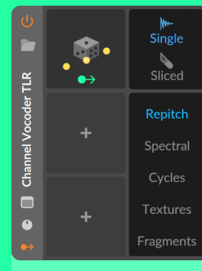

# ChipWave Design Language: "Wave Cartridge"

**Status:** design, chosen direction. Applies to every ChipWave screen.

ChipWave keeps the *functions* Del liked in Bitwig (horizontal device strips, a live draggable filter curve, a waveform display with markers, knobs that show modulation, drag-to-modulate) but has its **own look**. The Bitwig Sampler screenshot in [`reference/`](reference/del-visual-reference-bitwig-sampler.png) was **functional inspiration only**. None of its visual style is reused.

## 1. Two directions explored

| | **A: Workbench Modern** | **B: Wave/Neon** (recommended) |
|---|---|---|
| Idea | Amiga Workbench 3.1 grey bevels redone flat: light grey cartridges, deep-blue CRT displays, blue/orange/yellow accents | BigWave Radio's "wave" identity: deep ink-navy, a cyan→magenta gradient, neon lime/yellow accents, CRT displays with a pixel grid |
| Mockup | [`mockups/variants/sound_designer_A_workbench_modern.png`](mockups/variants/sound_designer_A_workbench_modern.png) | [`mockups/variants/sound_designer_B_wave_neon.png`](mockups/variants/sound_designer_B_wave_neon.png) |
| Strengths | Instantly reads as "Amiga"; very distinct from dark DAWs; high contrast | Ties ChipWave and BigWave Radio together as a family; comfortable for long night sessions; colours stay vivid on any monitor |
| Weaknesses | Light UI is tiring in dark studios; its blue + orange accents edge back towards common DAW colours | Neon has to be used sparingly so it doesn't get noisy |

**Decision: B "Wave/Neon"**, with Workbench Modern kept as the basis of the optional **Amiga mode** skin ([UI_SCALING.md §9](UI_SCALING.md)). Both use the same shapes and layout described below, so a skin only changes the palette and the bevels.

## 2. Distinguishing choices (what makes it ChipWave, not Bitwig)
| Element | ChipWave | Avoided Bitwig hallmark |
|---|---|---|
| **Modules** | **Cartridges**: panels with a cut (45°) top-left corner, like a game cartridge, and a **coloured vertical spine on the left edge** carrying the module name in rotated monospace caps (OSCILLATOR, FILTER, MOD, OUT) | Flat, evenly rounded charcoal panels with small top headers |
| **Signal flow** | Visible **wave-shaped patch arrows** between cartridges, in cyan, showing audio flowing left to right | A plain row of panels |
| **Knobs** | **Hex-cap LED-ring knobs**: a hexagonal cap with a dot pointer, ringed by **15 discrete LED segments** | Round knobs with a thin continuous arc |
| **Faders** | **"Chip" faders**: vertical segmented LED meters in a recessed slot (Res, Drive, Env, ADSR) | Thin vertical sliders with a cap |
| **Displays** | **CRT style**: near-black blue, an 8-px pixel grid, faint scanlines, gradient or neon traces | Smooth flat dark displays |
| **Filter curve** | Gradient (cyan→magenta) line; modulation sweep drawn as **stepped pixel columns**; a **square** handle | Smooth filled curve |
| **Markers** | Yellow lines with **triangle feet and letters below** the display (S = start, L = loop) | Flag markers at the top |
| **Modulation** | Mod sources are **chips** (coloured pills: ENV2, LFO1, M1) you **drag onto a control**. LED segments inside the modulated range light in the **source's colour**, and a small coloured square next to the knob shows each assigned source | Routing-button mode plus coloured arcs |
| **Source selection** | **Pill tabs in a row** at the top of the cartridge | A left-hand column of mode tabs |
| **Top bar** | A **wave band**: a gradient header with a wavy bottom edge, holding the patch name and macros | — |
| **Actions** | Rounded **outline pills** inside the OUT cartridge (RENDER ▸ SMP, FX CHAIN · 4) | A right-hand column of buttons with coloured top strips |
| **Playhead** | A **wavy yellow line** with a triangle cap (arranger and tracker) | A straight line |
| **Type** | Monospace caps for labels and values (JetBrains Mono, OFL), giving a tracker/terminal feel | Proportional sans |
| **Warnings** | **Guru red** (`#FF2A3D`) on black, in a blinking-border box, like an Amiga Guru Meditation | — |

## 3. Palette (Wave/Neon)
| Token | Hex | Use |
|---|---|---|
| `bg` | `#070B1C` | window background |
| `bg2` | `#0D1430` | toolbars, secondary areas |
| `panel` | `#121B3D` | cartridge body |
| `panel2` | `#18234D` | pills, knob wells |
| `edge` | `#2A3A78` | outlines (1.5 px) |
| `display` | `#050817` | CRT displays, fader slots |
| `grid` | `#13204A` | 8-px display grid |
| `led_off` | `#1F2B5C` | unlit LED segments |
| `text` | `#E6F0FF` | primary text |
| `dim` | `#7F8FBF` | labels, hints |
| `cyan` | `#22E3FF` | primary accent: oscillators, audio arrows, LFOs |
| `magenta` | `#FF3FB4` | filter, PWM/mod overlays, render |
| `lime` | `#B6FF3C` | envelopes, "on" lamps |
| `yellow` | `#FFD23F` | markers, handles, playhead, output |
| `violet` | `#8B5CFF` | extra clip colour |
| `guru_red` | `#FF2A3D` | warnings, clipping |
| gradient | `#22E3FF → #FF3FB4` | wave band, filter curve, branding |

**Colour roles by module:** Oscillator cyan, Filter magenta, Mod lime, Out yellow. FX cartridges take their category colour (drive/space magenta, crush yellow, chorus cyan, echo lime). Modulation chips use their source's colour: envelopes lime, LFOs cyan, macros magenta, tracker-command lanes yellow.

**Colour-blind-safe set:** swap to the Okabe–Ito accents ([UI_SCALING.md §8](UI_SCALING.md)). Mod chips also carry a letter prefix (E/L/M) so colour is never the only cue.

**Workbench Modern palette** (Amiga-mode skin): bg `#8E98A6`, panel `#C3C9D1`, display `#0F2B5B`, grid `#1D3F78`, text `#101418`, accents blue `#1F5FD1`, orange `#FF7A00`, yellow `#FFD400`, white; 2-px white/grey bevels.

### Workbench Gradient (A2) refinement
Del liked variant A. Variant **A2** adds soft gradients to it: [`mockups/variants/sound_designer_A2_workbench_gradient.png`](mockups/variants/sound_designer_A2_workbench_gradient.png). Rules:
- **Direction:** gradients are always **vertical**, light at the top and slightly darker at the bottom (light from above, like Workbench bevels). There are no diagonal or radial gradients and no glow, which keeps it flat-modern and unlike DAW-style dark panels.
- **Background:** `#9AA5B4` to `#6F7A8A`.
- **Cartridge body:** `#DFE4EA` to `#AEB6C1`. A cartridge is at most about 20 % darker at the bottom, so text contrast stays above WCAG AA everywhere.
- **Pills and knob wells:** `#EEF1F4` to `#C6CCD4`.
- **Header band:** Workbench blue, `#3F7FE6` to `#1747A8`, with a 1 px `#0D2F75` line underneath.
- **CRT displays:** `#173A72` to `#0A1F45`, with grid lines in `#24477F`.
- **Bevels:** 2 px gradient strokes. The highlight runs `#FFFFFF` to `#C9D0D8` (top-left edges) and the shadow `#7D8794` to `#3E4652` (bottom-right). They're reversed for inset elements such as displays and fader slots.
- **Spines, accents, LEDs and text** stay flat solid colours. Gradients are for surfaces only, never for data such as curves, LEDs or values, so information reads instantly.
- **Readability:** yellow (`#FFD400`) is used only on dark display surfaces. On light panels, values use blue `#1F5FD1` or orange `#FF7A00`. (The A/A2 mockups still show the Out value in yellow on grey; that will be fixed in the implementation.)
- **egui:** egui has no gradient fill for rects, so gradients are drawn as a `Mesh` with per-vertex colours (top two vertices light, bottom two dark). That's cheap and stays crisp at any scale. Rounded or cut corners use a tessellated path with vertex colours interpolated by y.

### Muted palette ("not too cartoonish")
Del's rule: the UI must not look cartoonish. **Surfaces and labels are desaturated; full saturation is reserved for functional data.**
| Role | Muted colour | Used for |
|---|---|---|
| Slate blue | `#516D96` | spines, Verse blocks, CLAP tag, "New" badge, active toggle pills |
| Sage green | `#4E7D5B` | Verified badge, on-toggles |
| Brick red | `#9C4F4B` | Failed badge, mute-on, Build/Fill blocks |
| Plum | `#6B5C82` | Blocked badge, Bridge/Pad, LV2 tag |
| Ochre | `#946B3E` | Chorus/Drop blocks, VST3 tag, FX tag |
| Teal grey | `#4F7D78` | Intro blocks |
| Graphite | `#4A525E` | Outro, CMD tag, neutral |
- **Saturated colours are for data only:** curves and meters (cyan `#22E3FF`, green `#7CFF9B`, magenta `#FF7AD0`, yellow `#FFD400` on dark displays), the cursor, the play position (`#FF7A00`), and values on light panels (blue `#1F5FD1`, or green `#2F6B3F` for status text).
- Badges are white text on the muted fill, which keeps contrast ≥ 4.5:1.
- No more than one saturated accent per control. No emoji-like icons as decoration; icons are monochrome glyphs.
- The plugin manager, auto arrange and pattern editor mockups were re-rendered with this palette. Mockup sources are in [`mockups/src/`](mockups/src/).

### Corner radius (modern rounded look)
Del asked for a more modern touch, so all surfaces get rounded corners. Values are in logical points and scale with `pixels_per_point`, like everything else ([UI_SCALING.md](UI_SCALING.md)).
| Element | Radius |
|---|---|
| Windows / dialogs / top-level panels | 10 |
| Cartridges | 8 (the spine is clipped to the same radius) |
| Buttons, pills, toggles, search fields | fully rounded (height ÷ 2); square tool buttons 6 |
| Status badges and format tags | pill-shaped (height ÷ 2) |
| CRT displays (inset) | 6, with the inset bevel following the curve |
| List row highlights, arranger blocks | 6 |
| Knob wells | circles; slider thumbs 4 |
- Data marks (curve handles, LEDs, pixel-grid sweeps) stay square on purpose; that's part of the Wave Cartridge identity.
- **egui:** set `Visuals.window_corner_radius`, `widgets.*.corner_radius` and `menu_corner_radius` via `CornerRadius::same(n)` (the type was called `Rounding` before egui 0.31). Painter rects take a `CornerRadius` directly. Gradient meshes with rounded corners use the tessellated-path approach above.

## 4. Component spec (for egui)
**Cartridge**
- Body `panel`, 1.5 px `edge` outline, square corners except a 14 px 45° cut at top-left.
- Spine: a 14 px wide strip on the left in the module colour, with the name rotated −90° in monospace caps, 10 px, weight 800, in `bg`.
- 26 px gap between cartridges holds the patch arrow: a 2.5 px cyan S-curve with an arrowhead.

**LED-ring knob**
- Hexagon cap (point-up rotated 30°) of radius r: 11 small, 13 standard, 20–22 large. Fill `#0A1028`, outline `edge`, 2.6 px dot pointer in the accent at 55 % of r.
- Well: a circle of radius r+9 in `panel2`.
- Ring: 15 radial segments, 3.2 px thick, from r+3 to r+7, sweeping 270° from bottom-left.
  - Unipolar values light from the start; bipolar ones light from the centre segment.
- **Modulation:** segments between the base value and base+amount light in the source colour. When the patch plays, the live position blinks one segment brighter. Small 6×6 source squares sit at the knob's top-right.
- Labels: monospace caps 9 px `dim` below; value 9 px in the accent below that.
- Interaction: vertical drag (Shift = fine), double-click resets, wheel nudges, right-click opens the menu. **Drop a mod chip** on the knob to create a routing, then drag the knob while hovering the chip's square to set the depth.

**Chip fader**
- Recessed `display` slot (30×62–78 px) with 10 LED blocks lit from the bottom in the accent, `led_off` otherwise.
- Drag vertically; modulated blocks show the source colour like the knob.

**CRT display**
- `display` fill, 8-px `grid` lines at 0.6 px, scanlines every 3 px at 18 % black.
- Traces 1.6–3 px. Handles are square with a 2.5 px yellow outline.
- Integer-snapped to physical pixels ([UI_SCALING.md](UI_SCALING.md)).

**Pills**
- Height 18–26 px, fully rounded. Selected: accent fill with `bg` text. Unselected: `panel2` with `dim` text. Action pills use an accent outline and accent text.

**Mod chip**
- 64×22 px, radius 4, in the source colour, with a grip square on the left and a monospace label (E·ENV2, L·LFO1, M·M1).
- Dragging it shows a cyan "cable" from the chip to the cursor, and valid targets get a dashed outline.

**Wave band header**
- 22 px gradient band with a sine-wave bottom edge (amplitude 3 px, period ~190 px) that drifts slowly when audio plays. Turned off by "reduce motion".

All of it is drawn with `egui::Painter` as vectors, so no assets are needed. The only bundled font is JetBrains Mono (OFL).

### Device side strip (implemented in 0.1.8, FX view)

Each device or instrument panel in a chain has a slim vertical strip (about 22 px) on its left edge:

| Position | Element |
|---|---|
| Top | **Power** toggle (bypass). Off dims the whole device. |
| Below it | **Preset / folder** icon: open the preset browser for this device. |
| Middle | **Device name**, written sideways (rotated 90°, reading bottom-to-top). Clicking the name collapses the device to just the strip; clicking again expands it. |
| Lower | **Collapse / window** icon: collapse, or pop the editor out into its own window (plugins). |
| Bottom | **Routing / output** icon: where the device sends its output (next device, a send, a sidechain). |

- The strip uses the theme `accent`, tinted per device type and kept muted: for example, instruments a little warmer, filters/EQ cooler, dynamics neutral, and time-based FX (delay/reverb) violet. A bypassed device's strip turns grey.
- Collapsed devices keep their order and stay draggable by the strip, so a long chain still fits on screen.
- **egui implementation:** draw the strip with `Painter` (a rounded rect plus icon buttons via `ui.put`). Render the name with `epaint::TextShape` and `angle = -FRAC_PI_2` (the galley laid out normally, then rotated about its position), so it reads bottom-to-top. Hit-test the name with an interact rect matching the rotated bounds.

## 5. Mockups
- Sound designer: [`mockups/sound_designer.png`](mockups/sound_designer.png) / `.svg`
- FX chain: [`mockups/fx_chain.png`](mockups/fx_chain.png) / `.svg`
- Arranger: [`mockups/arranger.png`](mockups/arranger.png) / `.svg`
- Instrument list + browser: [`mockups/samples.png`](mockups/samples.png) / `.svg`
- MIDI + plugins: [`mockups/midi_plugins.png`](mockups/midi_plugins.png) / `.svg`
- Variants: `mockups/variants/sound_designer_A_workbench_modern.*`, `mockups/variants/sound_designer_A2_workbench_gradient.*`, `mockups/variants/sound_designer_B_wave_neon.*`

## Themes

Del's direction (Oct 2026): the Amiga look is an option, not the default.

| Theme | Status | Notes |
|---|---|---|
| **Dark Circuit** | **Proposed default** | Modern dark grey gradient panels, a thin muted green outer border and glow, and green focus/selection. Mockups: [pattern editor](mockups/variants/pattern_editor_dark_green.png), [sound designer](mockups/variants/sound_designer_dark_green.png) |
| **Amiga (Workbench Gradient, A2)** | Optional | Light grey gradients with a Workbench-blue header. [Mockup](mockups/variants/sound_designer_A2_workbench_gradient.png) |
| Workbench Modern (A) | Optional / legacy | Flat Amiga variant |
| Wave/Neon (B) | Optional | The original cartridge look |

Every theme uses the same layout, corner radii and functional colours (meters, curves, play position). Only the tokens below change. The Dark Circuit mockups are made from the A2 SVGs with `mockups/src/theme_dark_circuit.py` (a token-mapping recolour), which is also a cheap way to preview any theme.

### Theme tokens

| Token | Dark Circuit | Amiga (A2) |
|---|---|---|
| `bg` (window gradient) | `#24272B` → `#17191C` | `#9AA5B4` → `#6F7A8A` |
| `header` band | `#2A2D31` → `#1F2124`, 1 px `#4CAF6A` rule | `#3F7FE6` → `#1747A8` |
| `panel` / cartridge gradient | `#33373C` → `#26292D` (slightly lighter than bg) | `#DFE4EA` → `#AEB6C1` |
| `pill` / button gradient | `#3A3F45` → `#2C3035` | `#EEF1F4` → `#C6CCD4` |
| `display` (pattern grid, scopes) | `#1A1C1F` → `#121416` | `#173A72` → `#0A1F45` |
| `border` (outer window and panels) | `#4CAF6A` at 1 px, plus a 3 px glow at 35 % on the window edge | `#3E4652` |
| `accent` (focus, selection, active) | `#5CC07A` | `#1F5FD1` |
| `selection_fill` | `#2E4A37` | `#C9D9F5` |
| `beat_row` highlight | `#2B3A30` | `#24477F` @ 55 % |
| `text` | `#D4D8DD` | `#1B2330` |
| `text_dim` | `#AEB4BC` / `#7E8790` | `#2C3644` |
| `value` (numbers) | `#E8C35A` amber / `#5CC07A` green | `#FFD400` / `#1F5FD1` |
| `warn` / record | `#D9605A` | `#C62828` |
| `spine` (module) | `#3F7A55` (and the shared amber/orange spines) | `#516D96` |

The green is muted on purpose (around `#4CAF6A`, never neon), so the look stays grown-up and not cartoonish. Bright colours are kept for meters, curves and the play position.
