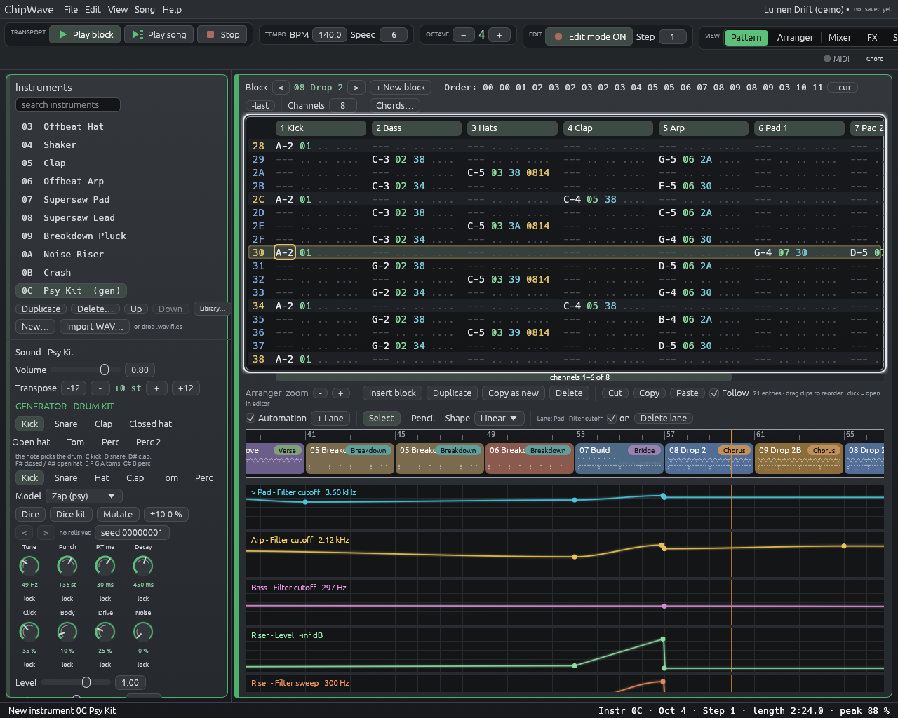
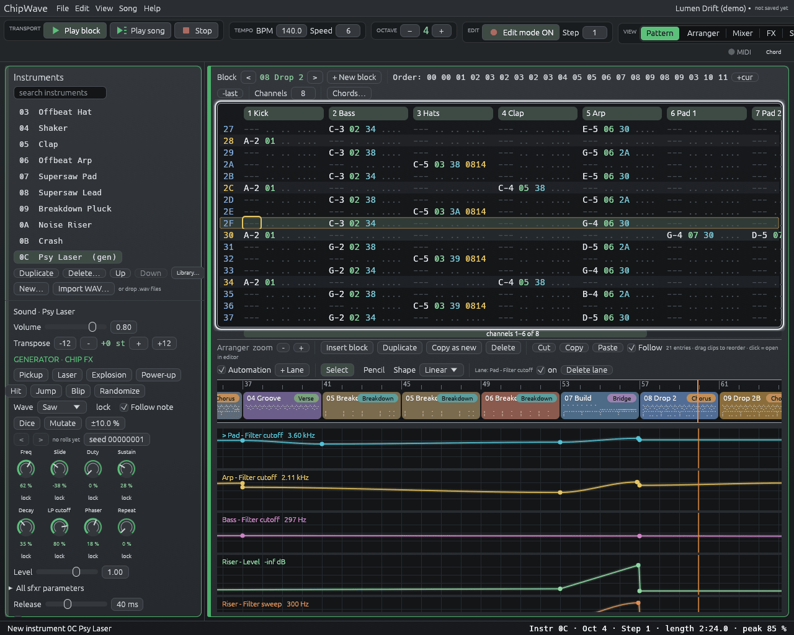
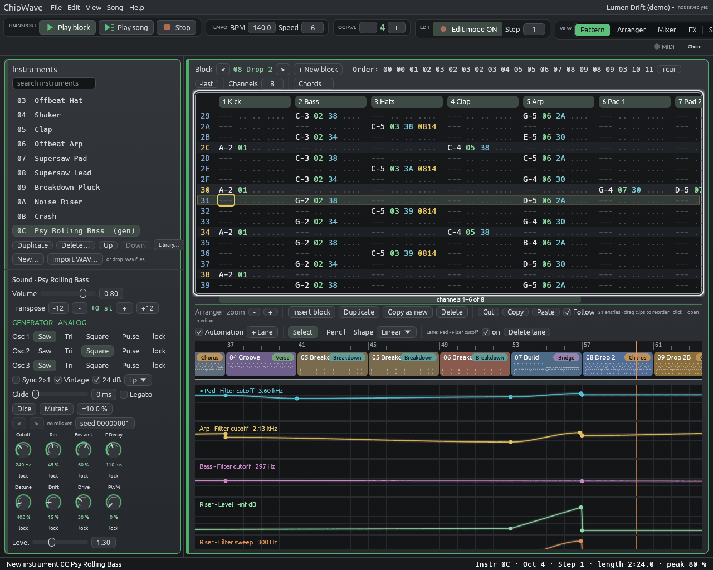
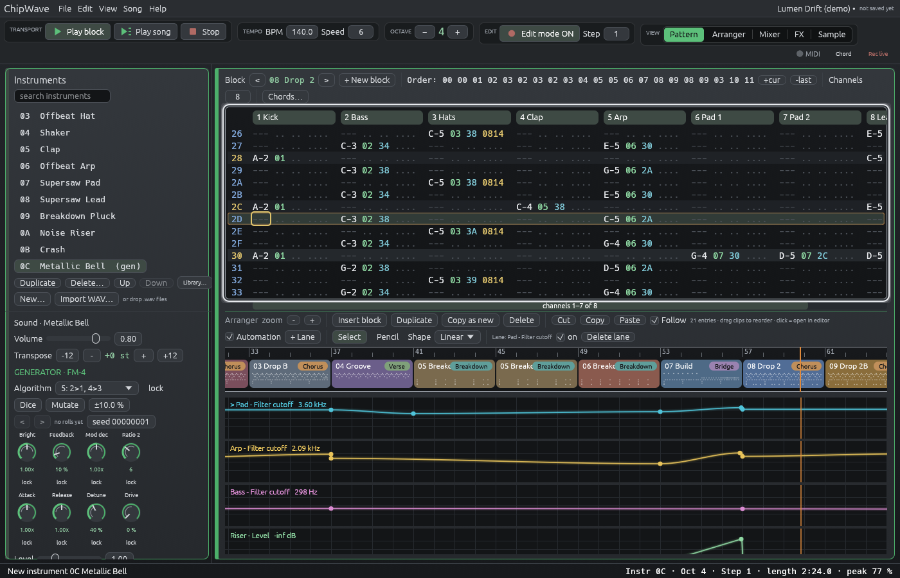
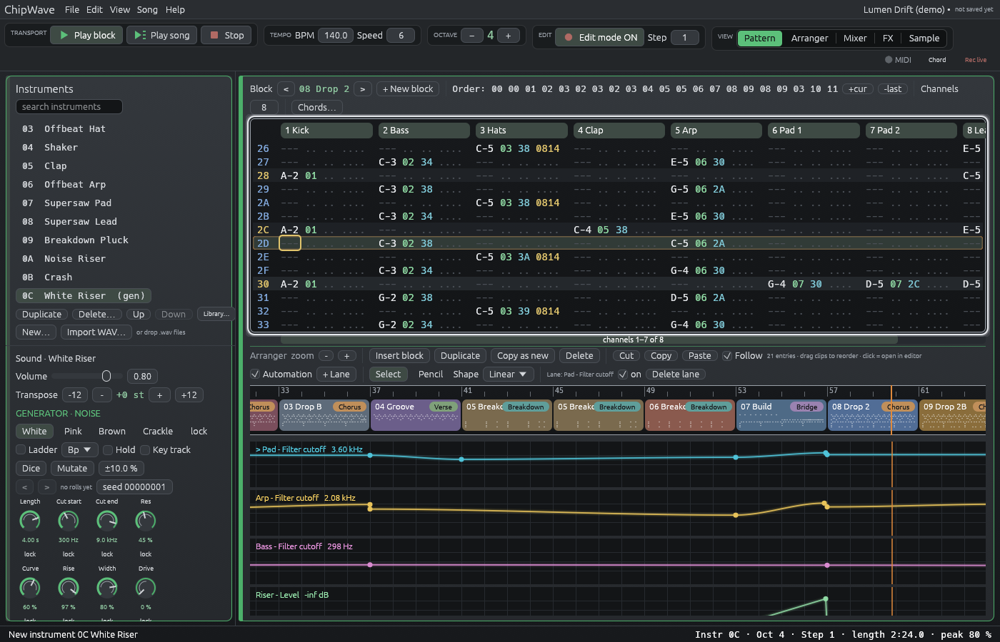
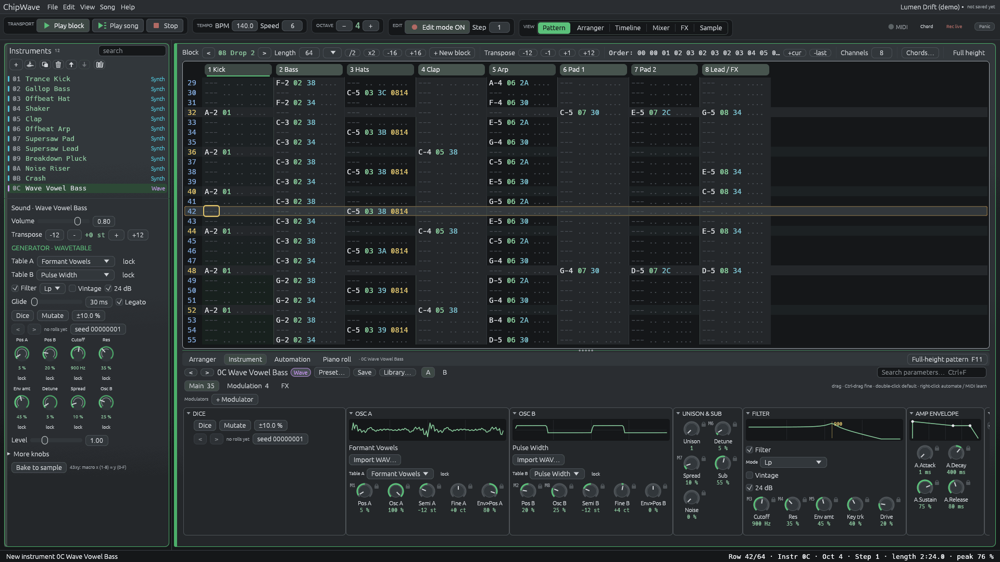

# Generators (0.2.3.12 – 0.2.3.14)

| Generator | Since | New… menu | Presets |
|---|---|---|---|
| [Drum Synth and kits](#drum-synth) | 0.2.3.12 | Generator (drums) | kicks, snares, hats, claps, toms, percs, kits |
| [Chip FX](#chip-fx-02313) (sfxr) | 0.2.3.13 | Generator (chip FX) | Coin, Laser Shot, Explosion, Power Up, Hit, Jump, Blip, Psy Laser |
| [Analog](#analog-02314) | 0.2.3.14 | Generator (analog) | Fat Moog Bass, Psy Rolling Bass, Warm Lead, Brass, Dark Pad, Acid Squelch |
| [FM-4](#fm-4-02314) | 0.2.3.14 | Generator (FM-4) | E-Piano, Metallic Bell, Psy Zap Bass, Growl, Dark Pluck |
| [Noise](#noise-02314) | 0.2.3.14 | Generator (noise) | White Riser, Downlifter, Impact, Wind, Vinyl Crackle |
| [Wave](#wave-wavetable-unreleased) (wavetable) | Unreleased | Generator (wavetable) | Wave Supersaw, Wave Vowel Bass, Wave Glass Keys, Wave Evolving Pad, Wave Chip Pluck, Wave Growl |

52 presets in all; every one is also in the instrument library under "generator".

Generators are instruments that synthesise a sound from a few **macro knobs**
instead of playing a sample or a full synth patch. Each one can be rolled with
**Dice**, nudged with **Mutate**, locked knob by knob, stepped back through
its last 16 rolls and **baked** to a sample. Research notes:
[research/sound-generators.md](research/sound-generators.md).

Add one from the instrument list with **New… > Generator (drums)** (kits,
kicks, snares, hats, claps, toms, percussion) or **New… > Generator (chip FX)**
(sfxr-style game sounds, 0.2.3.13), or, since 0.2.3.14, **Generator (analog)**,
**Generator (FM-4)** and **Generator (noise)**.

## Drum Synth

Six drum kinds, each with several models and eight macros. Recipes follow the
Sonic Pi **sc808** SynthDefs (after Yoshinosuke Horiuchi's SuperCollider
TR-808) and the **Plaits** / **DaisySP** analog drum models; all are
independent Rust implementations, with no samples.

| Kind | Models | Macros |
|---|---|---|
| Kick | v0 (punchy sine), 808, 909, Zap (psy) | Tune, Punch, P.Time, Decay, Click, Body, Drive, Noise |
| Snare | 808, 909, Shell (modal) | Tune, Tone, Snappy, Decay, Color, Click, Ring, Drive |
| Hat | 808 metal, Ring mod, Comb + FM | Tune, Decay, Metal, Tone, Color, Width, Click, Drive |
| Clap | 808, Tight | Tone, Decay, Spread, Claps, Q, Room, Width, Drive |
| Tom | 808 tom, Conga | Tune, Punch, P.Time, Decay, Click, Noise, Body, Drive |
| Perc | Cowbell, Claves, Rimshot, Cymbal, Zap | Tune, Decay, Tone, Color, Ring, Click, Width, Drive |

- **Pitch:** C-4 plays the drum as tuned. With **Follow note** on (the
  default), other notes transpose it, so a kick can be tuned to the song key.
  The Psy Zap Kick is tuned to E (41.2 Hz at C-4).
- **Knobs:** drag (Shift = fine), scroll, or double-click to reset to the
  middle of the dice range. The faint arc shows the range Dice rolls in.
- **Level, Release and Filter:** an optional filter after the drum (SVF or
  the Moog ladder, LP/BP/HP, cutoff, resonance).

### Kit mode

A kit holds eight pieces (Kick, Snare, Clap, Closed hat, Open hat, Tom, Perc,
Perc 2). The note picks the piece:

| Note | Piece |
|---|---|
| C | Kick |
| C# | Perc |
| D | Snare |
| D# | Clap |
| E, F, G, A | Tom at −7, −4, 0, +4 st |
| F#, G# | Closed hat |
| A# | Open hat |
| B | Perc 2 |

The octave transposes the piece around C-4. A channel is monophonic, so a
closed hat cuts an open hat on the same channel (choke). Put pieces that
should overlap on different channels. Presets: **Psy Kit** and **808 Kit**.

## Dice

- **Dice** rolls every unlocked knob of the selected drum within sensible
  ranges. **Dice kit** rolls every piece of a kit.
- **Mutate** moves each unlocked knob by up to ±N % (the number next to it)
  around its current value.
- **lock** under a knob keeps it out of Dice and Mutate.
- Every roll stores its **seed** (shown as hex). Typing a seed re-rolls that
  exact sound.
- **< / >** step through the last **16 rolls**. Ctrl+Z undoes knob changes
  and rolls like any other edit.
- **Bake to sample** renders the sound at C-4 (48 kHz, mono, tail trimmed, up
  to 8 s) into a new Sample instrument named "<name> (baked)", with the same
  volume and FX.

## Chip FX (0.2.3.13)

A port of **sfxr** by Tomas Pettersson (DrPetter), by way of **sfxr-rs** by
Teemu Erkkola (both MIT).

- **Sound engine:**
  - a square / saw / sine / noise / triangle oscillator, with frequency
    slide and delta slide, a minimum frequency (the sound stops there), duty
    sweep, vibrato and one arpeggio jump
  - an attack / sustain / decay envelope with punch
  - a resonant low-pass and a high-pass, each with a sweep
  - a phaser and a repeat
  - 8x supersampling at 44.1 kHz, resampled to the song rate
- **Category buttons:** **Pickup**, **Laser**, **Explosion**, **Power-up**,
  **Hit**, **Jump** and **Blip** each roll a new sound from sfxr's recipe for
  that category.
- **Randomize:** sfxr's anything-goes roll. It also rolls the wave, and the
  attack is capped so the sound stays audible.
- **Dice:** rolls again in the last category.
- **Mutate:** sfxr's mutate. Each parameter has a 50 % chance to move by up
  to ±N % of its half range; ±10 % matches sfxr's ±0.05.
- **Locks:** a **lock** keeps a parameter (or the wave) through every roll.
  Seed, history and **Bake to sample** work as for the drums.
- **Knobs:**
  - eight knobs show the main parameters: Freq, Slide, Duty, Sustain, Decay,
    LP cutoff, Phaser, Repeat
  - **All sfxr parameters** opens the other 15
  - with **Follow note**, C-4 plays the sound as designed and other notes
    transpose it
- **Presets:** Coin, Laser Shot, Explosion, Power Up, Hit, Jump, Blip, Psy
  Laser.
- **43xy:** sets knob x (1–8) to y (0–F). Chip FX reads it when the note
  starts, as sfxr computes a sound from its parameters at the start.
- **Text songs:** `patch = "gen:Coin"`, with optional overrides in
  `[instrument.gen.engine.ChipFx]` (for example `wave = "Triangle"` or
  `level = 0.5`).

Changes from sfxr:

- the saw is a plain ramp, and triangle is a real triangle
- the negative arpeggio follows the original sfxr (sfxr-rs flips its sign)
- zero-length envelope stages don't divide by zero
- seeded rolls replace sfxr's unseeded `rand()`
- nothing allocates while the sound plays
- "Vib delay" is stored but unused, as in sfxr

## Analog (0.2.3.14)

The Analog generator is a Moog-style synth voice: three oscillators, noise, the ladder filter, two ADSR envelopes and glide.

- **Oscillators:** each one is Saw, Tri, Square or Pulse. Saw and pulse use polyBLEP; the triangle is an integrated band-limited square. Each oscillator has its own level, plus octave (osc 2 and 3: Oct ±2) and semitone (osc 2) settings.
- **Detune** spreads osc 2 and 3 by up to ±40 cents. **Drift** adds a slow random walk of pitch (up to about ±15 cents) and random start phases, so no two notes are identical. **PWM** (depth and rate) and **Width** shape the pulse. **Sync 2>1** hard-syncs osc 2 to osc 1.
- **Filter:** the ChipWave Zavalishin ladder, **Vintage** by default (saturated, 2× oversampled), with LP/BP/HP modes, 12 or 24 dB, key tracking and a filter envelope.
- **Amp:** an ADSR, then soft saturation (**Drive**).
- **Glide** and **Legato** use the instrument's glide time. Overlapping notes slide like a mono synth.
- **Macros (43xy):** 1 Cutoff, 2 Res, 3 Env amt, 4 F.Decay, 5 Detune, 6 Drift, 7 Drive, 8 PWM. **More knobs** holds the oscillator levels, octaves, envelopes, key tracking, PWM rate and width.
- **Dice** keeps osc 1 audible. The "lock" next to each wave keeps it.

| Preset | Sound |
|---|---|
| Fat Moog Bass | 3 saws (−1 oct), 24 dB vintage, glide |
| Psy Rolling Bass | short, dark, plucky saw/square for offbeat psy bass in E or F# |
| Warm Lead | saw + square, gentle filter, glide |
| Brass | saws with a slow filter attack |
| Dark Pad | detuned saws, slow attack, low cutoff |
| Acid Squelch | single saw, high resonance, snappy envelope, glide |

## FM-4 (0.2.3.14)

FM-4 has four sine operators arranged by one of the **8 four-operator algorithms** of the Yamaha DX21 / DX100 / TX81Z (from a 4>3>2>1 stack to four carriers). Each operator has a **ratio** (20 steps from 0.5 to 16), a level and an ADSR. Operator 4 has **feedback**, averaged over two samples as in Dexed/MSFA.

The macros are Bright (modulation index), Feedback, Mod decay, Ratio 2, Attack ×, Release ×, Detune and Drive. Operator settings are under **Operators**, and "lock" next to the algorithm keeps it on Dice.

| Preset | Sound |
|---|---|
| E-Piano | two 1:1 / 14:1 pairs, tine attack |
| Metallic Bell | inharmonic ratios, long decay |
| Psy Zap Bass | fast-decaying index, a zappy psy bass |
| Growl | feedback stack, gritty |
| Dark Pluck | short, low-index pluck |

## Noise (0.2.3.14)

The Noise generator makes risers, downlifters, impacts and textures.

- **Colours:** white, pink (Paul Kellet's filter), brown (a leaky integrator) or crackle (Poisson clicks like SuperCollider's Dust, with **Density**, plus **Hiss**).
- **Filter:** the **Ladder** or the SVF (LP/BP/HP). The cutoff sweeps from **Cut start** to **Cut end** over **Length** (up to 16 s), and **Curve** shapes the sweep. **Rise** places the loudness peak.
- **Hold** keeps the sound at the peak while the note is held (wind, vinyl); otherwise it is a one-shot. **Gust** adds random cutoff motion, **Thump** adds a low sine hit for impacts, and **Width** decorrelates left and right.

Presets: White Riser, Downlifter, Impact, Wind, Vinyl Crackle.

## Wave (wavetable, Unreleased)

**New… > Generator (wavetable)**. A wavetable synth in the Generator family,
so Dice, Mutate, locks, Bake, 43xy, automation lanes, MIDI learn and
drag-to-modulate all work on it.

- **Two oscillators (A, B):** each plays a **table** (a stack of single-cycle
  frames) and scans it with **Pos A / Pos B** (0 % = the first frame, 100 % =
  the last; neighbouring frames crossfade smoothly). **Semi** (±24 st), **Fine**
  (±50 ct) and a level each. The card shows the current frame.
- **No aliasing:** every frame is stored as 10 band-limited **mipmaps**
  (512, 256, … 1 harmonics, built with an FFT when the table is made). Each
  note plays the richest level whose top harmonic stays below Nyquist, so even
  a 3 kHz saw is clean (tested: alias images below −74 dBFS).
- **Unison:** 1–8 voices per oscillator, **Detune** (up to ±50 cents across
  the stack) and **Spread** (stereo). One voice is mono and centred.
- **Sub** (a sine an octave below A) and **Noise** (white).
- **Filter:** ChipWave's ladder (LP / BP / HP, 12 or 24 dB, clean or
  **Vintage**), with **Cutoff**, **Res**, **Key trk**, **Drive** and its own
  ADSR (**Env amt**, up to 6 octaves). **Env>Pos A / B** also send that
  envelope to the table positions (±100 %), for vowel and sweep sounds.
- **Amp envelope** (A/D/S/R), **Level**, **Glide** and **Legato**.
- **Knobs 1–8** (43xy macros) are Pos A, Pos B, Cutoff, Res, Env amt,
  Detune, Spread and Osc B. All 28 knobs are automation targets
  (`instrument.N.gen.K`, K = 1…28) and drop targets for modulators.
- **38xx–3Bxx** move the Wave's own Cutoff (knob 3) and Res (knob 4) when its
  filter is on.

**Built-in tables** (generated in code by ChipWave, 32 frames each, so they're
free to redistribute): Basic Shapes (sine → triangle → saw → square), Pulse
Width (50 % → 3 %), Harmonic Sweep (1 → 64 harmonics), Formant Vowels (A E I O
U from the Voice engine's formant data), FM Sweep, Sync Sweep, Wavefold, Bit
Crush, Odd Harmonics and Digital Noise. They are built once at start-up (about
5.6 MB).

**Import** (the **Import WAV…** button on each oscillator card):

- a **single-cycle WAV** (up to 8 192 samples, any length), or
- a **wavetable WAV** of **2 048-sample frames** (Serum style, up to 256
  frames). A Serum `clm ` chunk (`<!>2048` etc.) sets the frame size when it is
  there.

Stereo files are mixed to mono and the table is peak-normalised. The table is
**saved inside the song** (16-bit, base64 in the instrument's `user` entry),
so the song plays on another machine without the file. **Clear** goes back to
Basic Shapes. Imported tables are your own responsibility: ChipWave ships no
third-party wavetables.

Text songs: `patch = "gen:Wave Supersaw"`, and `[instrument.gen.engine.Wave]`
keys override it (`tables = [0, 2]` picks built-ins by number, `p = [...]`
the knob values 0..1).

Not yet: warp modes (bend, sync, FM from B…), spectral morphing, drawing a
table or converting a ChipWave sample, per-voice modulation (modulators are
per instrument). The mipmaps are one per octave, so depending on the note the
top harmonic sits between a quarter and half the sample rate (12–24 kHz at
48 kHz), and below about 47 Hz the 512-harmonic limit sets it lower (≈ 10 kHz
at 20 Hz). Older versions can't open songs that use Wave.

## Moog ladder filter

The Synth, Voice and Generator filters can be switched from the default **SVF
12 dB** to **Ladder (clean)** or **Ladder (vintage)**, with LP / BP / HP at
24 dB (or 12 dB with the "12 dB" box).

- **Design:** a zero-delay-feedback model after Vadim Zavalishin's *The Art
  of VA Filter Design* (TPT one-poles, solved feedback). Resonance
  self-oscillates near the top of the range and stays bounded.
- **Passband:** compensated as in DaisySP, so turning resonance up doesn't
  thin the bass as much.
- **Vintage:** saturates the input and every stage (after Huovilainen and
  Välimäki & Huovilainen 2006) and runs at 2x oversampling through a
  halfband filter (about 0.5 ms latency).
- **Tests:** the filter is checked against the analytic 4-pole response and
  cross-checked against ports of the DaisySP and fundsp ladders (and the
  MoogLadders collection).

Old songs keep the SVF and sound the same.

## Pattern effect 43xy

`43xy` sets generator macro **x** (1–8, in knob order) to **y** (0–F = 0–100 %)
on that channel. `4300` returns every macro to the instrument's value. The
values stay on the channel until another instrument plays on it. Example: on
a kick, `4320` removes the punch, `432F` gives full punch, and `4340` sets
the shortest decay (macro 2 = Punch, macro 4 = Decay).

## Automation lanes on generator knobs

Every generator knob is an automation target (Unreleased, after 0.2.4.0):
the Drum Synth macros, each Kit piece's macros, all Chip FX parameters, and
every Analog, FM-4 and Noise knob (Moog-style presets are Analog patches).
Dice-rolled patches are ordinary knob values, so they automate the same way.

- **Add a lane:** right-click a knob → **Add automation lane**, or **+ Lane →
  NN name - Generator knobs** in the automation bar. MIDI learn works on the
  same knobs.
- **Ids:** `instrument.N.gen.K`, where K is the 1-based knob index: the
  parameter order of Chip FX, Analog, FM-4 and Noise (Analog Cutoff =
  `gen.1`, Res = `gen.2`), the macro order of a Drum, and piece × 8 + macro
  for a Kit (Kick Tune = `gen.1`, Snare macro 1 = `gen.9`, …). The lane shows
  the knob's own units (Hz, ms, …).
- **Priority:** a `43xy` macro on the channel beats a lane on that macro;
  `38xx`/`39xx` beat a lane on an Analog Cutoff/Res. The song keeps the
  knob's own value; the lane only overrides it during playback and export.
- **Chip FX** reads its parameters when a note starts (as sfxr does), so a
  lane changes each new note, not a sound that is already playing.
- **Compatibility:** songs without these lanes are unchanged. A song with a
  generator lane still opens in 0.2.4.0 and older; those versions ignore
  just that lane.
- **Realtime:** the engine keeps a fixed 64-slot override table per
  instrument, refreshed every 32 samples; no allocation in the audio thread.
- Tests: `a_lane_sweeps_the_analog_cutoff_and_is_allocation_free`,
  `every_generator_knob_is_an_automation_target`,
  `a_lane_moves_a_drum_kit_piece_macro`,
  `generator_knobs_offer_add_automation_lane`.

## Filter commands 38–3B on generators

`38xx`/`39xx` (cutoff / resonance) and `3Axx`/`3Bxx` (cutoff slides) also work
on generator instruments (Unreleased):

- **Analog** with the instrument Filter off: they move the Moog ladder's own
  **Cutoff** and **Res** knobs. `3A`/`3B` slide from the knob's value (or the
  last `38`).
- **Drum, Kit, Chip FX, FM-4, Noise** (and an Analog with the instrument Filter
  on): they drive the instrument filter (the generator's Filter card), and
  switch it on for that channel while a command is active even if the Filter
  switch is off. `3800`/`3900` return to the instrument's setting, as on synths.
- Test: `filter_commands_reach_generator_instruments`.

## Text songs and .cwi

- **Text songs:** `patch = "gen:Psy Kit"` loads a generator preset. An
  `[instrument.gen]` table overrides fields of it, merged key by key.
- **Filter model:** any synth patch accepts `filter_model = "svf" | "ladder" |
  "vintage"` and `slope = 12 | 24`.
- **Instrument files:** generators save to `.cwi` and appear in the
  instrument library under "generator".

## Limitations

- Kit choke only works within one channel, and a channel plays one piece at
  a time.
- Bake renders C-4 only, mono, at 48 kHz.
- The vintage ladder adds about 0.5 ms of latency, which isn't compensated.
- Perc and hat width come from decorrelated noise, not true stereo models.
- Songs using generators or the ladder filter don't open in ChipWave
  versions before 0.2.3.12, and songs with Chip FX don't open before
  0.2.3.13.
- Analog, FM-4 and Noise don't open in versions before 0.2.3.14. Wave
  (Unreleased) doesn't open in 0.2.4.0 or older.
- A channel plays one note, so the Analog generator is mono per channel.
  Chords use several channels (chord spread).
- FM-4 isn't oversampled, so very high ratios with a high Bright alias.
- Drift is a random walk, not a model of real oscillator temperature.
- Bake holds the note for 1.2 s, then renders the release.
- Chip FX is mono. It runs at sfxr's 44.1 kHz with linear-interpolation
  resampling, so very high pitches alias slightly, as in sfxr. Its pitch is
  capped at sfxr's 8-supersample minimum period.

## Credits

- **Vadim Zavalishin**, *The Art of VA Filter Design*; **A. Huovilainen**,
  DAFx-04; **V. Välimäki & A. Huovilainen**, CMJ 30(2), 2006.
- **DaisySP** ladder by Richard van Hoesel and Infrasonic Audio (MIT).
- **fundsp** by Sami Perttu (MIT / Apache-2.0).
- **MoogLadders** by Dimitri Diakopoulos.
- **Sonic Pi** sc808 by Sam Aaron and contributors (MIT), after Yoshinosuke
  Horiuchi's SC-808.
- **Plaits** by Emilie Gillet (MIT), via DaisySP by Electrosmith (MIT).
- **Bitwig Studio**, for the macro and dice idea (no code or assets).
- **sfxr** by Tomas Pettersson (DrPetter, MIT) and **sfxr-rs** by Teemu
  Erkkola (MIT): the Chip FX generator.

- **Wave:** the wavetable design is inspired by **Vital** by Matt Tytel
  (GPL-3) and Surge XT's wavetable oscillator (Surge Synth Team, GPL-3);
  ideas only, no code, presets or tables copied. Serum's `clm` chunk is read
  for frame sizes (format only).
- **Robert Moog**'s Minimoog (the Analog voice), **V. Välimäki & A.
  Huovilainen**, IEEE SPM 2007 (polyBLEP).
- **Vital** by Matt Tytel (GPL-3, https://github.com/mtytel/vital) and
  **Surge XT** by the Surge Synth Team (GPL-3,
  https://github.com/surge-synthesizer/surge): drift, noise and macro ideas.
- **Dexed** by Pascal Gauthier (GPL-3, https://github.com/asb2m10/dexed) and
  **MSFA** by Raph Levien (Apache-2.0): FM feedback and envelopes; Yamaha
  DX21/TX81Z algorithms.
- **Paul Kellet**'s pink noise filter; **SuperCollider** and DaisySP Dust.
- All of the above are references only. ChipWave's code is its own.

The licence notices are in `THIRD_PARTY_LICENSES.txt`.
