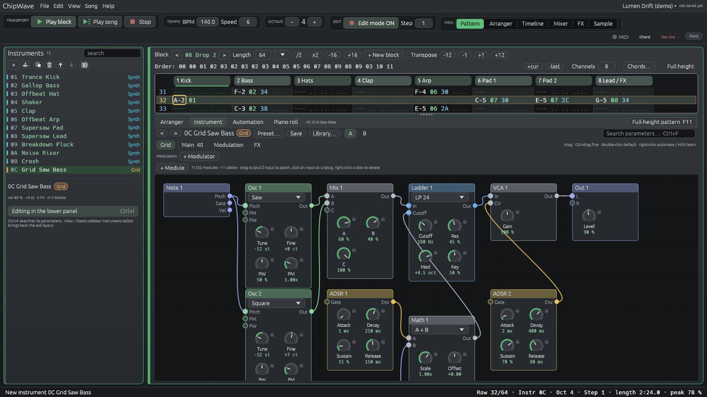

# The Grid (0.2.4.1)

A modular patching environment inspired by other DAWs: put
modules on a canvas, drag cables between their ports, and play the result as
an instrument (**Grid generator**) or run audio through it (**Grid FX**).

## Grid generator

**New… > Generator (grid)**. The instrument opens on the lower panel's
**Grid** tab, the canvas. The **Main** tab has the same knobs as cards (the
8 macros, one card per module, Level / Glide / Legato), and Dice / Mutate
roll every module knob gently (±25 %).

- **Add a module:** **+ Module** or right-click the empty canvas (it lands
  where you clicked). Modules are grouped as In / Out, Sources, Filters,
  Modulators, Math and FX.
- **Move it:** drag its title. **Delete it:** right-click the title.
- **Patch:** drag from an **output** port (right side) to an **input** port
  (left side). An input takes one cable (a new one replaces it); an output
  can feed any number. **Click an input** to unplug it.
- **Knobs** are the instrument panel's knobs: drag, Ctrl-drag for fine,
  double-click for the default, right-click to **automate** or **MIDI
  learn**, and drop a modulator chip on them for **drag-to-modulate**.
- Ctrl+Z undoes canvas edits like any other change.

Each voice (each playing note) runs its own copy of the patch, so the Grid is
**polyphonic per voice**: envelopes, LFO phases, sample & holds and delay
lines are per note.

### Signals

Everything is a number per sample. **Pitch** is in octaves from C-4 (0 = C-4,
1 = C-5), **gates** are 0 or 1, audio is about ±1. An input with no cable has
a default: Osc / Wavetable *Pitch* follow the note, ADSR *Gate* and S&H *Trig*
follow the note's gate, S&H *In* samples noise, VCA *CV* is 1, everything else
is 0. Filter and Delay inputs called *Cutoff* and *Time* are in octaves too:
+1 doubles the cutoff (times the module's **Mod** knob) or halves the delay
time, so cabling **Note › Pitch** into a delay's *Time* tunes it to the note.

### Modules

| Module | Ins | Outs | Knobs / mode |
|---|---|---|---|
| **Note** | | Pitch, Gate, Vel | the playing note (Vel = its velocity, 0..1) |
| **Macro** | | Out | mode M1–M8: one of the 8 Grid macros (0..1) |
| **Audio In** | | L, R | the audio into a Grid FX device (silent on an instrument) |
| **Out** | L, R | | Level; R follows L when it has no cable |
| **Osc** | Pitch, PM, PW | Out | Sine / Triangle / Saw / Square / Pulse (band-limited), Tune, Fine, PW, PM depth |
| **Wavetable** | Pitch, Pos | Out | one of the 10 built-in tables of the Wave generator, Tune, Fine, Pos, Pos mod (mipmapped, no aliasing) |
| **Noise** | | Out | Colour (white → dark) |
| **Filter** | In, Cutoff | Out | state-variable LP / BP / HP / Notch, Cutoff, Res, Mod (oct per unit), Key (follows the note) |
| **Ladder** | In, Cutoff | Out | ChipWave's Moog ladder LP 24 / LP 12 / BP / HP, same knobs |
| **ADSR** | Gate | Env | Attack, Decay, Sustain, Release |
| **LFO** | Rate | Out | Sine / Triangle / Saw / Square / Random, Rate (Hz; the input adds octaves), Phase |
| **Mix** | A, B, C | Out | a level (±1) for each |
| **VCA** | In, CV | Out | Gain; Out = In × CV × Gain |
| **Math** | A, B | Out | A, A + B, A - B, A × B, \|A\|, min, max; then × Scale + Offset |
| **Logic** | A, B | Out | A > B, A < B, AND, OR, XOR, NOT A (inputs above Threshold count as on) |
| **Slew** | In | Out | Rise and Fall times (portamento / smoothing) |
| **S&H** | In, Trig | Out | samples In on each rising Trig |
| **Shaper** | In | Out | Soft / Fold / Hard, Drive, Mix |
| **Delay** | In, Time | Out | Time (0.1–80 ms), Feedback (±), Mix, Damp: combs, chorus, Karplus-Strong |
| **Knob** | | Out | Value (±1): a constant you can automate or modulate |

A cable that closes a loop is a **feedback** cable: it reads the previous
sample's value, so loops are always allowed.

### Knobs, automation and modulation

The 8 **macros** are knobs 1–8 of the instrument (`instrument.N.gen.1…8`,
also 43xy). Every module knob takes the next free knob number when the module
is added and keeps it, so lanes and modulation routes stay attached when you
add, move or delete other modules. The automation menu and lane names show
"Osc 1: Tune" etc. A Grid has 64 knob numbers: 8 macros + up to 56 module
knobs.

### Starter patches

| Preset | What it shows |
|---|---|
| Grid Saw Bass | saw + square → ladder; a filter envelope plus Macro 1 on the cutoff (Math A + B) |
| Grid Wavetable Pad | two wavetables scanned by a slow LFO, filter, slow envelope, a delay on the right side |
| Grid FM Bell | 2-operator FM, the modulator's depth decays (ratio 3) |
| Grid Karplus Pluck | Karplus-Strong: a noise burst rings in a delay tuned by Note › Pitch |
| Grid S&H Lead | an LFO clocks a sample & hold of noise, slewed, into the filter |
| Grid Chip Gate | an LFO AND the note gate retrigger a short envelope on a pulse |

They are in **Preset…**, the instrument library and text songs
(`patch = "gen:Grid Karplus Pluck"`).

## Grid FX

**Add effect › Grid FX** (instrument FX chains). The device has 9 sliders,
**Macro 1–8** and **Mix**, which are automatable (`instrument.N.fx.D.p0` … `p8`)
and drag-to-modulate targets. **Edit patch...** in the FX view opens the
canvas in a window. **Audio In** carries the chain's signal into the patch,
**Note** follows the note playing on the channel (Pitch, Gate 1, Vel 1), and
Macro modules read the device's macro sliders. The window's **Patch** menu has
three starters: **Auto-Filter** (the default: an LFO plus Macro 1 sweep two
low-passes), **Ring Mod** (the input times a sine a fifth above the note) and
**Comb Resonator** (a feedback delay tuned to the note).

## Engine

When a voice starts, the patch is compiled into a fixed processing order (a
depth-first walk from the Out modules; the cable that closes a loop becomes
feedback) held in fixed-size arrays inside the voice. Knobs are read every 16
samples, modules run one sample at a time. Nothing is allocated on the audio
thread (tested with an automation lane and an LFO route on a module knob, and
on a Grid FX device). A patch edit while notes ring is picked up within 64
samples. Without an ADSR, a voice fades out 10 ms after note-off; with one it
ends once it has been silent for 50 ms (at the latest 30 s after release).

## Saved with the song

The patch (modules, positions, cables, knob values) is stored in the
instrument (`[instrument.gen.engine.Grid]`) or the FX device (`grid`). Songs
without a Grid save and render exactly as before.

## Limits (first version)

- Up to **32 modules** and **128 cables** per patch, 4 knobs per module, 2
  delays (4 096 samples each, about 85 ms at 48 kHz) and 4 ladders per voice.
  Extra delays / ladders pass audio through.
- The mode menus (oscillator shape, filter type, table, Math/Logic mode) are
  not automatable or modulatable; only knobs are.
- Grid FX: only its 8 macros and Mix are automatable / modulatable, not the
  knobs inside its patch; it runs per instrument chain (not per voice), and
  editing its patch structure while playing restarts the device's state.
- No sub-patches / containers, no per-module oversampling, no sample player,
  step sequencer, envelope follower, Voice formant or chip modules yet, no
  polyphonic audio-in, no import/export of patches as separate files (save the
  instrument as `.cwi` instead), no module help pages, no zoom on the canvas.
- Modulators (the instrument's LFOs, envelopes …) are per instrument, as on
  the other generators; per-voice modulation lives inside the patch.
- Older versions can't open songs that use the Grid.
