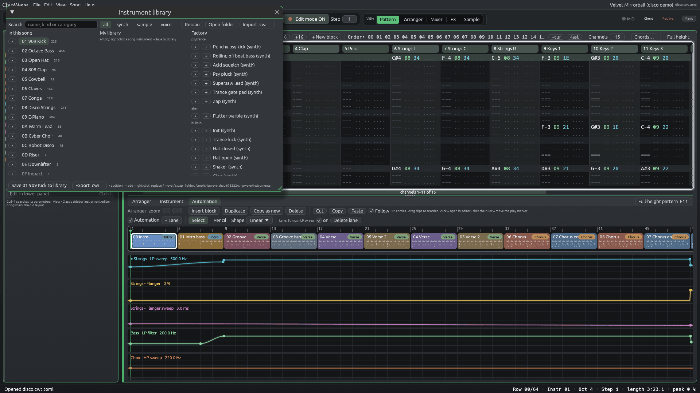

# Instrument library and instrument management (0.2.3.9)

## The instrument list (left panel)

| Action | How |
|---|---|
| Rename | double-click the name (or right-click > **Rename**), type, Enter. Esc cancels. Undoable. |
| Reorder | **Up** / **Down** under the list, or right-click > **Move up** / **Move down**. Every note, automation lane and cached render follows the instrument, so the song sounds the same (test `instrument_rename_move_and_swap_from_the_instrument_list` renders before/after and compares sample by sample). |
| Duplicate / Delete | as before (Duplicate, Delete… with a confirm when the instrument is used) |
| Search | a search box appears above the list once it has more than 6 instruments. Words match the name or the kind (`synth`, `sample`, `voice`). |
| Swap an instrument in the song | right-click the instrument you want to hear > **Use this instead of** > pick the one to replace. The button changes the whole song; **this block** only the current block. The old instrument stays in its slot (delete it if it is unused now). Undoable. |
| Save / export | right-click > **Save to library** (writes `<name>.cwi` into the library folder) or **Export .cwi…** (anywhere). |
| Replace a sound but keep the notes | right-click > **Replace sound from library…**, then in the library right-click a sound > **Replace sound of XX (keep its notes)**. |

## The library window

**File > Instrument library…** (or **Library…** under the instrument list) opens a window with three columns:

- **In this song**: the song's instruments, with how many notes use each. Right-click for Move up/down, Save to library, Export, and *Use instead of XX* (whole song / this block; XX = the instrument selected in the main list).
- **My library**: `.cwi` files in your library folder. Sub-folders (one level) are categories, e.g. `Instruments/Bass/Rolling.cwi`.
- **Factory**: the factory synth presets, the built-in sounds (init, trance kick, hats, shaker, clap, riser), the Voice presets and (since 0.2.3.12) every Generator preset (kind "generator": drums and kits, Chip FX, and from 0.2.3.14 Analog, FM-4 and Noise, 46 in all).

`›` auditions a sound (a short phrase with the current song's tempo, about 2.5 s, without touching the song), `+` adds it as a new instrument (selected, undoable), and right-click > **Replace sound of XX** swaps the selected slot's sound while keeping its notes. The search box matches the name, kind and category; the chips filter by kind. **Rescan** re-reads the folder, **Open folder** opens it in the file manager, **Import .cwi…** adds a file from anywhere. Dropping a `.cwi` file on the window imports it too.

**An imported instrument is the active one.** File › Import instrument (.cwi)…, the library's `+` and Import .cwi…, a dropped `.cwi` or WAV, Import WAV… and the Browser's *Add as a new instrument* all switch to the new instrument. In the Timeline the selected track plays it when that track is empty, otherwise a new track right below it does (named after the instrument); that track is lit and the Rack shows the instrument's compact card. It is one Ctrl+Z. In a tracker song the new slot is selected for the instrument column, as before.

The library folder defaults to `%APPDATA%\ChipWave\Instruments` on Windows (`~/.config/chipwave/Instruments` on Linux); change it in **Settings > Files & Safety > Instrument library**. Up to 4000 files are listed.

## The `.cwi` file

A `.cwi` is a small ZIP, like a `.cwt` song:

| Entry | Content |
|---|---|
| `mimetype` | `application/x-chipwave-instrument` (stored, first) |
| `instrument.toml` | `format = "chipwave-instrument"`, `format_version = 1`, `app = "ChipWave Studio <version>"` (e.g. `0.2.3.14`), then the `[instrument]` table: exactly the same fields a song's instrument has (synth patch, sample settings, Voice parameters, Generator engine and knobs, FX chain, glide/accent, transpose, …) |
| `sample.wav` | only for sample instruments: the sample as 32-bit float WAV |

Files are written to a temporary name and renamed, so a crash never leaves half a file. Unknown fields are ignored and missing ones take their defaults, so later versions can add fields; a `format_version` above 1 is refused with a message.
