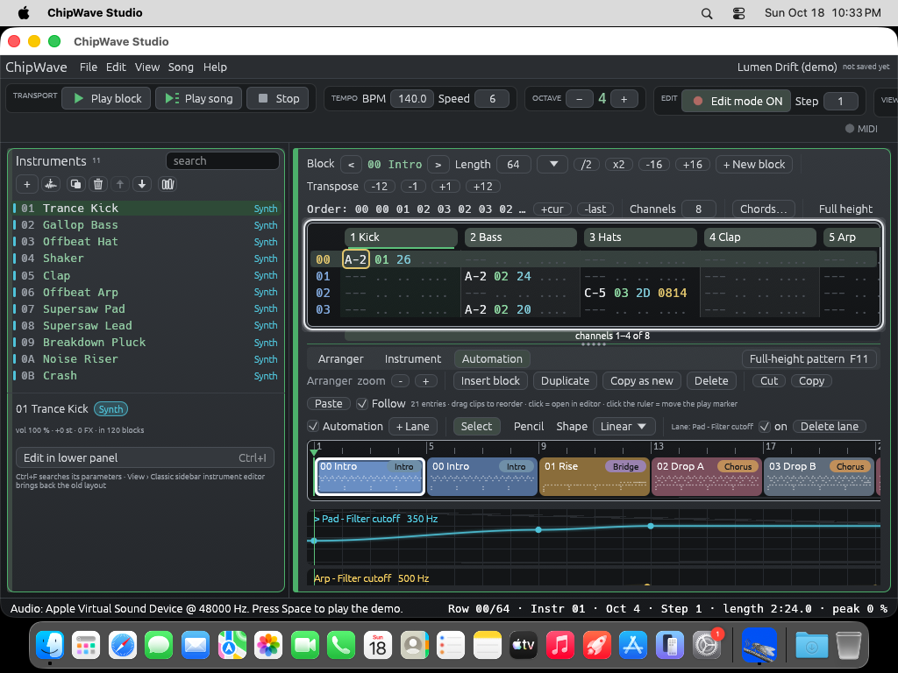

# ChipWave on macOS

ChipWave Studio has a **universal macOS build**: one `ChipWave.app` that runs natively on **Apple Silicon** (M1, M2, M3, M4…) and **Intel** Macs. It needs **macOS 11 Big Sur or later**.

> **Status:** the Mac build is made by GitHub Actions and checked there automatically (both CPU halves start, render audio and pass the self-test). Nobody has tried it on a real Mac yet, so please report anything odd in an [issue](https://github.com/postmanpat-303/ChipWaveStudio/issues) and include your macOS version and chip. The first release with Mac files is **v0.2.3.14**.

<p align="center"><br><sub>The universal build running on a GitHub Actions macOS machine (Apple Silicon, CoreAudio "Apple Virtual Sound Device"), captured by the workflow.</sub></p>

## Download

- **Disk image (recommended):** [`ChipWave-macos-universal.dmg`](https://github.com/postmanpat-303/ChipWaveStudio/releases/latest/download/ChipWave-macos-universal.dmg)
- **Zip of the app:** [`ChipWave-macos-universal.zip`](https://github.com/postmanpat-303/ChipWaveStudio/releases/latest/download/ChipWave-macos-universal.zip)

These links always fetch the newest release. Each release also has the versioned files (`ChipWave-<version>-macos-universal.dmg` / `.zip`) and their checksums in `SHA256SUMS.txt`.

## Install

1. Open the `.dmg` and drag **ChipWave.app** onto **Applications**. (If you used the zip, double-click it and move `ChipWave.app` to Applications.)
2. **First launch only:** the app is not signed with an Apple Developer ID and not notarised, so macOS will say it "can't be opened" or "cannot verify the developer". Use one of these:
   - In Finder, **Control-click (or right-click) ChipWave.app → Open → Open**.
   - On macOS 15 Sequoia and later, where that button may be missing: try to open the app once, then go to **System Settings → Privacy & Security**, scroll down and click **Open Anyway**.
   - Or in Terminal:
     ```sh
     xattr -dr com.apple.quarantine /Applications/ChipWave.app
     ```
   After that it opens normally.
3. **Upgrading from ChipWave Tracker (0.2.3.x):** drag the new `ChipWave.app` over the old one and choose **Replace**. The bundle keeps its name and its id (`com.postmanpat303.chipwave`), so it is the same app to macOS; the menu bar and Dock now say **ChipWave Studio**. Settings stay in `~/Library/Application Support/ChipWave`.

The app is **ad-hoc signed**, which is what Apple Silicon needs before it will run native code. It is **not notarised**, because that needs a paid Apple Developer account.

## Using it on a Mac

- Shortcuts written as **Ctrl** in the app and docs also work with **⌘ Command** (⌘S saves, ⌘Z undoes). Control works as well.
- Sound goes through **CoreAudio** (Settings → Audio picks the output device). MIDI keyboards work through **CoreMIDI**.
- Settings, recent files, crash recovery, the instrument library and keymaps are kept in `~/Library/Application Support/ChipWave/`.
- **Help → Check for updates…** offers the Mac `.dmg` from 0.2.3.15 on. In 0.2.3.14 its "Download installer" button opens the Windows `.exe`, so use the release page or the link above instead.
- The demo songs, presets and icon are built into the app, so nothing else needs installing.

## Known limits

- **Untested on real hardware** (see Status above). CI runs the app on GitHub's macOS machines, but nobody has played it on a Mac yet.
- **Double-clicking a `.cwt` song in Finder** doesn't open it in ChipWave yet. Open songs from **File → Open** instead.
- **Plugin hosting** (CLAP/VST3, in development) hasn't been tested on macOS yet.

## Building it yourself

On a Mac with Rust installed (`rustup target add aarch64-apple-darwin x86_64-apple-darwin`):

```sh
scripts/package-macos.sh            # version from Cargo.toml, e.g. 0.2.3+fix.15 -> 0.2.3.15
```

This writes `dist/mac/ChipWave.app` and `dist/mac/ChipWave-<ver>-macos-universal.{dmg,zip}`, plus versionless copies and `SHA256SUMS.txt`. For a quick single-architecture build, just run `cargo run --release`.

Without a Mac, run the **macOS** workflow on GitHub: **Actions → macOS → Run workflow** (or `gh workflow run macos.yml`). It builds both architectures on `macos-latest`, joins them with `lipo`, builds the `.app` (Info.plist, an `.icns` made with `sips`/`iconutil` from `assets/icon/chipwave_studio_1024.png`), makes the dmg (retrying `hdiutil` on "Resource busy") and zip, smoke-tests both halves, mounts the dmg to check it, and uploads everything as a workflow **artifact**. It never attaches anything to a release.

## Publishing (release checklist)

Publishing needs Del's approval. Once approved:

1. Bump the version and build the Windows files as usual (`scripts/package-windows.sh <ver>`).
2. Run the macOS workflow with `source_ref` set to the release tag and the same `version` (e.g. `gh workflow run macos.yml -f source_ref=v0.2.3.14 -f version=0.2.3.14`), so the app is built from exactly the released source.
3. Download the `ChipWave-<ver>-macos-universal` artifact and attach **all four** Mac files to the release: `ChipWave-<ver>-macos-universal.dmg`, `ChipWave-<ver>-macos-universal.zip`, `ChipWave-macos-universal.dmg` and `ChipWave-macos-universal.zip`. Copy them into `dist/` next to the Windows files and run `scripts/release-sums.sh dist <ver>`, so one `SHA256SUMS.txt` covers all eight files, and attach it too. Wave Hub checks downloads against it.
4. Check that `releases/latest/download/ChipWave-macos-universal.dmg` downloads, and that the README's Mac links still work.
