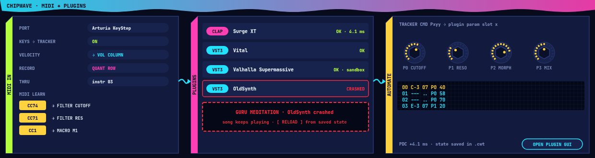

# ChipWave Studio: MIDI and Plugin Hosting (CLAP / VST3)

**Status:** MIDI keyboard input (play, record, velocity, sustain, pitch bend, simple CC learn) is implemented in 0.2.3, see [MIDI.md](MIDI.md). **CLAP instrument hosting** is implemented in 0.2.3.16, see [PLUGINS.md](PLUGINS.md). VST3 hosting, plugin effects, MIDI output and clock are still design. Visual style: [DESIGN_LANGUAGE.md](DESIGN_LANGUAGE.md).

## 1. MIDI input
- **Keyboard entry:** a MIDI keyboard enters notes into the tracker exactly like the computer keyboard (current instrument, octave from the key played). Chords spread across the next tracks (option).
- **Velocity:** off / into the volume command column / into the instrument volume.
- **Record:** in play+edit mode, incoming notes are written at the current row, quantised to the row (or to ticks via a delay command `Fxx`-style for feel). Note-offs optional (writes `---` off notes).
- **Thru:** incoming MIDI plays the selected instrument (sample, synth patch, MIDI-out instrument or plugin) live.
- **MIDI learn:** right-click any knob, fader, macro or mixer control → *MIDI Learn* → move a controller. Mappings: CC (7-bit, 14-bit pairs), NRPN, pitch bend, aftertouch, note-as-button. Ranges and curves editable in a mapping list. Global mappings (transport, octave, play/stop, next instrument) and per-song mappings (stored in `.cwt`).
- **Controllers:** generic mapping by default; pre-made maps can be TOML files (AI-writable, like presets).

## 2. MIDI output
- **MIDI instruments** in OctaMED style: an instrument slot of type ♪ MIDI with port, channel 1–16, program/bank (OctaMED's `midich`, `midipreset`, long preset), "suppress note-off", transpose, and default velocity ([OCTAMED_SPEC.md](OCTAMED_SPEC.md) §4/§7). OctaMED MIDI commands (program change, pedal, raw MIDI) are supported; MMD files with MIDI instruments import with their channel/preset.
- **External hardware synths**, with per-port latency offset (ms) so they line up with internal audio.
- **Clock / sync:** send MIDI clock + Start/Stop/Continue + Song Position Pointer; receive clock to follow an external master (with smoothing). MTC later if needed.

## 3. Plugin hosting
| Format | Status in ChipWave | Notes |
|---|---|---|
| **CLAP** | **First choice** | Open standard (MIT), designed for hosts like us: thread-safety rules, per-note modulation, polyphonic parameter modulation, good Linux support |
| **VST3** | Second, same phase | Most plugins ship VST3. Steinberg moved the VST 3 SDK to the **MIT licence with version 3.8 (20 Oct 2025)**; GPLv3/proprietary licensing options were retired |
| VST2 | **Not supported** | Steinberg discontinued the VST2 SDK and stopped licensing it; the VST2 API is explicitly *not* covered by the VST3 MIT licence |
| LV2 | Maybe later (Linux) | Not planned now |

### Scanner
- Default paths: CLAP `%COMMONPROGRAMFILES%\CLAP`, `%LOCALAPPDATA%\Programs\Common\CLAP`, `~/.clap`, `/usr/lib/clap`; VST3 `%COMMONPROGRAMFILES%\VST3`, `~/.vst3`, `/usr/lib/vst3`, plus user folders.
- Scanning happens **out of process** (a helper exe loads each plugin and reports metadata), so a broken plugin can't crash ChipWave; results cached with file mtime/hash; blocklist for plugins that fail.

### Sandboxed out-of-process hosting
- Each plugin (or group, user choice) runs in a **`chipwave-plugin-host`** process. Audio and events cross via shared-memory ring buffers with a lock-free handshake per audio block; control messages over a pipe/socket.
- If a plugin crashes, its slot shows a Guru-red "plugin crashed" box ([DESIGN_LANGUAGE.md](DESIGN_LANGUAGE.md)); the song keeps playing with that slot silent, and *Reload* restarts it from the last saved state.
- Option for **in-process** hosting for trusted plugins (lowest overhead).
- Cost: one block of extra latency is avoided by running the host in sync with the audio callback; overhead is roughly a context switch per block per process.

### Plugin GUI windows
- The plugin's own editor opens in a separate native window (CLAP `gui` extension / VST3 `IPlugView`), floating, stays on top optional, remembers position per screen setup ([UI_SCALING.md](UI_SCALING.md)). HiDPI scale is passed through to the plugin. On Wayland, plugin GUIs that need X11 run via XWayland.
- A generic ChipWave-style parameter view (LED knobs) is always available, even for plugins without a GUI.

### Use in songs
- **Instruments:** plugin in an instrument slot (type ▣); tracker notes, velocity and note-offs are sent as note events; per-note expressions with CLAP.
- **Effects:** plugins can be inserted in any patch FX chain, track or master chain, alongside built-in FX.
- **Automation from tracker commands:** a new command (e.g. `Pxyy`: parameter slot x, value yy) and an automation lane per track; up to 16 "exposed" parameters per plugin mapped to slots; values sent sample-accurately (CLAP events / VST3 parameter changes with sample offset).
- **Latency compensation:** plugins report latency; ChipWave delays other tracks to match (plugin delay compensation), and the offline export accounts for it ([EXPORT.md](EXPORT.md)).
- **State:** plugin state (CLAP `state` extension / VST3 component + controller state) saved inside `.cwt` as `plugins/<slot>.bin` with a TOML header naming the plugin id and version ([FILE_FORMAT.md](FILE_FORMAT.md)). Missing plugins keep their state and show a placeholder so nothing is lost.
- Export to MOD/MMD: plugin instruments are **auto-rendered** to samples (same path as synth patches).

## 4. Licensing (assuming ChipWave goes GPL-3.0)
- **CLAP:** MIT; fine with GPL-3.
- **VST 3 SDK 3.8+:** MIT; fine with GPL-3 (keep the copyright and licence text). The VST logo is a trademark: optional, and if used must follow Steinberg's usage guidelines.
- **Hosting proprietary plugins from a GPL host** is normal practice (Ardour, LMMS, Qtractor do it); the plugin is a separate work loaded at runtime.
- **LAME** (MP3, LGPL) and others: see [EXPORT.md](EXPORT.md).

## 5. Rust crates (checked on crates.io, 16 Oct 2026)
| Crate | Version | Licence | Maturity / use |
|---|---|---|---|
| `midir` | 0.11.1 | MIT | Cross-platform MIDI I/O (ALSA, JACK feature, WinMM, CoreMIDI); widely used; our default |
| `wmidi` | 4.0.11 | MIT | Typed MIDI message parsing/encoding; small, solid |
| `midly` | 0.5.3 | Unlicense | Standard MIDI File read/write (for .mid import/export later) |
| `clack-host` | 0.2.0 | MIT OR Apache-2.0 | Safe Rust CLAP host bindings (Prokopyl/clack); young (0.x) but active, used by real projects; our CLAP host base |
| `clack-extensions` | 0.2.0 | MIT OR Apache-2.0 | CLAP extensions (gui, params, state, latency…) |
| `vst3` | 0.3.0 | MIT OR Apache-2.0 | Generated Rust bindings to the VST3 COM API (from the coupler project); low-level, early; we'd write the host layer ourselves |
| `vst3-sys` | — | — | **Not on crates.io** (git-only, older RustAudio bindings); prefer `vst3` |
| `nih-plug` | — | ISC (framework) | **Not on crates.io**; used from git. Plugin *framework* (CLAP/VST3 export), not a host — relevant for §7 |

## 6. Platform notes
- **Linux:** `midir` uses ALSA sequencer by default (works under PipeWire, which provides ALSA seq/JACK compatibility); enable JACK for pro setups. Audio via cpal (ALSA, PipeWire through its ALSA/JACK layers; cpal also has a JACK host). Flatpak builds need `--device=all`/ALSA seq access and PipeWire socket permission; plugin paths need filesystem permission (`~/.clap`, `~/.vst3`, `/usr/lib/clap` via host extension).
- **Windows 11:** `midir` uses WinMM today (one app per port on many drivers; device names truncated). **Windows MIDI Services** (MIDI 2.0 stack, multi-client ports, part of Windows 11 updates) is the future; when a Rust binding is mature we'll add it, with WinMM fallback. Audio: WASAPI via cpal; ASIO via cpal's `asio` feature (needs the ASIO SDK at build time — its licence must be checked before shipping).

## 7. ChipWave as a plugin (phase 3 idea)
Use `nih-plug` (or `clack` plugin side) to ship **ChipWave as a CLAP/VST3 instrument**: the tracker runs inside a DAW, synced to the host transport, outputting audio (and optionally per-track outputs). Also export the **sound designer alone** as a synth plugin. The engine's no-allocation, block-based design ([SOUND_DESIGN.md §9](SOUND_DESIGN.md)) makes this realistic.

## 8. Roadmap placement
- **Phase 1.5:** MIDI input (keyboard entry, record, velocity, thru, MIDI learn).
- **Phase 2:** MIDI output instruments + clock sync; CLAP then VST3 hosting with scanner, sandbox, GUIs, automation commands, latency compensation, state in `.cwt`.
- **Phase 3:** ChipWave as a CLAP/VST3 plugin.

## 9. Plugin manager
Scanning, sandboxed verification, status badges, one-click enable and LV2 support are designed in [PLUGIN_MANAGER.md](PLUGIN_MANAGER.md).
