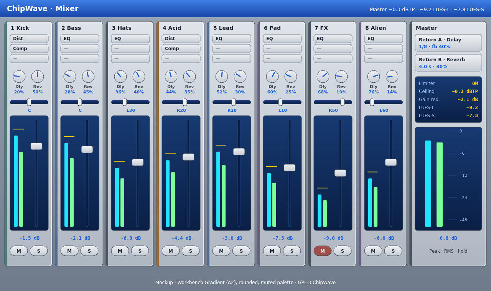

# Mixer

 (SVG: [`mockups/mixer.svg`](mockups/mixer.svg))

Opened with `F6`, or as a dockable panel. There's one strip per tracker channel, plus two send returns and the master. It uses the A2 style with the muted palette; meters and values are the only saturated colours.

## 1. Channel strip (top to bottom)
| Part | Details |
|---|---|
| Header | Channel number, name and colour spine. Double-click to rename. |
| **Inserts** | 4 slots for any built-in FX ([SOUND_DESIGN.md §6](SOUND_DESIGN.md)) or a CLAP/VST3/LV2 plugin ([PLUGIN_MANAGER.md](PLUGIN_MANAGER.md)). Drag to reorder; click to bypass; double-click opens the editor. These are per *channel*, after the instrument's own patch FX. |
| **Sends** | **Delay (A)** and **Reverb (B)** knobs, 0–100 %. Pre- or post-fader per send (right-click). More returns can be added (up to 8). |
| **Pan** | Constant-power (−3 dB centre). Shows C / L50 / R20. Double-click resets. |
| **Meters** | Peak (cyan) and RMS (green, 300 ms window) with a 1.5 s peak-hold line (yellow). Scale +6 to −60 dBFS. Clip LED latches until clicked. |
| **Fader** | −∞ to +6 dB, logarithmic taper; value readout in dB below. Shift-drag for fine control, double-click for 0 dB, and typing a number works. |
| **Mute / Solo** | Same state as the pattern editor channel header ([PATTERN_EDITOR.md §8](PATTERN_EDITOR.md)). Ctrl+click solo is additive. |

## 2. Returns
Return A has a synced ping-pong delay and return B a Freeverb-style reverb, both from the built-in FX. Each return has its own fader, mute, meter and EQ low-cut. Returns can feed each other (delay → reverb) with a loop guard.

## 3. Master
- Master fader and stereo meters.
- **Limiter:** a look-ahead brickwall (~1.5 ms) with true-peak detection (4× oversampled), ceiling default −0.3 dBTP and release 50 ms (auto option). It shows gain reduction and is on by default on export.
- **Loudness:** LUFS-M (momentary), LUFS-S (short-term), LUFS-I (integrated since play started) and LRA, per **ITU-R BS.1770 / EBU R128** (K-weighting, 400 ms / 3 s windows, gating). Reset on play. Optional target hints, e.g. "−14 LUFS for streaming", shown neutrally rather than as warnings.
- **Crate check:** the `ebur128` crate (Rust port of libebur128) is a candidate for this. Check its version and licence on crates.io before adopting it. Otherwise it's about 200 lines of our own code.

## 4. Engine notes
- Signal flow per channel: voices → instrument patch FX → channel inserts → fader/pan → sends → master bus → master inserts → limiter → output/export.
- Faders and pans are smoothed (10 ms) to avoid zipper noise. Meters are computed on the audio thread as cheap per-block peak/RMS values and sent to the UI over a lock-free ring buffer at 60 Hz.
- Export renders exactly this chain ([EXPORT.md](EXPORT.md)), with an option to export per-channel stems.
- Everything here is automatable ([AUTOMATION.md](AUTOMATION.md)) and MIDI-learnable ([MIDI_VST.md](MIDI_VST.md)).
- Mixer state is saved in `.cwt` as `mixer.toml`. MMD export keeps channel volume and pan only.

**Implemented in 0.1.3 (basic):** per-channel strip with fader (0 to +6 dB, double-click = 0 dB), constant-power pan, mute/solo (shared with F9/F10 and the channel headers), post-fader peak meter; master fader with L/R meters and the existing soft limiter. Gains are smoothed (5 ms). Saved in `.cwt` as `mixer.toml`; WAV export uses the same mix. Deferred: inserts, sends/returns, RMS/peak-hold/clip LED, LUFS, true-peak limiter, stems.

**Fixed in 0.2.3.1:** double-click reset (fader = 0 dB, pan = centre, send = 0) did nothing before, because egui sliders only sense drags; the sliders now also sense clicks. Covered by the UI test `mixer_double_click_resets_fader_and_pan`.

**Sidechain ducking (0.2.3.2):** the mixer header has a **Sidechain key** channel (default 1) and a **release** time (default 200 ms). Each strip has a **Duck** amount (0–100 %, double-click = 0, disabled on the key channel). Every note on the key channel dips the ducked channels by their Duck amount: 2 ms attack, 12 ms hold, then a smooth return over the release time. That gives the classic trance "pump" of pads and bass under the kick. It's applied post-fader before the sends, allocation-free on the audio thread, and saved in `mixer.toml` (`duck`, `duck_key`, `duck_release`). Covered by the engine test `sidechain_ducking_pumps_after_key_notes` and the UI test `mixer_duck_amount_drags_and_undoes`.
