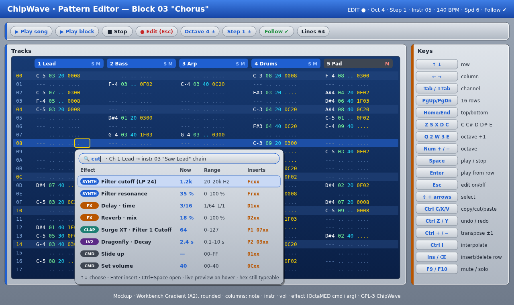
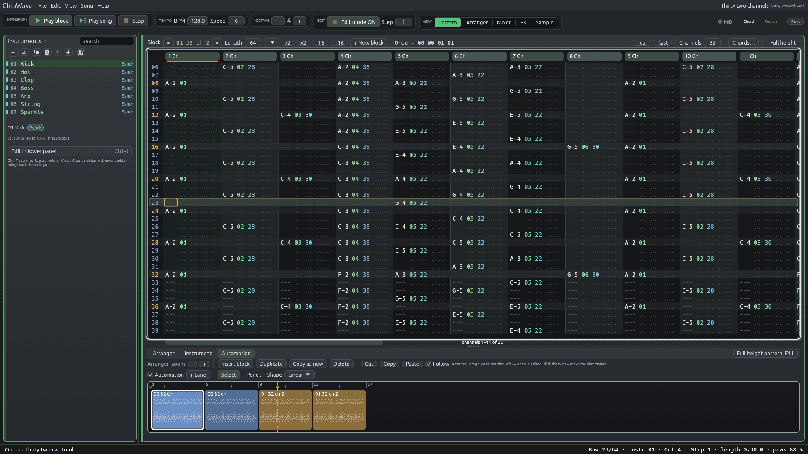

# Pattern Editor: the core screen

Del: *"the pattern editor is the main part, definitely want arrow keys to move around. use standard keys that are widely used."*

 (SVG: [`mockups/pattern_editor.svg`](mockups/pattern_editor.svg)). The mockup shows the effect autocomplete open on channel 1.

The defaults follow the conventions most trackers share (FastTracker 2, ProTracker, OpenMPT, Renoise), plus normal desktop shortcuts, so anyone who has used a tracker or a text editor feels at home. Everything can be remapped (§9).

## 1. Layout
- **Rows** run down the screen, **channels** across. Row numbers count in **decimal** by default since 0.2.3.17 (00–63 for a 64-row block, three digits for blocks over 100 rows). **View → Row numbers → Hex** or **Settings → Look → Row numbers** switches to classic hex (00–3F). Every 4th row (beat) and 16th row (bar) is highlighted either way, and the setting is saved. The status bar ("Row 32/64"), the play-marker message and MIDI recording messages use the same numbering. Effect, instrument, volume and order numbers stay hex.
- Each channel has **columns**: `Note` (C-4, `---` empty, `===`/`^^^` note-off), `Instr` (01–FF), `Vol` (00–40, or `..`), and 1–8 **effect columns** (`cmd` 2 hex + `arg` 2 hex). Cursor **sub-columns** step through the digits.
- **Channel header:** name, colour, **S**olo and **M**ute buttons, a mini level meter, and a collapse arrow that shrinks a channel to the note column only.
- **Follow playback:** the playing row stays centred (`Scroll Lock` or the toolbar toggle). With follow off, a play marker moves and the cursor stays put.
- **Edit step:** after a note is entered the cursor moves down *step* rows (0–16, default 1).

- **Lower panel (0.2.3.19):** under the pattern, switched between **Arranger**, **Instrument** (the instrument editor, `Ctrl+I`) and **Automation**. Drag the splitter to resize it, or to the bottom to hide it. **Full-height pattern** (`F11`, **View › Full-height pattern**, or the **Full height** toggle at the right of the Block bar) hides the panel and gives the pattern the whole height; press it again to restore the height. See [INSTRUMENT_EDITOR.md](INSTRUMENT_EDITOR.md).
- **Block bar (0.2.3.19):** one line. Block, Length and + New block are on the left; Channels, Chords… and Full height are on the right; the order list sits in between and is clipped when the window is narrow (its tooltip shows all of it). Very narrow windows put the right-hand group on a second line.

### Block length (0.2.3.17)
Each block has its own length, from 1 to 256 rows (older files can hold up to 3200, and those stay editable). The **Block bar** has a **Length** field next to the block selector. Drag it or type a value, or use the ▾ dropdown for 16 / 32 / 48 / 64 / 96 / 128 / 192 / 256. The quick buttons are **/2**, **x2**, **-16** and **+16**. **Song → Block** has **Set length…**, **Double length**, **Halve length**, **Stretch x2** and **Squash /2**, and `Ctrl+Shift+PgDn` / `Ctrl+Shift+PgUp` double or halve the length.

- **Growing** adds empty rows at the end.
- **Shrinking** asks first if any notes or effects would be cut ("removes N cell(s) … after row 31"). Shrinking over empty rows doesn't ask.
- **Stretch x2** doubles the length and moves every row r to 2r, so the block plays at half speed in rows. **Squash /2** halves it and moves row r to r/2. A note on an odd row moves up only if the row above is empty; otherwise it's dropped, and you're asked first.
- Every change is **one undo step** (`Ctrl+Z`).
- The arranger clip, the ruler, the play marker, the song length in the status bar and exports all follow the new length straight away. If the block is playing and the play position is past the new end, playback continues from the last row.
- A **derived** block (a Fill to length variation) becomes an ordinary block once it's resized.
- The length is saved per block in `.cwt` files. In text songs (`.cwt.toml`) it's the block's `lines = N`.

Before 0.2.3.17 there was no way to change a block's length in the app. **Fill to length** could only make derived blocks, and text songs could set `lines`.

## 2. Colours and readability (A2 rules)
On the dark CRT display: notes white `#FFFFFF`, instrument green `#7CFF9B`, volume cyan `#22E3FF`, effects yellow `#FFD400`, empty cells dim blue `#4F6FA0`, beat rows `#24477F`. The cursor is a yellow outline and the current row a blue bar. Yellow appears only on the dark display. Every colour pair meets WCAG AA (4.5:1) against `#0A1F45`, and a high-contrast theme and a colour-blind palette (effects in orange, instruments in light blue) are included.

**Alternate column shading (0.2.3.16).** Every other channel column (channels 2, 4, 6 …) has a faint tint, about 5 % luminance away from the background: lighter on the dark theme, darker on the Amiga Workbench theme. The tint is worked out from the theme's own background and ink colours, so any theme gets a matching stripe. A 1 px divider separates the columns, and the channel header buttons follow the same stagger. The stripe belongs to the channel number, not the screen position, so it stays put when you scroll sideways through 16–32 channels. Beat and bar rows, the cursor row, the selection and the play line are drawn on top of it. The channel under the cursor gets a faint accent wash and an accent underline on its header. Muted or not-soloed channels show dimmed cells as well as the grey header. Turn it off with **View → Alternate column shading** or **Settings → Look → Pattern**. It's on by default and saved in settings.

## 3. Scaling
Uses [UI_SCALING.md](UI_SCALING.md). The font is monospace (bundled **JetBrains Mono** or **DejaVu Sans Mono**; both are open licences, to be confirmed at bundling). Font size scales with `pixels_per_point` and `Ctrl + mouse wheel` changes pattern zoom only. Channels that don't fit scroll horizontally, and the cursor channel is always kept visible.



**Up to 32 channels (0.2.3.8).** A song has 1–32 channels (the **Channels** box in the block bar or the Song menu; 8 was the limit before). When they don't all fit, a bar under the grid shows which are in view ("channels 9–16 of 32"); click or drag it to scroll, and the cursor moves into view. `Tab` / `Shift+Tab` and the arrow keys scroll the view along with the cursor.

## 4. Keymap (defaults)
macOS uses **Cmd** wherever Windows/Linux use **Ctrl**, and **Option** for **Alt**. Mac laptops lack Insert/Home/End/PgUp/PgDn, so `Fn+↑/↓/←/→` (PgUp/PgDn/Home/End) and `Cmd+I` / `Cmd+⌫` (insert/delete row) also work.

### Navigation
| Action | Win / Linux | macOS |
|---|---|---|
| Row up / down | `↑` / `↓` | same |
| Column / sub-column left / right | `←` / `→` (wraps into the next channel) | same |
| Next / previous channel | `Tab` / `Shift+Tab` | same |
| Up / down 16 rows (configurable) | `PgUp` / `PgDn` | `Fn+↑` / `Fn+↓` |
| First / last row of block | `Home` / `End` (first press goes to row start / channel first column) | `Fn+←` / `Fn+→` |
| Song start / end (first / last block) | `Ctrl+Home` / `Ctrl+End` | `Cmd+Fn+←/→` |
| Previous / next block | `Ctrl+←` / `Ctrl+→`, or numpad `-`/`+` in sequence view | `Cmd+←/→` |
| Jump to row by beat | `Ctrl+1`…`Ctrl+4` (rows 0, ¼, ½, ¾) | `Cmd+1…4` |

### Note entry (FT2 / OpenMPT two-row piano)
```
 S D   G H J   2 3   5 6 7        upper row = black keys
Z X C V B N M , Q W E R T Y U I    Z = C (base octave), Q = C (base octave + 1)
```
| Action | Key |
|---|---|
| Notes | `Z S X D C V G B H N J M` = C … B (base octave); `Q 2 W 3 E R 5 T 6 Y 7 U I 9 O 0 P` = next octave up |
| Note off | `1` (FT2 style) or `` ` `` / `=` (OpenMPT) |
| Base octave down / up | numpad `/` / `*`, or `F1`–`F8` = octave 1–8 |
| Octave −/+ (alt) | numpad `-` / `+` when the cursor is in a note column |
| Hex digits | `0–9 A–F` in instrument/volume/effect columns |
| Clear cell | `Delete` (current cell, cursor stays) |
| Delete and pull up | `Backspace` deletes the row above the cursor in this channel and pulls the rest up (FT2 style) |
| Insert row (channel) | `Insert` pushes down; `Shift+Insert` inserts across all channels |
| Delete row (channel) | `Shift+Backspace` or `Shift+Delete`; with Ctrl it applies to all channels |
| Edit step −/+ | `Ctrl+[` / `Ctrl+]` |
| Edit mode on/off | `Esc` (Space too when "Space = edit" is chosen) |
| Record from MIDI keyboard | in edit mode, MIDI notes are entered with velocity → volume ([MIDI_VST.md](MIDI_VST.md)) |

### Playback
| Action | Key |
|---|---|
| Play / stop **current block** (loop) | `Space` |
| Play / stop song | `Shift+Space` |
| Restart block from the top | `Enter` |
| Play from cursor row | `Ctrl+Enter` or `Shift+Enter` (OpenMPT-like) |
| Play row (audition) | `4` on numpad or `Alt+↓` plays this row and moves down |
| Stop | `Space` / `Shift+Space` while playing, or `F8` |
| Follow playback | `Scroll Lock` / `Ctrl+F` |

### Editing and selection
| Action | Win / Linux | macOS |
|---|---|---|
| Select | `Shift+arrows` / `Shift+PgUp/PgDn/Home/End`, mouse drag | same |
| Select channel / block | `Ctrl+A` once = channel, twice = whole block | `Cmd+A` |
| Copy / cut / paste | `Ctrl+C` / `Ctrl+X` / `Ctrl+V` | `Cmd+C/X/V` |
| Mix-paste (only into empty cells) | `Ctrl+Shift+V` | `Cmd+Shift+V` |
| Undo / redo | `Ctrl+Z` / `Ctrl+Y` (also `Ctrl+Shift+Z`) | `Cmd+Z` / `Cmd+Shift+Z` |
| Transpose selection ±1 semitone | `Alt+=` / `Alt+-` | `Option+=/-` |
| Transpose ±1 octave | `Alt+Shift+=` / `Alt+Shift+-` | `Option+Shift+=/-` |
| Double / halve block length | `Ctrl+Shift+PgDn` / `Ctrl+Shift+PgUp` (rebindable) | `Cmd+Shift+Fn+↓/↑` |
| Interpolate (volume or effect arg, first→last row) | `Ctrl+I` | `Cmd+Shift+I` (since `Cmd+I` is insert row on Mac) |
| Humanise (random ±volume / micro-delay) | `Ctrl+H` | `Cmd+Option+H` (Cmd+H hides the app) |
| Set instrument of selection to current | `Ctrl+R` | `Cmd+R` |
| Mute / solo channel | `F9` / `F10`, or `Ctrl+M` / `Ctrl+Shift+M` | `Cmd+M` is minimise on Mac, so `Option+M` / `Option+Shift+M` |
| UI scale up / down / 100 % | `Ctrl+=` / `Ctrl+-` / `Ctrl+0` (clamped so the UI fits the window) | `Cmd+=/-/0` |
| Effect autocomplete | `Ctrl+Space` | `Cmd+Option+Space` (Ctrl+Space is input source on Mac) |

### File and app
| Action | Win / Linux | macOS |
|---|---|---|
| New / Open / Save / Save as | `Ctrl+N` / `Ctrl+O` / `Ctrl+S` / `Ctrl+Shift+S` | `Cmd+…` |
| Export WAV/MP3 | `Ctrl+E` | `Cmd+E` |
| Quit | `Ctrl+Q` (Alt+F4 on Windows) | `Cmd+Q` |
| Instrument editor in the lower panel / search its parameters | `Ctrl+I` / `Ctrl+F` | `Cmd+I` / `Cmd+F` |
| Full-height pattern (hide / show the lower panel) | `F11` | `Fn+F11` |
| **Panic**: stop all sound now (playback, held notes, plugin voices, delay/reverb tails, limiter) | `Ctrl+.` or the small **Panic** button at the far right of the toolbar | `Cmd+.` |
| Command palette | `Ctrl+Shift+P` | `Cmd+Shift+P` |
| Switch screen: pattern / arranger / sound / samples | `F2` / `F3` / `F4` / `F5` | `Fn+F…` or `Cmd+1…4` (set in prefs) |

## 5. Effect commands
Effect columns accept classic OctaMED/ProTracker commands (page 1, binary-compatible with MMD) plus ChipWave extended commands (§6). Main OctaMED commands, from [OCTAMED_SPEC.md §5](OCTAMED_SPEC.md).

**Played today (0.2.3.14):**

| Commands | What |
|---|---|
| `01`/`02` | slides |
| `08` | note decay (xx × 10 ms) |
| `09` | speed |
| `0C` | volume |
| `0D` | volume slide |
| `0F` | `0F00` pattern break, `0F01`–`0FF0` tempo |
| `30`–`43` | all ChipWave commands |

The other OctaMED commands below are stored and shown, but not played yet (see the roadmap).

| Cmd | Name | Arg |
|---|---|---|
| 00 | Arpeggio | x, y semitones |
| 01 / 02 | Slide up / down | speed |
| 03 | Portamento to note | speed |
| 04 | Vibrato (OctaMED depth ×2) | speed, depth |
| 05 / 06 | Porta + vol slide / vibrato + vol slide | slide |
| 07 | Tremolo | speed, depth |
| 08 | Hold & decay | decay, hold |
| 09 | Secondary tempo (ticks/line) | 01–20 |
| 0B | Position jump | position |
| 0C | Set volume | 00–40 (or hex mode) |
| 0D / 0A | Volume slide | up, down |
| 0F | Tempo / misc (00 break, 01–F0 tempo, F1 play twice, F2 delay ½ line, F3 play ×3, F8/F9 filter off/on, FE end, FF note off) | — |
| 11 / 12 | Fine slide up / down | amount |
| 15 | Finetune | F8–07 |
| 16 | Loop | count |
| 18 | Cut note at tick | tick |
| 19 | Sample offset | ×256 |
| 1A / 1B | Fine volume up / down | amount |
| 1D | Pattern break to line | line (the parameter is hex: `1D20` = row 32 in decimal numbering) |
| 1E | Repeat row | count |
| 1F | Note delay / retrigger | delay, retrig |
| 2E | Set pan (SoundStudio) | pan |
| 30 | Voice: set vowel (ChipWave) | x vowel 0–6 (A E I O U ER AE), y glide ×25 ms |
| 31 | Voice: jump to vowel-sequence step (ChipWave) | step |
| 32 | Voice: formant shift (ChipWave) | 80 = ×1 |
| 33 | Stutter / beat-repeat, any instrument (ChipWave) | x length (1 = 1/64 … 6 = 1/2 note), y repeats |
| 34 | Stutter pitch step (ChipWave) | +x / −y semitones |
| 35 | Voice: breath (ChipWave) | 00–40 |
| 36 | Voice: babble (ChipWave) | x step length, y amount |
| 37 | Voice: chop gate (ChipWave) | x cycle length, y open y/16 |
| 38 | Filter cutoff for this channel's notes (ChipWave) | 00 = instrument; 01–FF = 20 Hz … 20 kHz, log (40 ≈ 160 Hz, 80 ≈ 630 Hz, C0 ≈ 2.5 kHz) |
| 39 | Filter resonance (ChipWave) | 00 = instrument; 01–FF = 0–100 % |
| 3A / 3B | Cutoff slide up / down per tick (ChipWave) | xx/96 octave per tick (10 = 1/6 oct; at speed 6 that is 5/6 oct per row) |
| 3C | 303 glide to this note (ChipWave) | 00 = no glide (retrigger), 01 = the instrument's glide time, 02–FF = xx × 5 ms |
| 3D | Accent this note (ChipWave) | 00 = the instrument's accent amount, 01–40 = amount |
| 3E | Voice: speak word xx (ChipWave, 0.2.3.10) | 00–0F = word number; on a held note (no note in the row) the word is said again |
| 3F | Voice Transform blend (ChipWave, 0.2.3.11) | 00 = instrument; 01–FF = 0–100 % (stays on the channel) |
| 40 | Transform metallic resonance amount; also the Metal resonator device's mix (ChipWave) | 00 = instrument; 01–FF = 0–100 % |
| 41 | Transform digital distortion amount; also the Digital distortion device's mix (ChipWave) | 00 = instrument; 01–FF = 0–100 % |
| 42 | Transform sub level; also the Sub bass device's level (ChipWave) | 00 = instrument; 01–FF = 0–100 % |
| 43 | Generator macro (ChipWave, 0.2.3.12) | x = macro 1–8, y = 0–F (0–100 %); 4300 = instrument values; stays on the channel. Chip FX reads the macros when the note starts; the Drum Synth, Analog, FM-4 and Noise also follow a change on a sounding note. See [GENERATORS.md](GENERATORS.md) |

Effects 30–37, 3E and 3F–42 are documented in [VOICE.md](VOICE.md) (3F–42 also drive the Metal resonator, Digital distortion and Sub bass FX devices); 43 in [GENERATORS.md](GENERATORS.md#pattern-effect-43xy).

**Filter and acid commands 38–3D (0.2.3.7).** They work on synth and Voice instruments (sample instruments have no filter; `3C` glides samples too). OctaMED uses 00–1F plus 20, 29 and 2E (SoundStudio), and ChipWave's Voice uses 30–37, so 38–3D are free.
- `38`/`39` set the cutoff / resonance for the channel's notes until another `38`/`39`, `3800`/`3900`, or a note with a **different instrument number** (filter settings belong to the instrument they were set for). The filter envelope, key tracking, velocity and LFO still move the filter around the new cutoff.
- `3A`/`3B` slide the cutoff on every tick of the row (not on tick 0, like `01`/`02`); the reached value stays until the next `38` or reset. Example acid sweep: `3820` on the first note, then `3A08` on following rows.
- **Glide (303 slide):** the instrument's **Glide** time (sound editor, default 60 ms) and **Legato** switch. With Legato on, a new note while the previous one is still held (no note-off in between) glides to the new pitch without restarting the envelopes, like a TB-303 slide; `3C00` on a note forces a normal retrigger. With Legato off, `3C01` (instrument time) or `3Cxx` (xx × 5 ms) glides just that note. After a note-off (`===`) there is nothing to glide from, so the note starts normally. `01`/`02` slides still work as before and cancel a running glide.
- **Accent:** the instrument's **Accent** amount (default 60 %) and an **at vol ≥** threshold (00 = off). An accented note is louder (up to about +4.6 dB), its filter opens further (more on the envelope peak) and both decays get shorter. `3D00` accents with the instrument amount, `3D01`–`3D40` with a set amount; or set the threshold, e.g. `30`, and type a volume of 30–40 on the notes to accent.
- Text songs (`.cwt.toml`): `glide_ms`, `legato = true`, `accent`, `accent_vel` on an instrument.
- Tests: `effect_38_39_set_cutoff_and_resonance_per_row`, `effect_3a_3b_slide_the_cutoff_per_tick_and_a_new_instrument_resets`, `legato_glides_between_held_notes_without_retrigger`, `glide_needs_a_held_note_and_slides_01_02_still_work`, `accent_is_louder_brighter_and_shorter`, `acid_commands_and_limiter_are_allocation_free`.

## 6. Context-aware effect autocomplete
Typing hex codes is fast for experts but hard to learn. ChipWave adds a dropdown that **knows what's on this channel**.

**Opening:** `Ctrl+Space` in an effect column, or simply start typing a **letter** that isn't a hex-only context (e.g. `cut`, `rev`, `delay`). An "Effect list" item is also on the right-click menu. Typing hex digits keeps working as before and never opens the list, so experts are unaffected.

**What it lists** (in this order, grouped and tagged):
1. **SYNTH:** the current instrument's patch parameters, e.g. filter 1 cutoff/resonance/drive, osc PWM, wavetable position, LFO rate, the 4 macros.
2. **FX:** every device in that patch's FX chain, e.g. *Delay · time*, *Reverb · mix* ([SOUND_DESIGN.md §6](SOUND_DESIGN.md)).
3. **CLAP / VST3 / LV2:** automatable parameters of plugins on this channel, from the host's parameter list ([PLUGIN_MANAGER.md](PLUGIN_MANAGER.md)). Plugins with hundreds of parameters show favourites and recently used ones first.
4. **CMD:** the standard tracker commands from §5, with plain-English names.

"Current instrument" means the instrument on the nearest note above the cursor in this channel, or the selected instrument if there is none.

**Each row shows:** a tag, a **human name**, its **current value** (in real units: Hz, %, ms, synced note values), its **range**, and the **code it inserts**.

**Using it:** typing filters it (fuzzy: "fc" matches *Filter cutoff*), `↑↓` moves, `Enter` or `Tab` inserts the command, and the cursor jumps to the argument digits. `Esc` closes it. Hovering or moving over an item **previews** it live on the playing sound (a temporary parameter offset, released on close). After inserting, a small value slider appears over the argument; drag it or type hex.

**How the codes are stored (honest about compatibility):** classic commands go in page-1 effect columns and stay MMD-compatible. Parameter commands are **ChipWave extended commands** on a second command page, like MMD2's multiple command pages, so they never clash with OctaMED's 00–FF space.
| Shown as | Meaning | Arg |
|---|---|---|
| `Fcxx` / `Frxx` / `Fdxx` | Filter 1 cutoff / resonance / drive (`F2..` for filter 2) | 00–FF mapped across the parameter's range (cutoff in pitch, so it's musical) |
| `Mnxx` | Macro n (1–4) | 00–FF |
| `Dnxx` | FX chain device n main parameter (sub-parameter is picked in the dropdown and stored with it) | 00–FF |
| `Pn ppxx` | Plugin slot n, parameter index pp, value xx | 00–FF normalised; plugins with more than 256 parameters use a parameter-map table saved in the song |
The two letters are display mnemonics. Internally each is `(target id, value)`, resolved through the song's per-channel target table, so renaming or moving a device doesn't break patterns. MMD export bakes extended commands into automation where possible and lists the ones it had to drop.

## 7. Advanced edits
- **Interpolate:** linear (default) or curved, on volume or effect arguments; it keeps the command code from the first row.
- **Humanise:** volume ±n and/or 1–3 tick note delay (`1F`) with a seed, so it can be undone or rerolled.
- **Transpose:** skips drum channels marked "no transpose" and clamps to the sample range, with a status message.
- **Chord entry:** with `Shift` held, notes spread across the next channels (OctaMED "spread" mode).

## 8. Mute / solo
Mute affects playback and export (with an export option "ignore mutes"). Solo is exclusive; `Ctrl+click` adds to the solo set. The state is saved in `.cwt` but not in MMD. In the pattern editor, a muted (or not-soloed) channel has a grey header and dimmed cells.

## 9. Remappable keymap
`~/.config/chipwave/keymap.toml` (`%APPDATA%\ChipWave\keymap.toml` on Windows, `~/Library/Application Support/ChipWave/keymap.toml` on macOS). Only overrides are stored; defaults are built in. Presets: *ChipWave* (default), *FastTracker 2*, *ProTracker*, *OpenMPT*, *OctaMED*.
```toml
preset = "chipwave"
[pattern]
"Ctrl+Plus"   = "transpose_semitone_up"
"Ctrl+Minus"  = "transpose_semitone_down"
"PageUp"      = { action = "cursor_up", rows = 16 }
"F9"          = "channel_mute"
[notes]
layout = "ft2"          # or "piano_qwertz", "azerty"
base_octave = 4
note_off = ["1", "Equal"]
```
Keys are matched by **physical position** for note entry (so QWERTZ/AZERTY layouts still get the piano shape) and by **logical key** for shortcuts like Ctrl+Z. A key-conflict checker and a "press a key to assign" dialog come with the preferences screen.

## 10. Rust notes
Use egui `InputState` key events plus `egui::Key` physical scancodes (via `RawInput`/winit `PhysicalKey`) for note entry. The grid is drawn with one painter call per visible cell run (no widgets per cell), and only visible rows are laid out, so 3 200-line blocks scroll smoothly.

**Added in 0.1.3:** selection with Shift+arrows/PgUp/PgDn or mouse drag (green highlight), Ctrl+A (channel, then block), Ctrl+C/X/V (paste at cursor), Delete clears the selection, Alt+=/− transposes the selection (or the channel without one); all undoable. Base octave: F1–F8, numpad −/+, or the −/+ buttons by "Oct". Views: Ctrl+Tab cycles Pattern/Arranger/Mixer (plain Tab stays next channel), Ctrl+1/2/3 pick one.

**Changed in 0.1.2 (Del's testing):** Space now plays/stops the current block, because that's what you want while editing. Song playback moved to Shift+Space (Ctrl+Space is kept for the effect dropdown). Ctrl+=/−/0 now control the UI scale, so transpose moved to Alt+=/−.
