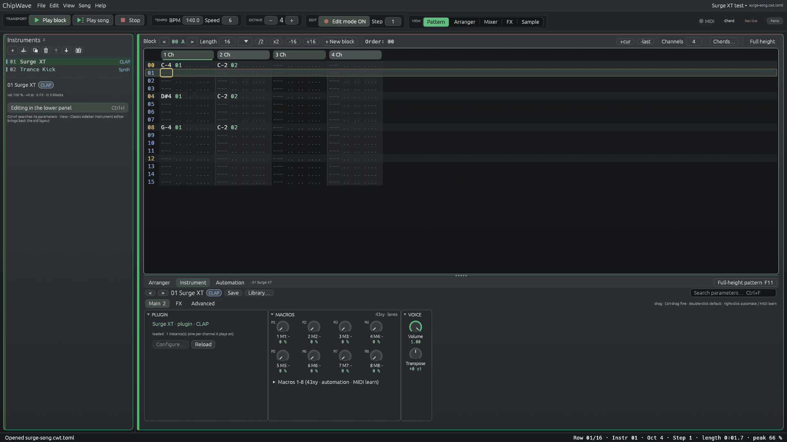
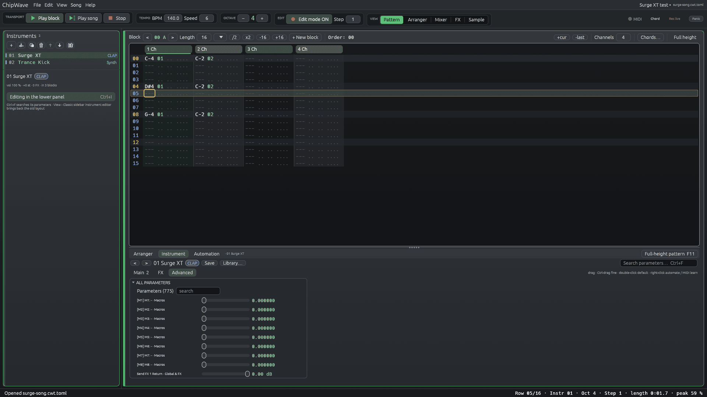

# Plugin instruments (0.2.3.16) and VST3 (Unreleased)

ChipWave 0.2.3.16 can play **CLAP** instrument plugins (Surge XT and so on) as ordinary instruments. **VST3** instruments and effects work the same way since the Unreleased build (see [VST3](#vst3-unreleased)). They take notes from the pattern, velocity, glide and slides, run through the instrument's FX chain and the mixer, and are saved inside the song. This page covers what works today. The longer-term design (MIDI output, LV2) is in [MIDI_VST.md](MIDI_VST.md) and [PLUGIN_MANAGER.md](PLUGIN_MANAGER.md).





## Formats

| Format | Status | Notes |
|---|---|---|
| **CLAP** | **Hosted**: scan, play, parameters, macros, automation, state, native editor (embedded on Windows, floating where the plugin offers one), offline render | Open standard by the free-audio project (MIT). On macOS a `.clap` is a bundle folder; ChipWave loads `Contents/MacOS/<binary>` |
| **VST3** | **Hosted (Unreleased)**: instruments and effects, the same scan, menus, parameters, macros, automation, modulation, state, missing-plugin handling and offline render as CLAP; embedded editor on Windows | VST 3 SDK by Steinberg, MIT since 3.8.0. A `.vst3` is a bundle folder (`Contents/x86_64-win/<name>.vst3`, `Contents/x86_64-linux/<name>.so`, `Contents/MacOS/<name>`) or, for old Windows plugins, a single file. See [VST3](#vst3-unreleased) |
| VST2 | Not supported | The SDK is discontinued and not covered by the VST3 MIT licence |
| LV2 | Not planned yet | |

Many plugins (Surge XT, Vital, Odin 2, …) ship a CLAP alongside their VST3; either works, and the browser shows both, marked CLAP or VST3. VST3-only plugins such as **Dexed** (0.9.x) now load through VST3 (Dexed itself not tested yet).

## Finding plugins

ChipWave scans these folders recursively, plus any folders you add in **Settings → Plugins → Add folder…**:

| OS | Folders |
|---|---|
| Windows | `%COMMONPROGRAMFILES%\CLAP`, `%LOCALAPPDATA%\Programs\Common\CLAP` (and the matching `VST3` folders) |
| macOS | `/Library/Audio/Plug-Ins/CLAP`, `~/Library/Audio/Plug-Ins/CLAP` (and `…/VST3`) |
| Linux | `~/.clap`, `/usr/lib/clap`, `/usr/local/lib/clap` (and `~/.vst3`, `/usr/lib/vst3`, `/usr/local/lib/vst3`) |
| all | every folder in `CLAP_PATH` and `VST3_PATH` |

**Find plugins… (Unreleased).** On the first start (and once for users of earlier versions) ChipWave asks how to find your plugins: **scan automatically** (the standard folders above, and optionally a deeper search of the whole drive for folders that contain `.vst3` / `.clap`), **choose folders yourself** with a folder picker, or **skip for now**. The search runs in the background with progress and a Stop button, lists the folders it found with their plugin counts, and adds the ones you keep to your plugin folders and to the Browser's locations, then runs the scan below. Open it again from **Settings › Plugins › Find plugins…** or the Browser's **••• › Find plugins…**. Details: [BROWSER.md › Find plugins](BROWSER.md#find-plugins). The deep search skips system, hidden, cache and trash folders and never enters plugin bundles; it stops after 14 levels or 2 million folders.

**Crash guard.** Each plugin is checked in a separate ChipWave process (`chipwave --scan-plugin <file>`), so a plugin that crashes, throws or hangs can't take ChipWave down. The checker loads the plugin, reads its name, vendor, id and features, creates an instance at 48 kHz, activates it and renders a test note. After 20 seconds it is killed and the plugin is marked "timed out". On Windows the checker suppresses crash dialogs. Results are cached in `plugin-cache.json` next to the settings file, keyed by file size and date, so later scans only re-check files that changed. **Rescan** checks new and changed files; **Full rescan** checks everything again. (The VST3 build bumped the cache version, so the first scan after updating checks every file once.)

The browser shows crashed, timed-out and unsupported files under "skipped" with the reason.

## VST3 (Unreleased)

VST3 plugins go through the same code paths as CLAP ones: one `Hosted` interface in `src/plugin/`, implemented by `clap.rs` and `vst3.rs`. Everything above it (instrument slots, FX chains, 43xy macros, automation lanes, drag-to-modulate, state in the song, missing-plugin placeholders, offline render, the self-test) doesn't care which format a plugin is.

- **Scan:** the scanner child loads the module (`ModuleEntry` on Linux, `InitDll` on Windows, `BundleEntry` on macOS), reads the factory's "Audio Module Class" entries (name, vendor, version, sub-categories: `Instrument…` = instrument, `Fx…` = effect), and for instruments creates an instance and renders a test note, as for CLAP.
- **Ids:** a VST3 plugin is saved as its class id in the SDK's text form, 32 hex digits (`ABCDEF019182FAEB566D624153675854` is Surge XT). The text is the same on every OS (Windows stores the bytes in GUID order; ChipWave converts), so a song made on Linux finds the plugin on Windows.
- **Instances:** component + edit controller (separate or combined), connected both ways through `IConnectionPoint`, with a host context (`IHostApplication`, which also creates `IMessage` / `IAttributeList` for plugins that talk between their halves). Main stereo buses, 32-bit float, the device's sample rate and block size, realtime mode.
- **Notes:** note-on / note-off events with note ids; glide and slides as the tuning note expression (`kTuningTypeID`), so they bend without retriggering.
- **Parameters** are VST3's normalised 0–1 values, shown with the plugin's own value text and units, grouped by the plugin's units ("Scene A/Filter 1"). Hidden parameters and the "MIDI CC" stand-ins a plugin lists for `IMidiMapping` (JUCE plugins add 2,080 of them) are left out, so Surge XT shows the same 775 parameters as its CLAP. Automation, 43xy, modulation and UI edits reach the processor as `IParameterChanges` at the start of each block; the processor's values are mirrored back into the controller on the UI thread.
- **Editor edits** arrive through `IComponentHandler` (`performEdit`, `restartComponent`, `setDirty`) and are queued for the audio thread without blocking it. A latency or bus change restarts the plugin; a parameter-list change re-reads it.
- **State:** the component's and the controller's streams, packed together (`CWV3` + two length-prefixed blobs) and stored base64 in the song like a CLAP state.
- **Latency** comes from `getLatencySamples` and feeds the same plugin delay compensation as CLAP effects.
- **Allocation-free audio thread:** the event list, parameter queues and the mirror are preallocated; tested with the allocation counter, for instruments and effects.
- **Editor:** on Windows the plugin's `IPlugView` is embedded in a ChipWave window (`HWND`), and resizes both ways (`IPlugFrame::resizeView`, `checkSizeConstraint`). On Linux and macOS the editor isn't offered yet, so use the parameter list. The Browser can capture that HWND for a **thumbnail** (`chipwave --capture-thumb`, see [BROWSER.md › Plugin thumbnails](BROWSER.md#plugin-thumbnails)).

Text songs take `patch = "vst3:<class id>"`:

```toml
[[instrument]]
slot = 2
name = "Surge XT (VST3)"
patch = "vst3:ABCDEF019182FAEB566D624153675854"
plugin_path = '/usr/lib/vst3/Surge XT.vst3'   # optional; found by id otherwise
```


## Adding one

**New → Plugin instrument…** (the **+** button in the Instruments panel, or right-click the instrument list → New instrument) opens **Add plugin instrument**. The first time, while the cache is still empty, it scans by itself. Type to filter by name, vendor or id, then **+ Add** an instrument. ChipWave adds an instrument slot named after the plugin.

From the command line: `chipwave --scan-plugins [folders…]` prints the scan results.

## Playing

- **One instance per channel.** Each channel that plays a plugin instrument gets its own instance, so separate channels never steal each other's notes. Instances are created on the UI thread and handed to the audio thread; the audio thread never allocates (checked by a test with an allocation counter).
- **Notes and velocity** go out as CLAP note events, sample-accurate at the start of each block. Note-off, `OFF` and new notes release notes as usual.
- **Glide and slides** (`01`/`02`, `3C` glide, Voice glide) reach the plugin as per-note tuning (`CLAP_NOTE_EXPRESSION_TUNING`), so slides keep working without retriggering. Plugins that ignore note expressions just play the plain note.
- **Sample rate and block size** follow the audio device. A device change re-activates every instance at the new rate.
- **Stereo out** goes through the instrument's FX chain, then the channel strip, sends and master limiter, like any other instrument.
- **Panic** (the toolbar button, **Ctrl+.**) sends every instance all-notes-off and all-sound-off (CC 120/123 and CC 64 off, or a CLAP note choke), then resets the plugin.

## The plugin panel

Select a plugin instrument to see, under the instrument list:

- **Status:** the plugin's name, vendor and format, plus how many instances are loaded. A missing plugin shows a warning instead.
- **Configure… / Close editor** opens the plugin's own editor window. On Windows it's embedded in a ChipWave window (or floating if the plugin only offers that). On macOS and Linux only floating CLAP editors are offered so far, and no VST3 editors. Surge XT has only embedded editors there, so on those systems you use the parameter list.
- **Reload** tries again after a plugin failed to load (for example after you installed it).
- **Macros 1–8:** pick any plugin parameter for each of eight macros. By default these are the first eight automatable parameters. You can also right-click a parameter slider and choose **Put on macro K**.
- **Parameters:** every parameter the plugin shows, as "name · group" (for example "Cutoff · Scene A/Filter 1"), with a slider, the plugin's own value text and a search box. Moving a slider changes the plugin straight away.

## Automation, 43xy and MIDI learn

The eight macros are the bridge to everything else in ChipWave:

- **`43xy`** in the effect column sets macro *x* (1–8) to *y*/15 (0–F = 0 … 100 %) on that channel's instance, the same way as generator macros. `4300` hands control back to the panel.
- **Automation lanes:** **+ Lane** offers "Macro 1" … "Macro 8" for plugin instruments, with the macro's parameter name. Lanes move the parameter smoothly, also in exports.
- **MIDI learn:** the macros are MIDI-learn targets too, so a hardware knob can drive them.

## Saving

The plugin's own state (its preset, as an opaque blob) is stored **base64-encoded** in the song (`.cwt`), in instrument files (`.cwi`) and in the instrument library, together with the plugin id, name, vendor, format, the path it was loaded from and the macro mapping. ChipWave asks the plugin for its state before every save, autosave, export, `.cwi` export and library save. This doesn't add an undo step, and plugin state changes aren't undoable in 0.2.3.16.

Text songs (`.cwt.toml`) take:

```toml
[[instrument]]
slot = 1
name = "Surge XT"
patch = "clap:org.surge-synth-team.surge-xt"
plugin_path = '/usr/lib/clap/Surge XT.clap'   # optional; found by id otherwise
# state = "<base64>"                          # optional
# macros = [ 12, 13, 40 ]                      # optional CLAP parameter ids
```

## Missing plugins

When a song uses a plugin that isn't installed (or fails to load), the instrument stays in the song as a **placeholder**. It shows the plugin's name and id, stays silent, and keeps its saved state and macros untouched, so saving the song on that machine loses nothing. A warning lists the missing plugins when the song opens, and the self-test checks this case.

## Offline render

WAV/MP3 export and `--render` create their own plugin instances at the export sample rate, with the saved state, and render them with the song. The live instances aren't disturbed. A song whose plugins are missing still exports, with those instruments silent.

## Tested plugins

| Plugin | Platform | Result |
|---|---|---|
| **cw-test-synth** (ChipWave's own tiny CLAP fixture, `plugins/cw-test-synth`) | Linux, Windows (Wine) | All tests: scan, play, state, macros, render, crash / hang guard copies |
| **Surge XT 1.3.4** CLAP | Linux | 775 parameters, 50 KB state round-trip, renders, no allocation on the audio thread |
| **Surge XT 1.3.4** CLAP (portable, with `SurgeXTData`) | Windows 11 build under Wine | Scans, plays, self-test PASS. Without its data folder Surge throws during the scan and is shown as crashed, which is the crash guard working |
| **cw-test-vst3** (ChipWave's VST3 fixture, `plugins/cw-test-vst3`: a synth and an effect, the same sound as the CLAP fixture, separate controller classes, a processor → controller message) | Linux, Windows (Wine) | All VST3 tests: scan, ids, notes, tuning, parameters, handler edits, state, macros, automation, modulation, latency / PDC, allocation, missing plugins, text songs; renders the same song as the CLAP fixture. Wine self-test PASS with it as instrument and effect |
| **Surge XT 1.3.4** VST3 (instrument + Effects) | Linux | 775 parameters (CC stand-ins hidden), state round-trip, renders as instrument and effect |
| **Surge XT 1.3.4** VST3 (portable) | Windows build under Wine | Scans (same class ids as on Linux), plays, editor embedded |
| **VST 3 SDK 3.8 samples**, built from source: mda-vst3 (JX10, DX10, Piano, EPiano + 30 effects), ADelay, AGain Sample Accurate | Linux | All scan, render and round-trip state. AGain Sample Accurate's processor starts at gain 0 until its gain is moved (the sample's own default), and its "Advanced Tutorial" class rejects its own saved state (a bug in that sample) |
| Dexed | not tested | VST3-only; should load now |
| Vital | not tested | |

## Limitations in 0.2.3.16

- VST3 (Unreleased): no editor on Linux or macOS yet; no VST3 program lists / preset browser, note expressions other than tuning, MIDI CC through `IMidiMapping`, sidechain or extra buses; the macOS module entry is written but untested (no Mac to try it on).
- Plugin *effects* in the FX chain came later (Unreleased): see [FX.md › Plugin effects](FX.md#plugin-effects-clap-unreleased).
- No embedded editors on macOS or Linux yet (floating ones work).
- Plugin state changes made in the plugin's editor are not undo steps.
- Note expressions other than tuning (pressure, brightness …) and polyphonic modulation aren't sent yet.
- No plugin sidechain inputs, MIDI output, or multiple output buses (only the main stereo out).

## Credits

- **CLAP** by the free-audio project (Alexandre Bique and contributors), MIT: <https://github.com/free-audio/clap>
- **clap-sys** Rust bindings (MIT/Apache-2.0): <https://github.com/micahrj/clap-sys>
- **VST 3 SDK** by Steinberg Media Technologies GmbH, MIT since 3.8.0: <https://github.com/steinbergmedia/vst3sdk> (licence text in `LICENSES/VST3_SDK_LICENSE.txt` and `THIRD_PARTY_LICENSES.txt`). VST is a registered trademark of Steinberg Media Technologies GmbH.
- **vst3** and **com-scrape-types** Rust bindings by Micah Johnston (coupler-rs, MIT/Apache-2.0): <https://github.com/coupler-rs/vst3-rs>
- **clack** (prokopyl, MIT/Apache-2.0), studied for host design: <https://github.com/prokopyl/clack>
- **Carla** (Filipe Coelho / falkTX) and **Ardour** (GPL-2.0+): ideas for out-of-process scanning, no code copied: <https://github.com/falkTX/Carla>, <https://github.com/Ardour/ardour>
- **libloading** (Simonas Kazlauskas, ISC) and **windows-sys** (Microsoft, MIT/Apache-2.0)
- **Surge XT** (Surge Synth Team, GPL-3.0) and the VST 3 SDK samples (mda, ADelay, AGain) used for testing: <https://surge-synthesizer.github.io/>

Full licence texts: `THIRD_PARTY_LICENSES.txt`.
