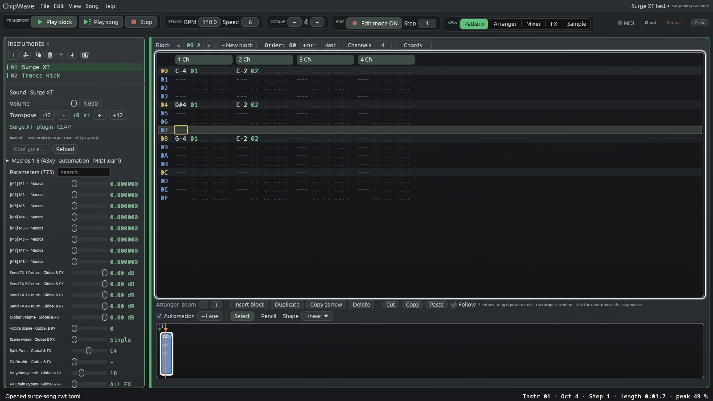

# Plugin instruments (0.2.3.16)

ChipWave 0.2.3.16 can play **CLAP** instrument plugins (Surge XT and so on) as ordinary instruments. They take notes from the pattern, velocity, glide and slides, run through the instrument's FX chain and the mixer, and are saved inside the song. This page covers what works today. The longer-term design (VST3, MIDI output, LV2) is in [MIDI_VST.md](MIDI_VST.md) and [PLUGIN_MANAGER.md](PLUGIN_MANAGER.md).



## Formats

| Format | 0.2.3.16 | Notes |
|---|---|---|
| **CLAP** | **Hosted**: scan, play, parameters, macros, automation, state, native editor (embedded on Windows, floating where the plugin offers one), offline render | Open standard by the free-audio project (MIT). On macOS a `.clap` is a bundle folder; ChipWave loads `Contents/MacOS/<binary>` |
| VST3 | **Listed, not hosted yet** | The scanner shows `.vst3` files as "VST3 hosting is not available yet (CLAP only in 0.2.3.16)". Still to do: VST3 COM hosting (IComponent / IAudioProcessor / IEditController), its parameter panel and IPlugView editor embedding |
| VST2 | Not supported | The SDK is discontinued and not covered by the VST3 MIT licence |
| LV2 | Not planned yet | |

Many plugins (Surge XT, Vital, Odin 2, …) ship a CLAP alongside their VST3, so install the CLAP too. **Dexed** (0.9.x) is VST3/AU/LV2 only and doesn't load until VST3 hosting lands.

## Finding plugins

ChipWave scans these folders recursively, plus any folders you add in **Settings → Plugins → Add folder…**:

| OS | Folders |
|---|---|
| Windows | `%COMMONPROGRAMFILES%\CLAP`, `%LOCALAPPDATA%\Programs\Common\CLAP` (and the matching `VST3` folders) |
| macOS | `/Library/Audio/Plug-Ins/CLAP`, `~/Library/Audio/Plug-Ins/CLAP` (and `…/VST3`) |
| Linux | `~/.clap`, `/usr/lib/clap`, `/usr/local/lib/clap` (and `~/.vst3`, `/usr/lib/vst3`, `/usr/local/lib/vst3`) |
| all | every folder in `CLAP_PATH` |

**Crash guard.** Each plugin is checked in a separate ChipWave process (`chipwave --scan-plugin <file>`), so a plugin that crashes, throws or hangs can't take ChipWave down. The checker loads the plugin, reads its name, vendor, id and features, creates an instance at 48 kHz, activates it and renders a test note. After 20 seconds it is killed and the plugin is marked "timed out". On Windows the checker suppresses crash dialogs. Results are cached in `plugin-cache.json` next to the settings file, keyed by file size and date, so later scans only re-check files that changed. **Rescan** checks new and changed files; **Full rescan** checks everything again.

The browser shows crashed, timed-out and unsupported files under "skipped" with the reason.

## Adding one

**New → Plugin instrument…** (the **+** button in the Instruments panel, or right-click the instrument list → New instrument) opens **Add plugin instrument**. The first time, while the cache is still empty, it scans by itself. Type to filter by name, vendor or id, then **+ Add** an instrument. ChipWave adds an instrument slot named after the plugin.

From the command line: `chipwave --scan-plugins [folders…]` prints the scan results.

## Playing

- **One instance per channel.** Each channel that plays a plugin instrument gets its own instance, so separate channels never steal each other's notes. Instances are created on the UI thread and handed to the audio thread; the audio thread never allocates (checked by a test with an allocation counter).
- **Notes and velocity** go out as CLAP note events, sample-accurate at the start of each block. Note-off, `OFF` and new notes release notes as usual.
- **Glide and slides** (`01`/`02`, `3C` glide, Voice glide) reach the plugin as per-note tuning (`CLAP_NOTE_EXPRESSION_TUNING`), so slides keep working without retriggering. Plugins that ignore note expressions just play the plain note.
- **Sample rate and block size** follow the audio device. A device change re-activates every instance at the new rate.
- **Stereo out** goes through the instrument's FX chain, then the channel strip, sends and master limiter, like any other instrument.
- **Panic** (the toolbar button, **Ctrl+.**) sends every instance all-notes-off and all-sound-off (CC 120/123 and CC 64 off, or a CLAP note choke), then resets the plugin.

## The plugin panel

Select a plugin instrument to see, under the instrument list:

- **Status:** the plugin's name, vendor and format, plus how many instances are loaded. A missing plugin shows a warning instead.
- **Configure… / Close editor** opens the plugin's own editor window. On Windows it's embedded in a ChipWave window (or floating if the plugin only offers that). On macOS and Linux only floating editors are offered so far. Surge XT has only embedded editors there, so on those systems you use the parameter list.
- **Reload** tries again after a plugin failed to load (for example after you installed it).
- **Macros 1–8:** pick any plugin parameter for each of eight macros. By default these are the first eight automatable parameters. You can also right-click a parameter slider and choose **Put on macro K**.
- **Parameters:** every parameter the plugin shows, as "name · group" (for example "Cutoff · Scene A/Filter 1"), with a slider, the plugin's own value text and a search box. Moving a slider changes the plugin straight away.

## Automation, 43xy and MIDI learn

The eight macros are the bridge to everything else in ChipWave:

- **`43xy`** in the effect column sets macro *x* (1–8) to *y*/15 (0–F = 0 … 100 %) on that channel's instance, the same way as generator macros. `4300` hands control back to the panel.
- **Automation lanes:** **+ Lane** offers "Macro 1" … "Macro 8" for plugin instruments, with the macro's parameter name. Lanes move the parameter smoothly, also in exports.
- **MIDI learn:** the macros are MIDI-learn targets too, so a hardware knob can drive them.

## Saving

The plugin's own state (its preset, as an opaque blob) is stored **base64-encoded** in the song (`.cwt`), in instrument files (`.cwi`) and in the instrument library, together with the plugin id, name, vendor, format, the path it was loaded from and the macro mapping. ChipWave asks the plugin for its state before every save, autosave, export, `.cwi` export and library save. This doesn't add an undo step, and plugin state changes aren't undoable in 0.2.3.16.

Text songs (`.cwt.toml`) take:

```toml
[[instrument]]
slot = 1
name = "Surge XT"
patch = "clap:org.surge-synth-team.surge-xt"
plugin_path = '/usr/lib/clap/Surge XT.clap'   # optional; found by id otherwise
# state = "<base64>"                          # optional
# macros = [ 12, 13, 40 ]                      # optional CLAP parameter ids
```

## Missing plugins

When a song uses a plugin that isn't installed (or fails to load), the instrument stays in the song as a **placeholder**. It shows the plugin's name and id, stays silent, and keeps its saved state and macros untouched, so saving the song on that machine loses nothing. A warning lists the missing plugins when the song opens, and the self-test checks this case.

## Offline render

WAV/MP3 export and `--render` create their own plugin instances at the export sample rate, with the saved state, and render them with the song. The live instances aren't disturbed. A song whose plugins are missing still exports, with those instruments silent.

## Tested plugins

| Plugin | Platform | Result |
|---|---|---|
| **cw-test-synth** (ChipWave's own tiny CLAP fixture, `plugins/cw-test-synth`) | Linux, Windows (Wine) | All tests: scan, play, state, macros, render, crash / hang guard copies |
| **Surge XT 1.3.4** CLAP | Linux | 775 parameters, 50 KB state round-trip, renders, no allocation on the audio thread |
| **Surge XT 1.3.4** CLAP (portable, with `SurgeXTData`) | Windows 11 build under Wine | Scans, plays, self-test PASS. Without its data folder Surge throws during the scan and is shown as crashed, which is the crash guard working |
| Dexed | n/a | No CLAP build; needs VST3 hosting |
| Vital | not tested | |

## Limitations in 0.2.3.16

- CLAP only: VST3 files are listed but not hosted (see Formats).
- Instrument plugins only; plugin *effects* in the FX chain are not hosted yet.
- No embedded editors on macOS or Linux yet (floating ones work).
- Plugin state changes made in the plugin's editor are not undo steps.
- Note expressions other than tuning (pressure, brightness …) and polyphonic modulation aren't sent yet.
- No plugin sidechain inputs, MIDI output, or multiple output buses (only the main stereo out).

## Credits

- **CLAP** by the free-audio project (Alexandre Bique and contributors), MIT: <https://github.com/free-audio/clap>
- **clap-sys** Rust bindings (MIT/Apache-2.0): <https://github.com/micahrj/clap-sys>
- **clack** (prokopyl, MIT/Apache-2.0), studied for host design: <https://github.com/prokopyl/clack>
- **Carla** (Filipe Coelho / falkTX) and **Ardour** (GPL-2.0+): ideas for out-of-process scanning, no code copied: <https://github.com/falkTX/Carla>, <https://github.com/Ardour/ardour>
- **libloading** (Simonas Kazlauskas, ISC) and **windows-sys** (Microsoft, MIT/Apache-2.0)
- **Surge XT** (Surge Synth Team, GPL-3.0) used for testing: <https://surge-synthesizer.github.io/>

Full licence texts: `THIRD_PARTY_LICENSES.txt`.
