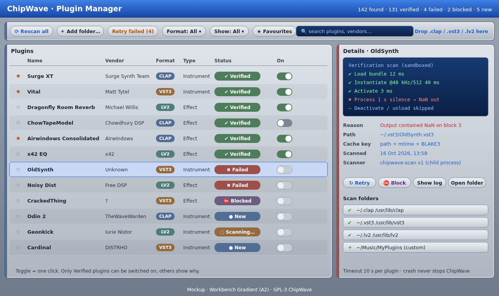

# Plugin Manager — load, verify, activate

Del's ask: *"an easy way for these to be loaded in and verified activated."* The Plugin Manager finds every CLAP, VST3 and LV2 plugin on the machine, test-loads each one in a sandbox, shows a clear badge, and lets you switch it on with one click. It extends [MIDI_VST.md](MIDI_VST.md).

**Status (0.2.3.16):** the CLAP part is implemented in a simpler form: an out-of-process crash/hang-guarded scanner, a cache, user folders and Rescan in Settings → Plugins, and the Add plugin instrument browser. See [PLUGINS.md](PLUGINS.md). Not done yet: VST3 and LV2 hosting, enable/disable badges, drag and drop of plugin files, and parallel scan helpers.

 (SVG: [`mockups/plugin_manager.svg`](mockups/plugin_manager.svg), Workbench Gradient A2 style per [DESIGN_LANGUAGE.md](DESIGN_LANGUAGE.md))

## 1. Finding plugins
Scanned automatically on first start and in the background on later starts (only changed files are re-verified).

| Format | Linux (CachyOS / any distro) | Windows 11 |
|---|---|---|
| CLAP | `~/.clap`, `/usr/lib/clap`, `/usr/local/lib/clap`, plus `$CLAP_PATH` | `%COMMONPROGRAMFILES%\CLAP`, `%LOCALAPPDATA%\Programs\Common\CLAP`, plus `%CLAP_PATH%` |
| VST3 | `~/.vst3`, `/usr/lib/vst3`, `/usr/local/lib/vst3` | `%COMMONPROGRAMFILES%\VST3`, `%LOCALAPPDATA%\Programs\Common\VST3` |
| LV2 | `~/.lv2`, `/usr/lib/lv2`, `/usr/local/lib/lv2`, plus `$LV2_PATH` | `%APPDATA%\LV2`, `%COMMONPROGRAMFILES%\LV2` |

- **Custom folders:** "＋ Add folder…" adds any directory (scanned recursively, toggle per folder). Stored in the user config, not in songs.
- **Drag & drop:** dropping a `.clap` file, a `.vst3` bundle/folder or a `.lv2` bundle onto the manager (or the main window) offers *Use from here* or *Copy to my user plugin folder* (`~/.clap` etc.), then verifies it immediately.
- **Flatpak:** needs filesystem permission for these paths (`--filesystem=~/.clap:ro`, `/usr/lib/clap` via host access, etc.); the manager shows a hint if a standard path is unreadable.
- Arch/CachyOS packages (e.g. `surge-xt`, `x42-plugins`, `dragonfly-reverb`) install to `/usr/lib/{clap,vst3,lv2}`, so they appear with no setup.

## 2. Verification scan (sandboxed)
Each plugin is checked by a separate helper process, `chipwave-scan`, so a crashing plugin can never take ChipWave down. Several helpers run in parallel (default: CPU cores − 1).

Steps, each timed and logged:
1. **Load** the binary / bundle (for LV2, read the TTL manifest first).
2. **Describe:** read name, vendor, ID, version, instrument/effect, ports (audio/MIDI/note).
3. **Instantiate** at 48 kHz, block size 512.
4. **Activate** and **process 1 s of silence** (plus a few test notes for instruments), stereo.
5. **Check output:** no NaN/Inf, no denormal storm, peak below +24 dBFS on silence input.
6. **Deactivate, destroy, unload** cleanly.

Limits: 10 s timeout per plugin (configurable), memory cap via job object (Windows) / `setrlimit` (Linux). Results are sent back over a pipe as JSON.

## 3. Status badges
| Badge | Meaning |
|---|---|
| ✔ **Verified** (green) | Passed every step. Can be enabled. |
| ✖ **Failed** (red) + reason | e.g. *crashed in instantiate (SIGSEGV)*, *timed out after 10 s in process*, *NaN output*, *missing dependency libfoo.so*, *wrong architecture (32-bit)*. |
| ⛔ **Blocked** (purple) | Blocked by you, or auto-blocked after repeated crashes. Never loaded until unblocked. |
| ● **New** (blue) | Found but not yet scanned (or changed since the last scan). |
| ◌ **Scanning…** (orange) | In progress. |

Colours follow the A2 readability rule: badge text is white on solid colour; no yellow on light panels.

## 4. One-click controls
- **On/off toggle** per row; only Verified plugins can be switched on. Off plugins are hidden from the instrument/FX pickers but kept in the list.
- **★ Favourites** float to the top of every picker.
- **⟳ Rescan all**, **Rescan this**, **↻ Retry** (failed only), **Retry failed (n)** in the toolbar.
- **⛔ Block / Unblock**, **Show log**, **Open folder**.
- Filters: format, status, instrument/effect, favourites; search by name/vendor.
- A song that uses a disabled or failed plugin opens normally and shows the slot as *missing*, keeping its saved state in the `.cwt` so nothing is lost.

## 5. Cache
`plugin-cache.toml` in the config dir (`~/.config/chipwave/`, `%APPDATA%\ChipWave\`). One entry per plugin, keyed by **path + mtime + BLAKE3 hash** of the binary (hash only computed when path/mtime changed, to keep startup fast). Stores descriptor, status, reason, timings, scanner version and user flags (enabled, favourite, blocked). A newer scanner version marks entries New again.

## 6. LV2 support (added)
LV2 joins CLAP and VST3 as a supported format (Linux first; Windows LV2 is rare but works the same way). Rust crates checked on crates.io (16 Oct 2026):

| Crate | Latest on crates.io | Licence | Notes |
|---|---|---|---|
| `livi` | 0.7.5 (Nov 2024) | MIT | LV2 host library built on lilv; simplest path to hosting. Small, single-maintainer project, so expect to contribute fixes. |
| `lilv` | 0.2.4 (Nov 2024) | MIT | Safe-ish bindings to the C **lilv** library (lilv itself is ISC). Needs `lilv` installed (`pacman -S lilv`). |
| `lilv-sys` | 0.2.1 (2019) | MIT | Raw FFI; old. |
| `lv2` | 0.6.0 (2020) | MIT OR Apache-2.0 | For *writing* LV2 plugins, not hosting. |

All are GPL-3-compatible. Plan: start with `livi`; drop to `lilv` directly if we need features it lacks (worker, state, UI). LV2 plugin GUIs (`suil`, X11/GTK) come later; generic parameter UI first.

## 7. Roadmap
- **Phase 2:** scanner process, cache, manager UI, CLAP then VST3, then LV2.
- **Phase 2.5:** drag-drop install, auto-block after 3 crashes, LV2 GUIs.
