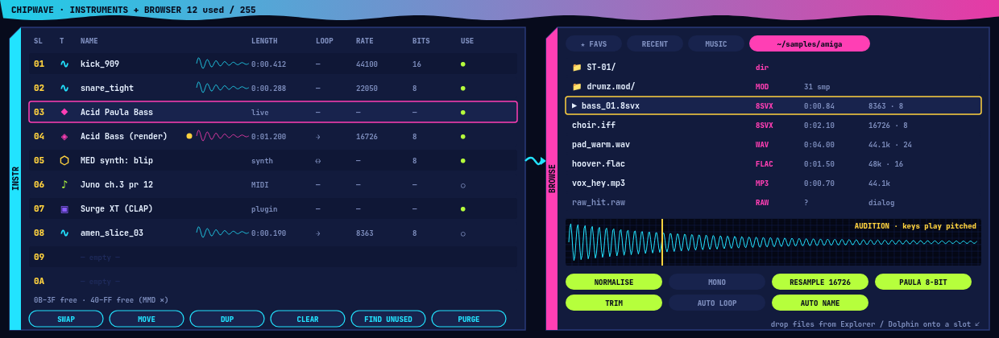

# ChipWave Tracker: Instrument List and Sample Importer

**Status (0.2.3.14):** the instrument list (New…, Duplicate, Delete…, Up / Down, rename, search, right-click menu), WAV import (button and drag and drop), the sample view with loop points and preview, and chop / slice (§8, 0.2.3.10) are implemented; the instrument library is in [INSTRUMENT_LIBRARY.md](INSTRUMENT_LIBRARY.md). Formats beyond WAV, the full browser and the MED/MOD slot limits below are still design. Visual style: [DESIGN_LANGUAGE.md](DESIGN_LANGUAGE.md).

## 1. Slot limits
| Format | Instrument slots |
|---|---|
| ChipWave `.cwt` | **255** (`01`–`FF`, hex like OctaMED's display; decimal display optional) |
| OctaMED MMD0–MMD3 | 63 (`sample[63]` array in the MMD song struct, per Kinnunen's format doc, [OCTAMED_SPEC.md](OCTAMED_SPEC.md) S1) |
| ProTracker MOD | 31 |

Slots above `3F` (63) show a small "MMD ✕" badge; exporting to MMD/MOD warns and offers to compact used slots into the lower range first (with automatic remapping, §5).

## 2. Instrument list panel
A cartridge (spine: **INSTR**, cyan) docked left by default ([UI_SCALING.md](UI_SCALING.md)). One row per slot:

| Column | Content |
|---|---|
| Slot | `01`…`FF`, monospace; the selected slot is highlighted and is the one the tracker enters |
| Type icon | **∿ sample**, **◆ synth patch** (SOUND_DESIGN.md), **◈ rendered** (sample with a live patch link; shows a stale dot when out of date), **♪ MIDI** (MIDI_VST.md), **▣ plugin** (CLAP/VST3 instrument), **⬡ OctaMED synth/hybrid** |
| Name | editable (F2 / double-click), up to 40 chars (truncated to 22 on MOD export) |
| Length | samples or mm:ss.ms (toggle) |
| Loop | `—`, `→` forward, `↔` ping-pong, plus loop start/length on hover |
| Rate | base sample rate (e.g. 8363, 16726, 44100) |
| Bits | 8 / 16 / 24 / 32f, mono/stereo dot |
| Used | **●** lit if any block uses the slot, with a use count on hover; hollow ○ if unused |

- A tiny waveform thumbnail in the row (toggle) drawn on the CRT background.
- Filters: all / used / unused / by type; search box.
- Keyboard: ↑/↓ select, **keypad** or `+`/`-` change slot (as OctaMED's keypad instrument selection), Space audition, Enter open in sample editor / sound designer.

## 3. Importer / browser
A cartridge (spine: **BROWSE**, magenta) that opens beside the list (or as a tab in Compact layout).

- **Places**: Favourites (pin any folder), Recent, Music, Home, drives (Windows), mounted volumes (Linux), and the current song's folder.
- **File list** with format, length, rate/bits and channels read from headers (fast, no full decode). Unsupported files are dimmed.
- **Preview / audition**: click plays the file (one-shot); ↑/↓ moves and auto-plays (toggle); the **tracker note keys** play it pitched across the keyboard (C-3 = original pitch) before it's even imported. Preview volume slider and a mini waveform with play position.
- **Modules as folders**: a MOD/MED/XM/IT/S3M file opens like a folder listing its samples, so you can audition and import them individually.
- **Import**: Enter / double-click → selected slot; **drag** files from the browser or **from the OS file manager** (Explorer, Dolphin, Nautilus; egui receives `dropped_files`) onto a slot. Dropping several files fills **consecutive free slots** from the drop point (batch import), with a summary of what went where.
- Options panel (remembered; per-import override):

| Option | Default |
|---|---|
| Normalise (peak, −0.3 dBFS) | off |
| Convert to mono (mix / left / right) | off |
| Resample to (keep / 8363 / 16726 / 22050 / 44100 / 48000 Hz) | keep |
| Bit depth (keep / 16 / 8-bit) and **Paula crunch** (8-bit + low-rate + A500 filter flavour) | keep |
| Trim silence (start/end, threshold −60 dB) | off |
| Auto loop detection (zero-crossing + autocorrelation; suggests a loop, never forces it) | off |
| Auto-naming (file name, cleaned up; or `{folder}-{n}`) | file name |
| Keep original file reference (re-import later) | on |

## 4. Supported formats
| Format | How |
|---|---|
| WAV (8/16/24/32f, incl. `smpl` loop chunk) | `hound` for PCM/float; loop points parsed from `smpl` chunk ourselves |
| AIFF / AIFC (incl. loop markers) | `symphonia` (AIFF support) or `aifc` |
| FLAC | `symphonia` (or `claxon`) |
| MP3 | `symphonia` |
| OGG Vorbis | `symphonia` (or `lewton`) |
| **IFF 8SVX** (Amiga) | own small parser (FORM/VHDR/BODY, one-shot + repeat parts, octaves, Fibonacci-delta compression); the `iff` crate (0.1.0, 2019) is too thin to rely on |
| Raw 8-bit / 16-bit | dialog: signed/unsigned, endianness, rate, channels (classic Amiga raw samples are signed 8-bit) |
| Samples from **MOD / MED (MMD0–3) / XM / IT / S3M** | our MMD and MOD loaders (needed anyway); `xmrs` for XM/IT/S3M/MOD; libopenmpt as an optional reference |

All decoding runs on a worker thread; large files show progress and can be cancelled. Untrusted input rules from [FILE_FORMAT.md §4](FILE_FORMAT.md) apply (size limits, no panics, fuzzing).

## 5. Slot management
- **Swap**, **move** (drag a row), **duplicate** (into next free slot), **clear**, **copy/paste** between songs.
- **Remap in song**: moving or swapping slots rewrites instrument numbers in every block (one undo step). An option lets you move a slot *without* remapping, for the rare case you want the song to point at a new sound.
- **Find unused** (selects all hollow ○ slots), **Purge unused** (clears them, with confirm), **Compact** (move used slots down to `01…`, remapping; useful before MMD/MOD export).
- **Replace sample** keeps slot settings (volume, finetune, loop if it still fits).
- **Save instrument**: sample → WAV/8SVX; synth → `.cwpatch`.
- Everything is undoable and saved in `.cwt` ([FILE_FORMAT.md](FILE_FORMAT.md)): samples as embedded WAV, original file path kept as metadata.

## 6. Rust crates (checked on crates.io, 16 Oct 2026)
| Crate | Version | Licence | Use |
|---|---|---|---|
| `symphonia` | 0.6.1 | MPL-2.0 | decode WAV/AIFF/FLAC/MP3/OGG (pure Rust). MPL-2.0 is file-level copyleft and compatible with GPL-3 |
| `hound` | 3.5.1 | Apache-2.0 | WAV read/write |
| `rubato` | 5.0.1 | MIT OR Apache-2.0 | high-quality resampling |
| `aifc` | 0.7.0 | MIT OR Apache-2.0 | AIFF/AIFC incl. markers (if symphonia lacks loops) |
| `claxon` | 0.4.3 | Apache-2.0 | FLAC fallback (older, stable) |
| `lewton` | 0.10.2 | MIT OR Apache-2.0 | Vorbis fallback (older, stable) |
| `xmrs` | 0.15.2 | MIT | XM/IT/S3M/MOD parsing for sample extraction |
| `libopenmpt-sys` | 0.3.0 | BSD-3-Clause | optional: libopenmpt for broad module support (C++ dependency; reference only by default) |
| `ebur128` | 0.1.10 | MIT | loudness analysis (shared with export) |

## 7. Roadmap placement
- **MVP:** instrument list (all columns except MIDI/plugin types), browser with preview and keyboard audition, OS drag-and-drop, batch import into free slots, WAV/AIFF/FLAC/MP3/OGG/8SVX, swap/move/clear with remap, find unused. You can't make music without loading samples.
- **Phase 1.5:** import options (normalise, mono, resample, Paula crunch, trim, auto loop, naming), favourites, module sample extraction, raw import, purge/compact.

## 8. Chop / slice (0.2.3.10)

The sample editor has a **Slice** row under the edit buttons.

- **Transients** cuts at the hits. The level is measured in 5 ms frames
  (10 ms windows); a slice starts where the level rises by
  `12 - 9 x sensitivity` dB above the loudest of the previous 15 ms and is
  within 40 dB of the loudest frame. The cut goes to the first sample above
  25 % of the local peak, then back to the zero crossing before it.
  **gap** (5-1000 ms, default 50) is the shortest slice. **sens** defaults to 50 %.
- **Grid** cuts into 2, 3, 4, 6, 8, 12, 16, 24, 32 or 64 equal parts (snapped to zero
  crossings within 64 frames).
- Slices are numbered on the waveform. Click a slice, or step with **Prev** /
  **Next**, to select it: Normalise, Reverse, Fade in/out and Gain then work on
  that slice only. **Alt+click** adds a slice point; **right-click** near a
  marker removes it; **Clear** removes them all (max 64).
- **To instruments** makes one sample instrument per slice, named
  `<name> 01`, `<name> 02`, …, with 1 ms fade-in / 3 ms fade-out declicks and
  the source's base note.
- **To notes** does the same, then clears the cursor channel in the current
  block and writes one note per slice at the row where it falls at the song
  tempo (a 120 BPM loop with 4 rows per beat: an 8th-note hit every 2 rows),
  and switches to the pattern. Rearrange the notes to re-sequence the loop.
- Each of those is one undo step (Ctrl+Z in the pattern view; inside the sample
  editor Ctrl+Z undoes sample edits).
- Slice points live in the editor only: they are not saved in the song, and are
  cleared after Crop / Delete / Trim, a sample undo or switching instrument.

The workflow follows the usual slicer tools (ReCycle, Renoise's slice markers,
OpenMPT's "Slice at cue points"); no code from them is used.
