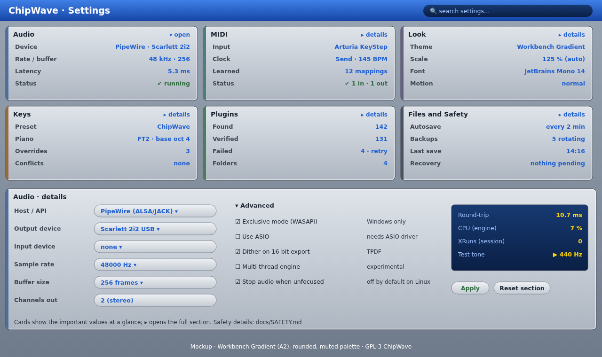

# Settings

**Status:** 0.2.0 implements the Audio, Look, Keys (remap + keymap.toml) and Files & Safety cards. 0.2.3 adds the MIDI card ([MIDI.md](MIDI.md)). Plugins is a placeholder card for now.

 (SVG: [`mockups/settings.svg`](mockups/settings.svg))

Opened with `Ctrl+,` (`Cmd+,` on macOS). The design goal is that you can **see at a glance** that everything's OK, and only dig in when you need to.

## 1. Summary cards
Six cards in a grid (3×2, reflowing to 2 or 1 columns on narrow screens, [UI_SCALING.md](UI_SCALING.md)). Each shows the 3–4 values that matter, plus a status line:

| Card | At a glance | Details section |
|---|---|---|
| **Audio** | Device, sample rate / buffer, latency, running status | §2.1 |
| **MIDI** | Input(s), clock in/out, number of learned mappings, ports status | §2.2 |
| **Look** | Theme (Workbench Gradient / Wave Neon), scale, font, motion | §2.3 |
| **Keys** | Keymap preset, piano layout and base octave, overrides, conflicts | §2.4 |
| **Plugins** | Found / verified / failed, scan folders | §2.5 → [PLUGIN_MANAGER.md](PLUGIN_MANAGER.md) |
| **Files and Safety** | Autosave interval, backups, last save, recovery status | §2.6 → [SAFETY.md](SAFETY.md) |

- A card shows a muted red edge and a one-line reason if something needs attention, e.g. "Audio: device unplugged, using default". Otherwise values are plain.
- Clicking a card (or `Enter` on a focused card) expands its **details** below the grid. Only one is open at a time, and the arrow keys move between cards.
- **Search** (top right) filters to matching settings across all sections and opens them.

## 2. Details sections
Each section has the common options first, then a collapsed **Advanced** group, and buttons **Apply** (for audio device changes, which restart the stream) and **Reset section**. Other settings apply instantly.

### 2.1 Audio
Host/API (PipeWire, ALSA or JACK on Linux; WASAPI or ASIO on Windows; CoreAudio on macOS), output and input device, sample rate, buffer size, channels. There's a live panel with round-trip latency, engine CPU, xruns and a test tone. **Advanced:** WASAPI exclusive mode, ASIO (only if built with it, see [MIDI_VST.md §6](MIDI_VST.md)), export dither, multi-thread engine (experimental), stop audio when unfocused.

### 2.2 MIDI
Enabled inputs and outputs, MIDI thru, clock send/receive and song position, the MIDI learn mapping list (edit/delete), and velocity curve. **Advanced:** per-port channel filters, MPE (later).

### 2.3 Look
Theme, UI scale (auto from the OS or 75–300 %), pattern font and size, row highlight spacing, hex/decimal rows, colour-blind palette, high contrast, reduce motion (turns off the wave band animation). See [DESIGN_LANGUAGE.md](DESIGN_LANGUAGE.md).

### 2.4 Keys
Keymap preset (ChipWave / FT2 / ProTracker / OpenMPT / OctaMED), "press a key" rebinding, conflict list, piano layout (physical-key based), and an import/export `keymap.toml` ([PATTERN_EDITOR.md §9](PATTERN_EDITOR.md)).

### 2.5 Plugins
Scan folders, scan timeout, parallel scanners, rescan / retry failed, and a link to the full plugin manager.

### 2.6 Files and Safety
Default song folder, autosave interval, number of backups and backup location, journal, persistent undo, recovery folder and cleanup age, and the recent files list (clear, pin). All of these are explained in [SAFETY.md](SAFETY.md).

**Updates (0.2.3.5):** "Check for updates at startup" (default on; quiet, at most once per 24 h, a menu-bar badge only when a newer non-skipped version exists), **Check now**, **Un-skip X**. See [UPDATES.md](UPDATES.md).

### 2.7 Layout (0.2.3.19)
These are set from the View menu and the lower panel, and saved in `settings.toml`:
- the lower panel's height (`lower_h`, 0 = automatic)
- whether it shows the instrument editor (`lower_inst`), and whether you chose that view
  yourself (`lower_chosen`). With no choice saved it opens on the instrument editor (Unreleased;
  before, it opened on the arranger)
- Full-height pattern (`full_height`)
- the classic sidebar instrument editor (`classic_editor`)
- the collapsed instrument-editor cards (`cards_closed`, as "Type/Card")
- whether File › New opens on the Timeline view, in timeline mode (`new_in_timeline`, default on; **Settings › New songs**, Unreleased; off = a tracker-mode song on the pattern editor). See [TIMELINE.md](TIMELINE.md#new-songs)
- what double-clicking a clip on the Timeline opens (`dblclick_roll`, default on = the piano roll; **Settings › Double-click a clip**, Unreleased; off = the pattern editor; Alt+double-click does the other one). See [TIMELINE.md](TIMELINE.md#finding-your-way-around)

Older settings files get the defaults.

## 3. Storage
`settings.toml` in the per-OS config folder ([SAFETY.md](SAFETY.md) lists the paths), saved atomically. Only non-default values are written, unknown keys are preserved, and a `settings_version` allows migrations. The portable Windows build stores it next to the exe.
