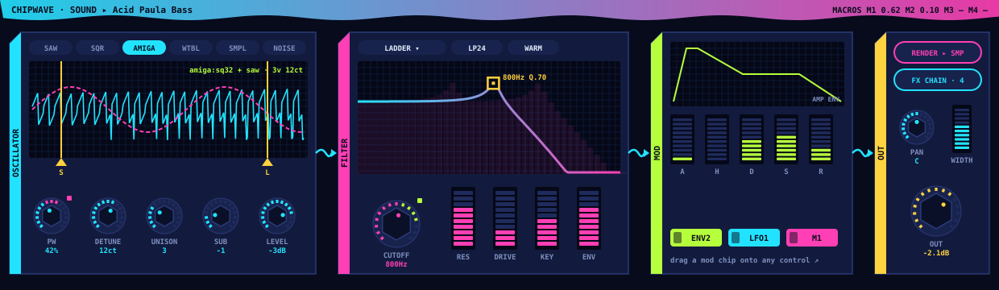
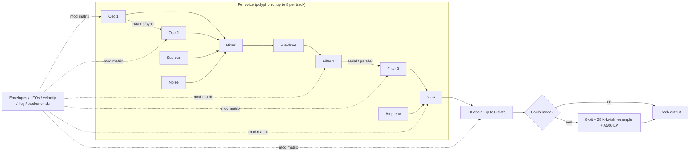
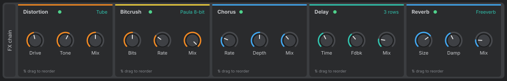

# ChipWave Tracker: Sound Design System

**Status:** design. No code yet.

ChipWave lets you build your own sounds *inside* the tracker and play them as ordinary instruments. Each sound is a **Patch**: an analogue-style subtractive synth voice followed by a per-instrument effects chain. A patch can stay **live** (rendered in real time) or be **sampled** to a normal 8/16-bit sample, the way Amiga musicians bounced synth sounds into samples for ProTracker/OctaMED.

The filter section is inspired by Bitwig Studio's filters and its modulation workflow (sources at the bottom). We copy ideas, not code or assets.



## 1. Signal flow



The voice runs at the engine rate (44.1/48 kHz). Filters and nonlinear stages run 2x oversampled (4x in "HQ" render mode).

## 2. Oscillators

Two main oscillators, plus a sub oscillator and noise.

| Parameter | Range / options |
|---|---|
| Waveform | Sine, Triangle, Saw, Square/Pulse, **Amiga 8-bit tables** (32/64-byte single-cycle waves like OctaMED synth sounds), Wavetable (user or built-in, morphable), Sample (use any instrument sample as an oscillator) |
| Pulse width | 1–99 %, modulatable (PWM) |
| Wavetable position | 0–100 %, modulatable |
| Octave / semi / fine | ±4 oct, ±12 st, ±100 cents |
| Unison | 1–8 voices, detune 0–100 cents, spread (stereo), blend |
| Sync | Osc 2 hard-synced to Osc 1 |
| FM / Ring | Osc 1 → Osc 2 linear FM amount; ring-mod mix |
| Phase | Free-running or reset on note-on, start phase 0–360° |
| Level / pan | per oscillator |
| Sub | Sine/square, −1 or −2 oct |
| Noise | White, pink, "Paula" (8-bit LFSR-style, sample-and-hold rate) |

**DSP notes:** saw/pulse use PolyBLEP (Välimäki & Huovilainen, 2007) to cut aliasing cheaply; wavetables use mip-mapped band-limited tables. The Amiga tables are deliberately *not* band-limited in Paula mode, because the aliasing is part of the sound.

## 3. Filters

Two filter slots, serial or parallel, each with **Cutoff** (20 Hz–20 kHz, set in pitch so modulation is musical), **Resonance**, **Drive**, **Key tracking** (0–100 %), **Env amount** and a **Model**.

| Model | Modes | Reference algorithm |
|---|---|---|
| **SVF** | LP, HP, BP, Notch, Peak, All-pass (+ morph LP→BP→HP) | Zavalishin, *The Art of VA Filter Design* (TPT / zero-delay-feedback 2-pole SVF); Simper's "SvfLinearTrapOptimised" notes (Cytomic) |
| **Ladder** | LP 1–4 pole (6/12/18/24 dB), optional HP/BP taps | Huovilainen, "Non-linear digital implementation of the Moog ladder filter" (DAFx 2004); Zavalishin's ZDF ladder; tanh saturation in the loop |
| **Sallen-Key** | LP/HP 1, 2, 4 pole, BP 2/4 | Zavalishin's TPT Sallen-Key (MS-20-style) with nonlinear feedback |
| **Diode / "TB"** | LP 4 pole (303-ish) | Zavalishin ZDF diode-ladder chapter (later phase) |
| **Comb** | +/− feedback, damping | Fractional delay line with one-pole damping |
| **Amiga LED** | LP fixed (~3.3 kHz 2-pole) + A500 output RC (~4.4 kHz) | Matches the Amiga hardware filter; on/off like OctaMED's filter command |
| **Formant/Vowel** | A-E-I-O-U morph | Parallel band-pass bank (phase 2) |

**Character switch** on SVF, Ladder and Sallen-Key: *Clean* (linear), *Warm* (symmetric tanh), *Dirty* (asymmetric, adds even harmonics). This mirrors the idea of Bitwig's "Character" options without copying their curves.

**Bitwig reference (what inspired this, verified):** Bitwig Studio 5.1 introduced the **Filter+** device, which loads any of ten Grid filters grouped as *Structural* (Low-pass LD ladder with variable slope and nonlinear option; Sallen-Key with 16 LP/HP/BP configurations; SVF high/low/band-pass and notch; Comb), *Inspired* (Low-pass MG Moog-style, XP Oberheim-style with 15 configurations, Vowels) and *Character* (Fizz, Rasp, Ripple) [1][2]. Third-party analysis by Polarity Music describes Low-pass LD as 1–4 poles with symmetric/asymmetric/linear character and drive [3], Sallen-Key modes as LP1/2/3/4/6/8, BP2/4/6/8, HP1/2/3/4/6/8 [4], and SVF as a resonant state-variable core [5]. Those are descriptions of Bitwig internals by a third party, not official docs, so we treat them as inspiration only.

## 4. Envelopes, LFOs and the mod matrix

- **Envelopes:** 3 per patch (Amp, Filter, Mod). ADSR + Hold + Delay, curve per segment (exp/lin/log), velocity sensitivity, loop mode for rhythmic effects. Times 0 ms–20 s, or synced to tracker ticks.
- **LFOs:** 3 per patch. Sine, triangle, saw up/down, square, S&H, smoothed random, and "tracker table" (step values like an OctaMED synth waveform list). Rate in Hz or synced (1/64 to 8 bars, in rows/ticks too), fade-in, phase, per-voice or global.
- **Other sources:** velocity, note (key), aftertouch/mod wheel (MIDI, phase 2), random-per-note, and **tracker command lanes**: a new effect command (e.g. `Mx yy`) sets a macro so a pattern can sweep a cutoff, just like classic filter commands.
- **4 Macros:** big knobs that can drive many targets, used by presets and by tracker commands.
- **Mod matrix:** up to 16 slots, `source → target × amount (bipolar)`, optional *via* (scale by another source). Every knob is a target, including FX parameters.

### Drag-to-modulate (Bitwig-style)
Bitwig's Unified Modulation System works like this: click a modulator's routing button, every possible target is highlighted, then click-and-drag a parameter to set modulation depth and direction; Alt temporarily edits the base value, Esc exits routing mode, and modulators can be per-voice [6][7][8]. ChipWave copies that workflow:

1. Each envelope/LFO/macro has a small **routing button** (dot-with-arrow).
2. Clicking it enters routing mode: valid targets get a tinted outline.
3. Dragging a knob up/down sets a bipolar amount; the matrix slot is created automatically.
4. Each knob shows a **coloured arc** outside its value ring for each mod source (colour = source), plus a moving dot for the live modulated value.
5. Right-click an arc → edit amount, bypass, remove. Alt-drag edits base value.

## 5. UI: the device strip

**Visual reference:** Del supplied a screenshot of Bitwig Studio's Sampler device ([`reference/del-visual-reference-bitwig-sampler.png`](reference/del-visual-reference-bitwig-sampler.png)). We follow its *style* (layout rhythm, colour roles, knob shape), drawn with our own egui code. No Bitwig artwork, icons or fonts are copied.




### Layout: one horizontal strip per patch, left to right
1. **Title rail** (26 px): vertical patch name, power/bypass dot, preset/browse icons.
2. **Mode tabs column:** oscillator source list (Saw, Square, Amiga, Wavetable, Sample, Noise). The active tab is in accent blue, the others dimmed. Bottom toggle picks OSC 1 / OSC 2.
3. **Oscillator / sample display** (largest panel): a header row of value readouts (source name in blue, unison and level values in teal/blue), an inset display showing the single-cycle wave or sample in light grey, **yellow** draggable start/loop/phase markers with flag tabs, and an **orange** line overlaid showing the live modulation (e.g. PWM or wavetable position over time). A footer row holds yellow numeric readouts (PW, WT position) and sync/FM values. Below it sit two small panels: a "◂ Analog ▸" character selector with Crunch/Tape-style knobs, and pitch (Oct, Detune, Retrig).
4. **Filter panel:** model / mode / character dropdowns in the header; an inset **draggable response curve** (blue line with soft blue fill, yellow handle at the peak: drag left/right for cutoff and up/down for resonance, wheel for drive); an orange translucent band showing the modulation sweep and a dashed orange line for the live cutoff. Underneath: one large cutoff knob with a Hz readout, plus **small vertical sliders** for Res, Drive and Key tracking.
5. **Envelope / modulator panel:** an envelope selector (Amp ▾ / Filter / Env 3), a mini envelope graph in orange, a row of small A H D S R knobs, velocity/curve readouts in teal, then compact LFO and macro rows. Each modulator has its routing button (green ring when it's armed).
6. **Right column:** buttons with coloured top strips, **Note** (blue: note/voice settings), **Render** (red: render-to-sample), **FX (n)** (teal: opens the FX strip), then an output panel with pan, width and a large **Out** knob.
7. **FX strip** (opens beneath, same style): one panel per effect with a coloured top strip matching its category, an enable dot, a mode readout in teal, three to six knobs, drag to reorder.

### Colour palette (egui `Color32`)
| Role | Hex | Use |
|---|---|---|
| `window_bg` | `#202123` | behind everything |
| `device_frame` | `#3B3D40` | the strip's outer rounded frame |
| `panel` | `#2A2B2D` | section panels (corner radius 6) |
| `inset` | `#1A1B1C` | waveform / curve displays (radius 3) |
| `knob_body` | `#3E4044` | knob fill, 1.5 px `#151617` outline |
| `track` | `#4A4C50` | unfilled knob arc / slider track |
| `label` | `#C9CBCE` | section headers, knob labels |
| `dim` | `#85888D` | inactive tabs, hints |
| `accent_blue` | `#3FA9F5` | active tab, primary values, LFOs, filter curve |
| `accent_teal` | `#2FC6B0` | secondary values (modes, %), FX button |
| `accent_orange` | `#F5891F` | value arcs, envelopes, modulation overlay |
| `accent_yellow` | `#F2D23C` | markers, draggable handles, numeric readouts on displays |
| `accent_green` | `#4FD18B` | enabled / routing armed |
| `accent_red` | `#E5484D` | Render button strip, clipping |

Modulation colours: envelopes orange, LFOs blue, macros green, tracker-command lanes yellow. Every arc and overlay uses its source's colour.

### Knob style
- A 270° sweep starting at 135° (bottom-left) and ending bottom-right.
- **Body:** a filled circle (`knob_body`), radius 11 px (small: ADSR, pan), 15 px (standard) or 20 px (hero: cutoff, Out).
- **Pointer:** a 2 px light line from 30 % to 85 % of the radius, round caps.
- **Value arc:** 3 px, radius + 4, drawn over a full `track` arc. Unipolar knobs fill from the start; bipolar ones (pan, octave, mod amounts) fill from 12 o'clock.
- **Modulation arcs:** 2 px at radius + 8 (+4 for each extra source), from the base value to base + amount, in the source's colour. A small dot shows the live modulated value.
- **Label** below in `label` at 11 px. The value appears in a tooltip while dragging, and in teal in place of the label for 1 s afterwards.
- **Interaction:** vertical drag (Shift = fine), double-click resets, wheel nudges, right-click opens the menu (modulation, MIDI learn, reset). In routing mode, dragging sets the mod amount and Alt-drag sets the base value.
- **Vertical slider:** 18 × 62 px dark slot, coloured fill from the bottom, 5 px light cap.

Implementation: custom `egui::Widget`s drawn with `Painter` (`circle_filled`, an arc path via `PathShape`, `rect_filled`). The theme lives in one `Theme` struct so a light or "Workbench" skin can come later. Font: egui's default (or bundle Inter, OFL-licensed), 11–12 px, headers semi-bold.

### Bitwig-inspired behaviour (sourced)
- **Modulation routing:** described in §4, with sources [6]–[8].
- **The draggable response curve is our own design.** We didn't find official Bitwig documentation describing one in Filter+, so we don't claim it.

## 6. Effects chain (per patch)

Up to 8 slots, reorderable by drag, each with bypass and dry/wet.

| Effect | Key parameters | DSP notes |
|---|---|---|
| Distortion | type (soft tanh, hard clip, foldback, tube asym), drive, tone, mix | 2x oversampled, ADAA (antiderivative anti-aliasing) for clippers |
| Bitcrush / Paula | bits 1–16, sample rate reduce, Amiga 8-bit mode | S&H + quantise; no interpolation for authentic grit |
| Chorus / Flanger | rate, depth, delay, feedback, voices | modulated fractional delay (Hermite) |
| Phaser | stages 2–12, rate, depth, feedback | cascaded first-order all-pass |
| Delay | time (ms or rows/ticks), feedback, ping-pong, LP/HP in loop | synced to tracker BPM/tempo |
| Reverb | size, decay, damping, pre-delay, mix | Freeverb (Schroeder/Moorer) first; FDN (Jot) later |
| EQ | 3-band + LP/HP, draggable curve like the filter panel | RBJ "Audio EQ Cookbook" biquads |
| Compressor | threshold, ratio, attack, release, knee, makeup | feed-forward, RMS/peak detector |
| Filter | any filter model from §3 as an FX | reuses filter code |

## 7. Render to sample (Amiga workflow)

- **Render** button: plays the patch at a chosen note (default C-3), velocity and length (or "until silent", with tail detection) and writes the result into a sample instrument slot.
- Options: 8-bit or 16-bit, sample rate (Paula periods like 8363 Hz/16726 Hz, or 44.1 kHz), mono/stereo, normalise, auto loop-point finder for sustaining sounds, render across a key range (multi-sample).
- **Keep live:** the sample remembers the source patch (`source_patch` link + a hash of its parameters). If the patch is edited, the sample shows a "stale" badge and re-renders in one click, or automatically if "auto-render" is on.
- Rendered samples export to MOD/MMD normally; live patches can't be stored in MOD, so export **auto-renders** them (with a warning).
- OctaMED's own synth/hybrid instruments (waveform + volume/pitch command lists) load from MMD into a dedicated *OctaMED Synth* instrument type (see OCTAMED_SPEC.md), separate from this patch engine, so files round-trip exactly.

## 8. Patch / preset format

Human-readable **TOML** (AI and diff friendly), one file per patch, `.cwpatch`. Stored inside the song file and in a user preset library (`~/.config/chipwave/patches/` on Linux, `%APPDATA%\ChipWave\patches\` on Windows).

```toml
format = "chipwave-patch"
version = 1
name = "Acid Paula Bass"
author = "Del"
tags = ["bass", "acid", "amiga"]

[osc1]
wave = "saw"
octave = -1
unison = { voices = 3, detune = 12.0, spread = 0.4 }

[osc2]
wave = "amiga:square32"
semi = 7
level = 0.5

[filter1]
model = "ladder"
mode = "lp24"
cutoff_hz = 420.0
resonance = 0.72
drive = 0.3
character = "warm"
key_track = 0.5

[env.amp]
attack_ms = 2
decay_ms = 180
sustain = 0.6
release_ms = 120

[env.filter]
attack_ms = 0
decay_ms = 260
sustain = 0.0
release_ms = 100

[[lfo]]
id = "lfo1"
shape = "triangle"
rate = "1/8"

[[mod]]
source = "env.filter"
target = "filter1.cutoff"
amount = 0.65      # bipolar -1..1, in octaves of range

[[mod]]
source = "lfo1"
target = "osc1.pulse_width"
amount = 0.2

[[fx]]
type = "distortion"
mode = "tube"
drive = 0.4
mix = 0.5

[[fx]]
type = "delay"
time = "3 rows"
feedback = 0.35
mix = 0.2

[render]
note = "C-3"
bits = 8
rate = 16726
keep_live = true
```

Unknown keys are kept and ignored (forward-compatible). A short `docs/PATCH_FORMAT.md` with every key will come with the code so an AI can write patches from a description.

## 9. Engine design (Rust)

- **Real-time safety:** audio thread (cpal callback) never allocates or locks. UI sends parameter changes through a lock-free ring buffer (`rtrb`/`ringbuf`); parameters are `AtomicF32`-style smoothed values (10 ms ramps).
- **Voices:** fixed pre-allocated pool; voice stealing by oldest/quietest; per-voice mod sources.
- **Block processing:** 32–64 sample sub-blocks so tracker tick timing stays sample accurate; modulation updated per sub-block, audio-rate for FM/filter cutoff where needed.
- **Testing:** golden-render tests (render patch → compare against stored WAV with tolerance), filter magnitude response tests against analytic curves.

### Crates worth evaluating (checked on crates.io, 16 Oct 2026)

| Crate | Latest | Use |
|---|---|---|
| `egui` / `eframe` | 0.37.0 | UI (already chosen) |
| `egui_plot` | 0.37.0 | quick response curves/scopes; we'll likely hand-paint the filter curve with `egui::Painter` instead |
| `egui_knob` | 0.6.3 | knob widget to start from; we need custom mod arcs so may fork/write our own |
| `cpal` | 0.18.2 | audio output (already chosen) |
| `fundsp` | 0.23.0 | DSP building blocks (oscillators, SVF, Moog, reverb); good for prototyping, but we'll own core filter code for control over nonlinearity |
| `biquad` | 0.6.0 | RBJ biquads for EQ |
| `realfft` | 3.5.0 | spectrum overlay |
| `rubato` | 5.0.1 | resampling for render-to-sample and sample import |
| `hound` | 3.5.1 | WAV read/write |
| `freeverb` | 0.2.0 | reference reverb |
| `synfx-dsp` | 0.5.6 | reference DSP (ladder, SVF, oversampling); older, read for ideas |
| `serde` + `toml` | 1.0.229 / 1.1.8 | patch format |

## 10. Roadmap placement

**Phase 1.5** (right after MVP): one-oscillator-pair synth, SVF + Ladder, amp/filter envelopes, 2 LFOs, drag-to-modulate, 4 FX (distortion, bitcrush, delay, reverb), render-to-sample, TOML presets.
**Phase 2:** Sallen-Key, diode, comb, formant; wavetables; unison; full mod matrix; remaining FX; spectrum overlay; multi-sample render.

Why not MVP: the MVP must prove the tracker core (timing, sample playback, MMD load). The synth plugs in as a new instrument type behind the same `Instrument` trait, so it doesn't block or reshape the MVP.

## Sources

1. Bitwig Studio 5.1 release notes, "New device: Filter+": https://downloads.bitwig.com/5.1.1/Release-Notes-5.1.1.html
2. Bitwig user guide, Filter devices: https://www.bitwig.com/userguide/latest/filter15
3. Polarity Music, Low-pass LD (third-party analysis): https://polarity.me/topics/low-pass-ld/
4. Polarity Music, Sallen-Key: https://polarity.me/topics/sallen-key/
5. Polarity Music, SVF: https://polarity.me/topics/svf/
6. Bitwig user guide, The Unified Modulation System: https://www.bitwig.com/userguide/latest/the_unified_modulation_system
7. Bitwig, An Introduction to Modulators: https://www.bitwig.com/learnings/an-introduction-to-modulators-45/
8. Bitwig Studio Getting Started Guide, §6 Modulation: https://dash.bitwig.com/documentation/Bitwig%20Studio%20Getting%20Started%20Guide%20English.pdf
9. V. Zavalishin, *The Art of VA Filter Design* (Native Instruments, free PDF).
10. A. Huovilainen, "Non-linear digital implementation of the Moog ladder filter", DAFx 2004.
11. V. Välimäki, A. Huovilainen, "Antialiasing oscillators in subtractive synthesis", IEEE Signal Processing Magazine, 2007 (PolyBLEP family).
12. R. Bristow-Johnson, "Audio EQ Cookbook" (W3C note).
