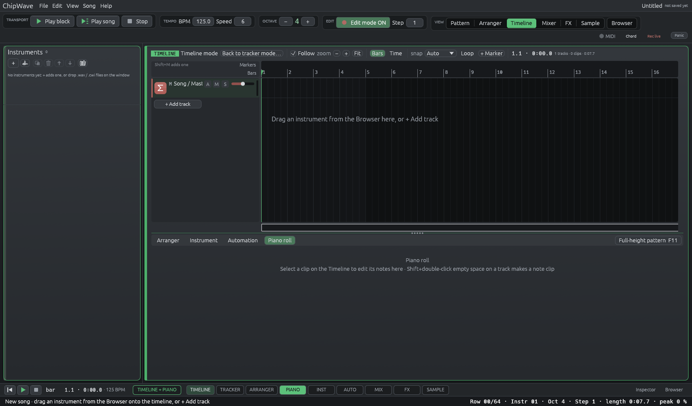
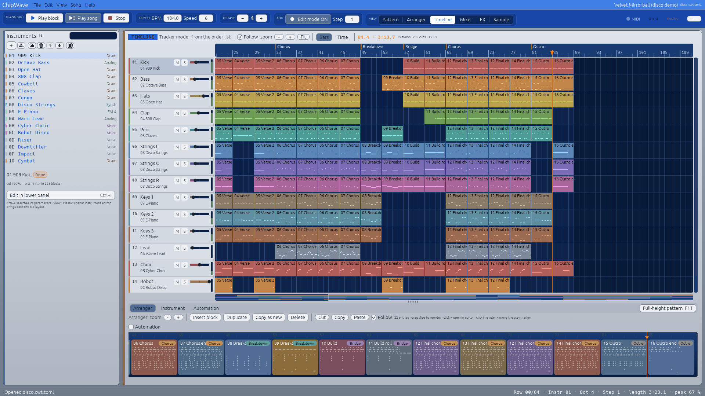

# Timeline view

**Status:** editable (milestones M0, M1 and M2 of [DAW_TIMELINE_PLAN.md](DAW_TIMELINE_PLAN.md), unreleased). A song is in **tracker mode** (the order list decides what plays, and the timeline only shows it) or in **timeline mode** (the clips are the song, and you arrange them here). New songs start in timeline mode, and tracker-mode songs and demos are switched to timeline mode when you open them (below).

The **Timeline** view (the **Timeline** tab in the VIEW group, **View › Timeline**, or **Ctrl+T**) shows the song the way a DAW does: tracks run down the screen, time runs left to right, and each track holds the clips it plays. It is another view of the same song, so nothing about the song changes when you open it.

- **Tracks are channels.** Track 6 *is* channel 6. It has the same name, the same mixer strip, the same mute/solo and the same meter.
- **A clip is one column of one block.** If block 06 has notes in columns 1, 2 and 5, playing it from the order list puts a "06" clip on tracks 1, 2 and 5. Empty columns don't get a clip, and an empty column behaves exactly like a gap.
- When the order list plays the same block several times in a row, the clips merge into one **looped clip**, with small notches where each repeat starts.
- **Markers** come from the Order list's section roles (Intro, Verse, Chorus…).

The toolbar shows which mode the song is in:

- **Tracker mode · from the order list.** The timeline is worked out from the order list and blocks every time they change. You can look, play, seek and open clips, but the first clip edit (dragging a clip, S, M, Delete, Ctrl+D…) asks *Switch to timeline mode?* (see below). Since 0.2.4.1 a tracker-mode song (a `.cwt`, a demo from File › Demo songs or Help › Load demo song, a recovered song, a file on the command line) is **switched to timeline mode when it is opened**, with the same lossless conversion as the prompt below and no prompt. It plays bit-identically (tests compare the render of every demo). Opening is not an edit: the song isn't marked unsaved and there is no conversion step to undo. The status bar says *Opened in timeline mode. File > Export tracker-compatible copy for 0.2.4.0 and older.* The file on disk is untouched until you save. **Settings › Opening songs › Open tracker songs in timeline mode** (on by default) turns this off: songs then open in tracker mode and play exactly as before, and the first clip edit asks. Screenshots (`--screenshot`) and the command-line tools (`--render`, `--self-test`, `--play-test`) don't convert.
- **Timeline mode.** The clips are the song. The order list is no longer used (the Order list says so), and the blocks are the clips' contents. **Back to tracker mode…** turns the timeline back into blocks and an order list.

## Timeline mode

### Switching
- **Switch to timeline mode** (toolbar), or any clip edit in a tracker-mode song, opens a prompt. **Switch to timeline mode** (or Enter) converts the song and then runs the edit you asked for. **Not now** (or Esc) leaves everything alone.
- The switch is lossless: the song plays the **same samples** afterwards (checked by a test for every demo and fixture song, and by `--self-test`).
- **Undo puts it back.** The switch and the edit that asked for it are separate undo steps, so Ctrl+Z once undoes the edit and twice returns to tracker mode.
- **Back to tracker mode…** asks first, then turns the timeline into blocks and an order list that play the same (overlapping or partial clips become new blocks). Markers, the loop region and track speeds are dropped. Undo brings the timeline back.
- **File › New** starts a song in timeline mode (Del's decision). Turning off **Settings › New songs › Open on the Timeline view** gives a tracker-mode song on the Tracker instead.

### Editing clips

| Do | How |
|---|---|
| Select | Click a clip. **Ctrl-click** or **Shift-click** adds or removes clips. Drag on empty space for a **box** selection (with Ctrl/Shift it adds). **Ctrl+A** selects every clip, **Esc** clears |
| Move | Drag a clip (the whole selection moves, across tracks too). Moves snap to the grid by the clip's start. Hold **Shift** for single rows |
| Copy | **Alt-drag**: copies follow the mouse and the originals stay. **Ctrl+D** duplicates the selection right after itself. Copies are **linked**: they play the same block, so editing the block changes all of them |
| Make unique | **Ctrl+Shift+D**: the clip gets its own copy of its block ("Groove copy"), so editing it no longer changes the others |
| Resize / loop | Drag a clip's **right edge**. Past the end of its block the block repeats (notches show each repeat) |
| Trim | Drag the **left edge**: hides (or, on a looping clip, reveals) the start, while the content stays where it is |
| Split | **S** splits the clips under the mouse (or the selected clips at the play marker) at the snapped position |
| Glue | **Ctrl+J**: the selected clips of one track become one clip of a new block "Glue NN" that plays exactly what they played (gaps become empty rows, up to 256 rows) |
| Mute | **M** mutes or unmutes the selected clips (drawn dim, marked *muted*) |
| Delete | **Del** or **Backspace** (the blocks stay in the song) |
| New clip | **Double-click** empty space on a track: a new empty 64-row block on that bar, opened in the Tracker on that channel |
| Clip menu | **Right-click** a clip: open, split here, duplicate, make unique, glue, mute, delete, loop around the selection, add marker |
| Track speed | **Right-click** a track header: the ticks per row for this track's effects (slides, `0D` volume slides, filter slides), or *Follow the song*. A track with its own speed shows "speed N" in its header |

Each gesture is one undo step (a drag records when you let go). The status line shows the position while dragging.

### Snap
The **snap** menu in the toolbar: **Auto** (bar, beat or row, whichever is at least about 10 pixels wide at this zoom), **Bar**, **Beat** or **Row**. Hold **Shift** while dragging for rows. The ruler snaps to the same grid (**Alt** = exact row).

### Loop region and markers
- **Shift-drag the ruler** to set the loop region, or press **Ctrl+L** to loop around the selected clips. **L** or the **Loop** toggle switches it on and off. While it is on, playback wraps from its end to its start, and the region is shaded.
- **+ Marker** (or **Shift+M**) adds a marker at the play marker and asks for its name. Right-click the marker strip to add one under the mouse. Click a marker to jump there. Drag it to move it, double-click it to rename it, and right-click it to rename or delete it.

### Playing
- **Space** on the Timeline plays the song from the play marker (the triangle on the ruler), and stops it. Click the ruler to move the marker; while playing, playback jumps there.
- **Seeking is exact.** Starting or jumping anywhere replays everything before that point silently (tempo, speed, instruments, volumes, filter and the other state commands), and a note that is still held is struck again if its instrument sustains.
- The song ends at the end of the last clip, or at the end the song had when it was converted, whichever is later.
- **Export** (File › Export…) renders the timeline once, never looped. In timeline mode the range can also be **Loop region** (the region, once, with everything before it chased).

### File › Export tracker-compatible copy…
Timeline-mode songs save a `timeline.toml` and need this version to open (older versions refuse them cleanly, see below). **File › Export tracker-compatible copy…** saves a tracker-mode copy (blocks + order list, reader version 1) that ChipWave Studio 0.2.4.0 and older open and play the same. Your song stays as it is.

## Piano roll and note clips

The lower panel has a **Piano roll** tab (next to Order list / Instrument / Automation). It edits the clip selected on the Timeline, or the current block column in the Tracker. Clicking into it gives it the keyboard; clicking elsewhere gives it back.

**Toolbar and editing (Unreleased, all targets):** one row, left to right:
- the clip / block **chip** (track colour) and **ALL** (select every note, Ctrl+A);
- the tools: **Pointer** (key **1**, the default: click empty space draws a note, drag a note moves it, its right edge resizes it), **Select** (**2**: drag a box on empty space; never draws) and **Pencil** (**3**: click draws, dragging paints a run of notes, each the remembered length, at the mouse's pitch);
- note clips: the **snap** menu (Bar, Beat, 1/8, 1/16, 1/32, 1/16T, **Smart** = follows the zoom, off), **Quantize** (Q);
- **Fit** (F: zoom to the notes); **Scale** turns the song key on or off (its notes are highlighted; the same key as the Chords window) with the **key** and **scale** menus;
- **Len**: the length the next click draws (also a menu).
- note clips: **Chords** shows the **chord lane** above the notes, **Generate** opens *Generate chord progression*, and **Stamp** picks the chord the click draws (see [CHORDS.md › Chord lane](CHORDS.md#chord-lane-in-the-piano-roll-unreleased)).

**Single-click entry:** one click on empty grid draws a note **the length of the last note you drew, resized or clicked** (the grid step at first), snapped to the grid. Drag while drawing to set its length; that becomes the new length. A slightly long or wobbly click keeps the remembered length (it only changes once the mouse moves half a grid step). Double-clicking still works (the second click selects the new note). Clicking a note selects it and never draws.

**Selection:** a plain click selects only that note. **Shift+click** (or Ctrl+click) adds a note to the selection or takes it out; **Shift+drag** on empty space draws a box that adds to the selection. Shift+click on empty space never draws. Selected notes are **orange** (darker when quiet, so velocity still reads; a lighter outline), also in the clip on the Timeline; the note under the mouse lightens a little.

**Moving a selection:** press on **any selected note** (after Ctrl+A too) and drag: the whole selection moves together in time and pitch, snapped to the grid, keeping its shape, as **one undo step**; faint ghosts stay at the old spot while you drag. The group stops at bar 0, at the block's last row and at the top and bottom keys (no note gets squashed). Pressing a selected note without moving keeps the selection; a click on it (press and release) selects just that note. Dragging the right edge resizes the whole selection (note clips; block columns resize the grabbed note).

**Navigating (hold to pan):** **press and hold** on empty grid for **¼ s** without moving (6 px), and the cursor becomes a grab hand: drag to scroll time and pitch together; let go and nothing is drawn. A quick click still draws a note, and a quick press-and-drag still draws / boxes / paints as before. **Middle-drag** pans straight away. The pan stops at the start, half a screen past the end and the key range. (Space+drag is not a pan: Space is play / stop.)

**Eraser:** **right-click** a note deletes it; **right-drag** deletes every note the mouse passes over (the cursor becomes an eraser). The whole swipe is **one undo step**. Deleted notes break into small pixels of their colour that drift up and fade (about half a second; purely visual, skipped with **Settings › Look › Flat**). Right-click on empty space does nothing.

**Tracker clips and block columns (M3a)** are shown as notes on the row grid, one at a time, as the tracker plays them:
- Click to draw a note (current instrument, a note-off at its end), the length of the last one. Drag while drawing to set its length.
- Drag a note (or a selection, together) to move it (time and pitch), and drag its right edge to resize it (this moves the note-off).
- Right-click (or right-drag) erases notes. Shift/Ctrl+click toggles a note in the selection, and Shift-drag adds a box to it.
- The **velocity lane** sets the volume column.
- Effect commands show as badges above the grid. Edit the selected note's instrument, velocity and effect in the bar at the top.
- Keys: **Del** deletes, **arrows** move (Shift+Up/Down = octave), **Ctrl+A** selects all, **1 / 2 / 3** pick Pointer / Select / Pencil, **F** fits, **Q** quantises (note clips), **+/−** zooms, **Esc** clears the selection. Ctrl+wheel zooms; wheel and Shift+wheel scroll.
- Only the cells of the notes you touch change. Drawing a note into silence and deleting it again leaves identical cells.

**Note clips (M3b)** are polyphonic, with free timing:
- To make one: right-click empty space › **New note clip here**, or **Shift+double-click** empty space. Double-click or **Enter** on a note clip opens it in the roll; double-click opens Tracker clips there too (see [Finding your way around](#finding-your-way-around)).
- The **snap** menu sets the grid (Bar, Beat, 1/8 … 1/32, 1/16T, Smart, off), and **Q** / **Quantize** snaps the selection (or every note).
- **Chord** draws the song key's chord on the clicked scale degree (set the key in the Chords window). Notes in the song key are highlighted.
- Dragging the edge of a note resizes the whole selection.
- Note clips loop, trim, split, duplicate (linked) and **make unique** like Tracker clips. They play **on top of** Tracker clips on the same track; they don't replace them.
- **Playback:** each track has 8 voices for its note clips. When more notes sound, the oldest released voice is stolen, then the oldest. Notes start at sample accuracy on the row clock and play through the track's insert chain and mixer channel. A note with instrument 00 uses the track's current instrument. Chance draws from the clip seed, so playback, seeks and exports repeat exactly. A seek re-strikes held notes of sustaining instruments. Plugin instruments get the notes too.
- **MIDI recording:** with **Edit mode** on, **Rec live** on and the timeline playing, keys played on the Timeline view go into a note clip on the cursor track. The clip starts on the bar and grows as you play. Each note is placed at the time it was heard, with the output latency taken off.
- **Capture:** right-click › **Capture played MIDI here** turns the last phrase you played (recorded or not; a 4 s gap ends a phrase) into a note clip, timed at the song tempo.

## Audio clips

Audio files play on the timeline as **audio clips (M4)**, on any track, mixed into that track's mixer channel.

- **Import:** drop WAV, FLAC, MP3 or Ogg Vorbis files on a track in the Timeline view (they land on the grid under the mouse; several files go on the tracks below), or right-click empty space › **Import audio file here…**. Files are decoded in the background; the clip appears when it's ready. Dropping on another view still imports a WAV as a sample instrument, as before. In tracker mode a drop asks to switch to timeline mode first.
- **Waveform:** clips draw their waveform (min/max per pixel), shaped by the clip gain and fades.
- **Editing:** move, Alt-drag copy, trim either edge, drag the right edge past the end of the file to **loop** it (with notches), **split** (S), duplicate, mute and delete work as for other clips. Overlapping clips on one track play together, so a fade-out over a fade-in is a crossfade.
- **Fades:** drag the small handles in the top corners of a selected (or hovered) clip; Shift snaps to rows. The curve is **Equal power** (the default, steady loudness through a crossfade), **Linear** or **S-curve**: right-click › Fades.
- **Gain:** right-click › **gain dB** (−48 to +12 dB). The clip name shows it.
- **Playback:** a file plays at its **own speed and pitch**. Its sample rate is converted while it plays (4-point Hermite), so it sounds the same at 44.1, 48 or 96 kHz, live and in **export**. Clips start at sample accuracy, play from the right spot when you start or seek inside them (with a 1.5 ms fade-in), and end exactly at their end (a split is seamless). Tempo changes don't stretch audio (no warping yet).
- **Saved with the song:** files are **stored in the `.cwt`** (the original file bytes, so an MP3 stays an MP3) unless they are larger than 64 MB, which are **referenced** by path. Right-click › **Store the file in the song** switches between the two. A referenced file that has moved is also looked for next to the song.
- **Missing files:** when a referenced file can't be found, the song still opens. You get a warning, and the clip turns red and is silent but keeps its place, length and settings (saving keeps it). Right-click › **Locate audio file…** relinks it.
- **Memory:** files are decoded into memory (32-bit float): about 21 MB per stereo minute at 44.1 kHz. Files over 5 minutes import with a memory note; files over 20 minutes are refused.

## Automation lanes

**Stage 1–3 (Unreleased, design A):** Song/Master track + song-lane migration;  knob LEDs, Show automation, follow last-touched;  lane headers show Device > Parameter; colour by parameter family; value scale on the left; double-click to add points; searchable "+ lane" menu. See [AUTOMATION.md](AUTOMATION.md) and [research/automation-ux.md](research/automation-ux.md).

In timeline mode every track can show **automation lanes (M5)** under its header.

- **Open and close:** click the **A** button on a track header (sage when open). The lanes fold away with it; which tracks are open is saved with the song but isn't part of undo. In tracker mode the button offers to switch to timeline mode.
- **Add a lane:** **+ lane** under the open track lists everything that can be automated: the track's mixer channel (volume, pan, sends), instrument parameters, generator knobs, FX devices (built-in and **plugin FX** parameters), return buses, the master and **modulation depths** (route amounts). Tempo stays a song lane. **pin song lane** moves an existing song lane (from the lower panel's Automation tab) onto the track; right-click its lane header › **Move to the song lanes (unpin)** moves it back.
- **Drawing:** click to add a point; drag a point to move it (snaps to rows, **Shift** for free movement); drag in empty space to add a point and keep dragging it; **Ctrl-drag** draws freehand (pencil); **Alt-drag** a segment **bends** it into a curve; double-click a point to delete it. Right-click a point for its shape (linear, step, smooth), **Straighten (no curve)**, or **Delete point**.
- **Lane header:** the dot turns the lane on or off, **×** removes it (Ctrl+Z brings it back), right-click to clear, **Move to the song lanes (unpin)** or remove.
- **Clip automation:** right-click a lane inside a clip › **Add clip automation to this clip** gives that clip its own copy of the lane, drawn as a box over the clip. Its points belong to the clip's source, so they **move, loop, trim and split with the clip** like its notes, and linked copies of a clip each keep their own lane. Clear or remove it from the same menu.
- **Innermost lane wins:** Absolute clip lanes replace the track lane inside the clip; **Relative +** / **Relative ×** combine with it (design A). Song lanes migrate onto tracks (and a **Song / Master** row) when entering timeline mode. Muted clips and switched-off lanes don't count. Where two Absolute clip lanes overlap, the one that starts later wins. **Glue** merges clip automation onto the glued clip.
- **Playback and export:** lanes play live (edits are heard at once, without restarting notes or audio) and in WAV/MP3 export, sample for sample the same.
- **Back to tracker mode:** track and clip lanes are baked into song lanes (sampled every row and at clip edges, straight runs merged), so the tracker copy sounds the same up to row resolution.
- **Files:** songs with track or clip lanes, or a curved segment anywhere, need **reader version 4**. Songs without them are saved and play exactly as before.

## Finding your way around

| Do | How |
|---|---|
| Open the view | **Ctrl+T**, the **Timeline** tab, or View › Timeline. **Ctrl+Tab** cycles Order list → Timeline → Mixer |
| Zoom | **Ctrl+wheel** zooms around the mouse. **+** / **−** (keys or toolbar). **Fit** or **F** shows the whole song |
| Scroll | Wheel scrolls tracks. **Shift+wheel** scrolls time (the wheel scrolls time too when every track fits). Drag the **mini-map** strip under the clips, or the scroll bar on the right. **Home** / **End** jump to the start / end, and **←** / **→** scroll a bar |
| Track height | **Alt+wheel** |
| Move the play marker / seek | Click the **ruler** (or the marker strip). Like the Order list it snaps to the bar, and **Alt** gives the exact row. While playing, playback jumps there. Drag to scrub |
| Follow | **Follow** in the toolbar pages the view so the playhead stays about a third of the way in |
| Bars or time | **Bars** / **Time** switches the ruler between bar numbers and minutes:seconds. The readout shows `bar.beat · m:ss` at the playhead, or at the play marker while stopped |
| Open a clip | **Double-click** a clip: it opens in the lower panel's **Piano roll** tab (a Tracker clip shows that column of its block, which also becomes the Tracker's current block and channel; a note clip shows its notes). **Alt+double-click**, **Enter** or right-click › **Open in the Tracker** opens the block in the Tracker instead, with the cursor in the clip's column (on the row you clicked; Enter: at the clip's start). **Settings › Double-click a clip** swaps the two (*Piano roll*, the default, or *Tracker*; Alt always does the other one). Audio clips don't open. Double-clicking an empty part of a track opens the block playing there (tracker mode) or writes a new one (timeline mode) in the Tracker |
| Select | Click a clip (outlined). **Esc** clears the selection. The [Inspector](INSPECTOR.md) (**I**) shows the clicked clip or track |
| Clips and markers | Each clip has a solid title bar in its track's colour over a softer body. The row above the ruler shows each marker as a section band up to the next one (**Markers** / **Bars** captions on the left) |
| Track header | Coloured strip, an **icon tile** in the track colour with the instrument type's glyph (synth, drum, voice, sample, wave, Grid, plugin; audio and Song/Master tracks have their own), number, name and instrument. **M** / **S** mute and solo the channel. The mini-fader is the mixer volume (double-click for 0 dB), and the meter is the channel's. Click a header to put the pattern cursor on that channel. Drag it up or down to reorder; right-click to add tracks ([Tracks](#tracks-add-reorder-instruments)) |
| Full height | **F11** hides the lower panel and the timeline gets the whole height. **Ctrl+I** brings back the instrument editor under it |

Keys typed in the Timeline view never enter notes. Ctrl shortcuts and the F-keys work as everywhere else, and **Space** plays the song from the play marker.

## Tracks: add, reorder, instruments

Tracks are mixer channels, so these change the song's channels (up to 32). Every one is a single undo step.

| Do | How |
|---|---|
| **Add a track** | **+ Add track** under the last track header, or right-click a header › **Add ›** › **Empty track above** / **below** (the [track pie](#track-pie-menu)). A new track is empty, with default mixer settings, named "Track N" |
| **Add a track with an instrument** | right-click a header › **Add ›** › **Instrument track…**: the [Browser](BROWSER.md) opens on its Instruments tab, and the next instrument you double-click (or Enter) there makes the track, named after it. Or **drag an instrument from the Browser onto the empty area below the last track**: an insertion line and "New track: <name>" show where it goes |
| **Give a track an instrument** | drag an instrument, preset, `.cwi` file or VST3 / CLAP plugin instrument from the Browser onto the **track's header** (or its row). The header lights up. Every note on the track switches to that instrument (Tracker clips: the track's column of each block; note clips: their notes), and the track remembers it, so the header shows it even while the track is empty and clicking the header makes it the current instrument |
| **Reorder** | **drag a header up or down** (by its number / name). An insertion line shows where it lands; let go to move it |

When all 32 tracks are used, the add commands are greyed out with "all 32 tracks are used (the channel limit)" and a drop below the tracks says so instead of adding one.

**Reordering moves the whole channel**, in timeline *and* tracker mode: its column in every block (so tracker-mode blocks are remapped, not just the view), its mixer strip (volume, pan, mute / solo, sends, ducking, and the duck key if it was this channel), its name, its timeline track (clips, height, automation lanes) and every automation lane or modulation route that targets the channel (`mixer.ch.N.volume`, `…pan`, `…send.X`). Playback is therefore the same music; only the order in which the channels are added together changes, which can differ in the last bits of a float (tests allow 1e‑4 and in practice it's far smaller). We chose to remap safely in both modes rather than allow reordering only in timeline mode, because tracks are channels in both and a tracker-mode user expects the columns to follow. Track colours follow the position unless you picked one in the [Inspector](INSPECTOR.md) (timeline mode; saved with the song), so a moved track without its own colour takes the colour of its new place.

## Track pie menu

**Right-click a track header** (in the Timeline's track list, or a channel header in the Tracker) and a round menu opens around the pointer. The centre says **TRACK** and the track's name; nine segments go round it, clockwise from the top:

| Segment | What it does |
|---|---|
| **Rename** | the name in the header becomes a text field: type, then **Enter** or click away keeps it, **Esc** cancels (one undo step) |
| **Colour ›** | a swatch panel pops out: the 12 track colours or **Auto** (the palette colour of the track's place). Timeline mode |
| **Icon ›** | the **TRACK ICON** panel: **Auto** (picked from the instrument type, the default) or one of 16 icons (keys, synth wave, sine, square, drums, hi-hat, guitar, bass clef, mic, violin, brass, voice, sparkle, waveform, noise, pad). Shown in the track header, the channel header and the [Inspector](INSPECTOR.md). Saved with the song; timeline mode |
| **Add ›** | **Instrument track…** (the Browser picks the instrument, as "Add track with instrument"), **Audio track** (timeline mode), **Empty track above / below**, **Duplicate** (a copy below: its block column, clips with their own notes, mixer strip, colour, icon and lanes). **FX track** is greyed out: bus tracks are not in ChipWave yet |
| **Devices** | the lower panel's Devices tab for this track |
| **Routing** | the Inspector for this track; its **Sends** section has the delay / reverb sends and the duck depth |
| **Organize ›** | **Move up / down / to top / to bottom** (the whole channel moves, as when you drag a header) and the track's **effect speed** (follow the song, 3, 6, 12) |
| **Save CPU** | greyed out for now (freezing or deactivating a track is on the [roadmap](ROADMAP.md)) |
| **Delete** | deletes the track with its clips, its block column, mixer strip and the lanes aimed at it (**Ctrl+Z** brings it back). Refused with a message if another track's clip plays this track's block column, or for the last channel of a tracker-mode song |

**Using it:** point at a segment to light it (it lifts a little with an accent arc on the rim; segments with **›** pop their panel out), then click. Or hold the right button, drag onto a segment and let go. **Esc**, a click on the centre or anywhere outside closes it. Keyboard: the **arrow keys** (or Tab) walk round the ring and through a panel, **Enter** or Space chooses, Esc closes a panel and then the pie; other keys do nothing while it is open, so shortcuts can't act behind it. The pie (and its panels) always fits on screen: near an edge it moves in. The Song / Master row keeps its small menu (add a track).

**Motion:** it opens in 180 ms with an ease-out (scale 0.6 → 1 and a fade, each segment 12 ms after the one before, clockwise), closes in 120 ms, and hover fades in 80 ms; a panel pops out from its segment in 120 ms. ChipWave only repaints while something moves. **Settings › Look › Reduce motion** shows and hides it at once. The ring's shape is computed once and only scaled per frame, so it stays smooth at 60 fps and more. Every choice is one undo step and works in the Dark and Amiga themes.

## The default layout: Timeline + piano roll

ChipWave starts with the clean song of File › New (no demo; the demos are in File › Demo songs), with the **Timeline on top and the piano roll docked below** (about 40 % of the height; drag the splitter to resize). File › New and opening a timeline-mode song show the same layout; tracker-mode songs open in the view you are in.

- The piano roll follows the selection: **click a clip** and its notes are in the roll; double-click still opens it focused. With nothing selected it shows the selected track's first clip, or an empty roll with a hint.
- **Back to it in one step:** **Ctrl+6**, **View › Reset to default layout** (also the panel height), The Inspector (I) and the Browser stay as they are.

## New songs

**File › New** (Ctrl+N) is a clean project: timeline mode on the Timeline view, **no tracks and no instruments**, only the **Song / Master** track (tempo, master and return automation), with the piano roll below, default tempo (125 BPM) and time signature. The lanes say *"Drag an instrument from the Browser here, or + Add track"*: a Browser drop makes the first track with that instrument; **+ Add track** makes an empty one (double-click it to write a block). Undo takes either back. Leaving timeline mode with no tracks gives the song one empty channel, since the tracker needs a column.

To go straight to the Tracker instead, turn off **Settings › New songs › Open on the Timeline view**. Songs you open from disk keep the view you are in.

**The decision (Del, 19 Oct 2026):** new songs start on the Timeline, in **timeline mode** (clips are the song). Existing songs used to open in tracker mode and switch only when asked. **Update (Del, 19 Oct 2026: "default is timeline mode"):** tracker-mode songs and demos now open in timeline mode, playing the same; Settings › Open tracker songs in timeline mode (off) brings the old behaviour back.

## Performance

Clips, notes, grid lines and the mini-map are drawn as a few meshes. Only the clips in view are visited (a per-track binary search), and note previews are thinned to about one mark per pixel column. The derived timeline is rebuilt only when the song changes. A UI test draws a 32-track song with more than 9,000 clips and checks the frame time, both fitted to the window (everything visible) and zoomed in.

## Under the hood (for developers)

### Time base
- A **row is always a 16th note** (`model::ROWS_PER_BEAT = 4`). The engine's tick length is `sr·60/(bpm·4·speed)`, so speed changes how often effects step, never how long a row lasts. `lines_per_beat` only changes the display (row highlighting). M0 fixed the places that used it for timing (`arrange.rs` seconds, bars and target lengths, the chord histogram, the sample views). A test checks that changing it never changes any duration.
- The timeline counts in **ticks: 960 per quarter note**, so a row is 240 ticks and triplets and 1/64 swing come out exact.

### The model (`src/timeline.rs`)
Everything uses `serde(default)` and leaves out fields that are at their default, so a clip that just plays a block saves as five short lines.

- `Timeline { tracks, clips, notes, tempo, signature, markers, loop_range, view, next_id }`
- `Track { name, colour, kind: Note|Audio, height, folded, armed, auto }`. The track index is the mixer channel.
- `Clip { id, track, start, len, offset, loop_len, kind, name, colour, muted, gain, fade_in, fade_out, seed, auto }`
  - `ClipKind::Block { pattern, col }` is one column of a block. `ClipKind::Notes { data }` is polyphonic notes (the piano roll, M3b).
  - `offset` is a left trim. `loop_len` makes the source repeat. `source_at(t)` and `pass_at(t)` give the source position and which loop pass you're in.
- **Note data is shared**: `notes: Vec<Shared<NoteClipData>>`, where `Shared` is an `Arc` that serialises as plain data. Linked clips and undo snapshots copy a pointer, and an edit copies only the clip it touches (`Arc::make_mut`).
- **Notes, MIDI 2.0 style** (ideas from Microsoft's MIDI work, [research/microsoft-midi.md](research/microsoft-midi.md)): `Note { start, len, key, vel: u16, rel_vel: u16, instr, fx, tune, chance, expr }`.
  - Velocities are 16-bit. `vel_from_7` / `vel_to_7` use the MIDI 2.0 M2-115 min-centre-max scaling, which round-trips every 7-bit value exactly.
  - `tune` is a per-note detune in semitones. `chance` is a percentage (0 = always).
  - `expr` holds optional per-note expression lanes (`ExprKind` Volume, Pan, Tuning, Vibrato, Expression, Brightness, Pressure). They are numbered like CLAP's `CLAP_NOTE_EXPRESSION_*`, so they go to plugins unchanged.
- **Automation values are stored as 0–1 floats** and turned into parameter units only at the output. The **innermost lane wins**: clip lane, then track lane, then song lane (`innermost()`).
- **Randomness is reproducible.** Each clip has a `seed` (taken from its id when created). Anything random in a clip (note chance, later random modulators) must come from `ClipRng::new(seed, pass)`, a SplitMix64. So a random result depends only on the seed and the loop pass, never on playback history. Exports, seeking and looping stay bit-exact.
- **Tempo map** `TempoPoint { tick, bpm, ramp }`. A ramp goes linearly in BPM to the next point, and `seconds_at` integrates it exactly (a closed-form log). An empty map means `song.bpm`.
- **Time-signature map** `SigPoint { tick, num, den }` (ruler and snap only). `bars_in` and `bar_pos` give bar lines and bar.beat. **Markers** `Marker { name, tick, colour, track }` (`track` = a per-track marker).
- `TimelineView { zoom, scroll, scroll_y, track_h }` is UI state.

### Converting
- `from_order(song)` builds the derived timeline plus an `OrderMap` (order entry ↔ tick). A `0F00` pattern break ends a block's effective length after the break row.
- `consolidate(song, timeline)` goes the other way. It cuts the timeline at every clip start, end and loop wrap (at most 256 rows per block), builds one new block per distinct slice (identical slices share a block), and writes the order list. A later clip wins where clips overlap, muted clips are silent, and gaps are empty rows. A `0F00` survives only on the last row of a slice.
- **Tested bit-exact:** for the three demos, the 0.2.3.5 and 0.2.3.6 fixture songs, and a synthetic song with breaks, odd lengths, repeats and a 300-row block, order list → timeline → consolidated order list renders the **same samples**. The self-test (`--self-test`) checks the demo too.

### Timeline mode in the engine (M2)
- `song.timeline: Option<Box<Timeline>>`. `None` is tracker mode and the engine's tracker path is untouched (so old songs stay bit-exact).
- **The plan.** In timeline mode the engine plays an `Arc<Plan>` (`src/timeline/plan.rs`): per track, a sorted list of non-overlapping row segments (`Seg { start, end, pattern, col, src0, loop_rows }`). A later clip start wins where clips overlap, and muted clips and note clips are left out. The plan is built on the UI thread (`Engine::ensure_plan`, keyed by a cheap hash of everything it depends on) whenever the timeline changes, and right away by every edit. The audio thread only reads it, never allocates, and finds each track's segment with a cursor (binary search after a seek).
- **Rows stay global.** Every track steps rows together, so the song-wide tick length still follows `song.speed`, `09xx` (last writer wins across tracks, as in the tracker) and `0Fxx`. This is what makes the conversion lossless. **Per-track speed** is a track property (`Track.speed`, 0 = follow the song): a track with its own speed spreads that many effect steps over the row.
  - *Deviation from the plan:* `09xx` stays song-wide in timeline mode (rather than becoming per-track), because making it per-track would change how converted songs sound.
- A `0F00` pattern break ends **its clip's** block there (the rest of the block is silent in that clip); playback never jumps. A tempo map point changes the tempo at its row. Before the first point the tempo is `song.bpm` (points at tick 0 are dropped on conversion).
- **Seek / start** chase rows 0 to the target with state only (instrument, volume column, `09`, `0C`, `0Fxx`, `38`/`39`, `3F`–`42`, `43`), then strike notes that are still held, if the patch sustains (`amp.s ≥ 0.05`).
- **Loop region:** wraps when the next row would be the region's end, if `loop_on`. **Song end:** `play_end` = the later of the last unmuted clip's end and `Timeline.end` (the converted song's length), rounded up to a row (64 rows if empty).
- **Edits** (`src/timeline/edit.rs`): `enter_timeline_mode` (from the order list; automation positions move from block rows to timeline rows, which differ only after a break), `leave_timeline_mode` / `tracker_copy` (consolidate), `move_clips`, `set_end` (turns on looping past the block end), `set_start`, `split`, `duplicate`, `copies_at`, `delete`, `toggle_mute`, `make_unique`, `glue`, `new_clip`, `add_marker`, `set_loop`, `snap`. They edit the song in place; the song-wide undo keeps a pointer copy of the timeline (`same_content` ignores the view state).
- `Timeline::fix(&song)` repairs a loaded `timeline.toml` (drops clips on missing tracks or blocks, clamps values, matches the track count) and returns warnings.
- Tests (`src/timeline/m2_tests.rs`, `src/app/timeline_m2_tests.rs`): a moved clip plays exactly a bar later; split, glue and make unique render the same samples; resize loops and trim; mute; the loop region wraps; a seek chases tempo and held notes; per-track speed changes effects, not timing; the tracker copy renders the same as the edited timeline; the switch prompt and its two undo steps; drag, Alt-drag, edges, S, Ctrl+D, Delete, Ctrl+Shift+D, ruler seek, Shift-drag loop and L.

### Note clips in the engine (M3b)
`build_plan` also resolves the unmuted note clips into per-track `NoteSpan`s (absolute ticks, sorted). It handles loops, left trims and clip ends, and draws chance from `ClipRng(seed, pass)`. The plan key hashes the notes, so edits during playback take effect. `src/engine/notes.rs` keeps a preallocated pool of 8 voices per track. Once per sample it compares the row clock (`tl_clock`) with the spans' cursors, and mixes the voices into the track before its stutter / insert chain. Seeks, loop wraps and Stop release the voices; a seek re-strikes sustained notes. Plugin notes use tagged live notes in the plugin rack. None of this runs unless the plan has notes, so tracker songs and block-only timelines render the same samples as before (tested).

### Audio clips in the engine (M4)
- **Model:** `ClipKind::Audio { asset }` points into `Timeline.audio: Vec<AudioAsset>` (pooled; linked copies share a file). `AudioAsset { name, path, embed, ext, rate, channels, frames }` is saved in `timeline.toml`; the decoded audio (`pcm: Option<Arc<audiofile::Pcm>>`) and, for stored files, the original bytes (`bytes`) are runtime only. `Clip.gain`, `fade_in`, `fade_out` and the new `fade_shape` (`FadeShape::{EqualPower, Linear, SCurve}`) apply to audio clips. Trim (`offset`) and `loop_len` stay in ticks and convert to frames at the tempo where the clip starts (`Timeline::frames_per_tick`); a loop of the whole file wraps exactly at its last frame. `audio_ticks` gives a file's length in ticks.
- **Decoding** (`src/audiofile.rs`): Symphonia 0.5 (MPL-2.0) with the WAV/PCM, FLAC, MP3 and Ogg Vorbis features; more than 2 channels fold to stereo. Peaks are kept every 256 frames for drawing. The import runs on a worker thread (`app/timeline/audioclip.rs`).
- **Plan:** `build_plan` adds per-track `AudioSpan { start, end, asset, off, loop_len, rate, gain, fades, shape, secs0 }` for unmuted clips whose file is loaded, plus the decoded files (`Plan.pcm`) and the tempo map. `Plan::audio_frame` finds the source frame at any tick through the tempo map (seeks).
- **Voices** (`src/engine/audioclips.rs`): 4 per track, preallocated, holding only `Copy` data; they read the files through the plan (the audio thread never allocates or frees, tested). Once per sample the row clock starts and ends spans; each voice steps `file rate / output rate` frames per sample and mixes into the track before its stutter / insert chain. Seek and Stop fade voices out over 64 samples; a plan rebuilt during playback (an edit) keeps unchanged clips playing and starts new ones under the playhead. Nothing runs unless the plan has audio, so other songs render exactly as before (tested).
- **Files:** a stored file goes into the `.cwt` as `audio/NNN.<ext>` (stored, not deflated; NNN = pool index). A song with audio clips writes `min_reader_version = 3` (older readers would fail on `ClipKind::Audio`); this version reads 3. `fileio::load_audio_assets` decodes stored files, reads referenced ones from their path or next to the song, and warns about missing ones. A `.cwt.toml` text song can reference audio files next to it (it can't store them).
- Tests: `src/audiofile.rs` (WAV exact, FLAC/MP3/Ogg fixtures in `tests/fixtures/audio`, bad input), `src/timeline/m4_tests.rs` (bit-exact without audio, frame-exact start, own speed at 22.05/44.1/48 kHz, trim/loop/split/fades/gain, fade curves, seek position, edits while playing, crossfade, allocation-free, embedded + referenced + moved + missing files, tracker-mode refusal, export and its tail), `src/app/audioclip_tests.rs` (drop on a track + undo, fade handles, clip menu, tracker-mode drop, bad file). `--self-test` plays a WAV clip at another rate and round-trips it through a `.cwt`.

### Automation lanes in the engine (M5)
- **Model:** `Track.auto` (positions in rows from the song start) and `Clip.auto` (positions in rows of the clip's *source*: a timeline tick `t` maps to `(offset + t − start) mod loop_len`, so lanes follow moves, trims, loops and splits; split copies the lanes into both halves). `Point.curve` (−1..1, saved only when set) bends a Linear segment as `t^(2^(−2.5·c))`, exactly linear at 0 (`automation::bend`). `TimelineView.auto_open` is a bit per track.
- **Plan:** `timeline::build_auto` (`src/timeline/autoplan.rs`) flattens the enabled, non-empty lanes of unmuted clips into an `AutoPlan { targets, layers, points }`: track layers first, then clip layers sorted by start. It has its own key (`auto_key`), separate from the clip plan, so drawing doesn't re-seek notes or audio clips. Built on the UI thread in `ensure_plan`; the engine's value buffers are sized there too.
- **Evaluation:** `eval_auto` (every 32 frames) runs the song lanes first, then `eval_tl_auto` evaluates the plan's layers at the playhead; a later layer overrides an earlier one with the same target, so the innermost lane wins. Smoothing is per target slot and starts from the song lane's value. Modulation-depth targets write the route amount. No allocation (tested); nothing runs when the plan is empty, so older songs render bit-exactly (tested).
- **Leaving timeline mode:** `bake_into_song` samples each target every row and just before each clip edge, out to the last breakpoint, merges straight runs and replaces the matching song lane.
- **Renumbering:** `Song::lane_lists_mut` covers song, track and clip lanes, so deleting an instrument or moving FX slots or routes renumbers all of them.
- **UI:** `src/app/timeline/autolanes.rs` (`Layout` gives each track its clip row plus open lanes; `lanes_ui` draws and edits, returning `AutoOp`s that `App::auto_op` applies with undo snapshots; drags are one undo step). The add-lane menu is shared with the lower panel (`app/lanes.rs::lane_menu_ui`).
- **Files:** lanes are saved inline in `timeline.toml` (`[[tracks.auto]]`, `[[clips.auto]]`). A song with track or clip lanes or any curved point writes `min_reader_version = 4`; this version reads 4.
- Tests: `src/timeline/m5_tests.rs` (bit-exact without lanes, track lanes, innermost wins with moves and mutes, splits and trims, curves and targets, allocation-free, save/load, baking, export, renumbering), `src/app/autolanes_tests.rs` (fold button, click/drag/double-click editing, clip lanes, pencil, menus), `automation.rs` (curves). `--self-test` plays track and clip lanes and round-trips them through a `.cwt`.

### File format and older versions
Tracker-mode songs are written exactly as before, byte for byte, with `min_reader_version = 1`. A timeline-mode song adds **`timeline.toml`** (the `Timeline`, see the model above) to the `.cwt` and writes **`min_reader_version = 2`** in `manifest.toml` (a `.cwt.toml` text song takes an optional `[timeline]` table). This version reads version 2. Since M0, ChipWave reads `min_reader_version` (in `manifest.toml` of a `.cwt`, or the top level / `[song]` table of a `.cwt.toml`) and refuses files that need a newer reader. You get *"This song was made with a newer ChipWave Studio … Please update"* and a **Check for updates** button, rather than a wrong-sounding song. So 0.2.4.0 and older (which read version 1 or don't check) are told to update instead of opening a timeline-mode song wrongly, and **File › Export tracker-compatible copy…** saves a consolidated version 1 song for them.

### Screenshots
`chipwave --screenshot out.png --view timeline --song demos/disco.cwt.toml` plays from order entry 8 (`CHIPWAVE_SHOT_POS=n` changes it). `--view timeline-new` shows a new song, `--view timeline-audio` audio clips (a looped break with a fade-in, a pad with fades and gain, a missing file), `--view timeline-automation` automation lanes (track lanes on Bass and Hats, a clip lane on a Bass clip), `--view trackpie` the track pie on track 2 with Icon lit and `--view trackpie-icons` with its TRACK ICON panel out (`CHIPWAVE_SHOT_PIE_T=<s>` freezes the open animation at that time, `CHIPWAVE_SHOT_PIE_KEY=<n|none>` picks the lit segment). See `scripts/screenshots.sh`.

## Limits in this version
- **Not yet in M2:** range selection with insert / delete time, snapping to other clips' edges and markers, clip fades and gain, a MOD/MMD exporter (ChipWave has none yet; the tracker-compatible copy is a `.cwt`), and the browser panel. These move to M3. (The Browser is now in: [BROWSER.md](BROWSER.md).)
- **Chase:** a seek re-strikes held notes only on sustaining patches (plugin instruments get no re-strike), and slides (`01`, `02`, `0D`…) running at the seek point are not replayed.
- **Glue** writes the result into the track's own column of the new block, at most 256 rows.
- **Tempo:** the ruler's time and the readout use the song's BPM and the tempo map. `0Fxx` tempo commands inside blocks still play, but the ruler doesn't show their effect on time.
- **Song automation after a pattern break:** positions are moved to timeline rows on the switch, but a song that has both automation and `0F00` breaks may not consolidate back bit-exactly.
- **New songs** keep their empty block 00 (unused) next to the blocks you create.
- **Note clips:** a timeline with note clips can't go back to tracker mode or export a tracker copy (no conversion to blocks yet). Note expressions and release velocity aren't played yet. Plugin notes go out at plugin-block boundaries (up to one engine tick, about 20 ms, late) and without CLAP note ids. There is no MIDI file import. Tempo-map ramps aren't used for recording or Capture timing (the current tempo is). The track's insert chain follows its tracker instrument (or the first note-clip instrument on a note-only track).
- **Piano roll on blocks:** moving several notes in time moves only the grabbed one (arrow keys move the whole selection). Block notes are monophonic per column.
- **Audio clips (M4):** no time-stretch or repitch (`Warp`), no reverse, no per-clip FX, no Slice to sampler or Collect-and-save yet, and files are held in memory (no streaming). Fades are per clip (no automatic crossfades). Audio trims and loops are measured at the tempo where the clip starts, so moving a clip across a tempo change shifts its trim in seconds. A timeline with audio clips can't go back to tracker mode or export a tracker copy. Plugin-delay-compensated tracks don't delay audio clips differently from other sounds on the track.
- **Automation lanes (M5 + design A):** Song / Master track (tempo / master / returns); write modes + ● Write; Pointer/Pencil/Line/Shape; clip Absolute/Rel+/Rel× (Glue keeps lanes); 38xx diamonds and mod band. Still open: MIDI/plugin GUI recording with pass thinning, piano-roll automation strip, lane↔command convert, rubber-band multi-select/copy. Clip lanes stay inline in `timeline.toml`. Baking into tracker mode is exact only at rows (curves become straight segments a row long).
- The arm button is in the model but not used yet.

## Glossary

| Term | Means |
|---|---|
| **Timeline** | the arrangement: tracks across time |
| **Clip** | a region on a timeline track: **Note clip**, **Audio clip** or **Tracker clip** |
| **Tracker** | the row / column editor (Ctrl+1, view tab TRACKER) |
| **Block** | the tracker's unit: N rows across all channels |
| **Tracker clip** | a timeline clip that plays one block's column |
| **Order list** | a tracker song's sequence of blocks (Ctrl+2, view tab ORDER) |
| **Drum Patterns** | the Browser's step-pattern library; a dropped pattern becomes a Note clip |
| **timeline mode / tracker mode** | how a song is arranged (clips on tracks, or blocks in an order list) |

## Layout

The toolbar holds the one transport (⏮ · Play · Stop and the playhead position), tempo and the status lights. The view tab bar runs TIMELINE · MIX · FX · SAMPLE. **Settings › Show Tracker (experimental)** (off by default since 20 Oct 2026) adds ORDER · TRACKER at the far right, the lower panel's Order list, Ctrl+1 / Ctrl+2 and the Tracker controls (Play block, Octave, Edit / Step), which appear only in the Tracker view. In timeline mode the header carries no mode label: **Song › Back to tracker mode…** turns the song back into blocks and an order list. The lower panel's tabs are Piano roll · Devices · Instrument · Automation · Order list.

On the left of the Timeline sits the **Clip Arranger** (scenes = blocks, slots = a track's column of a block, launched on the next bar) with a small **Master** panel under it; Ctrl+8 shows the Instruments list there instead. See [CLIP_ARRANGER.md](CLIP_ARRANGER.md).
